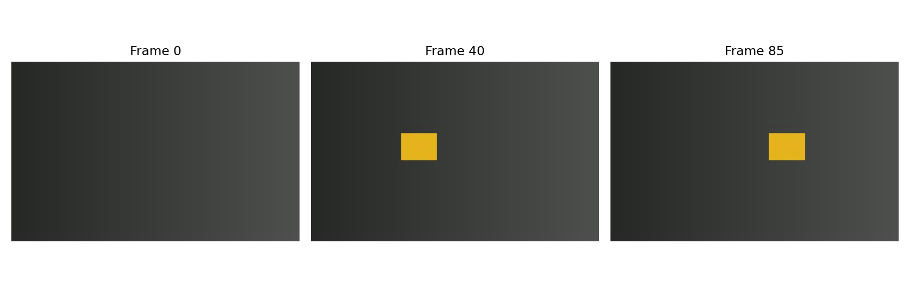
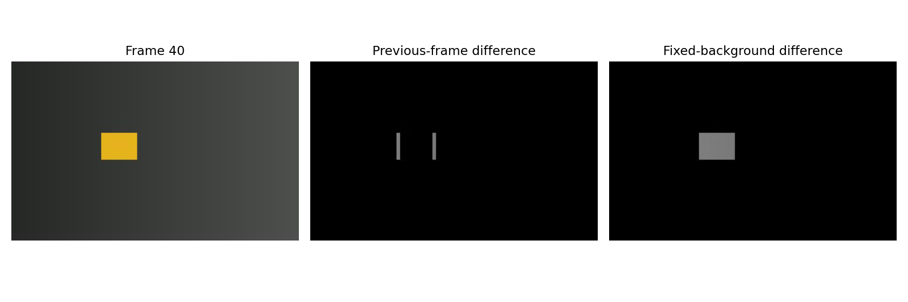
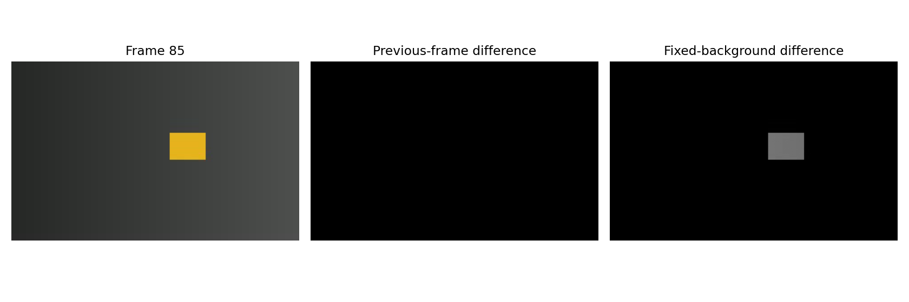
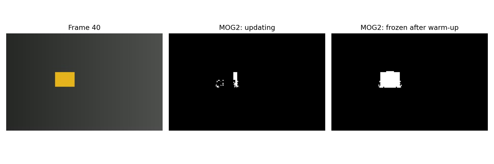
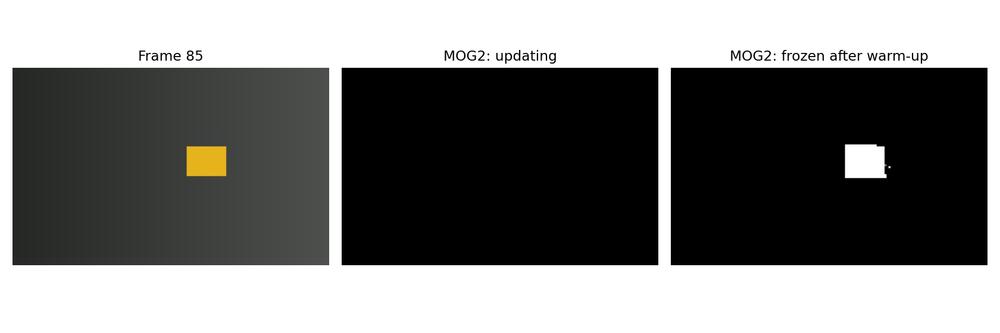
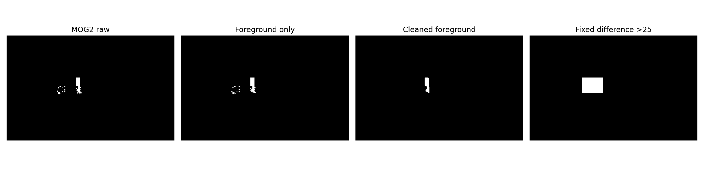
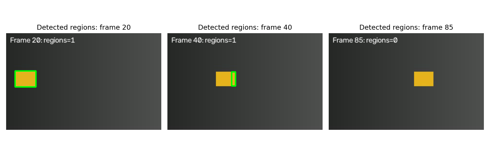
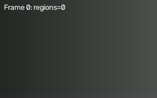
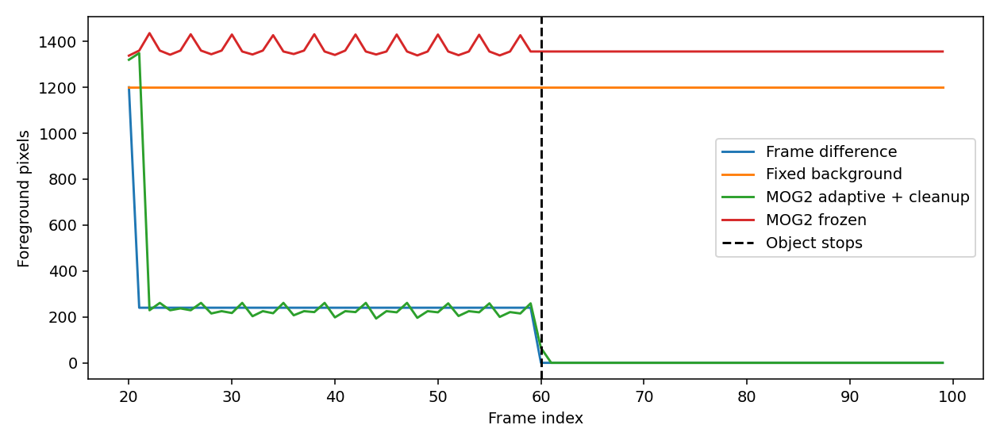

# 10. 동영상 처리와 움직임 검출

## 10.1 동영상 읽기와 프레임 처리

- 동영상은 시간 순서대로 나열된 영상, 즉 **프레임**의 모음이다.
- FPS는 1초에 표시하는 프레임 수다. 처리 속도와 영상 FPS는 다른 값이다.
- `VideoCapture.read()`로 한 프레임씩 읽고 처리한다.
- 반환값 `ret`가 False이면 파일 끝 또는 읽기 실패일 수 있다.
- 작업이 끝나면 `release()`로 파일과 장치를 닫는다.
- 이번에는 고정 배경 위에서 사각형이 이동하고 멈추는 합성 영상을 만든다. 
- 실제 촬영의 조명 변화·그림자·카메라 흔들림을 모두 재현한 영상은 아니다.
- 실제 동영상은 저작권 때문에 합성 동영상을 만들어서 개념 이해 영상으로 실습 코드를 작성한다.

### 준비와 합성 동영상 저장

```python
# 셀 1: 합성 동영상 생성
# 배경만 있는 구간, 물체가 이동하는 구간, 정지하는 구간을 포함한 100프레임을 만든다.

# Path는 운영체제에 맞게 파일 경로를 조합하는 데 사용한다.
from pathlib import Path
import json
# OpenCV는 영상 처리, NumPy는 배열 계산, Matplotlib은 결과 시각화에 사용한다.
import cv2
import numpy as np
import matplotlib.pyplot as plt
from PIL import Image
# 현재 작업 폴더를 기준으로 assets를 찾는다. 노트북은 각 장의 폴더에서 실행한다.
ROOT=Path.cwd();ASSETS=ROOT/'assets';ASSETS.mkdir(exist_ok=True)
W,H,FPS,N=320,200,20,100
# 프레임 0~19: 배경만, 20~59: 이동, 60~99: 같은 위치에서 정지
xgrid=np.linspace(40,80,W,dtype=np.uint8)
background=np.repeat(xgrid[None,:,None],H,axis=0).repeat(3,axis=2)
frames=[];truth=[]
for t in range(N):
    frame=background.copy();gt=np.zeros((H,W),np.uint8)
    if t>=20:
        x=20+4*min(t-20,39);y=80
        # 오른쪽 아래 좌표도 포함해 그린다. 폭·높이에서 1을 빼면 지정한 픽셀 범위와 맞는다.
        cv2.rectangle(frame,(x,y),(x+39,y+29),(30,180,230),-1)
        gt[y:y+30,x:x+40]=255
    frames.append(frame);truth.append(gt)
video_path=ASSETS/'synthetic_motion.avi'
# MJPG 코덱, FPS, (너비, 높이)를 지정하고 같은 크기의 BGR 프레임을 기록한다.
writer=cv2.VideoWriter(str(video_path),cv2.VideoWriter_fourcc(*'MJPG'),FPS,(W,H))

if not writer.isOpened():raise RuntimeError('MJPG VideoWriter를 열 수 없습니다.')
try:
    for frame in frames:writer.write(frame)
finally:writer.release()

preview=[Image.fromarray(cv2.cvtColor(f,cv2.COLOR_BGR2RGB)) for f in frames[::2]]
preview[0].save(ASSETS/'motion_preview.gif',save_all=True,append_images=preview[1:],duration=100,loop=0)

print('저장:',video_path.name,'프레임:',N,'FPS:',FPS)

# 비교 그림의 배치를 통일하고, 영상 또는 결과 배열을 화면에 표시한다.
def show(items,name):
    fig,axs=plt.subplots(1,len(items),figsize=(4*len(items),4),squeeze=False)
    
    for ax,(title,img) in zip(axs.flat,items):
        if img.ndim==2:ax.imshow(img,cmap='gray',vmin=0,vmax=255)
        else:ax.imshow(cv2.cvtColor(img,cv2.COLOR_BGR2RGB))
        ax.set_title(title);ax.axis('off')
        
    fig.tight_layout();fig.savefig(ASSETS/name,dpi=140);plt.show();plt.close(fig)
```

```text
저장: synthetic_motion.avi 프레임: 100 FPS: 20
```

### 저장한 파일을 다시 읽기

- 코덱을 거친 영상을 실제로 읽어서 처리한다. 
- MJPEG는 손실 압축이므로 생성 배열과 읽은 픽셀이 완전히 같지는 않을 수 있다. 
- 짧은 실습이므로 모든 프레임을 저장하지만, 긴 동영상은 프레임 하나씩 처리하고 필요한 이전 프레임만 유지한다.

```python
# 셀 2: 동영상 읽기
# VideoCapture로 끝까지 읽으며 반환값으로 종료를 판단하고 마지막에 자원을 해제한다.

# 파일 경로로 동영상을 열고 isOpened로 읽기 가능 여부를 확인한다.
capture=cv2.VideoCapture(str(video_path))

if not capture.isOpened():raise FileNotFoundError(video_path)

read_frames=[]
try:
    read_fps=capture.get(cv2.CAP_PROP_FPS)
    while True:
        # ret이 False면 다음 프레임을 얻지 못한 상태이므로 읽기를 종료한다.
        ret,frame=capture.read()
        if not ret:break
        read_frames.append(frame)
finally:capture.release()

assert len(read_frames)==N
assert all(f.shape==(H,W,3) for f in read_frames)

print('실제 읽은 프레임:',len(read_frames),'기록 FPS:',read_fps)
show([(f'Frame {t}',read_frames[t]) for t in [0,40,85]],'frames.png')
```

```text
실제 읽은 프레임: 100 기록 FPS: 20.0
```



## 10.2 차영상 (Difference Image)

### 프레임 간 차이

$$D_t(x,y)=|I_t(x,y)-I_{t-1}(x,y)|$$

- 직전 프레임 이후 바뀐 곳을 강조한다.
- 물체가 조금 움직이면 겹친 내부는 변하지 않아 이동 경계만 나타날 수 있다.
- 물체가 멈추면 변화가 없어서 사라질 수 있다.

### 기준 배경 영상과의 차이

$$D_{B,t}(x,y)=|I_t(x,y)-B(x,y)|$$

- 물체가 없는 기준 배경 B와 현재 영상을 비교한다.
- 물체가 정지해도 배경과 다르면 검출할 수 있다.
- 조명이나 배경 자체가 바뀌면 오검출이 생길 수 있다.
- 첫 프레임에 물체가 있으면 그것도 배경에 포함되므로 첫 프레임이 항상 좋은 기준은 아니다.

차이는 `cv2.absdiff()`로 계산한다. `uint8` NumPy 배열을 그대로 빼면 음수가 순환하여 잘못된 결과가 생길 수 있다.

### 이동·정지 시점의 차영상

```python
# 셀 3: 프레임 차이와 고정 배경 차이
# 직전 프레임과의 변화, 최초 빈 배경과의 차이를 각각 계산한다.

# B·G·R을 밝기 가중합으로 바꾸어 단일 채널 영상으로 만든다.
grays=[cv2.cvtColor(f,cv2.COLOR_BGR2GRAY) for f in read_frames]
# 첫 프레임은 물체가 없는 배경으로 생성했으므로 고정 배경 기준으로 사용한다.
reference=grays[0]
frame_diffs=[np.zeros_like(reference)]
for i in range(1,N):frame_diffs.append(cv2.absdiff(grays[i],grays[i-1]))
# absdiff는 두 uint8 영상의 절대 차이를 계산하여 음수 순환을 피한다.
background_diffs=[cv2.absdiff(g,reference) for g in grays]
for t in [40,85]:
    show([(f'Frame {t}',read_frames[t]),('Previous-frame difference',frame_diffs[t]),
          ('Fixed-background difference',background_diffs[t])],f'difference_{t}.png')
print('정지 시점의 프레임 차이 최댓값:',int(frame_diffs[85].max()))
```

```text
정지 시점의 프레임 차이 최댓값: 0
```





## 10.3 배경 차분 (Background Subtraction)

### MOG2와 KNN

| 방법 | 배경을 표현하는 관점 |
| :---: | :---: |
| MOG2 | 픽셀 값 분포를 여러 가우시안 성분으로 모델링 |
| KNN | 과거에 관측한 표본들과의 근접성을 이용 |

고정 배경과의 단순 뺄셈과 달리 배경 모델을 시간에 따라 갱신한다. 이번에는 MOG2를 사용한다.

- `history`: 배경 모델의 이력에 관련된 설정. 정확히 해당 프레임이 지나면 물체가 사라지는 타이머가 아니다.
- `varThreshold`: 모델과 관측의 일치 판단에 쓰는 제곱 마할라노비스 거리 임계값. 원래 밝기 차이 임계값이 아니다.
- `learningRate`: 갱신 속도. 0은 갱신 중지, 음수는 자동 선택이다.
- 모델은 프레임 루프 밖에서 한 번 만들고 순서대로 갱신한다.
- 재실행할 때는 새 모델을 만들어야 초기 상태에서 비교할 수 있다.

그림자 검출을 켜면 기본 마스크 값은 배경 0, 그림자 후보 127, 전경 255다. 
그림자 판정이 항상 정확한 것은 아니다.

### 갱신 모델과 고정 모델 비교

처음 20프레임으로 빈 배경을 학습한다. 이후 하나는 갱신하고, 다른 하나는 학습을 멈춘다. 정지 물체가 배경으로 흡수되는 현상은 학습률과 장면에 따라 달라진다.

```python
# 셀 4: MOG2 배경 모델 비교
# 계속 학습하는 모델과 초기 학습 이후 갱신을 멈춘 모델의 정지 물체 반응을 비교한다.

# varThreshold=16은 배경 성분과의 거리 판정 기준이며, 그림자는 기본값 127로 별도 표시된다.
adaptive=cv2.createBackgroundSubtractorMOG2(history=100,varThreshold=16,detectShadows=True)
# varThreshold=16은 배경 성분과의 거리 판정 기준이며, 그림자는 기본값 127로 별도 표시된다.
frozen=cv2.createBackgroundSubtractorMOG2(history=100,varThreshold=16,detectShadows=True)
adaptive_masks=[];frozen_masks=[]
for t,frame in enumerate(read_frames):
    # 초기 20프레임은 0.1로 학습하고 이후에도 0.05로 갱신해 정지 물체가 배경에 흡수될 수 있다.
    adaptive_masks.append(adaptive.apply(frame,learningRate=.1 if t<20 else .05))
    # 초기 학습 후 learningRate=0으로 고정하여 기준 배경을 더 이상 갱신하지 않는다.
    frozen_masks.append(frozen.apply(frame,learningRate=.1 if t<20 else 0))
for t in [40,85]:
    show([(f'Frame {t}',read_frames[t]),('MOG2: updating',adaptive_masks[t]),
          ('MOG2: frozen after warm-up',frozen_masks[t])],f'mog2_{t}.png')
print('초기 프레임은 배경 학습 중이므로 검출 평가에서 제외합니다.')
```

```text
초기 프레임은 배경 학습 중이므로 검출 평가에서 제외합니다.
```





## 10.4 전경 마스크 후처리

### 이진화

$$M(x,y)=\begin{cases}255,&D(x,y)>\tau\\0,&\text{그 외}\end{cases}$$

- 차영상은 밝기 차이가 임계값보다 큰 곳을 전경으로 만든다.
- MOG2의 기본 그림자 값 127을 제외하려면 255만 선택한다.
- MOG2에 `raw > 0`을 적용하면 그림자 후보까지 전경에 들어간다.

### 형태학적 처리

- 열림: 작은 흰 잡음을 줄일 수 있다.
- 닫힘: 작은 검은 구멍·틈을 메울 수 있다.
- 큰 커널은 작은 실제 물체를 지우거나 가까운 물체를 합칠 수 있다.
- 아래의 3×3, 5×5는 이 실습용 설정이다.

### 이진 마스크와 후처리

```python
# 셀 5: 전경 마스크 후처리
# MOG2에서 확실한 전경 255만 남기고 열림·닫힘으로 작은 점과 틈을 정리한다.

kopen=cv2.getStructuringElement(cv2.MORPH_ELLIPSE,(3,3))
kclose=cv2.getStructuringElement(cv2.MORPH_ELLIPSE,(5,5))
def cleanup(binary):
    # 침식 다음 팽창을 적용하여 구조 요소보다 작은 밝은 구조를 줄인다.
    opened=cv2.morphologyEx(binary,cv2.MORPH_OPEN,kopen)
    return cv2.morphologyEx(opened,cv2.MORPH_CLOSE,kclose)
clean_masks=[]
for raw in adaptive_masks:
    # 배경 0과 그림자 127을 제외하고 전경으로 분류된 255만 유지한다.
    binary=np.where(raw==255,255,0).astype(np.uint8)
    clean_masks.append(cleanup(binary))
t=40
_,fixed_binary=cv2.threshold(background_diffs[t],25,255,cv2.THRESH_BINARY)
show([('MOG2 raw',adaptive_masks[t]),('Foreground only',(adaptive_masks[t]==255).astype(np.uint8)*255),
      ('Cleaned foreground',clean_masks[t]),('Fixed difference >25',fixed_binary)],'cleanup.png')
assert all(set(np.unique(m)).issubset({0,255}) for m in clean_masks)
```



## 10.5 움직이는 영역 표시

- `findContours()`로 흰 영역의 외곽선을 찾는다.
- `contourArea()`로 작은 영역을 제외한다.
- `boundingRect()`로 영역을 감싸는 사각형을 얻는다.
- 면적 임계값은 제곱픽셀 단위이며 영상 해상도에 영향을 받는다.
- 외곽선 면적과 흰 픽셀 개수는 정의가 달라 정확히 같지는 않다.
- 한 물체가 여러 영역으로 나뉘거나 여러 물체가 하나로 합쳐질 수 있다.
- 이 단계는 매 프레임의 영역 검출이며 같은 물체에 ID를 유지하는 추적은 아니다.

### 경계 상자와 결과 동영상

```python
# 셀 6: 움직이는 영역 표시와 영상 저장
# 전경 외곽선에서 작은 영역을 제외하고 경계 상자를 그린 프레임을 저장한다.

annotated=[];counts=[];boxes_per_frame=[]
for t,(frame,mask) in enumerate(zip(read_frames,clean_masks)):
    canvas=frame.copy();boxes=[]
    if t>=20:  # 초기 배경 학습 구간 제외
        # 바깥 외곽선만 추출하고 직선 구간의 중간 점을 줄여 저장한다.
        contours,_=cv2.findContours(mask,cv2.RETR_EXTERNAL,cv2.CHAIN_APPROX_SIMPLE)
        for contour in contours:
            # 너무 작은 외곽선은 잡음 후보로 제외한다. 외곽선 면적은 흰 픽셀 수와 완전히 같지 않다.
            if cv2.contourArea(contour)<100:continue
            # 외곽선을 둘러싸는 축 정렬 사각형의 왼쪽 위 좌표와 폭·높이를 얻는다.
            x,y,w,h=cv2.boundingRect(contour)
            boxes.append([int(x),int(y),int(w),int(h)])
            # 오른쪽 아래 좌표도 포함해 그린다. 폭·높이에서 1을 빼면 지정한 픽셀 범위와 맞는다.
            cv2.rectangle(canvas,(x,y),(x+w-1,y+h-1),(0,255,0),2)
    cv2.putText(canvas,f'Frame {t}: regions={len(boxes)}',(8,20),cv2.FONT_HERSHEY_SIMPLEX,.5,(255,255,255),1)
    annotated.append(canvas);counts.append(len(boxes));boxes_per_frame.append(boxes)
show([(f'Detected regions: frame {t}',annotated[t]) for t in [20,40,85]],'detections.png')

# MJPG 코덱, FPS, (너비, 높이)를 지정하고 같은 크기의 BGR 프레임을 기록한다.
writer=cv2.VideoWriter(str(ASSETS/'motion_detection.avi'),cv2.VideoWriter_fourcc(*'MJPG'),FPS,(W,H))

if not writer.isOpened():raise RuntimeError('결과 VideoWriter 생성 실패')
try:
    for frame in annotated:writer.write(frame)
finally:writer.release()

gif=[Image.fromarray(cv2.cvtColor(f,cv2.COLOR_BGR2RGB)) for f in annotated[::2]]
gif[0].save(ASSETS/'detection_preview.gif',save_all=True,append_images=gif[1:],duration=100,loop=0)

print('영상·GIF 저장 완료')
```

```text
영상·GIF 저장 완료
```





### 차이와 한계 검증

정지한 사각형도 화면에는 존재하지만 ‘최근 변화’와 ‘갱신된 배경에서 벗어난 영역’이라는 기준에서는 검출되지 않을 수 있다. 아래 그래프는 픽셀 개수를 비교할 뿐 물체 인식 정확도를 의미하지 않는다.

합성 이동 구간에서는 생성 시의 정답 마스크와 IoU를 계산한다. 이 단순 실험의 수치를 실제 CCTV 성능으로 해석하지 않는다.

```python
# 셀 7: 검출 반응과 합성 정답 평가
# 정지 전후 전경 수, 이동 구간 마스크 IoU, 결과 영상의 프레임 수를 확인한다.

def count_foreground(ms):return [int(np.count_nonzero(m)) for m in ms]
fd_binary=[(d>25).astype(np.uint8)*255 for d in frame_diffs]
bg_binary=[(d>25).astype(np.uint8)*255 for d in background_diffs]
fr_binary=[(m==255).astype(np.uint8)*255 for m in frozen_masks]
fig,ax=plt.subplots(figsize=(9,4))
for name,ms in [('Frame difference',fd_binary),('Fixed background',bg_binary),('MOG2 adaptive + cleanup',clean_masks),('MOG2 frozen',fr_binary)]:
    ax.plot(range(20,N),count_foreground(ms)[20:],label=name)
ax.axvline(60,color='black',linestyle='--',label='Object stops')
ax.set(xlabel='Frame index',ylabel='Foreground pixels');ax.legend();fig.tight_layout()
fig.savefig(ASSETS/'comparison.png',dpi=140);plt.show();plt.close(fig)
ious=[]
for t in range(20,60):
    # 후처리한 예측 마스크와 합성 영상 생성 때 기록한 정답을 불리언 영역으로 비교한다.
    pred=clean_masks[t]>0;gt=truth[t]>0
    # 전경 예측과 합성 정답의 교집합 픽셀 수를 합집합 픽셀 수로 나누어 IoU를 구한다.
    ious.append(float(np.count_nonzero(pred & gt)/np.count_nonzero(pred|gt)))
assert np.count_nonzero(fd_binary[85])==0
assert np.count_nonzero(bg_binary[85])>0
check=cv2.VideoCapture(str(ASSETS/'motion_detection.avi'));decoded=0
try:
    while True:
        ok,_=check.read()
        if not ok:break
        decoded+=1
finally:check.release()
assert decoded==N
summary={'opencv':cv2.__version__,'frames_read':len(read_frames),'output_frames_read':decoded,
         'synthetic_moving_interval_mean_iou':float(np.mean(ious)),
         'frame85_pixels':{'frame_difference':int(np.count_nonzero(fd_binary[85])),
                           'fixed_background':int(np.count_nonzero(bg_binary[85])),
                           'mog2_adaptive':int(np.count_nonzero(clean_masks[85])),
                           'mog2_frozen':int(np.count_nonzero(fr_binary[85]))}}
# 수치 결과를 UTF-8 JSON으로 저장하여 그림과 별도로 확인할 수 있게 한다.
(ROOT/'results.json').write_text(json.dumps(summary,indent=2),encoding='utf-8')
# 수치 결과를 UTF-8 JSON으로 저장하여 그림과 별도로 확인할 수 있게 한다.
(ROOT/'bounding_boxes.json').write_text(json.dumps(boxes_per_frame),encoding='utf-8')
print(json.dumps(summary,indent=2))
```

```text
{
  "opencv": "5.0.0",
  "frames_read": 100,
  "output_frames_read": 100,
  "synthetic_moving_interval_mean_iou": 0.2068252052081892,
  "frame85_pixels": {
    "frame_difference": 0,
    "fixed_background": 1200,
    "mog2_adaptive": 0,
    "mog2_frozen": 1356
  }
}
```



### 실제 동영상에 적용할 때

| 상황 | 예상 문제 |
| :---: | :---: |
| 카메라 흔들림 | 영상 전체의 차이가 생김; 안정화 등이 필요 |
| 급격한 조명 변화 | 배경도 전경으로 판정될 수 있음 |
| 나뭇잎·물결 | 반복적인 배경 움직임이 남을 수 있음 |
| 오래 정지한 물체 | 갱신 모델에 배경으로 흡수될 수 있음 |
| 그림자·반사 | 실제 물체와 다른 영역이 검출될 수 있음 |
| 작은 물체 | 형태학·면적 필터에 의해 제거될 수 있음 |

실제 파일은 셀 2의 VideoCapture 경로를 바꿔 읽을 수 있지만, 이번 코드의 20프레임 준비 구간·정답 마스크·검증문은 합성 영상 전용이므로 그대로 적용하면 안 된다. 입력에 맞게 처리 구간과 평가 방식을 조정한다. 긴 영상은 모든 프레임을 리스트에 담지 않고 읽기·처리·쓰기를 한 루프에서 수행한다.

## 참고 문서

- [OpenCV — Background Subtraction](https://docs.opencv.org/4.x/d1/dc5/tutorial_background_subtraction.html)

