# 2. 히스토그램 (Histogram)

히스토그램은 **픽셀 값을 종류별로 세어 놓은 그래프**다. 레나 영상의 밝기 분포를 확인하고, 전체 평활화와 CLAHE로 대비가 어떻게 변하는지 비교한다. 실습은 8비트 `uint8` 영상을 사용한다.

## 2.1 히스토그램의 개념

### 밝기별로 픽셀을 분류한 개수표

- 픽셀을 밝기별 상자에 담고, 각 상자에 몇 개가 들어 있는지 센다고 생각하면 된다.
- 가로축은 **픽셀 값**이고, 세로축은 **해당 값을 가진 픽셀 개수**다.
- Gray 영상에서 왼쪽은 어두운 값, 오른쪽은 밝은 값이다.
- 가로축은 픽셀의 위치도, DFT의 주파수도 아니다.

예를 들어 픽셀 값이 `[0, 0, 128, 255]`라면 다음과 같다.

| 픽셀 값 | 개수 | 비율 |
| :---: | :---: | :---: |
| 0 | 2 | 0.50 |
| 128 | 1 | 0.25 |
| 255 | 1 | 0.25 |
| 나머지 | 0 | 0 |

$$
h(k)=\sum_{y=0}^{H-1}\sum_{x=0}^{W-1}\mathbf{1}[I(y,x)=k]
$$

- $h(k)$: 밝기가 $k$인 픽셀 개수
- $H,W$: 영상의 높이와 너비
- $\mathbf{1}[\cdot]$: 조건이 맞으면 1, 아니면 0

- 모든 개수를 더하면 전체 픽셀 수 $N=HW$가 된다. 
- 비율로 바꾸면 서로 크기가 다른 영상도 분포를 비교하기 쉽다.

$$
\sum_{k=0}^{255}h(k)=N,\qquad p(k)=\frac{h(k)}{N},\qquad \sum_{k=0}^{255}p(k)=1
$$

### 그래프를 읽는 방법

| 분포 모습 | 해석의 단서 |
| :---: | :---: |
| 왼쪽에 많이 모임 | 어두운 픽셀이 많음 |
| 오른쪽에 많이 모임 | 밝은 픽셀이 많음 |
| 좁은 범위에 모임 | 전체 밝기 변화가 작을 가능성 |
| 넓게 퍼짐 | 다양한 밝기 값이 존재함 |

> [!warning] 그래프만으로 영상 품질을 판단하지 않기
> - 밤 사진은 어두운 값이 많아도 자연스럽다. 넓은 분포가 항상 좋은 사진을 뜻하지 않는다. 
> - 히스토그램은 픽셀의 위치를 저장하지 않으므로 서로 다른 사진이 같은 히스토그램을 가질 수 있다.

```python
# 셀 1: 히스토그램의 기본 집계
# 2×2 예제에서 값별 개수와 비율을 직접 확인한다.

# Path는 운영체제에 맞게 파일 경로를 조합하는 데 사용한다.
from pathlib import Path
# OpenCV는 영상 처리, NumPy는 배열 계산, Matplotlib은 결과 시각화에 사용한다.
import cv2
import numpy as np
import matplotlib.pyplot as plt

# 현재 작업 폴더를 기준으로 assets를 찾는다. 노트북은 각 장의 폴더에서 실행한다.
ROOT = Path.cwd()  # 노트북과 assets 폴더가 있는 위치
path = ROOT / 'assets' / 'Lenna.png'
if not path.exists():
    raise FileNotFoundError('assets/Lenna.png를 확인하세요.')
# 파일을 바이트 배열로 읽어 디코딩한다. IMREAD_COLOR의 결과는 BGR 순서다.
img = cv2.imdecode(np.fromfile(path, dtype=np.uint8), cv2.IMREAD_COLOR)
if img is None:
    raise ValueError('이미지 디코딩 실패')
# B·G·R을 밝기 가중합으로 바꾸어 단일 채널 영상으로 만든다.
gray = cv2.cvtColor(img, cv2.COLOR_BGR2GRAY)

# 8비트 밝기값 0~255를 256개 구간으로 세어 1차원 배열로 반환한다.
def hist(a):
    # channels는 집계할 채널, histSize는 구간 수, ranges의 끝값 256은 포함하지 않는다.
    return cv2.calcHist([a], [0], None, [256], [0, 256]).ravel()

sample = np.array([[0, 0], [128, 255]], dtype=np.uint8)
h = hist(sample)
for k in [0, 128, 255]:
    print(f'값 {k}: 개수 {int(h[k])}, 비율 {h[k]/sample.size:.2f}')
assert h.sum() == sample.size
print('OpenCV:', cv2.__version__)
fig, axes = plt.subplots(1, 2, figsize=(9, 3))
axes[0].imshow(sample, cmap='gray', vmin=0, vmax=255)
axes[0].set_title('2 x 2 pixels')
for y in range(2):
    for x in range(2):
        axes[0].text(x,y,str(sample[y,x]),ha='center',va='center',color='red')
axes[1].bar([0,128,255], h[[0,128,255]], width=12)
axes[1].set(xlabel='Pixel value', ylabel='Pixel count', xticks=[0,128,255])
fig.tight_layout()
plt.show()
```

```text
값 0: 개수 2, 비율 0.50
값 128: 개수 1, 비율 0.25
값 255: 개수 1, 비율 0.25
OpenCV: 5.0.0
```

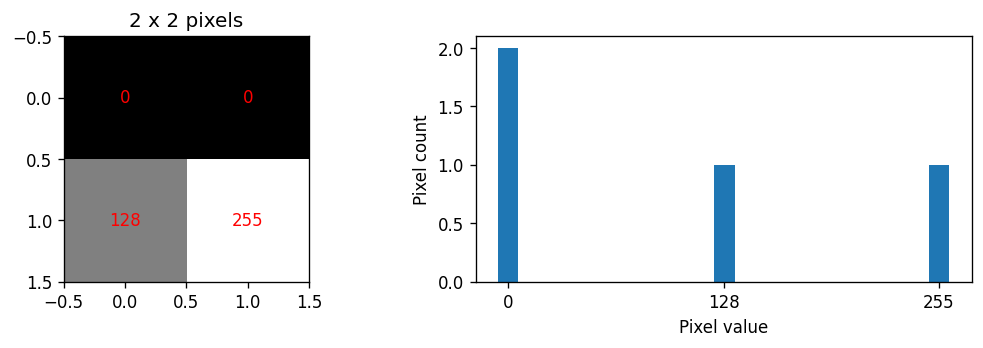

## 2.2 그레이스케일 및 컬러 히스토그램

### 그레이스케일 히스토그램


| 인수 | 의미 |
| :---: | :---: |
| `[gray]` | 계산할 영상 |
| `[0]` | 사용할 채널 번호 |
| `None` | 전체 영역 집계 |
| `[256]` | 값을 담는 구간(bin) 256개 |
| `[0, 256]` | 0 이상 256 미만, 즉 0~255 포함 |

- 256개 bin을 사용하면 정수 값 하나당 상자 하나다.
- 16개 bin이라면 0~15, 16~31처럼 여러 값을 묶는다.
- `calcHist()`의 단일 채널 결과 모양은 `(256, 1)`이다. `.ravel()`로 1차원으로 펼칠 수 있다.
- 관심 영역만 세려면 같은 높이·너비의 8비트 마스크를 사용한다. 
- 마스크가 0이 아닌 위치만 집계된다.

```python
# 셀 2: 레나의 그레이스케일 히스토그램
# 히스토그램의 합이 전체 픽셀 수와 같고 NumPy 집계와 일치하는지 확인한다.

h_gray = hist(gray)
assert h_gray.sum() == gray.size
assert np.array_equal(h_gray, np.bincount(gray.ravel(), minlength=256))
fig, axes = plt.subplots(1, 2, figsize=(10, 4))
axes[0].imshow(gray, cmap='gray', vmin=0, vmax=255)
axes[0].set_title('Lenna grayscale')
axes[0].axis('off')
axes[1].plot(h_gray, color='black')
axes[1].set(xlim=(0,255), xlabel='Pixel value', ylabel='Pixel count')
fig.tight_layout()
plt.show()
print('영상 크기:', gray.shape, '픽셀 수:', gray.size)
print('히스토그램 합:', int(h_gray.sum()))
```

```text
영상 크기: (250, 250) 픽셀 수: 62500
히스토그램 합: 62500
```

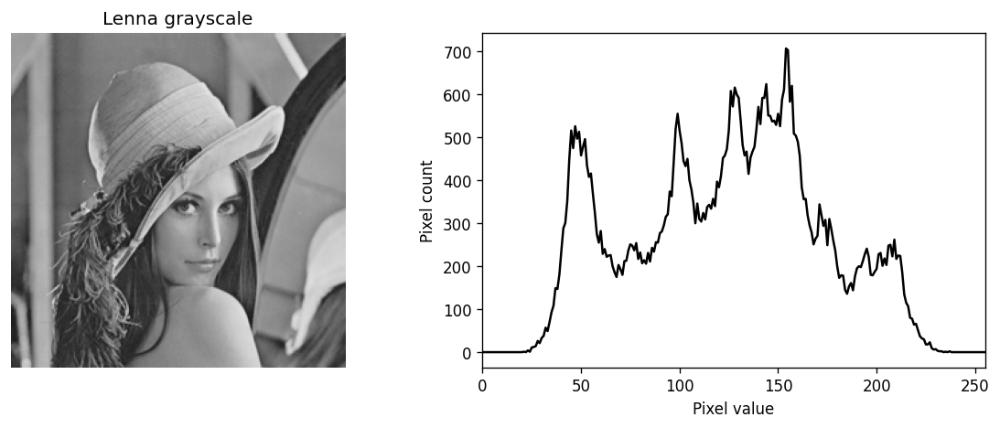

### 컬러 히스토그램


- OpenCV의 BGR 영상은 0번이 B, 1번이 G, 2번이 R이다.
- 채널별 그래프는 해당 색 성분의 **숫자 분포**다. 빨간 선 자체가 빨간 물체의 개수는 아니다.
- 각각의 채널 히스토그램 합은 $N$이다. 세 채널의 개수를 모두 합치면 $3N$이다.
- Gray 히스토그램은 B·G·R 히스토그램을 단순히 더한 결과가 아니다.
- 채널별 1차원 히스토그램만으로는 같은 픽셀에서 세 성분이 어떻게 조합되는지 알 수 없다.

```python
# 셀 3: B·G·R 채널별 히스토그램
# 세 채널을 따로 집계한다. 각 그래프는 해당 성분의 값 분포를 나타낸다.

fig, ax = plt.subplots(figsize=(8, 4))
for channel, color in enumerate(['blue', 'green', 'red']):
    # channels는 집계할 채널, histSize는 구간 수, ranges의 끝값 256은 포함하지 않는다.
    h = cv2.calcHist([img], [channel], None, [256], [0, 256]).ravel()
    assert h.sum() == gray.size
    ax.plot(h, color=color, label=color.upper())
    print(color, '픽셀 수:', int(h.sum()))
ax.set(xlim=(0,255), xlabel='Channel value', ylabel='Pixel count')
ax.legend()
fig.tight_layout()
plt.show()
```

```text
blue 픽셀 수: 62500
green 픽셀 수: 62500
red 픽셀 수: 62500
```

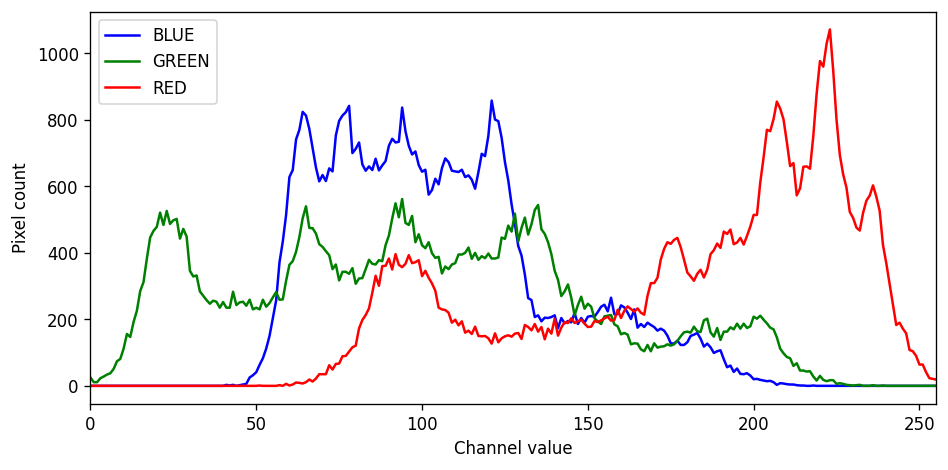

### 관심 영역만 집계하기

- 마스크는 영상에 붙이는 선택 표시와 같다. **0이 아닌 위치의 픽셀만 센다.**
- 전체 영상과 영역의 크기가 다르므로 개수 대신 비율로 비교한다.
- 선택 영역은 얼굴 주변의 직사각형이며, 얼굴을 자동 검출한 결과가 아니다.

```python
# 셀 4: 관심 영역의 히스토그램
# 마스크가 0이 아닌 위치만 세고, 크기가 다른 영역은 비율로 비교한다.

mask = np.zeros_like(gray)
mask[85:190, 95:180] = 255
# 8비트 마스크에서 0이 아닌 위치만 집계한다. 범위의 위쪽 끝 256은 제외된다.
h_roi = cv2.calcHist([gray], [0], mask, [256], [0,256]).ravel()
assert h_roi.sum() == np.count_nonzero(mask)
marked = img.copy()
# 오른쪽 아래 좌표도 포함해 그린다. 폭·높이에서 1을 빼면 지정한 픽셀 범위와 맞는다.
cv2.rectangle(marked, (95,85), (179,189), (0,255,0), 2)
fig, axes = plt.subplots(1, 2, figsize=(10,4))
axes[0].imshow(cv2.cvtColor(marked, cv2.COLOR_BGR2RGB))
axes[0].axis('off')
axes[0].set_title('Selected ROI')
axes[1].plot(h_gray/gray.size, label='Whole image')
axes[1].plot(h_roi/h_roi.sum(), label='ROI')
axes[1].set(xlim=(0,255), xlabel='Pixel value', ylabel='Pixel fraction')
axes[1].legend()
fig.tight_layout()
plt.show()
print('선택한 픽셀 수:', int(h_roi.sum()))
```

```text
선택한 픽셀 수: 8925
```

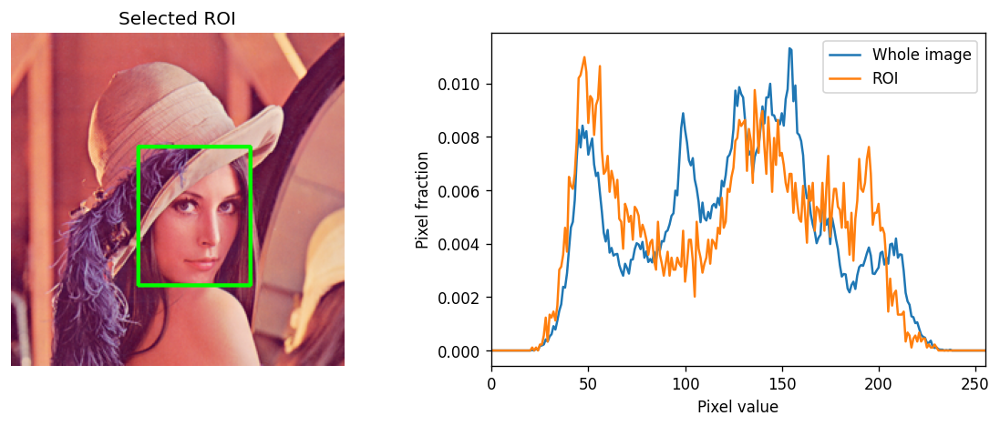

## 2.3 히스토그램 평활화

### 밝기 값을 다시 배정하기

- 픽셀 위치는 그대로 두고 밝기 값을 바꾼다.
- 전체 영상의 밝기 분포를 바탕으로 변환표를 만든다.
- 좁은 밝기 범위에 모인 영상에서 대비를 높이는 데 도움이 될 수 있다.
- **평활화(equalization)**는 평균·가우시안 필터의 **평활화(smoothing)**와 다르다. 여기서는 흐리게 만드는 주변 픽셀 평균을 계산하지 않는다.

### 누적 분포 함수(CDF)

밝기 $k$ 이하의 픽셀이 전체의 얼마나 되는지 누적해서 센다.

$$
C(k)=\sum_{j=0}^{k}p(j)
$$

처음 예제에서 $C(0)=0.5$, $C(128)=0.75$, $C(255)=1$이다.

최초의 0이 아닌 누적 비율을 $C_{\min}$이라 하면 다음 식으로 변환 원리를 설명할 수 있다.

$$
T(k)=\operatorname{round}\left(255\frac{C(k)-C_{\min}}{1-C_{\min}}\right)
$$

- 입력에 존재하는 밝기 값에 대해 생각하면 된다.
- 예제에서는 0→0, 128→약 128, 255→255로 대응한다.
- 모든 픽셀이 같은 값이면 분모가 0이다. 별도 처리가 필요하며 OpenCV는 일정한 영상을 그대로 유지한다.
- 위 식은 원리 설명용이다. 정수 반올림 방식에 따라 직접 만든 구현과 라이브러리의 경계 값이 조금 다를 수 있다.


`equalizeHist()`에는 8비트 단일 채널 영상을 넣는다.

```python
# 셀 5: 전체 히스토그램 평활화
# 영상 전체의 누적 분포를 이용하여 밝기 값을 다시 배정한다.

# equalizeHist는 8비트 단일 채널 영상에 전체 히스토그램 평활화를 적용한다.
equalized = cv2.equalizeHist(gray)

# 모든 영상은 0~255, 히스토그램은 공통 y축 범위로 표시하여 비교한다.
def compare_gray(arrays, titles):
    fig, axes = plt.subplots(2, len(arrays), figsize=(4*len(arrays), 7), squeeze=False)
    ymax = max(hist(a).max() for a in arrays)*1.05
    for i, (a,title) in enumerate(zip(arrays,titles)):
        axes[0,i].imshow(a, cmap='gray', vmin=0, vmax=255)
        axes[0,i].set_title(title)
        axes[0,i].axis('off')
        axes[1,i].plot(hist(a), color='black')
        axes[1,i].set(xlim=(0,255), ylim=(0,ymax), xlabel='Pixel value', ylabel='Pixel count')
        print(f'{title}: min={a.min()}, max={a.max()}, mean={a.mean():.3f}, std={a.std():.3f}')
    fig.tight_layout()
    plt.show()

compare_gray([gray,equalized], ['Original','Global equalization'])
constant = np.full((16,16),128,dtype=np.uint8)
assert np.array_equal(constant,cv2.equalizeHist(constant))
```

```text
Original: min=21, max=237, mean=123.550, std=47.624
Global equalization: min=0, max=255, mean=128.318, std=73.624
```

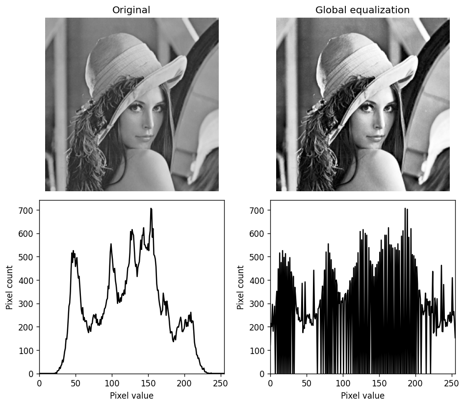

### 차이를 쉽게 보는 입력

- 아래 그림의 입력은 원본 Gray를 의도적으로 좁은 밝기 범위로 변환한 것이다. 
- 원본 사진 자체의 상태로 오해하지 않는다.

$$
I_{\mathrm{low}}=\operatorname{round}(80+0.4I)
$$


> [!note] 왜 히스토그램이 완전히 평평하지 않을까?
> 정수 밝기와 한정된 픽셀 개수 때문에 모든 bin의 개수가 같아지는 것은 아니다. 같은 입력 밝기는 같은 출력 밝기로 옮겨지므로 빈 구간이나 봉우리가 남을 수 있다. 손실된 원래 세부 정보를 복구하는 작업도 아니다.


- 아래에서 입력과 출력의 CDF, 입력 밝기를 출력 밝기로 바꾸는 변환표를 함께 비교한다.
- 표준편차는 밝기 분포의 퍼짐을 나타내며 영상 품질 점수는 아니다.

```python
# 셀 6: 저대비 입력과 CDF 변환표
# 밝기 범위를 인위적으로 줄인 입력에서 직접 만든 변환표와 OpenCV 결과를 비교한다.

# 원본과 구분되는 교육용 저대비 영상을 만들어 변환 효과를 쉽게 비교한다.
low = np.round(80 + 0.4*gray.astype(np.float64)).astype(np.uint8)
low_eq = cv2.equalizeHist(low)
compare_gray([low,low_eq], ['Synthetic low contrast','Global equalization'])
p = hist(low)/low.size
# 밝기별 비율을 누적하여 해당 밝기 이하 픽셀의 비율 CDF를 구한다.
cdf = np.cumsum(p)
# 입력에 실제로 등장하는 가장 낮은 밝기의 누적 비율을 찾는다.
cmin = cdf[np.flatnonzero(p)[0]]
# 최초의 유효 CDF를 빼고 0~255로 재배정한다. 단색 입력은 분모가 0이므로 별도 처리가 필요하다.
lut = np.round(255*(cdf-cmin)/(1-cmin)).clip(0,255).astype(np.uint8)
# 각 입력 밝기를 변환표의 인덱스로 사용하여 전체 영상의 새 밝기를 얻는다.
manual = lut[low]
print('수식 구현과 OpenCV의 최대 차이:', int(np.abs(manual.astype(np.int16)-low_eq.astype(np.int16)).max()))
fig, axes = plt.subplots(1,2,figsize=(10,4))
axes[0].plot(cdf,label='Input CDF')
axes[0].plot(np.cumsum(hist(low_eq))/low_eq.size,label='Output CDF')
axes[0].set(xlim=(0,255),ylim=(0,1),xlabel='Pixel value',ylabel='Cumulative fraction')
axes[0].legend()
present = np.flatnonzero(p)
axes[1].plot(present,lut[present])
axes[1].set(xlim=(0,255),ylim=(0,255),xlabel='Input value',ylabel='Output value',title='Mapping of observed values')
fig.tight_layout()
plt.show()
```

```text
Synthetic low contrast: min=88, max=175, mean=129.423, std=19.051
Global equalization: min=0, max=255, mean=129.602, std=73.579
수식 구현과 OpenCV의 최대 차이: 0
```

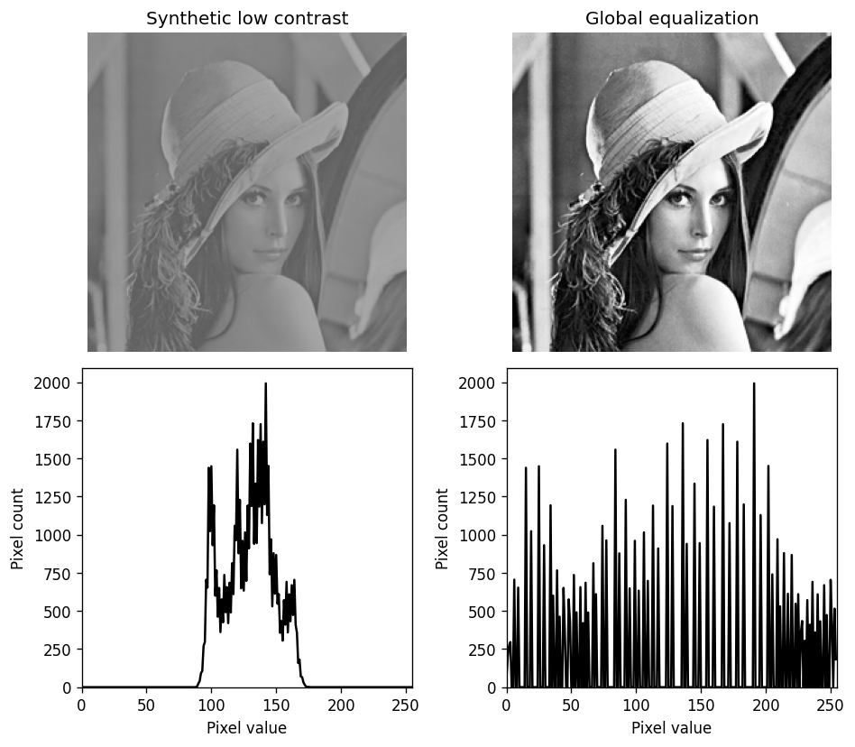

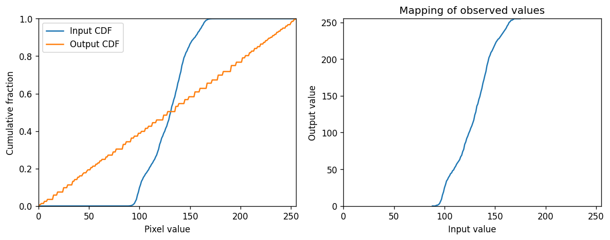

## 2.4 적응형 히스토그램 평활화 (CLAHE)

### 전체 대신 작은 영역을 기준으로 조절하기

- 전체 영상에 한 변환표를 쓰면 어두운 부분과 밝은 부분을 모두 적절히 조정하기 어려울 수 있다.
- AHE는 작은 영역별 분포를 사용하지만, 작은 잡음도 크게 강조할 수 있다.
- CLAHE는 **Contrast Limited Adaptive Histogram Equalization**, 즉 대비 제한 적응형 히스토그램 평활화다.
- 작은 영역의 히스토그램에서 지나치게 높은 bin의 개수를 제한하고 초과분을 재분배한다.
- 영역별 변환을 보간하여 경계가 갑자기 갈라져 보이는 현상을 줄인다.
- 잡음 강조를 제한하지만 잡음을 제거하는 필터는 아니다.


| 설정 | 의미 | 바꿀 때 관찰할 점 |
| :---: | :---: | :---: |
| `clipLimit=2.0` | 대비 제한 조절값 | 큰 양수는 일반적으로 더 강한 대비 변화를 허용하지만 잡음도 강조될 수 있음 |
| `tileGridSize=(8, 8)` | 가로·세로 영역의 개수 | 개수를 늘리면 각 영역이 작아져 더 국소적인 변화를 반영 |

> [!warning] 자주 헷갈리는 설정
> `(8, 8)`은 **8×8픽셀짜리 영역**이라는 뜻이 아니다. 가로 8개, 세로 8개 영역으로 나눈다는 뜻이다. `clipLimit=2.0`도 픽셀 밝기를 2로 제한하거나 bin마다 픽셀 2개만 남긴다는 뜻이 아니다. 내부적으로 영역 크기와 bin 수에 맞춰 제한값을 계산한다.

### 전체 평활화와 CLAHE 비교

| 구분 | 전체 평활화 | CLAHE |
| :---: | :---: | :---: |
| 참조 범위 | 영상 전체 | 작은 영역별 |
| 같은 입력 밝기 | 같은 출력 밝기 | 위치에 따라 다른 출력 가능 |
| 주요 설정 | 별도 대비 제한값 없음 | clipLimit, tileGridSize |
| 주의점 | 일부 영역의 과도한 변화 | 잡음·질감의 과도한 강조 가능 |

```python
# 셀 7: CLAHE와 설정 비교
# 영역별 대비를 조절하며, clipLimit과 영역 개수의 영향을 따로 살펴본다.

# clipLimit은 대비 제한값, tileGridSize는 픽셀 크기가 아니라 가로·세로 타일 개수다.
clahe = cv2.createCLAHE(clipLimit=2.0, tileGridSize=(8,8))
cl = clahe.apply(gray)
low_cl = clahe.apply(low)
compare_gray([gray,equalized,cl], ['Original','Global equalization','CLAHE'])
compare_gray([low,low_eq,low_cl], ['Synthetic low contrast','Global equalization','CLAHE'])
# 한 번에 한 설정만 바꾸어 효과를 비교한다.
settings = [(2.0,(8,8)), (8.0,(8,8)), (2.0,(4,4))]
fig, axes = plt.subplots(1,3,figsize=(12,4))
for ax, (limit,grid) in zip(axes,settings):
    result = cv2.createCLAHE(clipLimit=limit,tileGridSize=grid).apply(low)
    ax.imshow(result,cmap='gray',vmin=0,vmax=255)
    ax.set_title(f'clip={limit}, grid={grid}')
    ax.axis('off')
fig.tight_layout()
plt.show()
```

```text
Original: min=21, max=237, mean=123.550, std=47.624
Global equalization: min=0, max=255, mean=128.318, std=73.624
CLAHE: min=6, max=254, mean=132.530, std=58.365
Synthetic low contrast: min=88, max=175, mean=129.423, std=19.051
Global equalization: min=0, max=255, mean=129.602, std=73.579
CLAHE: min=47, max=216, mean=134.502, std=36.162
```

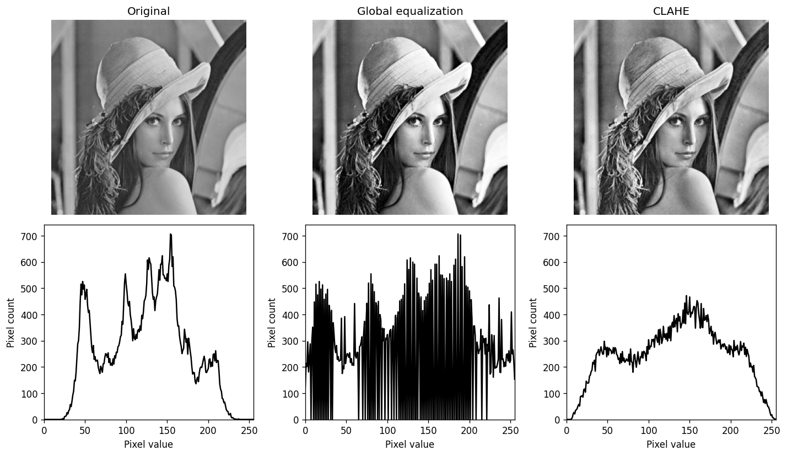

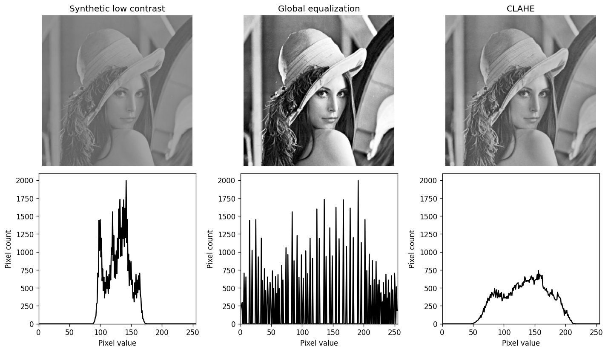

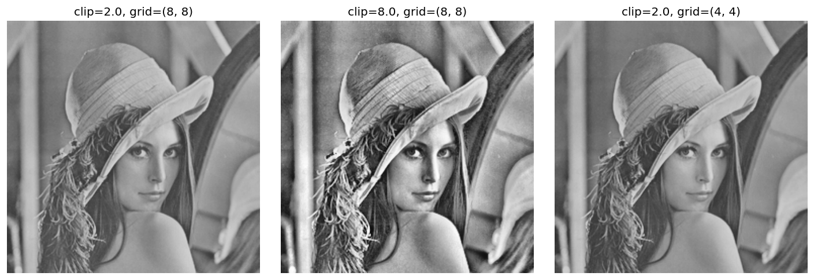

### 결과 해석

- 교육용 저대비 입력은 **88~175**에 모여 있었다. 전체 평활화 후에는 **0~255**, CLAHE 후에는 **47~216** 범위가 되었다.
- 전체 평활화는 밝기 범위를 크게 넓혔지만, 히스토그램에는 빈 구간과 높은 봉우리가 남는다.
- 이 설정의 CLAHE는 전체 평활화보다 범위를 덜 넓히면서 국소 대비를 바꿨다. 다른 입력과 설정에서도 항상 같은 순서가 되는 것은 아니다.
- 머리카락과 얼굴의 세부 표현뿐 아니라 배경 질감이 과하게 강조되는지도 함께 비교한다.

### 컬러 영상에는 밝기 성분만 적용하기

- B·G·R을 각각 평활화하면 세 성분의 상대적인 관계가 달라져 색이 변할 수 있다.
- Y만 처리하면 색차 성분을 유지하면서 밝기 성분을 조정할 수 있다.
- 다만 BGR 복원 과정의 반올림·범위 제한 때문에 색이 완전히 보존된다고 보장하지는 않는다.

```python
# 셀 8: 컬러 영상의 밝기 성분만 조절
# Y만 처리하고 Cr·Cb를 유지한 뒤 BGR로 되돌려 채널별 평활화와 비교한다.

# 밝기 성분 Y와 색차 성분 Cr·Cb를 분리할 수 있는 표현으로 변환한다.
ycrcb = cv2.cvtColor(img,cv2.COLOR_BGR2YCrCb)
# OpenCV의 반환 순서는 Y, Cr, Cb이다. 각 채널은 높이×너비 배열이다.
Y, Cr, Cb = cv2.split(ycrcb)
y_eq = cv2.merge([cv2.equalizeHist(Y),Cr,Cb])
y_cl = cv2.merge([clahe.apply(Y),Cr,Cb])
assert np.array_equal(y_cl[:,:,1:],ycrcb[:,:,1:])
color_eq = cv2.cvtColor(y_eq,cv2.COLOR_YCrCb2BGR)
color_cl = cv2.cvtColor(y_cl,cv2.COLOR_YCrCb2BGR)
# 비교용: 세 채널을 독립적으로 바꾸면 색 관계가 달라질 수 있다.
channel_eq = cv2.merge([cv2.equalizeHist(c) for c in cv2.split(img)])
fig, axes = plt.subplots(1,4,figsize=(16,4))
for ax,a,title in zip(axes,[img,channel_eq,color_eq,color_cl],
                      ['Original','Equalize B,G,R separately','Equalize Y only','CLAHE on Y only']):
    ax.imshow(cv2.cvtColor(a,cv2.COLOR_BGR2RGB))
    ax.set_title(title)
    ax.axis('off')
fig.tight_layout()
plt.show()
print('Y 처리 중 Cr, Cb 유지:', np.array_equal(y_cl[:,:,1:],ycrcb[:,:,1:]))
```

```text
Y 처리 중 Cr, Cb 유지: True
```

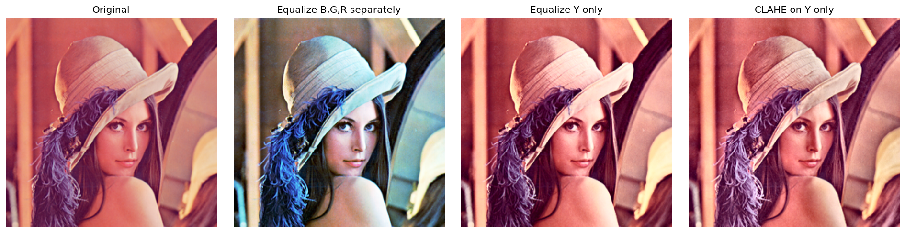

## 참고 문서

- [OpenCV — Histograms: Find, Plot, Analyze](https://docs.opencv.org/4.x/d1/db7/tutorial_py_histogram_begins.html)
- [OpenCV — Histogram Equalization](https://docs.opencv.org/4.x/d5/daf/tutorial_py_histogram_equalization.html)
- [OpenCV — CLAHE API](https://docs.opencv.org/4.x/d6/db6/classcv_1_1CLAHE.html)
