# 3. 공간 필터링 (Spatial Filtering)

- 한 픽셀을 바꿀 때 **주변 픽셀을 함께 살펴보는 방법**이다. 
- 이웃 값을 평균내거나, 중앙값을 고르거나, 최솟값·최댓값을 선택하여 흐림·잡음 감소·경계 강조·형태 변화를 만든다.

|   분류   |         대표 연산          |          계산 방식          |
| :----: | :--------------------: | :---------------------: |
| 선형 필터  | 평균, 가우시안, Sobel, 라플라시안 |        고정 가중치의 합        |
| 비선형 필터 |     미디언, 양방향, 형태학      | 중앙값, 입력 의존 가중치, 최솟값·최댓값 |

형태학은 비선형 공간 처리에 속하며, 3.4에서 별도로 자세히 다룬다.

### 입력 영상과 표시 함수

- 레나는 제공된 원본을 그레이스케일로 바꿔 사용한다.
- 미분과 차분 결과는 음수가 나올 수 있어 `float32`로 계산한다.
- 일반 영상은 0~255, 부호 있는 영상은 양수·음수를 구분하는 색상과 색 막대로 표시한다.

```python
# 셀 1: 실습 영상과 출력 함수
# 그레이스케일을 float32로 바꾸어 미분과 차분의 음수를 보존한다.

# Path는 운영체제에 맞게 파일 경로를 조합하는 데 사용한다.
from pathlib import Path
import json
# OpenCV는 영상 처리, NumPy는 배열 계산, Matplotlib은 결과 시각화에 사용한다.
import cv2
import numpy as np
import matplotlib.pyplot as plt

# 현재 작업 폴더를 기준으로 assets를 찾는다. 노트북은 각 장의 폴더에서 실행한다.
ROOT = Path.cwd()  # 노트북과 assets 폴더가 있는 위치
OUT = ROOT / 'assets'
# 파일을 바이트 배열로 읽어 디코딩한다. IMREAD_COLOR의 결과는 BGR 순서다.
img = cv2.imdecode(np.fromfile(OUT/'Lenna.png', np.uint8), cv2.IMREAD_COLOR)
if img is None:
    raise FileNotFoundError('assets/Lenna.png를 확인하세요.')
# B·G·R을 밝기 가중합으로 바꾸어 단일 채널 영상으로 만든다.
gray = cv2.cvtColor(img, cv2.COLOR_BGR2GRAY)
f = gray.astype(np.float32)
border = cv2.BORDER_REFLECT_101

# 비교 그림의 배치를 통일하고, 영상 또는 결과 배열을 화면에 표시한다.
def panel(name, items, cols=3, signed=False):
    fig, axes = plt.subplots((len(items)+cols-1)//cols, cols, figsize=(4*cols,4*((len(items)+cols-1)//cols)), squeeze=False)
    for ax, (title, a) in zip(axes.flat, items):
        if signed:
            m = max(float(np.abs(a).max()), 1e-6)
            im = ax.imshow(a, cmap='coolwarm', vmin=-m, vmax=m)
            fig.colorbar(im, ax=ax, shrink=.65)
        else:
            ax.imshow(a, cmap='gray', vmin=0, vmax=255)
        ax.set_title(title); ax.axis('off')
    for ax in list(axes.flat)[len(items):]: ax.axis('off')
    fig.tight_layout(); plt.show()


print('OpenCV:',cv2.__version__,'영상 크기:',gray.shape)
panel('original.png',[('Original grayscale',gray)],cols=1)
```

```text
OpenCV: 5.0.0 영상 크기: (250, 250)
```

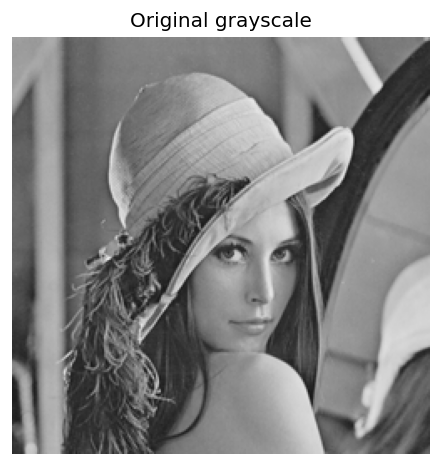

## 3.1 마스크 기반 처리의 원리

### 이웃 영역과 커널

- 픽셀 주변에 작은 창을 올리고 한 칸씩 이동한다고 생각한다.
- 선형 필터의 커널은 각 위치에 적용할 **가중치 표**다.
- 미디언은 주변 값의 중앙값을 고르며, 형태학은 구조 요소로 선택한 영역의 최솟값·최댓값 등을 사용한다.
- 따라서 작은 창을 사용한다고 모두 합성곱인 것은 아니다.
- 아래에서는 홀수 크기 커널의 중심을 기준점(anchor)으로 사용한다.

주변 값이 다음과 같고 모든 가중치가 $1/9$라면 가운데 출력은 5다.

$$
P=\begin{bmatrix}1&2&3\\4&5&6\\7&8&9\end{bmatrix},\qquad
K=\frac{1}{9}\begin{bmatrix}1&1&1\\1&1&1\\1&1&1\end{bmatrix}
$$

$$
g=\frac{1+2+3+4+5+6+7+8+9}{9}=5
$$

- 실제 연산은 출력 배열에 기록한다. 
- 입력을 제자리에서 순서대로 덮어쓰는 손계산과 혼동하지 않는다.

### 합성곱과 상관 연산

입력 $f[y,x]$, 중심 기준 커널 $K[j,i]$에 대해:

$$
\text{상관: }g[y,x]=\sum_j\sum_i K[j,i]f[y+j,x+i]
$$

$$
\text{합성곱: }g[y,x]=\sum_j\sum_i K[j,i]f[y-j,x-i]
$$

- 상관은 커널을 그대로 사용한다.
- 합성곱은 커널을 가로·세로로 뒤집어 적용하는 것과 같다.
- 평균·가우시안처럼 중심 대칭인 커널은 두 결과가 같다.
- 비대칭 커널은 다를 수 있다. 
- 위 행렬에서 오른쪽 이웃만 고르면 상관 결과는 6, 뒤집어 왼쪽을 고르면 합성곱 결과는 4다.


> [!warning] 적용 범위
> 위 뒤집기 예제는 홀수 크기·중앙 anchor 기준이다. 
> 다른 anchor를 사용한다면 뒤집은 커널에 맞게 anchor도 조정해야 한다.

```python
# 셀 2: 상관과 합성곱의 차이
# 중심 기준 비대칭 커널로 오른쪽 값 6과 왼쪽 값 4가 선택되는지 확인한다.

a = np.arange(1,10,dtype=np.float32).reshape(3,3)
k_mean = np.ones((3,3),np.float32)/9
# 오른쪽 이웃 하나만 선택하는 비대칭 커널로 뒤집기의 효과를 확인한다.
k_asym = np.array([[0,0,0],[0,0,1],[0,0,0]],np.float32)
# filter2D는 커널을 뒤집지 않는 상관 연산을 수행한다.
corr = cv2.filter2D(a,-1,k_asym,borderType=border)
# 중앙 anchor의 홀수 커널을 양축으로 뒤집어 합성곱 결과를 구한다.
conv = cv2.filter2D(a,-1,cv2.flip(k_asym,-1),borderType=border)
print('입력:\n',a)
print('평균 필터의 중심:',cv2.filter2D(a,-1,k_mean)[1,1])
print('상관 중심:',corr[1,1], '합성곱 중심:',conv[1,1])
assert corr[1,1] == 6 and conv[1,1] == 4
```

```text
입력:
 [[1. 2. 3.]
 [4. 5. 6.]
 [7. 8. 9.]]
평균 필터의 중심: 5.0
상관 중심: 6.0 합성곱 중심: 4.0
```

### 경계 처리

영상 가장자리에서는 커널 일부가 영상 밖으로 나간다. 바깥 값을 어떻게 정할지 선택해야 한다.

| 방법 | 바깥 값 설정 | 주의점 |
| :---: | :---: | :---: |
| `BORDER_CONSTANT` | 지정한 상수 | 0을 쓰면 밝은 영상 가장자리가 어두워질 수 있음 |
| `BORDER_REPLICATE` | 가장자리 값 반복 | 끝 값이 이어짐 |
| `BORDER_REFLECT` | 가장자리 값까지 포함해 반사 | 끝 픽셀이 중복됨 |
| `BORDER_REFLECT_101` | 끝 픽셀을 중복하지 않고 반사 | 일반적인 선형 필터 비교에 사용 |

예를 들어 한 줄의 왼쪽 끝 값이 `[10, 20, 30]`이면 왼쪽 바로 바깥 값은 REPLICATE와 REFLECT에서는 10, REFLECT_101에서는 20이다.

실습의 주요 선형 필터는 `BORDER_REFLECT_101`을 사용한다. 
미디언은 OpenCV에서 REPLICATE 경계를 사용하므로 잡음 비교 패널의 가우시안·양방향도 REPLICATE로 맞췄다. 
형태학 역시 REPLICATE로 명시했다.

```python
# 셀 3: 경계 밖 값의 처리
# 같은 입력이라도 0 채우기·반복·반사 방식에 따라 가장자리 계산이 달라진다.

line = np.array([[10,20,30]],np.float32)
for name,mode in [('CONSTANT',cv2.BORDER_CONSTANT),('REPLICATE',cv2.BORDER_REPLICATE),
                  ('REFLECT',cv2.BORDER_REFLECT),('REFLECT_101',cv2.BORDER_REFLECT_101)]:
    print(name,cv2.copyMakeBorder(line,0,0,1,1,mode,value=0).ravel().tolist())
bright_test = np.full((20,20),200,np.float32)
items=[]
for name,mode in [('Zero border',cv2.BORDER_CONSTANT),('Replicate',cv2.BORDER_REPLICATE),
                  ('Reflect 101',cv2.BORDER_REFLECT_101)]:
    result=cv2.blur(bright_test,(5,5),borderType=mode)
    items.append((name,result))
    print(name,'왼쪽 위:',result[0,0])
panel('border.png',items)
```

```text
CONSTANT [0.0, 10.0, 20.0, 30.0, 0.0]
REPLICATE [10.0, 10.0, 20.0, 30.0, 30.0]
REFLECT [10.0, 10.0, 20.0, 30.0, 30.0]
REFLECT_101 [20.0, 10.0, 20.0, 30.0, 20.0]
Zero border 왼쪽 위: 72.0
Replicate 왼쪽 위: 200.0
Reflect 101 왼쪽 위: 200.0
```

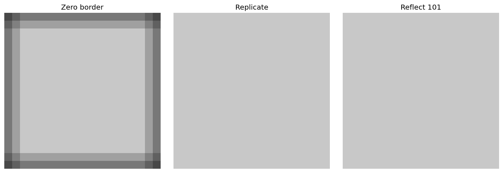

## 3.2 선형 공간 필터

### 선형의 뜻

고정된 계수의 필터 $F$가 다음 성질을 만족하면 선형이다.

$$
F(af+bg)=aF(f)+bF(g)
$$

입력을 섞은 뒤 처리한 결과와, 각각 처리한 뒤 같은 비율로 섞은 결과가 같다. 
정수 반올림·클리핑은 이 성질을 깨뜨릴 수 있으므로 여기서는 필터의 실수 연산 자체를 분류한다.

### 평균 필터

- 이웃 픽셀을 같은 비중으로 평균낸다.
- 작은 변화가 줄어들지만 경계도 흐려질 수 있다.
- 커널이 커지면 더 넓은 영역이 섞인다.


### 가우시안 필터

- 가까운 픽셀에 더 큰 가중치를 주는 종 모양 커널이다.
- 아래 연속 함수에서 값을 샘플링하고 커널 합이 1이 되도록 정규화한다.
- $\sigma$는 퍼짐 정도다. 커널 크기도 충분히 커야 의도한 퍼짐을 표현한다.

$$
G_\sigma(x,y)=\frac{1}{2\pi\sigma^2}\exp\left(-\frac{x^2+y^2}{2\sigma^2}\right)
$$

```python
# 셀 4: 평균 및 가우시안 필터
# 같은 비중의 평균과 중심에 큰 비중을 주는 가우시안의 흐림 효과를 비교한다.

# 5×5 이웃을 같은 비중으로 평균내며 반사 경계 처리를 사용한다.
avg = cv2.blur(f,(5,5),borderType=border)
# 9×9 커널과 sigma=1.5를 사용하여 가까운 이웃에 더 큰 가중치를 준다.
gauss = cv2.GaussianBlur(f,(9,9),1.5,borderType=border)
panel('smoothing.png',[('Original',f),('Mean 5x5',avg),('Gaussian sigma=1.5',gauss)])
```

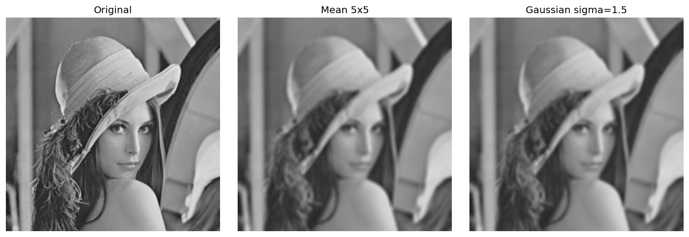

### Sobel과 라플라시안

| 방법 | 살펴보는 것 | 해석 |
| :---: | :---: | :---: |
| Sobel x | 가로 방향 밝기 변화 | 세로 경계에 강하게 반응할 수 있음 |
| Sobel y | 세로 방향 밝기 변화 | 가로 경계에 강하게 반응할 수 있음 |
| 라플라시안 | 두 방향의 2차 변화 합 | 경계·미세 변화 및 잡음에도 민감 |

$$
K_x=\begin{bmatrix}-1&0&1\\-2&0&2\\-1&0&1\end{bmatrix},\quad
K_y=\begin{bmatrix}-1&-2&-1\\0&0&0\\1&2&1\end{bmatrix}
$$

$$
\nabla^2 f=\frac{\partial^2 f}{\partial x^2}+\frac{\partial^2 f}{\partial y^2},\qquad
K_L=\begin{bmatrix}0&1&0\\1&-4&1\\0&1&0\end{bmatrix}
$$


- 이 그림은 부호를 보존해 파랑·빨강으로 표시했다. 각 패널의 색 범위는 독립적이다.
- `uint8` 출력만 쓰면 음수 변화가 잘려서 사라질 수 있다.
- Sobel 결과 $s_x,s_y$는 선형이지만 $\sqrt{s_x^2+s_y^2}$로 합친 크기 연산은 비선형이다.
- 위 라플라시안 커널은 `ksize=1`에 해당한다. 다른 크기에는 그대로 적용되지 않는다.

```python
# 셀 5: Sobel과 라플라시안
# Sobel은 방향별 1차 변화, 라플라시안은 2차 변화를 나타낸다. 결과의 부호를 유지한다.

# dx=1, dy=0은 가로 방향 미분이며 세로 경계에 강하게 반응한다.
sx = cv2.Sobel(f,cv2.CV_32F,1,0,ksize=3,borderType=border)
# dx=0, dy=1은 세로 방향 미분이며 가로 경계에 강하게 반응한다.
sy = cv2.Sobel(f,cv2.CV_32F,0,1,ksize=3,borderType=border)
# ksize=1의 라플라시안으로 2차 변화를 계산하고 CV_32F로 음수를 보존한다.
lap = cv2.Laplacian(f,cv2.CV_32F,ksize=1,borderType=border)

panel('derivatives.png',[('Sobel x',sx),('Sobel y',sy),('Laplacian',lap)],signed=True)
print('Sobel x 범위:',float(sx.min()),float(sx.max()))
print('Laplacian 범위:',float(lap.min()),float(lap.max()))
```

```text
Sobel x 범위: -801.0 610.0
Laplacian 범위: -326.0 302.0
```

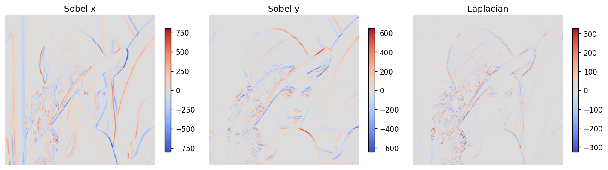

### 샤프닝

흐린 영상과 원본의 차이를 더하는 언샤프 마스킹:

$$
g=f+\alpha(f-G_\sigma*f),\qquad \alpha>0
$$

위 부호의 라플라시안 커널을 사용하는 샤프닝:

$$
g=f-\lambda\nabla^2f,\qquad \lambda>0
$$


- 원본과 같은 0~255 표시 범위를 사용했다. 
- 과도한 샤프닝은 테두리의 밝고 어두운 띠나 잡음을 강조할 수 있다. 
- 고정 계수의 조합은 클리핑 전에는 선형이며, 표시용 클리핑은 별도 단계다.

```python
# 셀 6: 샤프닝
# 원본에 미세 변화를 더해 경계를 강조하고, 표시할 때만 0~255로 제한한다.

# 원본에서 흐림 결과를 뺀 고주파 성분을 원본에 더한다.
sharp = np.clip(f + (f-gauss),0,255)
# 중앙 계수가 음수인 라플라시안 결과를 빼서 경계를 강조한다.
sharp_lap = np.clip(f-0.25*lap,0,255)
panel('sharpen.png',[('Original',f),('Unsharp alpha=1',sharp),('Laplacian sharpening',sharp_lap)])
```

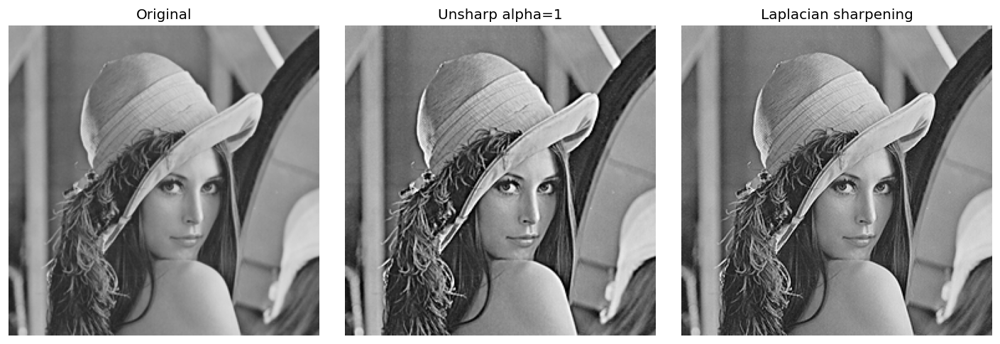

## 3.3 비선형 공간 필터

### 미디언 필터

- 주변 값을 정렬한 뒤 중앙값을 고른다.
- 평균과 달리 매우 큰 값 하나에 크게 끌려가지 않는다.
- 예를 들어 `[10, 10, 10, 10, 255]`의 평균은 59지만 중앙값은 10이다.
- 소금·후추처럼 드문 흰 점·검은 점 잡음에 유용할 수 있다.
- 작은 선이나 세부 무늬도 없어질 수 있다.

$$
g[y,x]=\operatorname{median}\{f[y+j,x+i]:(j,i)\in\mathcal N\}
$$


### 양방향 필터

- 가까우면서 픽셀 값도 비슷한 이웃에 큰 가중치를 준다.
- 경계를 가로질러 크게 다른 값을 덜 섞어 경계 보존을 돕는다.
- 가중치가 입력 값에 따라 달라지므로 비선형이다.

$$
g(p)=\frac{\sum_{q\in\mathcal N(p)}w(p,q)f(q)}{\sum_{q\in\mathcal N(p)}w(p,q)}
$$

$$
w(p,q)=\exp\left(-\frac{\|p-q\|^2}{2\sigma_s^2}\right)
\exp\left(-\frac{(f(p)-f(q))^2}{2\sigma_r^2}\right)
$$


| 인수 | 의미 |
| :---: | :---: |
| d | 이웃 영역의 지름 |
| sigmaColor | 허용하는 값 차이의 규모 |
| sigmaSpace | 거리 가중치의 규모 |


잡음은 원본과 별도로 확률 0.05, 난수 시드 42로 생성했다. 가우시안·미디언·양방향 모두 같은 잡음 입력을 받는다. 양방향 필터는 값 차이가 큰 점 잡음을 이웃과 섞지 않아 남길 수 있다. 이 예제 하나로 모든 잡음에 대한 성능 순위를 정하지 않는다.


두 필터의 강도가 동등하게 보정된 비교는 아니다. 모자와 얼굴 경계, 평탄한 영역을 중심으로 동작 차이를 관찰한다.

```python
# 셀 7: 비선형 필터와 잡음
# 동일한 소금·후추 잡음 입력에 가우시안·미디언·양방향 필터를 적용한다.

# 같은 잡음 입력으로 비교하며 난수 시드를 고정합니다.
rng = np.random.default_rng(42)
noisy = gray.copy(); u = rng.random(gray.shape)
noisy[u<.025]=0; noisy[u>.975]=255
# 5×5 이웃의 중앙값을 고른다. 드문 흰 점·검은 점에 덜 끌리는 특성이 있다.
med = cv2.medianBlur(noisy,5)
# 지름 9의 이웃에서 밝기 차이 규모 50, 거리 규모 5로 가중치를 조절한다.
bil = cv2.bilateralFilter(noisy,9,50,5,borderType=cv2.BORDER_REPLICATE)
ng = cv2.GaussianBlur(noisy,(5,5),1.2,borderType=cv2.BORDER_REPLICATE)
panel('nonlinear.png',[('Original reference',gray),('Salt & pepper: p=0.05',noisy),('Gaussian on noisy',ng),('Median 5x5',med),('Bilateral on noisy',bil)])
# 지름 9의 이웃에서 밝기 차이 규모 50, 거리 규모 5로 가중치를 조절한다.
bil_clean = cv2.bilateralFilter(gray,9,50,5,borderType=border)
panel('bilateral.png',[('Original',gray),('Gaussian',gauss),('Bilateral d=9, 50, 5',bil_clean)])


for name,a in [('Noisy',noisy),('Gaussian',ng),('Median',med),('Bilateral',bil)]:
    print(name,'원본 대비 MAE:',round(float(np.abs(a.astype(np.float32)-f).mean()),3))
```

```text
Noisy 원본 대비 MAE: 6.397
Gaussian 원본 대비 MAE: 8.53
Median 원본 대비 MAE: 4.994
Bilateral 원본 대비 MAE: 9.278
```

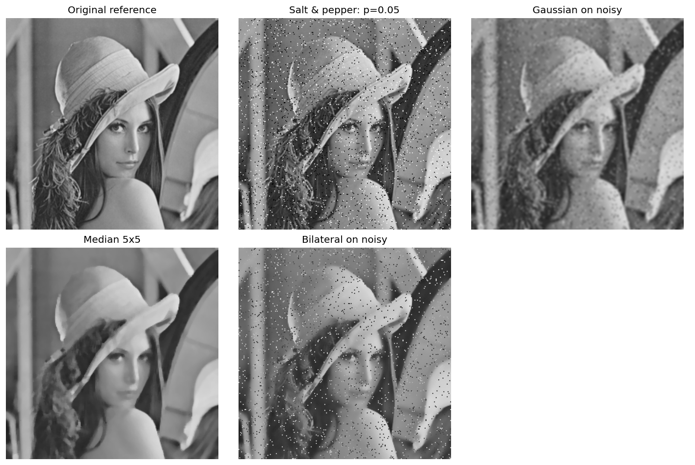


### 잡음 비교의 해석

- 같은 잡음 영상과 같은 경계 처리 조건을 사용했다. 필터의 강도가 완전히 동등한 비교는 아니다.
- MAE는 원본과의 픽셀 값 차이의 평균이다. 이 합성 잡음 실험의 복원 오차이며, 모든 사진의 품질을 나타내는 점수는 아니다.
- 미디언은 드문 극단값을 줄이는 데 유리하지만, 작은 유효 구조도 없앨 수 있다.
- 실제 MAE는 잡음 입력 6.397, 가우시안 8.530, 미디언 4.994, 양방향 9.278이었다. 이 설정에서는 미디언만 원본 대비 평균 오차를 줄였다. 가우시안과 양방향 결과는 세부 변화 또는 잔여 잡음 때문에 오차가 더 컸다.

## 3.4 형태학적 처리 (Morphology)

### 구조 요소로 모양 살펴보기

- 비선형 공간 처리의 한 종류다. 이 절은 분량 때문에 따로 펼쳤다.
- 구조 요소는 어떤 이웃 위치를 사용할지 표시한 작은 모양이다.
- 평균 가중치가 아니라, 선택된 위치에서 최솟값·최댓값 등을 구한다.
- 이진 영상과 그레이스케일 영상 모두에 적용할 수 있다.


RECT는 사각형, CROSS는 십자, ELLIPSE는 타원 형태다. 크기와 모양에 따라 남거나 사라지는 구조가 달라진다.

### 침식과 팽창

아래는 중심 대칭·평탄 구조 요소 $B$를 사용하는 경우다.

$$
\operatorname{erode}(f)(p)=\min_{q\in B} f(p+q),\qquad
\operatorname{dilate}(f)(p)=\max_{q\in B} f(p+q)
$$

- 흰색 전경의 침식: 흰 영역을 줄인다.
- 흰색 전경의 팽창: 흰 영역을 늘린다.
- 검은 물체를 전경으로 해석하면 위 시각적 설명이 뒤바뀐다. 먼저 전경의 색을 정한다.

```python
# 셀 8: 구조 요소, 침식, 팽창
# 흰색을 전경으로 정하고 구조 요소가 선택한 이웃의 최솟값·최댓값을 계산한다.

shapes = [('RECT',cv2.MORPH_RECT),('CROSS',cv2.MORPH_CROSS),('ELLIPSE',cv2.MORPH_ELLIPSE)]
panel('elements.png',[(name,cv2.getStructuringElement(shape,(9,9))*255) for name,shape in shapes])
binary=np.zeros((160,200),np.uint8)
# 오른쪽 아래 좌표도 포함해 그린다. 폭·높이에서 1을 빼면 지정한 픽셀 범위와 맞는다.
cv2.rectangle(binary,(35,30),(150,125),255,-1)
cv2.circle(binary,(85,75),3,0,-1)
# 오른쪽 아래 좌표도 포함해 그린다. 폭·높이에서 1을 빼면 지정한 픽셀 범위와 맞는다.
cv2.rectangle(binary,(110,30),(113,65),0,-1)
cv2.circle(binary,(175,45),2,255,-1)
# 9×9 타원 구조 요소에서 0이 아닌 위치를 형태학 연산의 이웃으로 사용한다.
k=cv2.getStructuringElement(cv2.MORPH_ELLIPSE,(9,9))
def morph(a,op):
    return cv2.morphologyEx(a,op,k,borderType=cv2.BORDER_REPLICATE)
# 이웃의 최솟값을 선택하여 흰색 전경을 줄인다.
er=cv2.erode(binary,k,borderType=cv2.BORDER_REPLICATE)
# 이웃의 최댓값을 선택하여 흰색 전경을 넓힌다.
di=cv2.dilate(binary,k,borderType=cv2.BORDER_REPLICATE)
panel('erode_dilate.png',[('White foreground',binary),('Erosion',er),('Dilation',di)])
assert np.all(er<=binary) and np.all(di>=binary)
print('흰 픽셀 수:',*[int(np.count_nonzero(a)) for a in [binary,er,di]])
```

```text
흰 픽셀 수: 10976 8927 12985
```

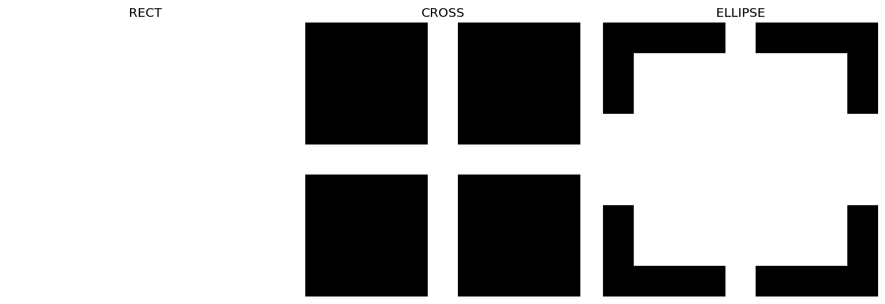

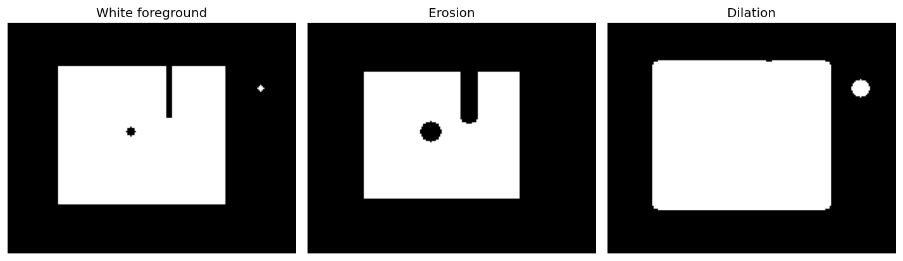

### 열림·닫힘과 차이 연산

$$
\operatorname{open}(f)=\operatorname{dilate}(\operatorname{erode}(f))
$$

$$
\operatorname{close}(f)=\operatorname{erode}(\operatorname{dilate}(f))
$$

| 연산 | 계산 | 흰색 전경 또는 Gray에서의 관찰 |
| :---: | :---: | :---: |
| 열림 | 침식 → 팽창 | 작은 밝은 점·돌출부 등을 제거할 수 있음 |
| 닫힘 | 팽창 → 침식 | 작은 어두운 구멍·틈 등을 메울 수 있음 |
| 그래디언트 | 팽창 − 침식 | 영역 경계나 국소 밝기 변화 강조 |
| 탑햇 | 원본 − 열림 | 구조 요소보다 작은 밝은 구조 강조 |
| 블랙햇 | 닫힘 − 원본 | 구조 요소보다 작은 어두운 구조 강조 |

열림과 닫힘은 서로 역연산이 아니다. 제거된 모양이 반드시 복구되는 것도 아니다. 
효과는 구조 요소에 대한 크기·모양 관계에 달려 있다. <br>

도형은 원리를 보여주려고 별도로 만든 흰색 전경이다. 
작은 흰 점, 내부의 검은 구멍, 위에서 내려오는 가느다란 틈을 비교한다. <br>

레나에는 이진화하지 않고 Gray 그대로 적용했다. 
탑햇과 블랙햇은 밝은·어두운 국소 세부에 반응하며, 사람이나 물체를 의미적으로 인식한 결과가 아니다.

```python
# 셀 9: 열림·닫힘과 형태학적 차이 연산
# 이진 도형과 그레이스케일에서 작은 구조 및 경계에 대한 반응을 비교한다.

ops=[('Opening',cv2.MORPH_OPEN),('Closing',cv2.MORPH_CLOSE),
     ('Gradient',cv2.MORPH_GRADIENT),('Top-hat',cv2.MORPH_TOPHAT),('Black-hat',cv2.MORPH_BLACKHAT)]
panel('binary.png',[('Binary input',binary)]+[(name,morph(binary,op)) for name,op in ops])
panel('gray.png',[('Gray input',gray)]+[(name,morph(gray,op)) for name,op in ops])
# 침식 다음 팽창을 적용하여 구조 요소보다 작은 밝은 구조를 줄인다.
opened=morph(binary,cv2.MORPH_OPEN)
# 팽창 다음 침식을 적용하여 작은 어두운 구멍이나 틈을 메운다.
closed=morph(binary,cv2.MORPH_CLOSE)
assert np.all(opened<=binary) and np.all(closed>=binary)
assert np.array_equal(morph(binary,cv2.MORPH_GRADIENT),cv2.subtract(di,er))
print('작은 흰 점 제거:',int(opened[45,175])==0)
print('작은 검은 구멍 채움:',int(closed[75,85])==255)
```

```text
작은 흰 점 제거: True
작은 검은 구멍 채움: True
```

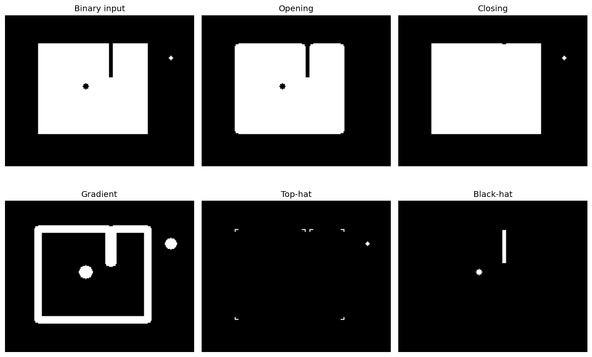

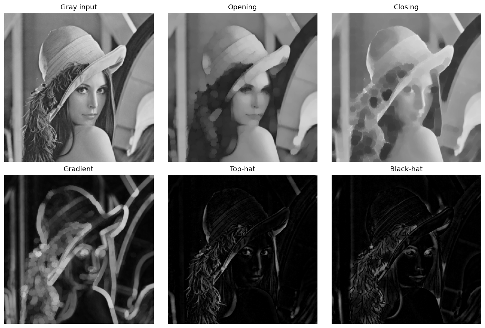

## 3.5 공간 필터 조합

### 가우시안 차분 (DoG)

서로 다른 정도로 흐린 두 영상을 뺀다.

$$
D=(G_{\sigma_1}*f)-(G_{\sigma_2}*f),\qquad 0<\sigma_1<\sigma_2
$$

$$
D=(G_{\sigma_1}-G_{\sigma_2})*f
$$

- 두 가우시안 결과의 차이와, 차분 커널 한 번의 적용은 같은 선형 조합으로 이해할 수 있다.
- 거의 일정한 밝기는 두 결과에 공통으로 남아 빼면 사라진다.
- 매우 빠른 변화는 두 가우시안 필터가 모두 줄인다.
- 그 사이 규모의 변화에 반응하는 밴드패스 특성이 생긴다.


DoG는 음수도 포함하므로 float 배열로 계산한다. 그림의 빨강·파랑은 양수·음수 반응이다. 절댓값으로 표시하면 부호 정보가 사라지고, `uint8`로 바로 빼면 잘못된 값이 생길 수 있다.

```python
# 셀 10: 가우시안 차분 DoG
# 서로 다른 두 흐림 결과를 빼 중간 규모의 변화를 추출한다.

# DoG: 동일 크기 25x25 커널로 두 스케일을 비교합니다.
g1=cv2.GaussianBlur(f,(25,25),1.0,borderType=border)
g2=cv2.GaussianBlur(f,(25,25),3.0,borderType=border)
# 덜 흐린 결과에서 더 흐린 결과를 뺀다. 음수도 의미가 있으므로 절댓값을 취하지 않는다.
dog=g1-g2
panel('dog_blurs.png',[('Original',f),('Gaussian sigma=1',g1),('Gaussian sigma=3',g2)])
panel('dog_signed.png',[('DoG: sigma 1 minus 3',dog)],cols=1,signed=True)

constant=np.full_like(f,100)
dc=cv2.GaussianBlur(constant,(25,25),1)-cv2.GaussianBlur(constant,(25,25),3)
assert np.max(np.abs(dc))<1e-3
print('DoG 범위:',float(dog.min()),float(dog.max()))
print('일정한 영상의 최대 절대 응답:',float(np.abs(dc).max()))
```

```text
DoG 범위: -67.8143310546875 64.11682891845703
일정한 영상의 최대 절대 응답: 7.62939453125e-06
```

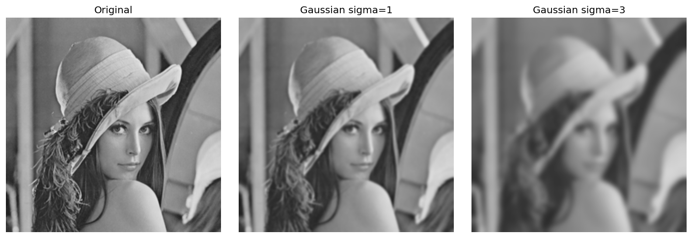

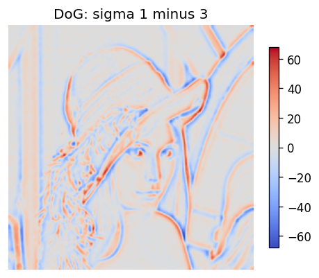

### 공간 영역에서의 밴드패스 특성

정규화된 연속 가우시안 모델의 주파수 응답은 다음과 같다.

$$
H(\rho)=e^{-2\pi^2\sigma_1^2\rho^2}-e^{-2\pi^2\sigma_2^2\rho^2}
$$

$\rho$는 공간 주파수의 크기이며 단위는 cycles/pixel이다.


- $\rho=0$에서 응답은 0이므로 일정한 밝기 성분을 제거한다.
- 중간 주파수에서 반응하고 높은 주파수로 갈수록 줄어든다.
- 이상적인 직사각형 대역 통과가 아니라 부드러운 응답이다.
- 그림은 연속 모델이며 실제 25×25 이산 커널의 정확한 응답을 측정한 그래프는 아니다.
- 유한 커널·샘플링·경계 처리 때문에 실제 결과는 연속 모델과 차이가 있다.
- 공간에서 직접 계산해도 주파수 선택 특성을 설명할 수 있다. DFT 수행 자체가 필수는 아니다.

```python
# 셀 11: DoG의 주파수 응답
# 연속 가우시안 모델의 응답을 그린다. 실제 유한 이산 커널의 측정값은 아니다.

nu=np.linspace(0,.5,501)
response=np.exp(-2*np.pi**2*1**2*nu**2)-np.exp(-2*np.pi**2*3**2*nu**2)
fig,ax=plt.subplots(figsize=(7,4)); ax.plot(nu,response)
ax.set(xlabel='Spatial frequency (cycles/pixel)',ylabel='Response',title='Continuous Gaussian model: DoG response',xlim=(0,.5))
ax.grid(alpha=.3); fig.tight_layout(); plt.show()
```

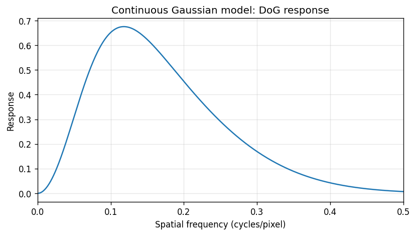

## 참고 문서

- [OpenCV Image Filtering API](https://docs.opencv.org/4.x/d4/d86/group__imgproc__filter.html)
- [OpenCV Morphological Transformations](https://docs.opencv.org/4.x/d9/d61/tutorial_py_morphological_ops.html)
