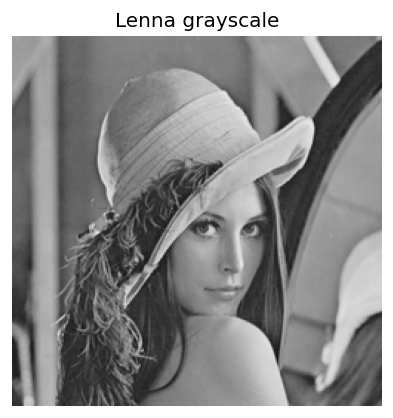
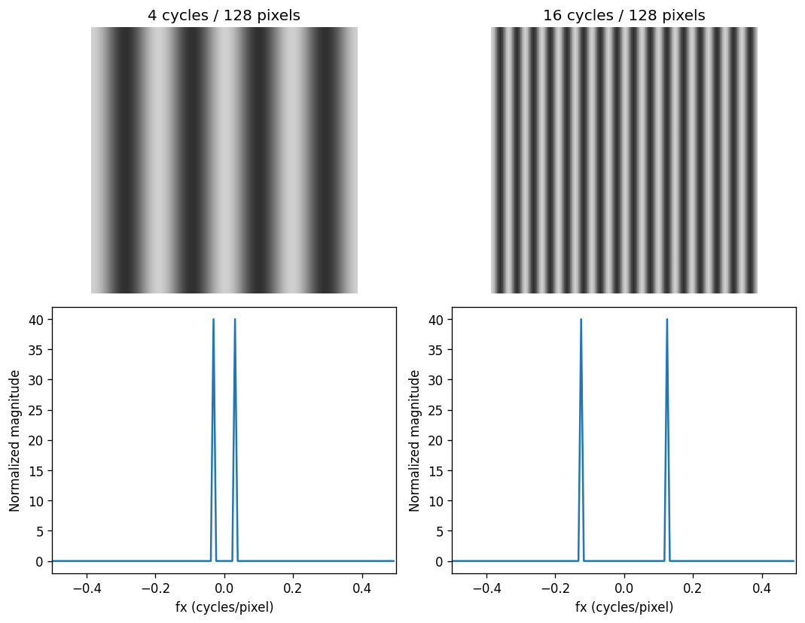
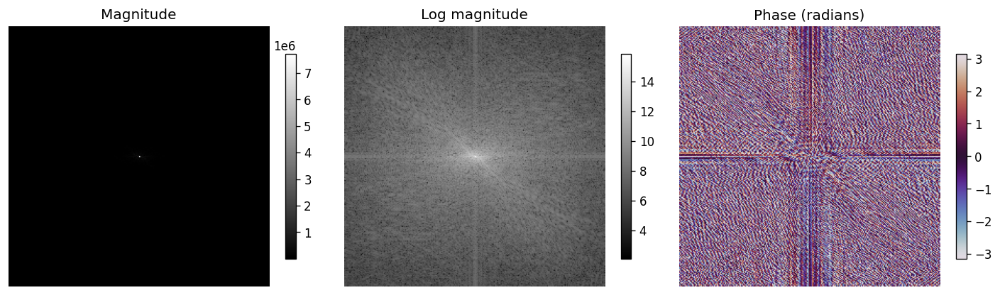
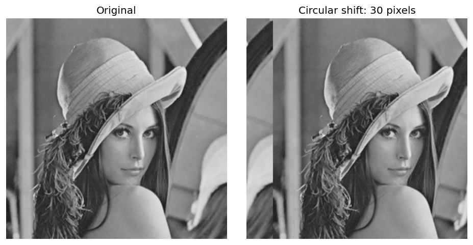
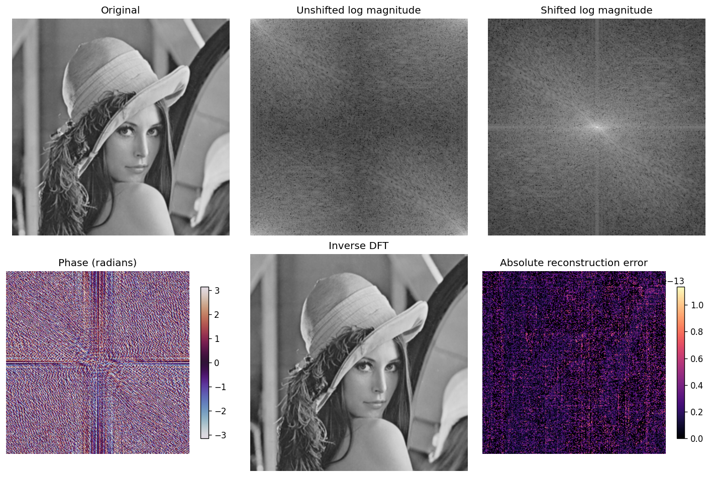
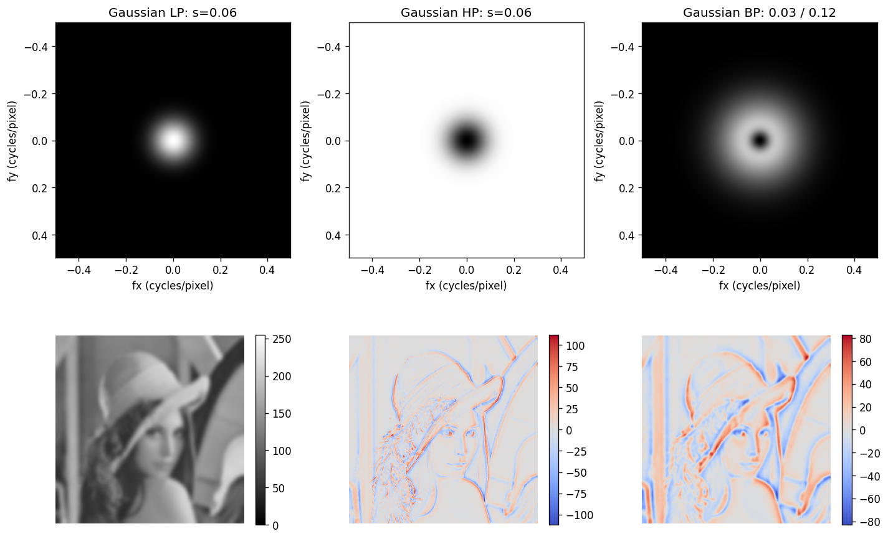
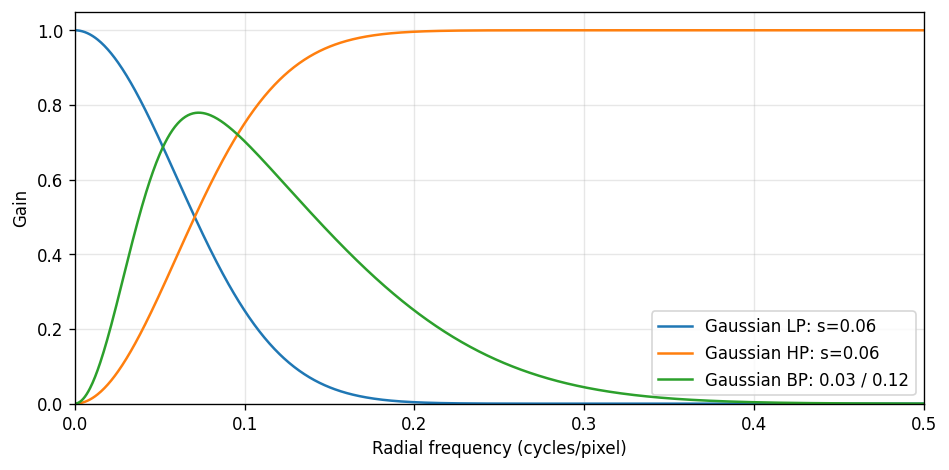

# 4. 주파수 영역 처리

사진을 여러 방향과 빠르기의 밝기 변화로 나누고, 성분을 조절한 뒤 다시 영상으로 합친다. 
레나 영상과 교육용 줄무늬로 **주파수의 의미와 필터 효과**를 확인한다.

## 4.1 DFT와 FFT

### 공간과 주파수는 같은 영상을 보는 두 가지 방식

- 공간 영역: 어느 위치에 어떤 밝기가 있는지 본다.
- 주파수 영역: 어떤 방향과 빠르기의 밝기 변화가 들어 있는지 본다.
- 넓고 완만한 변화는 저주파, 촘촘한 무늬와 급격한 변화는 고주파 성분과 관련된다.
- 고주파에는 잡음뿐 아니라 중요한 경계도 들어 있다.
- 음악을 여러 음으로 나누듯 영상을 여러 파동 성분으로 나타낸다고 생각하면 된다.

| 용어 | 뜻 | 역할 |
| :---: | :---: | :---: |
| DFT | Discrete Fourier Transform | 이산 푸리에 변환의 정의 |
| FFT | Fast Fourier Transform | DFT를 빠르게 계산하는 알고리즘 계열 |
| IDFT | Inverse DFT | 공간 영상으로 복원 |
| IFFT | Inverse FFT | 역변환을 빠르게 계산 |

FFT가 DFT보다 정확도가 떨어지는 별도 근사 변환이라는 뜻은 아니다. 수치 계산에서는 부동소수점 오차가 생긴다.

### 2차원 DFT 수식

높이 $H$, 너비 $W$인 영상 $f[y,x]$에 대해:

$$
F[v,u]=\sum_{y=0}^{H-1}\sum_{x=0}^{W-1}f[y,x]
\exp\left[-j2\pi\left(\frac{ux}{W}+\frac{vy}{H}\right)\right]
$$

- $x,y$: 공간 좌표, $u,v$: 주파수 인덱스
- $j$: 제곱하면 −1인 허수 단위
- 배열은 `[행, 열]` 순서다.
- $F[0,0]$은 DC 성분이며, 기본 정규화에서 모든 픽셀 값의 합이다.

$$
\overline f=\frac{F[0,0]}{HW}
$$


실습은 Gray를 사용한다. 컬러 `(H,W,3)` 배열에 기본 `fft2()`를 바로 적용하면 의도한 공간 축이 아닌 마지막 두 축을 변환하므로 채널별로 처리하거나 공간 축을 명시해야 한다.

```python
# 셀 1: DFT 계산과 DC 성분
# FFT로 복소 계수를 계산하고 DC를 픽셀 수로 나눈 값이 평균 밝기인지 확인한다.

# Path는 운영체제에 맞게 파일 경로를 조합하는 데 사용한다.
from pathlib import Path
import json
# OpenCV는 영상 처리, NumPy는 배열 계산, Matplotlib은 결과 시각화에 사용한다.
import cv2
import numpy as np
import matplotlib.pyplot as plt
# 현재 작업 폴더를 기준으로 assets를 찾는다. 노트북은 각 장의 폴더에서 실행한다.
ROOT=Path.cwd()  # 노트북과 assets 폴더가 있는 위치
OUT=ROOT/'assets'
# 파일을 바이트 배열로 읽어 디코딩한다. IMREAD_COLOR의 결과는 BGR 순서다.
bgr=cv2.imdecode(np.fromfile(OUT/'Lenna.png',np.uint8),cv2.IMREAD_COLOR)
if bgr is None: raise FileNotFoundError('assets/Lenna.png를 확인하세요.')
# B·G·R을 밝기 가중합으로 바꾸어 단일 채널 영상으로 만든다.
f=cv2.cvtColor(bgr,cv2.COLOR_BGR2GRAY).astype(np.float64)

# 공간 영상을 복소수 주파수 계수로 변환한다. 기본 FFT는 정방향 스케일을 나누지 않는다.
F=np.fft.fft2(f)
print('OpenCV:',cv2.__version__,'영상 크기:',f.shape)
print('평균 밝기:',f.mean(),'DC / 픽셀 수:',F[0,0].real/f.size)
assert np.isclose(F[0,0].real,f.sum())
plt.figure(figsize=(4,4))
plt.imshow(f,cmap='gray',vmin=0,vmax=255)
plt.title('Lenna grayscale')
plt.axis('off')
plt.show()
```

```text
OpenCV: 5.0.0 영상 크기: (250, 250)
평균 밝기: 123.550496 DC / 픽셀 수: 123.550496
```



### 줄무늬로 공간 주파수 이해하기

- 밝기 변화가 한 픽셀마다 얼마나 자주 반복되는지를 cycles/pixel로 나타낸다.
- 아래 세로 줄무늬는 가로 방향으로 밝기가 바뀐다. 따라서 스펙트럼의 봉우리도 가로축 방향에 나타난다.
- 평균 밝기를 뺀 뒤 변환하여 DC를 제거했다. 좌우 두 봉우리는 실수 코사인파의 양·음 주파수 성분이다.

```python
# 셀 2: 줄무늬의 공간 주파수
# 128픽셀 동안 4회와 16회 반복하는 코사인파의 주파수 위치를 비교한다.

n=128
x=np.arange(n)
fig,axs=plt.subplots(2,2,figsize=(9,7))
for i,k in enumerate([4,16]):
    stripes=np.tile(128+80*np.cos(2*np.pi*k*x/n),(n,1))
    S=np.fft.fftshift(np.fft.fft2(stripes-128))
    axs[0,i].imshow(stripes,cmap='gray',vmin=0,vmax=255)
    axs[0,i].set_title(f'{k} cycles / 128 pixels')
    axs[0,i].axis('off')
    freq=np.fft.fftshift(np.fft.fftfreq(n))
    axs[1,i].plot(freq,np.abs(S[n//2])/n**2)
    axs[1,i].set(xlabel='fx (cycles/pixel)',ylabel='Normalized magnitude',xlim=(-0.5,0.5))
    peaks=np.sort(freq[np.argsort(np.abs(S[n//2]))[-2:]])
    assert np.allclose(peaks,[-k/n,k/n])
    print(k,'회 반복: 봉우리',peaks.tolist())
fig.tight_layout()
plt.show()
```

```text
4 회 반복: 봉우리 [-0.03125, 0.03125]
16 회 반복: 봉우리 [-0.125, 0.125]
```



## 4.2 크기 스펙트럼과 위상

복소 계수에는 크기와 위상이 함께 들어 있다.

$$
F=a+jb=Ae^{j\phi},\qquad
A=\sqrt{a^2+b^2},\quad \phi=\operatorname{atan2}(b,a)
$$

| 정보 | 코드 | 쉬운 뜻 |
| :---: | :---: | :---: |
| 크기 | `np.abs(F)` | 각 성분이 얼마나 들어 있는가 |
| 위상 | `np.angle(F)` | 각 파동의 상대적인 위치 |
| 크기 제곱 | `np.abs(F)**2` | 비정규화 파워 스펙트럼 |

크기가 0인 성분의 위상은 의미가 없고, 매우 작은 성분의 위상 해석도 주의한다.

### 로그 표시

큰 성분에 작은 성분이 묻히지 않도록 표시할 때만 로그를 취한다.

$$
S=\log(1+|F|)
$$


> [!warning] 표시용 그림과 계산 배열 구분
> 로그 스펙트럼 PNG만으로 원본을 복원할 수 없다. 역변환에는 원래 복소 배열을 사용한다. 제공된 `frequency_arrays.npz`에는 복소 스펙트럼과 필터 결과를 보존했다.

```python
# 셀 3: 크기와 위상 표시
# 크기에는 log1p를 적용해 작은 성분도 보이게 하고, 위상은 라디안으로 표시한다.

# DC가 중앙에 오도록 배열 위치만 재배치한다. 주파수 값 자체를 새로 계산하지 않는다.
Fs=np.fft.fftshift(F)
magnitude=np.abs(Fs)
phase=np.angle(Fs)
fig,axs=plt.subplots(1,3,figsize=(12,4))
for ax,a,title,cmap in zip(axs,[magnitude,np.log1p(magnitude),phase],
                         ['Magnitude','Log magnitude','Phase (radians)'],['gray','gray','twilight']):
    im=ax.imshow(a,cmap=cmap,**({'vmin':-np.pi,'vmax':np.pi} if title.startswith('Phase') else {}))
    ax.set_title(title)
    ax.axis('off')
    fig.colorbar(im,ax=ax,shrink=.65)
fig.tight_layout()
plt.show()
```



### 위상은 왜 필요한가?

- 오른쪽 영상은 원본을 오른쪽으로 30픽셀 순환 이동한 것이다.
- 밖으로 나간 부분은 반대편으로 돌아온다.
- 두 영상의 크기 스펙트럼은 같지만 위상은 달라진다. 실습에서 수치적으로 확인한다.
- 따라서 크기만으로 물체의 위치를 모두 알 수 없다.

```python
# 셀 4: 순환 이동과 위상
# 오른쪽으로 30픽셀 이동하면 크기 스펙트럼은 유지되고 위상 관계가 달라진다.

shift=np.roll(f,30,axis=1)
assert np.allclose(abs(np.fft.fft2(shift)),abs(F),atol=1e-7)
fig,axs=plt.subplots(1,2,figsize=(8,4))
for ax,a,title in zip(axs,[f,shift],['Original','Circular shift: 30 pixels']):
    ax.imshow(a,cmap='gray',vmin=0,vmax=255);ax.set_title(title);ax.axis('off')
fig.tight_layout();plt.show()


F_shift=np.fft.fft2(shift)
print('순환 이동 전후 크기 최대 차이:',float(np.abs(np.abs(F_shift)-np.abs(F)).max()))
# 순환 이동 정리: 가로 30픽셀 이동은 주파수별 위상 변화를 만든다.
phase_factor=np.exp(-2j*np.pi*np.fft.fftfreq(f.shape[1])*30)
assert np.allclose(F_shift,F*phase_factor[None,:],atol=1e-7)
print('위상 변화 관계 검증 통과')
```

```text
순환 이동 전후 크기 최대 차이: 1.1641532182693481e-10
위상 변화 관계 검증 통과
```



## 4.3 fftshift와 역변환

### fftshift는 배열 재배치

- 기본 FFT 결과에서 DC는 `[0, 0]`에 있다.
- `fftshift()`는 DC를 중앙에 배치해 보기 쉽게 한다.
- 새로운 변환을 계산하거나 필터링하는 함수는 아니다.
- 중앙 근처는 낮은 주파수이며, 멀수록 높은 주파수다.
- 주파수 방향은 밝기가 변화하는 방향이다. 세로 줄무늬는 가로 주파수에 반응한다.

홀수 크기에서도 올바르게 복원하려면 `fftshift()`와 `ifftshift()`를 짝으로 사용한다.

### 역변환 수식

$$
f[y,x]=\frac{1}{HW}\sum_{v=0}^{H-1}\sum_{u=0}^{W-1}F[v,u]
\exp\left[j2\pi\left(\frac{ux}{W}+\frac{vy}{H}\right)\right]
$$

- NumPy 기본 설정은 역변환에서 $1/(HW)$를 적용한다. 
- 수정하지 않은 계수는 원본을 반올림 오차 범위에서 복원한다.

- 위: 원본, 이동 전 로그 크기, 이동 후 로그 크기
- 아래: 위상, 역변환 영상, 절대 복원 오차
- 오차 그림은 아주 작은 값을 확대해 보이는 별도 색 범위다. 큰 영상 손상이 생긴 것이 아니다.

```python
# 셀 5: fftshift 해제와 역변환
# ifftshift로 원래 순서를 복구한 후 역변환하며 실수부 오차와 허수 잔차를 확인한다.

# ifftshift로 배열 순서를 되돌린 뒤 역변환한다. NumPy는 역변환에서 픽셀 수로 나눈다.
rest=np.fft.ifft2(np.fft.ifftshift(Fs))
err=float(np.abs(rest.real-f).max())
assert err<1e-9 and np.abs(rest.imag).max()<1e-9
# 홀수 크기에서는 두 번 fftshift 하는 것으로 역이동을 대신할 수 없다.
odd=f[:249,:247]
odd_back=np.fft.ifft2(np.fft.ifftshift(np.fft.fftshift(np.fft.fft2(odd))))
assert np.max(np.abs(odd_back-odd))<1e-9
print('역변환 최대 오차:',err)
print('최대 허수 잔차:',float(np.abs(rest.imag).max()))
fig,axs=plt.subplots(2,3,figsize=(12,8))
for ax,title,a,cmap in zip(axs.flat,['Original','Unshifted log magnitude','Shifted log magnitude','Phase (radians)','Inverse DFT','Absolute reconstruction error'],[f,np.log1p(abs(F)),np.log1p(abs(Fs)),np.angle(Fs),rest.real,abs(rest.real-f)],['gray','gray','gray','twilight','gray','magma']):
    kwargs={'vmin':0,'vmax':255} if title in ['Original','Inverse DFT'] else {}
    im=ax.imshow(a,cmap=cmap,**kwargs)
    ax.set_title(title)
    ax.axis('off')
    if title in ['Phase (radians)','Absolute reconstruction error']:
        fig.colorbar(im,ax=ax,shrink=.7)
fig.tight_layout()
plt.show()
```

```text
역변환 최대 오차: 1.1368683772161603e-13
최대 허수 잔차: 6.188987108954897e-14
```



### OpenCV와 비교

| 항목 | NumPy | OpenCV의 이 설정 |
| :---: | :---: | :---: |
| 복소 배열 | `(H,W)` complex | `(H,W,2)` 실수부·허수부 |
| 역변환 스케일 | 기본 적용 | `DFT_SCALE` 명시 |
| 공간 축 이동 | `fftshift(F)` | `fftshift(cvF, axes=(0,1))` |

- 실수 출력은 실수 영상에 대응하는 켤레 대칭 계수를 전제로 한다. 
- 임의의 비대칭 마스크를 쓴 뒤 허수부를 무조건 버리지 않는다.

```python
# 셀 6: NumPy와 OpenCV DFT 비교
# OpenCV의 실수부·허수부 2채널을 복소 배열로 조합하고 역변환 스케일을 맞춘다.

# DFT_COMPLEX_OUTPUT을 지정해 실수부·허수부 두 채널을 얻는다.
cvF=cv2.dft(f,flags=cv2.DFT_COMPLEX_OUTPUT)
cv_complex=cvF[:,:,0]+1j*cvF[:,:,1]
assert np.allclose(F,cv_complex,atol=1e-7)
# DFT_SCALE로 역변환 정규화를 적용하고 켤레 대칭 계수에서 실수 출력을 얻는다.
cvback=cv2.idft(cvF,flags=cv2.DFT_SCALE|cv2.DFT_REAL_OUTPUT)
assert np.max(np.abs(cvback-f))<1e-9
print('NumPy shape:',F.shape,'OpenCV shape:',cvF.shape)
print('변환 계수 최대 차이:',float(np.abs(F-cv_complex).max()))
print('OpenCV 역변환 최대 오차:',float(np.abs(cvback-f).max()))
```

```text
NumPy shape: (250, 250) OpenCV shape: (250, 250, 2)
변환 계수 최대 차이: 3.841815860489176e-10
OpenCV 역변환 최대 오차: 1.5631940186722204e-13
```

## 4.4 주파수 영역 필터링

### 공통 원리

$$
G[v,u]=M[v,u]F[v,u],\qquad g=\operatorname{IDFT}(G)
$$

- $M$은 각 주파수 성분에 곱할 필터 이득이다.
- 1은 유지, 0은 제거, 0과 1 사이는 약화다.
- 표시용 크기 그림이 아니라 **복소 계수에 마스크를 곱한다**.
- 이동한 스펙트럼에는 이동한 좌표의 마스크를 맞춘다.

### 주파수 좌표를 정확하게 만들기


$$
\rho=\sqrt{f_x^2+f_y^2}
$$

- 단위는 cycles/pixel이다. 예를 들어 한 방향에서 0.1이면 10픽셀마다 한 번 반복한다.
- 주파수 인덱스와 cycles/pixel은 다르다. 
- 영상 크기가 바뀌어도 같은 단위를 쓰면 비교하기 쉽다.
- 각 축의 나이퀴스트 크기는 0.5 cycles/pixel이다. 
- 2차원 모서리의 반경은 약 0.707까지 가능하다.
- 마스크의 회색 밝기는 이득이며 원본 픽셀의 밝기가 아니다.

### 경계와 링잉

- 패딩 없이 DFT에서 곱하면 주기적 경계를 가진 순환 합성곱으로 해석된다.
- 영상의 왼쪽과 오른쪽 등이 연결되어 경계에 인공적인 변화가 나타날 수 있다.
- 실습은 각 방향으로 **64픽셀 반사 패딩**하고 처리한 뒤 원본 크기로 잘라낸다.
- 패딩은 영향을 줄이는 방법이며 모든 조건에서 경계 효과를 완전히 없앤다는 보장은 없다.
- 0/1로 갑자기 끊는 이상적 마스크는 경계 주변에 물결 같은 링잉을 만들 수 있다. 여기서는 부드러운 가우시안 마스크를 사용한다.
- 일반 창 함수를 곱하면 입력 자체도 변하므로 이번 실습에는 적용하지 않았다.

> [!warning] 역변환 후 절댓값을 무조건 취하지 않기
> - 고역·대역 결과의 음수는 정상적인 정보다. 
> - 실수 영상과 대칭 마스크를 사용했다면 허수 잔차가 충분히 작은지 확인하고 `.real`을 취한다. 절댓값은 별도의 비선형 처리다.

```python
# 셀 7: 반사 패딩과 주파수 좌표
# 경계 영향을 줄이기 위해 64픽셀 패딩하고 cycles/pixel 좌표를 만든다.

# 반사 패딩 후 주파수 영역에서 처리하고 원본 영역을 잘라냅니다.
pad=64
# 반사 패딩은 반대편 경계가 직접 연결되는 영향을 줄이며, 처리 후 원래 영역만 자른다.
padded=np.pad(f,pad,mode='reflect')
P=np.fft.fftshift(np.fft.fft2(padded))
# shape는 (높이, 너비) 순서다. 좌표 (x, y)로 읽을 때는 배열 인덱스 [y, x]와 구분한다.
h,w=padded.shape
# 세로 주파수 좌표를 cycles/pixel 단위로 만들고 스펙트럼과 같은 순서로 이동한다.
fy=np.fft.fftshift(np.fft.fftfreq(h))
# 가로 주파수 좌표도 동일하게 구성하여 직사각형 영상에서 축 간 단위를 맞춘다.
fx=np.fft.fftshift(np.fft.fftfreq(w))
FX,FY=np.meshgrid(fx,fy);rho=np.hypot(FX,FY)

print('원본 크기:',f.shape,'패딩 후:',padded.shape)
print('가로 주파수 간격:',1/w,'cycles/pixel')
```

```text
원본 크기: (250, 250) 패딩 후: (378, 378)
가로 주파수 간격: 0.0026455026455026454 cycles/pixel
```

### 저역 통과 필터 (Low-pass)

$$
M_{LP}(\rho)=\exp\left(-\frac{\rho^2}{2s^2}\right)
$$

- 완만한 변화는 남기고 미세한 변화를 줄인다.
- 영상이 부드러워지지만 경계도 흐려질 수 있다.
- 여기서 $s$는 **주파수 영역 폭**이다. 공간 가우시안의 픽셀 단위 $\sigma$와 구분한다.
- $s$가 작을수록 좁은 저주파만 통과시켜 더 많이 흐려진다.
- $s$는 딱 끊기는 차단 주파수가 아니다. $\rho=s$에서 이득은 약 0.607이다.

### 고역 통과 필터 (High-pass)

$$
M_{HP}(\rho)=1-M_{LP}(\rho)
$$

- DC와 완만한 변화를 줄여 경계·질감에 반응한다.
- 출력에 음수가 생기므로 원본처럼 0~255로만 표시하면 정보가 잘린다.
- 고역 통과 결과 자체는 일반적인 샤프닝 완성 영상이 아니다.
- 원본에 고역 결과를 일정 비율로 더하면 샤프닝으로 활용할 수 있다.

$$
g_{\mathrm{sharp}}=f+\alpha g_{HP}
$$

### 대역 통과 필터 (Band-pass)

실습에서는 폭이 다른 두 저역 통과 마스크의 차이를 사용한다.

$$
M_{BP}(\rho)=\exp\left(-\frac{\rho^2}{2s_h^2}\right)-\exp\left(-\frac{\rho^2}{2s_l^2}\right),\qquad 0<s_l<s_h
$$

- 낮은 주파수와 높은 주파수를 줄이고 중간 규모의 변화를 남긴다.
- 실습은 $s_l=0.03$, $s_h=0.12$다.
- 두 값은 부드러운 응답의 폭 설정이며, 그 사이만 완벽하게 통과하는 경계가 아니다.
- 공간 영역의 DoG와 연결되는 가우시안 차분 방식이다. 공간 폭과 주파수 폭은 반대 방향으로 대응한다.

곡선은 반경 0~0.5만 보여주며, 2차원 마스크는 모서리 주파수까지 계산한다.

- 위: 같은 0~1 범위로 표시한 마스크다.
- 아래 왼쪽: 저역 결과, 0~255로 표시했다.
- 아래 가운데·오른쪽: 고역·대역 결과이며 각각 독립된 대칭 색 범위를 사용한다.
- 색 막대를 보고 양수·음수의 크기를 해석한다. 서로 다른 패널의 같은 색이 같은 수치를 뜻하지는 않는다.

```python
# 셀 8: 저역·고역·대역 통과 필터
# 복소 스펙트럼에 마스크를 곱하고 역변환한다. 고역·대역 결과의 음수를 유지한다.

cut=.06; lo=.03; hi=.12
# 중심 저주파는 유지하고 멀어질수록 감쇠시키며, hp=1-lp로 보완 고역을 만든다.
lp=np.exp(-rho**2/(2*cut**2)); hp=1-lp
# 폭이 넓은 저역 마스크에서 좁은 저역 마스크를 빼 부드러운 대역 통과를 만든다.
bp=np.exp(-rho**2/(2*hi**2))-np.exp(-rho**2/(2*lo**2))
masks=[lp,hp,bp]; names=['Gaussian LP: s=0.06','Gaussian HP: s=0.06','Gaussian BP: 0.03 / 0.12']
outputs=[];residual=[]
for mask in masks:
    # 표시용 크기 그림이 아닌 복소 스펙트럼에 마스크를 곱하여 역변환한다.
    z=np.fft.ifft2(np.fft.ifftshift(P*mask))
    residual.append(float(abs(z.imag).max())); assert residual[-1]<1e-9
    # 반사 패딩을 제외하고 입력과 같은 크기로 결과를 자른다.
    outputs.append(z.real[pad:pad+f.shape[0],pad:pad+f.shape[1]])
assert np.max(abs(outputs[0]+outputs[1]-f))<1e-9
fig,axs=plt.subplots(2,3,figsize=(12,8))
for i,(name,mask,out) in enumerate(zip(names,masks,outputs)):
    im=axs[0,i].imshow(mask,cmap='gray',vmin=0,vmax=1,extent=[fx[0],fx[-1],fy[-1],fy[0]])
    axs[0,i].set_title(name);axs[0,i].set_xlabel('fx (cycles/pixel)');axs[0,i].set_ylabel('fy (cycles/pixel)')
    if i==0: im=axs[1,i].imshow(out,cmap='gray',vmin=0,vmax=255)
    else:
        m=abs(out).max();im=axs[1,i].imshow(out,cmap='coolwarm',vmin=-m,vmax=m)
    axs[1,i].axis('off');fig.colorbar(im,ax=axs[1,i],shrink=.7)
fig.tight_layout();plt.show()
r=np.linspace(0,.5,1000)
fig,ax=plt.subplots(figsize=(8,4))
for a,label in zip([np.exp(-r*r/(2*cut*cut)),1-np.exp(-r*r/(2*cut*cut)),np.exp(-r*r/(2*hi*hi))-np.exp(-r*r/(2*lo*lo))],names):ax.plot(r,a,label=label)
ax.set(xlabel='Radial frequency (cycles/pixel)',ylabel='Gain',ylim=(0,1.05),xlim=(0,.5));ax.legend();ax.grid(alpha=.3)
fig.tight_layout();plt.show()

print('필터 결과 최대 허수 잔차:',max(residual))
print('LP + HP 복원 최대 오차:',float(abs(outputs[0]+outputs[1]-f).max()))
for name,a in zip(names,outputs):
    print(name,'범위:',float(a.min()),float(a.max()))
# 다시 분석할 수 있도록 계산 배열을 원래 자료형으로 보존한다.
np.savez_compressed(ROOT/'frequency_arrays.npz',spectrum=F,lowpass=outputs[0],highpass=outputs[1],bandpass=outputs[2])
```

```text
필터 결과 최대 허수 잔차: 5.3474322909824486e-14
LP + HP 복원 최대 오차: 1.9895196601282805e-13
Gaussian LP: s=0.06 범위: 43.702149456853526 213.5890052861948
Gaussian HP: s=0.06 범위: -112.07452174139522 111.47326779989515
Gaussian BP: 0.03 / 0.12 범위: -82.88549861295577 82.33621439521673
```





### 결과 해석

- 저역 통과 영상에서는 얼굴과 배경의 큰 밝기 변화가 남고 머리카락 같은 세부가 흐려진다.
- 고역·대역 통과는 부호 있는 변화량이다. 음수를 검정으로 잘라내거나 절댓값으로 바꾸면 원래 계산과 달라진다.
- 저역과 보완 고역의 마스크 합은 1이므로, 두 출력의 합이 원본과 일치하는지 확인할 수 있다.
- 마스크 그림의 밝기는 0~1의 **통과 이득**이다. 영상 결과의 0~255 밝기와 구분한다.
- `frequency_arrays.npz`는 시각화용 PNG와 달리 원래 복소 스펙트럼 및 부동소수점 필터 결과를 보존한다.

## 참고 문서

- [NumPy — Discrete Fourier Transform](https://numpy.org/doc/stable/reference/routines.fft.html)
- [OpenCV — Fourier Transform](https://docs.opencv.org/4.x/de/dbc/tutorial_py_fourier_transform.html)
