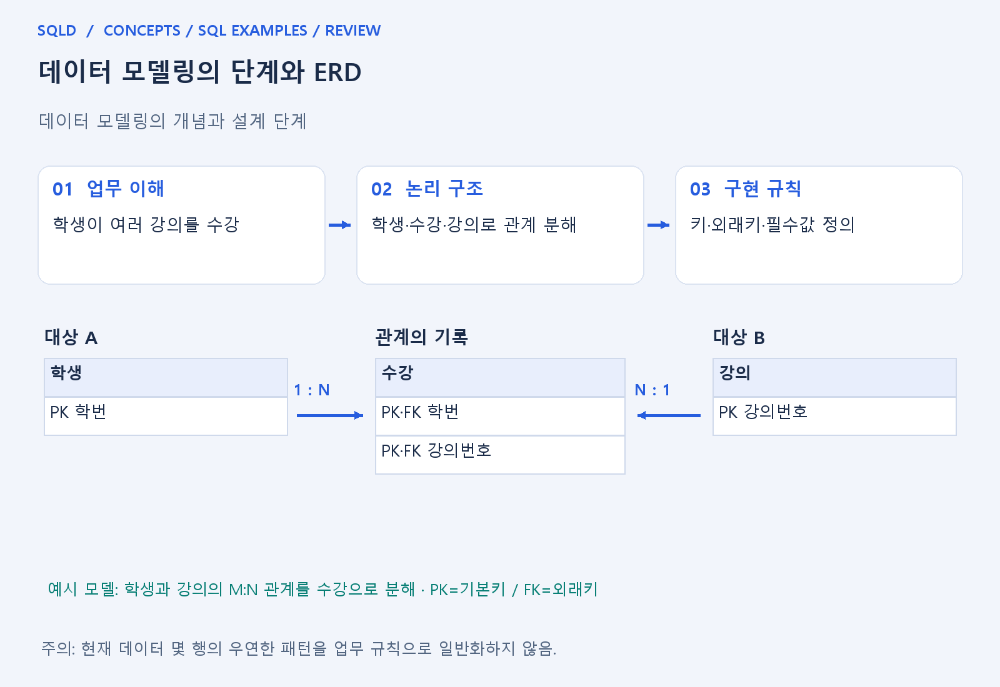
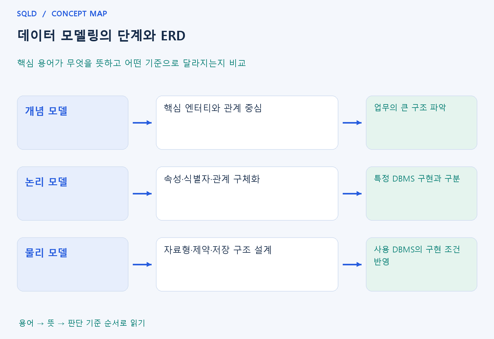

# 데이터 모델링의 단계와 ERD

- **학습 순서**: 개념 설명 → 그림으로 원리 확인 → 예제와 풀이 → 복습 요약.

## 이 글의 목차

- [1. 개념의 뜻과 동작 원리](#1.%20%EA%B0%9C%EB%85%90%EC%9D%98%20%EB%9C%BB%EA%B3%BC%20%EB%8F%99%EC%9E%91%20%EC%9B%90%EB%A6%AC)
  - [1-1. 데이터 모델링이 필요한 이유](#1-1.%20%EB%8D%B0%EC%9D%B4%ED%84%B0%20%EB%AA%A8%EB%8D%B8%EB%A7%81%EC%9D%B4%20%ED%95%84%EC%9A%94%ED%95%9C%20%EC%9D%B4%EC%9C%A0)
  - [1-2. 개념·논리·물리 모델의 연결](#1-2.%20%EA%B0%9C%EB%85%90%C2%B7%EB%85%BC%EB%A6%AC%C2%B7%EB%AC%BC%EB%A6%AC%20%EB%AA%A8%EB%8D%B8%EC%9D%98%20%EC%97%B0%EA%B2%B0)
  - [1-3. 모델을 읽을 때 확인할 기준](#1-3.%20%EB%AA%A8%EB%8D%B8%EC%9D%84%20%EC%9D%BD%EC%9D%84%20%EB%95%8C%20%ED%99%95%EC%9D%B8%ED%95%A0%20%EA%B8%B0%EC%A4%80)
- [2. 세부 정의와 관련 규칙](#2.%20%EC%84%B8%EB%B6%80%20%EC%A0%95%EC%9D%98%EC%99%80%20%EA%B4%80%EB%A0%A8%20%EA%B7%9C%EC%B9%99)
  - [2-1. 정의와 기본 규칙](#2-1.%20%EC%A0%95%EC%9D%98%EC%99%80%20%EA%B8%B0%EB%B3%B8%20%EA%B7%9C%EC%B9%99)
- [3. 핵심 차이 한눈에 보기](#3.%20%ED%95%B5%EC%8B%AC%20%EC%B0%A8%EC%9D%B4%20%ED%95%9C%EB%88%88%EC%97%90%20%EB%B3%B4%EA%B8%B0)
- [4. 예제](#4.%20%EC%98%88%EC%A0%9C)
- [5. 복습 요약](#5.%20%EB%B3%B5%EC%8A%B5%20%EC%9A%94%EC%95%BD)
- [6. 관련 글과 추가 학습](#6.%20%EA%B4%80%EB%A0%A8%20%EA%B8%80%EA%B3%BC%20%EC%B6%94%EA%B0%80%20%ED%95%99%EC%8A%B5)

## 1. 개념의 뜻과 동작 원리

### 1-1. 데이터 모델링이 필요한 이유

- 데이터 모델링은 현실의 업무를 데이터로 표현하는 설계 작업. 무엇을 저장할지뿐 아니라 대상 사이의 관계와 지켜야 할 규칙을 함께 정하는 과정.
- 설계 없이 표부터 만들면 같은 사실을 여러 곳에 적거나 필요한 관계를 빠뜨리기 쉬움. 모델은 개발자와 업무 담당자가 같은 구조를 이해하도록 돕는 공통 설명서.
- ERD는 엔터티·속성·관계를 그림으로 나타낸 표현. 그림 자체가 데이터베이스는 아니며, 그림에 정한 규칙을 테이블·키·제약조건으로 구현해야 실제 저장에 적용됨.

### 1-2. 개념·논리·물리 모델의 연결

- 개념 모델은 업무의 큰 대상을 정리하는 단계. 고객·주문처럼 중요한 엔터티와 연결을 먼저 잡고 세부 자료형 같은 구현 사항은 뒤로 미룸.

- 논리 모델은 각 대상의 속성, 식별자, 관계를 구체화하는 단계. 같은 업무 사실이 불필요하게 반복되지 않도록 정규화 등 구조의 타당성을 함께 검토.

- 물리 모델은 실제 DBMS에 맞춰 테이블·자료형·제약조건·인덱스 등을 정하는 단계. 같은 논리 구조라도 사용하는 제품과 성능 요구에 따라 구현이 달라질 수 있음.

### 1-3. 모델을 읽을 때 확인할 기준

- 한 행이 무엇을 뜻하는지 먼저 확인. 주문 한 건과 주문에 포함된 상품 한 건은 서로 다른 단위이므로 같은 대상으로 섞으면 중복과 집계 오류가 생길 수 있음.
- 관계는 현재 표에 보이는 행 수가 아니라 업무 규칙으로 판단. 지금 고객 한 명에게 주문이 하나뿐이어도 여러 주문이 가능하다면 1:N 관계로 설계.
- 추상화는 필요한 특징을 골라내는 것, 단순화는 복잡한 현실을 이해하기 쉽게 줄이는 것, 명확화는 여러 사람이 같은 의미로 읽도록 정의를 분명히 하는 것.
- 업무에서 관리할 대상과 관계를 먼저 정하고, 이를 엔터티·속성·식별자로 구체화한 뒤 실제 테이블로 구현하는 흐름. ERD는 이 과정에서 대상끼리 어떻게 연결되는지 확인하는 설계 지도 역할.

## 2. 세부 정의와 관련 규칙

### 2-1. 정의와 기본 규칙

- 개념 모델은 업무의 큰 대상과 관계, 논리 모델은 속성과 식별자·정규화, 물리 모델은 제품의 타입과 인덱스 등 구현을 구체화함.

- 엔터티는 관리할 대상의 집합이며 속성은 특성임.
- 관계에는 최대 참여 수인 일대일·일대다·다대다와 최소 참여 수인 필수·선택을 구분함.

- 다대다 수강은 학생-수강-강의의 두 일대다로 풀 수 있음.
- 식별 관계는 부모 식별자가 자식 주식별자에 포함되는 경우임.

- SQLD 추가 복습: 기본 속성은 업무에서 원래 수집하는 값, 설계 속성은 관리 목적으로 만든 코드 등, 파생 속성은 계산해서 얻는 값임.
- 본질 식별자는 업무에 원래 의미가 있는 식별자이고 인조 식별자는 관리상 만든 대리 식별자임.
- 인조 번호를 추가해도 업무상의 유일성 제약을 따로 보존해야 함.

## 3. 핵심 차이 한눈에 보기

|  구분 | 핵심 뜻 | 확인할 기준 |
| --- | --- | --- |
| 개념 모델 | 핵심 엔터티와 관계 중심 | 업무의 큰 구조 파악 |
| 논리 모델 | 속성·식별자·관계 구체화 | 특정 DBMS 구현과 구분 |
| 물리 모델 | 자료형·제약·저장 구조 설계 | 사용 DBMS의 구현 조건 반영 |

## 4. 예제

- **상황**: 학교가 학생과 수강 정보를 관리하려는 상황.
- **질문**: 학교의 학생과 강의 정보를 실제 테이블로 만들 때, 모델링의 세 단계에서는 각각 무엇을 정해야 하는가?
- **정답**: 학생·강의를 정하고 관계를 연결한 뒤 열·키·자료형을 구체화.
- **풀이 ①**: 학생·강의라는 대상을 고르는 일과 열·키·자료형을 정하는 일을 나누어 판단.
- **풀이 ②**: 큰 업무 구조에서 실제 구현으로 내려가는 순서가 개념→논리→물리 모델. 개념 단계에서는 대상과 큰 관계, 논리 단계에서는 속성과 식별자, 물리 단계에서는 자료형과 구현 구조를 구체화.

## 5. 복습 요약

- **개념 모델**: 핵심 엔터티와 관계 중심. 업무의 큰 구조 파악.
- **논리 모델**: 속성·식별자·관계 구체화. 특정 DBMS 구현과 구분.
- **물리 모델**: 자료형·제약·저장 구조 설계. 사용 DBMS의 구현 조건 반영.

## 6. 관련 글과 추가 학습

- [전체 목차](../../00_%EC%A0%84%EC%B2%B4%EB%AA%A9%EC%B0%A8.md)
- [개념별 빠른 복습표](../../%EB%B3%B5%EC%8A%B5_%ED%95%B5%EC%8B%AC%EB%B9%84%EA%B5%90%ED%91%9C.md)
- [추가 SQL 소스 안내](../../%EC%B6%94%EA%B0%80_SQL_%EC%86%8C%EC%8A%A4%EC%95%88%EB%82%B4.md)
