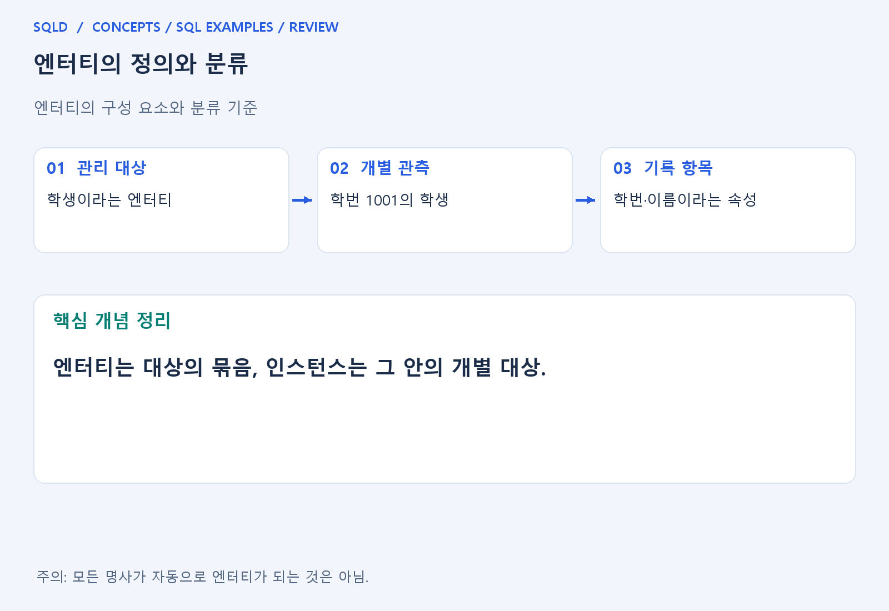
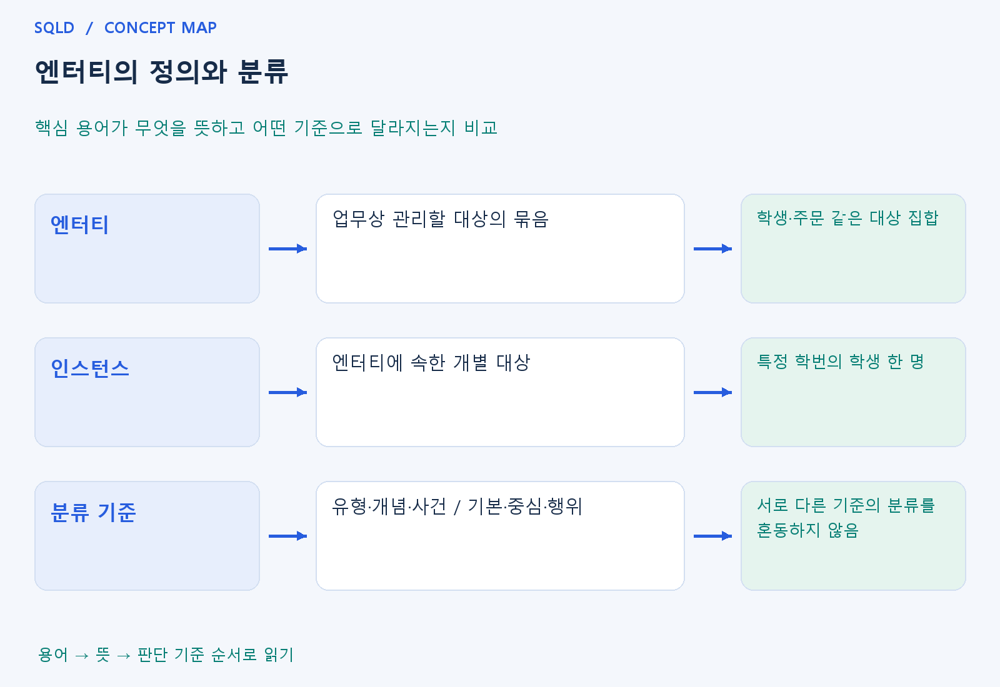

# 엔터티의 정의와 분류

- **학습 순서**: 개념 설명 → 그림으로 원리 확인 → 예제와 풀이 → 복습 요약.

## 이 글의 목차

- [1. 개념의 뜻과 동작 원리](#1.%20%EA%B0%9C%EB%85%90%EC%9D%98%20%EB%9C%BB%EA%B3%BC%20%EB%8F%99%EC%9E%91%20%EC%9B%90%EB%A6%AC)
  - [1-1. 엔터티와 인스턴스의 차이](#1-1.%20%EC%97%94%ED%84%B0%ED%8B%B0%EC%99%80%20%EC%9D%B8%EC%8A%A4%ED%84%B4%EC%8A%A4%EC%9D%98%20%EC%B0%A8%EC%9D%B4)
  - [1-2. 엔터티를 선정하는 기준](#1-2.%20%EC%97%94%ED%84%B0%ED%8B%B0%EB%A5%BC%20%EC%84%A0%EC%A0%95%ED%95%98%EB%8A%94%20%EA%B8%B0%EC%A4%80)
  - [1-3. 분류 기준을 구분하는 방법](#1-3.%20%EB%B6%84%EB%A5%98%20%EA%B8%B0%EC%A4%80%EC%9D%84%20%EA%B5%AC%EB%B6%84%ED%95%98%EB%8A%94%20%EB%B0%A9%EB%B2%95)
- [2. 세부 정의와 관련 규칙](#2.%20%EC%84%B8%EB%B6%80%20%EC%A0%95%EC%9D%98%EC%99%80%20%EA%B4%80%EB%A0%A8%20%EA%B7%9C%EC%B9%99)
  - [2-1. 엔터티 선정 기준](#2-1.%20%EC%97%94%ED%84%B0%ED%8B%B0%20%EC%84%A0%EC%A0%95%20%EA%B8%B0%EC%A4%80)
  - [2-2. 엔터티의 분류 기준](#2-2.%20%EC%97%94%ED%84%B0%ED%8B%B0%EC%9D%98%20%EB%B6%84%EB%A5%98%20%EA%B8%B0%EC%A4%80)
- [3. 핵심 차이 한눈에 보기](#3.%20%ED%95%B5%EC%8B%AC%20%EC%B0%A8%EC%9D%B4%20%ED%95%9C%EB%88%88%EC%97%90%20%EB%B3%B4%EA%B8%B0)
- [4. 예제](#4.%20%EC%98%88%EC%A0%9C)
- [5. 복습 요약](#5.%20%EB%B3%B5%EC%8A%B5%20%EC%9A%94%EC%95%BD)
- [6. 관련 글과 추가 학습](#6.%20%EA%B4%80%EB%A0%A8%20%EA%B8%80%EA%B3%BC%20%EC%B6%94%EA%B0%80%20%ED%95%99%EC%8A%B5)

## 1. 개념의 뜻과 동작 원리

### 1-1. 엔터티와 인스턴스의 차이

- 엔터티는 업무에서 같은 종류로 관리할 대상의 묶음. 학생이라는 엔터티는 학생 한 명의 이름이 아니라 여러 학생을 기록할 수 있는 공통 구조를 뜻함.

- 인스턴스는 엔터티에 들어 있는 개별 대상. 특정 학번의 학생 한 명이 인스턴스이며, 학번·이름은 그 학생을 설명하는 속성에 해당.

- 테이블로 구현하면 엔터티는 표의 종류, 인스턴스는 개별 행, 속성은 열에 대응하여 이해할 수 있음. 개념 모델과 물리 테이블을 완전히 같은 말로 보지는 않음.

### 1-2. 엔터티를 선정하는 기준

- 업무에서 실제로 보관하고 사용할 정보인지 확인. 문장에 등장하는 명사라도 별도 관리할 필요가 없으면 반드시 독립 엔터티로 만들 필요는 없음.

- 인스턴스를 구분할 식별자가 필요. 이름처럼 겹칠 수 있는 값만으로 구분하면 서로 다른 대상을 같은 것으로 처리할 위험이 있음.

- 대상을 설명하는 속성과 다른 대상과의 관계를 확인. 관리할 사실이 속성 하나인지, 독립적인 대상인지, 다른 대상 사이의 사건인지 구별하여 설계.

### 1-3. 분류 기준을 구분하는 방법

- 유형·개념·사건 분류는 대상의 성격을 보는 기준. 물건처럼 형태가 있는 대상, 제도나 조직 같은 개념, 주문·결제처럼 발생한 사건을 구분.
- 기본·중심·행위 분류는 업무에서 생기는 순서와 역할을 보는 기준. 기초 대상에서 중심 업무가 발생하고 그 진행 과정에서 상세 행위가 기록되는 흐름으로 이해.
- 두 분류는 다른 관점이므로 한 목록의 경쟁하는 답처럼 외우지 않음. 구체적인 분류는 문제에 적힌 업무 범위와 발생 과정을 먼저 읽어 판단.
- 관리할 대상의 묶음인 엔터티를 정한 뒤 개별 인스턴스와 그 특성인 속성을 구분. 업무가 저장할 필요가 있고 여러 개체를 같은 기준으로 관리할 수 있어야 엔터티로 설계하기 적절.

## 2. 세부 정의와 관련 규칙

### 2-1. 엔터티 선정 기준

- 업무에서 계속 기록해야 하는 대상인지 봄.
- 각각을 구분할 식별자가 있는지 봄. 동명이인이 있으므로 이름만 믿으면 안 됨.
- 그 대상을 설명할 속성이 있는지 봄.
- 다른 대상과 어떤 관계를 맺는지 읽음. '학생이 강의를 수강한다'면 학생과 강의 사이에 수강 관계가 있음.
- 입문 시험에서는 보통 식별 가능성, 속성의 존재, 업무 필요성, 여러 인스턴스, 다른 엔터티와의 관계 등을 엔터티의 특징으로 묻음.
- 다만 실제 설계의 특수 사례와 시험에서 설명하는 전형적 특징을 구분할 것.

### 2-2. 엔터티의 분류 기준

| 분류 기준 | 구분 | 예와 뜻 |
| --- | --- | --- |
| 형태 | 유형 엔터티 | 학생, 상품처럼 형태를 떠올리기 쉬움 |
| 형태 | 개념 엔터티 | 부서, 보험상품처럼 개념으로 관리 |
| 형태 | 사건 엔터티 | 주문, 결제처럼 업무 사건을 기록 |
| 발생 순서 | 기본 엔터티 | 고객, 상품처럼 다른 업무 사건보다 먼저 존재하는 기초 대상 |
| 발생 순서 | 중심 엔터티 | 주문처럼 업무의 중심 사건이며 후속 업무를 발생시킴 |
| 발생 순서 | 행위 엔터티 | 주문이력 등 업무 진행 중 발생하는 상세 행위 |

- 사건 엔터티와 행위 엔터티는 같은 분류 축의 용어가 아님.
- 구체적인 대상의 분류는 문제에서 설명한 업무와 발생 과정을 먼저 봄.

## 3. 핵심 차이 한눈에 보기

|  구분 | 핵심 뜻 | 확인할 기준 |
| --- | --- | --- |
| 엔터티 | 업무상 관리할 대상의 묶음 | 학생·주문 같은 대상 집합 |
| 인스턴스 | 엔터티에 속한 개별 대상 | 특정 학번의 학생 한 명 |
| 분류 기준 | 유형·개념·사건 / 기본·중심·행위 | 서로 다른 기준의 분류를 혼동하지 않음 |

## 4. 예제

- **상황**: 학생이라는 묶음에 학번 1001인 민수가 있음.
- **질문**: 학생과 민수는 각각 엔터티와 인스턴스 중 무엇이며, 학번은 어떤 역할인가?
- **정답**: 학생은 엔터티, 민수 한 명은 인스턴스.
- **풀이 ①**: 학생이라는 관리 단위, 그 안의 민수 한 명, 민수를 설명하는 학번을 각각 분리.
- **풀이 ②**: 묶음과 그 안의 개별 대상을 구분하면 됨. 학번은 학생 인스턴스를 구별하는 속성으로 사용할 수 있음.

## 5. 복습 요약

- **엔터티**: 업무상 관리할 대상의 묶음. 학생·주문 같은 대상 집합.
- **인스턴스**: 엔터티에 속한 개별 대상. 특정 학번의 학생 한 명.
- **분류 기준**: 유형·개념·사건 / 기본·중심·행위. 서로 다른 기준의 분류를 혼동하지 않음.

## 6. 관련 글과 추가 학습

- [전체 목차](../../00_%EC%A0%84%EC%B2%B4%EB%AA%A9%EC%B0%A8.md)
- [개념별 빠른 복습표](../../%EB%B3%B5%EC%8A%B5_%ED%95%B5%EC%8B%AC%EB%B9%84%EA%B5%90%ED%91%9C.md)
- [추가 SQL 소스 안내](../../%EC%B6%94%EA%B0%80_SQL_%EC%86%8C%EC%8A%A4%EC%95%88%EB%82%B4.md)
