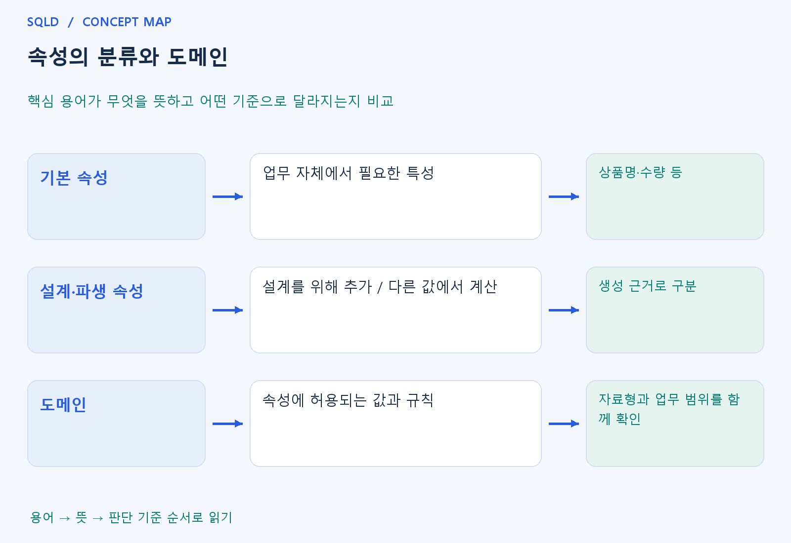

# 속성의 분류와 도메인

- **학습 순서**: 개념 설명 → 그림으로 원리 확인 → 예제와 풀이 → 복습 요약.

## 이 글의 목차

- [1. 개념의 뜻과 동작 원리](#1.%20%EA%B0%9C%EB%85%90%EC%9D%98%20%EB%9C%BB%EA%B3%BC%20%EB%8F%99%EC%9E%91%20%EC%9B%90%EB%A6%AC)
  - [1-1. 속성과 속성값의 의미](#1-1.%20%EC%86%8D%EC%84%B1%EA%B3%BC%20%EC%86%8D%EC%84%B1%EA%B0%92%EC%9D%98%20%EC%9D%98%EB%AF%B8)
  - [1-2. 기본·설계·파생 속성의 구분](#1-2.%20%EA%B8%B0%EB%B3%B8%C2%B7%EC%84%A4%EA%B3%84%C2%B7%ED%8C%8C%EC%83%9D%20%EC%86%8D%EC%84%B1%EC%9D%98%20%EA%B5%AC%EB%B6%84)
  - [1-3. 설계할 때 함께 정할 규칙](#1-3.%20%EC%84%A4%EA%B3%84%ED%95%A0%20%EB%95%8C%20%ED%95%A8%EA%BB%98%20%EC%A0%95%ED%95%A0%20%EA%B7%9C%EC%B9%99)
- [2. 세부 정의와 관련 규칙](#2.%20%EC%84%B8%EB%B6%80%20%EC%A0%95%EC%9D%98%EC%99%80%20%EA%B4%80%EB%A0%A8%20%EA%B7%9C%EC%B9%99)
  - [2-1. 속성의 특성에 따른 분류](#2-1.%20%EC%86%8D%EC%84%B1%EC%9D%98%20%ED%8A%B9%EC%84%B1%EC%97%90%20%EB%94%B0%EB%A5%B8%20%EB%B6%84%EB%A5%98)
  - [2-2. 식별자와의 관계에 따른 분류](#2-2.%20%EC%8B%9D%EB%B3%84%EC%9E%90%EC%99%80%EC%9D%98%20%EA%B4%80%EA%B3%84%EC%97%90%20%EB%94%B0%EB%A5%B8%20%EB%B6%84%EB%A5%98)
  - [2-3. NULL과 원자성](#2-3.%20NULL%EA%B3%BC%20%EC%9B%90%EC%9E%90%EC%84%B1)
- [3. 핵심 차이 한눈에 보기](#3.%20%ED%95%B5%EC%8B%AC%20%EC%B0%A8%EC%9D%B4%20%ED%95%9C%EB%88%88%EC%97%90%20%EB%B3%B4%EA%B8%B0)
- [4. 예제](#4.%20%EC%98%88%EC%A0%9C)
- [5. 복습 요약](#5.%20%EB%B3%B5%EC%8A%B5%20%EC%9A%94%EC%95%BD)
- [6. 관련 글과 추가 학습](#6.%20%EA%B4%80%EB%A0%A8%20%EA%B8%80%EA%B3%BC%20%EC%B6%94%EA%B0%80%20%ED%95%99%EC%8A%B5)

## 1. 개념의 뜻과 동작 원리

### 1-1. 속성과 속성값의 의미

- 속성은 대상을 설명하기 위해 기록하는 항목. 학생의 이름이라는 열이 속성이고 실제로 저장된 민수라는 글자는 속성값이므로 항목과 값을 구분해야 함.
- 같은 속성에 서로 다른 의미의 값을 섞으면 계산과 비교가 어려워짐. 금액 열에 원과 천 원을 설명 없이 섞으면 숫자 합계는 계산해도 결과 의미가 틀릴 수 있음.
- 도메인은 허용되는 값의 범위와 규칙. 정수라는 자료형만 정하는 것보다 학년은 1~6, 수량은 1 이상처럼 업무상 범위까지 정하는 개념.

### 1-2. 기본·설계·파생 속성의 구분

- 기본 속성은 업무가 본래 요구하는 특성. 상품명이나 주문수량처럼 실제 대상이나 사건에서 얻어야 하는 정보를 나타냄.
- 설계 속성은 시스템의 관리와 식별을 위해 추가한 항목. 업무 설명에 없던 일련번호를 설계 과정에서 붙이는 경우를 생각하면 이해하기 쉬움.
- 파생 속성은 다른 값으로부터 계산하는 항목. 수량과 단가로 만든 금액은 따로 저장해도 계산 근거가 있다는 점에서 파생 속성의 성격을 가짐.

### 1-3. 설계할 때 함께 정할 규칙

- NULL을 허용할지와 기본값을 줄지 따로 정함. 모르는 금액을 0으로 넣으면 실제 0원과 구분할 수 없어 평균과 조건 검색의 의미가 바뀔 수 있음.
- 파생값을 저장하면 원래 값이 바뀔 때 함께 갱신해야 함. 값 하나를 덜 계산하려고 저장하더라도 일관성을 유지하는 비용은 새로 생김.
- 한 속성값의 원자성은 업무가 다루는 단위로 판단. 전화번호별 검색이 필요하다면 여러 번호를 한 문자열에 묶기보다 별도 행으로 관리하는 구조를 검토.
- 속성은 대상의 사실을 표현하고 도메인은 그 사실에 허용되는 값의 범위를 정함. 파생 속성을 따로 저장한다면 원래 속성의 변경 때 계산 결과도 함께 맞춰야 일관성을 유지.

## 2. 세부 정의와 관련 규칙

### 2-1. 속성의 특성에 따른 분류

| 구분 | 뜻 | 예 |
| --- | --- | --- |
| 기본 속성 | 업무 자체에서 필요한 성질 | 상품명, 주문수량, 단가 |
| 설계 속성 | 설계와 관리를 위해 추가 | 인조 주문번호, 관리용 코드 |
| 파생 속성 | 다른 값에서 계산 | 주문수량 × 단가로 계산한 금액 |

- 금액을 실제 저장한다고 해서 파생 속성이 기본 속성으로 자동 변경되는 것은 아님.
- **어떻게 생긴 값인가**가 분류 기준임.
- 파생 값을 저장하면 원래 값이 바뀔 때 함께 갱신할 규칙이 필요함.

### 2-2. 식별자와의 관계에 따른 분류

- 주식별자 속성은 대상을 대표하여 식별하고, 외래식별자 속성은 다른 엔터티의 식별자를 가져와 관계를 표현함.
- 나머지는 일반 속성임.
- 이 분류와 기본·설계·파생 분류는 서로 다른 기준이므로 한 속성을 여러 관점으로 설명할 수 있음.

### 2-3. NULL과 원자성

- 값이 아직 알려지지 않았다면 NULL을 허용할지 정함.
- 빈 문자열이나 0을 임의로 대신 넣으면 뜻이 바뀔 수 있음.
- 한 칸의 원자성은 업무가 다루는 단위에 따라 판단함.
- 여러 개의 전화번호를 한 문자열로 묶어 전화번호별 검색을 해야 한다면 별도 전화번호 엔터티를 고려함.

## 3. 핵심 차이 한눈에 보기

|  구분 | 핵심 뜻 | 확인할 기준 |
| --- | --- | --- |
| 기본 속성 | 업무 자체에서 필요한 특성 | 상품명·수량 등 |
| 설계·파생 속성 | 설계를 위해 추가 / 다른 값에서 계산 | 생성 근거로 구분 |
| 도메인 | 속성에 허용되는 값과 규칙 | 자료형과 업무 범위를 함께 확인 |

## 4. 예제

- **상황**: 수량 2개, 단가 1000원으로 금액을 계산.
- **질문**: 수량 2개와 단가 1000원에서 구한 금액은 어떤 속성이며, 수량이 바뀌면 무엇을 주의해야 하는가?
- **정답**: 금액 2000원은 파생 속성.
- **풀이 ①**: 금액이 독립적으로 입력한 사실인지, 수량과 단가에서 계산한 값인지 확인.
- **풀이 ②**: 다른 값으로부터 계산한 값이라는 생성 근거가 기준. 수량을 바꾸면 저장한 금액도 다시 계산해야 값이 서로 어긋나지 않음.

## 5. 복습 요약

- **기본 속성**: 업무 자체에서 필요한 특성. 상품명·수량 등.
- **설계·파생 속성**: 설계를 위해 추가 / 다른 값에서 계산. 생성 근거로 구분.
- **도메인**: 속성에 허용되는 값과 규칙. 자료형과 업무 범위를 함께 확인.

## 6. 관련 글과 추가 학습

- [전체 목차](../../00_%EC%A0%84%EC%B2%B4%EB%AA%A9%EC%B0%A8.md)
- [개념별 빠른 복습표](../../%EB%B3%B5%EC%8A%B5_%ED%95%B5%EC%8B%AC%EB%B9%84%EA%B5%90%ED%91%9C.md)
- [추가 SQL 소스 안내](../../%EC%B6%94%EA%B0%80_SQL_%EC%86%8C%EC%8A%A4%EC%95%88%EB%82%B4.md)
