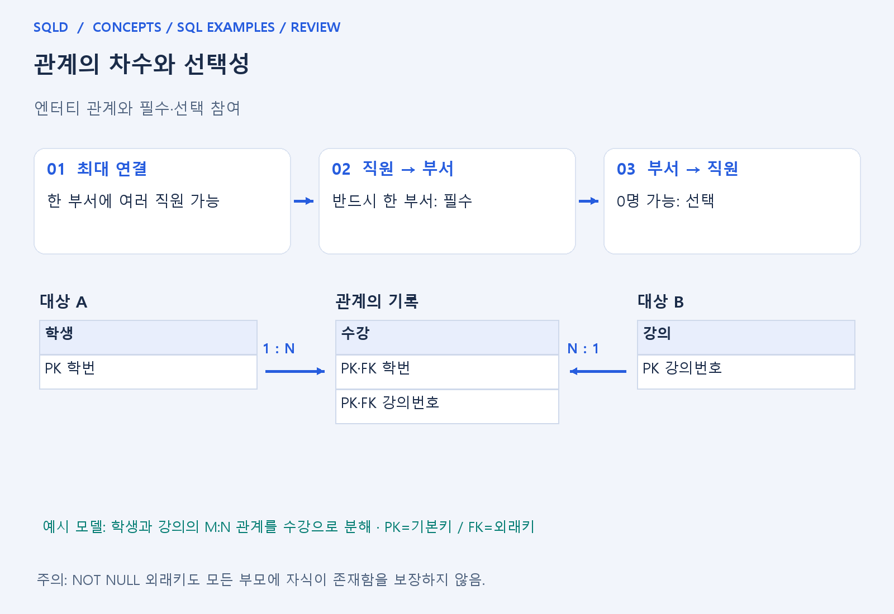
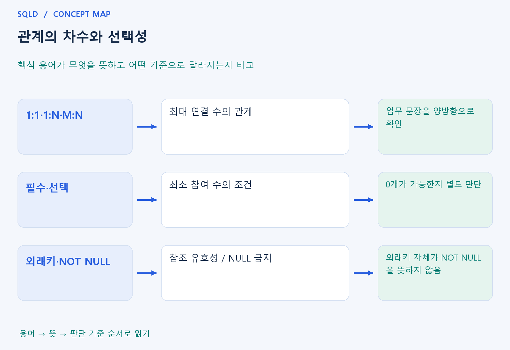

# 관계의 차수와 선택성

- **학습 순서**: 개념 설명 → 그림으로 원리 확인 → 예제와 풀이 → 복습 요약.

## 이 글의 목차

- [1. 개념의 뜻과 동작 원리](#1.%20%EA%B0%9C%EB%85%90%EC%9D%98%20%EB%9C%BB%EA%B3%BC%20%EB%8F%99%EC%9E%91%20%EC%9B%90%EB%A6%AC)
  - [1-1. 관계가 표현하는 내용](#1-1.%20%EA%B4%80%EA%B3%84%EA%B0%80%20%ED%91%9C%ED%98%84%ED%95%98%EB%8A%94%20%EB%82%B4%EC%9A%A9)
  - [1-2. 최대 연결 수와 최소 참여 수](#1-2.%20%EC%B5%9C%EB%8C%80%20%EC%97%B0%EA%B2%B0%20%EC%88%98%EC%99%80%20%EC%B5%9C%EC%86%8C%20%EC%B0%B8%EC%97%AC%20%EC%88%98)
  - [1-3. 관계를 테이블로 구현하는 방법](#1-3.%20%EA%B4%80%EA%B3%84%EB%A5%BC%20%ED%85%8C%EC%9D%B4%EB%B8%94%EB%A1%9C%20%EA%B5%AC%ED%98%84%ED%95%98%EB%8A%94%20%EB%B0%A9%EB%B2%95)
- [2. 세부 정의와 관련 규칙](#2.%20%EC%84%B8%EB%B6%80%20%EC%A0%95%EC%9D%98%EC%99%80%20%EA%B4%80%EB%A0%A8%20%EA%B7%9C%EC%B9%99)
  - [2-1. 관계의 구성 요소](#2-1.%20%EA%B4%80%EA%B3%84%EC%9D%98%20%EA%B5%AC%EC%84%B1%20%EC%9A%94%EC%86%8C)
  - [2-2. 존재 관계와 행위 관계](#2-2.%20%EC%A1%B4%EC%9E%AC%20%EA%B4%80%EA%B3%84%EC%99%80%20%ED%96%89%EC%9C%84%20%EA%B4%80%EA%B3%84)
  - [2-3. M:N을 연결 엔터티로 바꾸기](#2-3.%20M%3AN%EC%9D%84%20%EC%97%B0%EA%B2%B0%20%EC%97%94%ED%84%B0%ED%8B%B0%EB%A1%9C%20%EB%B0%94%EA%BE%B8%EA%B8%B0)
- [3. 핵심 차이 한눈에 보기](#3.%20%ED%95%B5%EC%8B%AC%20%EC%B0%A8%EC%9D%B4%20%ED%95%9C%EB%88%88%EC%97%90%20%EB%B3%B4%EA%B8%B0)
- [4. 예제](#4.%20%EC%98%88%EC%A0%9C)
- [5. 복습 요약](#5.%20%EB%B3%B5%EC%8A%B5%20%EC%9A%94%EC%95%BD)
- [6. 관련 글과 추가 학습](#6.%20%EA%B4%80%EB%A0%A8%20%EA%B8%80%EA%B3%BC%20%EC%B6%94%EA%B0%80%20%ED%95%99%EC%8A%B5)

## 1. 개념의 뜻과 동작 원리

### 1-1. 관계가 표현하는 내용

- 관계는 서로 다른 대상 사이의 업무상 연결. 고객이 주문한다, 직원이 부서에 소속된다는 문장에서 어떤 대상들이 어떤 의미로 이어지는지를 표현.
- 관계명은 연결의 뜻을 설명하고, 연결 수와 선택성은 허용되는 개수를 설명. 의미와 개수는 다른 항목이므로 선 하나만 보고 모두 같은 규칙이라고 판단하지 않음.
- 관계는 양쪽 방향으로 읽어야 함. 한 부서에 직원이 몇 명 가능한지와 직원 한 명이 부서 몇 개에 속할 수 있는지는 따로 확인할 질문.

### 1-2. 최대 연결 수와 최소 참여 수

- 1:1·1:N·M:N은 최대 몇 개까지 연결될 수 있는지 설명하는 관점. 학생 한 명이 여러 강의를 듣고 강의 하나에 여러 학생이 오면 M:N으로 이해.
- 필수·선택 참여는 연결이 하나도 없어도 되는지 설명. 부서에 직원이 0명일 수 있어도 직원 한 명의 부서 소속은 반드시 필요할 수 있음.
- 따라서 1:N이라는 사실만으로 양쪽 모두 필수라고 결론 내리지 않음. 최대 연결 수와 최소 연결 수를 각각 적으면 관계를 더 정확하게 읽을 수 있음.

### 1-3. 관계를 테이블로 구현하는 방법

- 일반적인 1:N 관계는 N쪽에 1쪽의 키를 가져와 외래키로 표현. 다수의 직원이 같은 부서번호를 가리켜도 각 직원은 별도 행으로 구별됨.
- 외래키는 참조한 값의 유효성을 확인하는 규칙이며, 값이 반드시 있어야 하는지는 NOT NULL로 따로 정할 수 있음. 두 제약의 목적은 다름.
- M:N은 수강처럼 연결을 기록하는 엔터티로 나누는 구조를 자주 사용. 수강일·성적처럼 관계 자체의 속성도 연결 엔터티에 저장할 수 있음.
- 관계는 두 대상의 연결을 나타내고 차수는 최대 연결 수, 선택성은 최소 연결 수를 나타냄. 한쪽 설명만 읽으면 반대 방향의 필수 여부를 놓치므로 두 방향의 업무 문장을 따로 확인.

## 2. 세부 정의와 관련 규칙

### 2-1. 관계의 구성 요소

| 질문 | 용어 | 예 |
| --- | --- | --- |
| 어떤 관련이 있는가 | 관계명 | 소속된다, 주문한다 |
| 최대 몇 개까지 가능한가 | 관계 차수 / 카디널리티 | 1:1, 1:N, M:N |
| 최소 한 개가 꼭 필요한가 | 선택성 / 필수성 | 0개 허용 또는 반드시 1개 이상 |

- 관계 차수라는 말은 문맥에 따라 참여 엔터티 수를 가리키기도 하므로, 문제의 정의와 표기법을 확인함.
- 여기서는 1:N과 같은 연결 수를 읽는 연습을 함.
- 까마귀발 표기에서 동그라미는 선택, 막대는 하나, 갈라진 발은 다수를 나타냄.
- 표기법마다 기호가 달라지므로 범례가 우선임.

### 2-2. 존재 관계와 행위 관계

- 부서와 직원의 소속처럼 존재와 상태에 관한 관련과, 고객이 주문한다는 사건을 통해 맺는 관련을 구분하여 설명할 수 있음.
- ERD의 실선·점선은 사용 표기법에서 식별 관계 여부 등을 뜻할 수 있으므로 존재·행위를 언제나 선 모양으로 구별한다고 외우지 않음.

### 2-3. M:N을 연결 엔터티로 바꾸기

- 학생과 강의는 다대다임.
- 수강을 두면 학생 1:N 수강, 강의 1:N 수강으로 나눌 수 있음.
- 관계 자체의 속성인 수강신청일과 성적은 수강에 두는 것이 자연스럽음.
- 학생의 이름을 수강마다 반복하면 이름 변경 때 여러 행을 고쳐야 함.

## 3. 핵심 차이 한눈에 보기

|  구분 | 핵심 뜻 | 확인할 기준 |
| --- | --- | --- |
| 1:1·1:N·M:N | 최대 연결 수의 관계 | 업무 문장을 양방향으로 확인 |
| 필수·선택 | 최소 참여 수의 조건 | 0개가 가능한지 별도 판단 |
| 외래키·NOT NULL | 참조 유효성 / NULL 금지 | 외래키 자체가 NOT NULL을 뜻하지 않음 |

## 4. 예제

- **상황**: 직원은 한 부서에 반드시 속하고 부서는 직원이 없을 수 있음.
- **질문**: 부서와 직원의 관계는 1:1인가 1:N인가? 양쪽 모두 반드시 연결되어야 하는가?
- **정답**: 부서:직원=1:N, 직원→부서는 필수, 부서→직원은 선택.
- **풀이 ①**: 직원 한 명이 속하는 부서의 최대 수와 부서 하나가 갖는 직원의 최대 수를 비교.
- **풀이 ②**: 최대 연결 수와 0개 허용 여부를 따로 읽음. 직원은 부서가 반드시 필요하지만 부서는 직원이 0명이어도 되므로 양쪽 모두 필수인 관계는 아님.

## 5. 복습 요약

- **1:1·1:N·M:N**: 최대 연결 수의 관계. 업무 문장을 양방향으로 확인.
- **필수·선택**: 최소 참여 수의 조건. 0개가 가능한지 별도 판단.
- **외래키·NOT NULL**: 참조 유효성 / NULL 금지. 외래키 자체가 NOT NULL을 뜻하지 않음.

## 6. 관련 글과 추가 학습

- [전체 목차](../../00_%EC%A0%84%EC%B2%B4%EB%AA%A9%EC%B0%A8.md)
- [개념별 빠른 복습표](../../%EB%B3%B5%EC%8A%B5_%ED%95%B5%EC%8B%AC%EB%B9%84%EA%B5%90%ED%91%9C.md)
- [추가 SQL 소스 안내](../../%EC%B6%94%EA%B0%80_SQL_%EC%86%8C%EC%8A%A4%EC%95%88%EB%82%B4.md)
