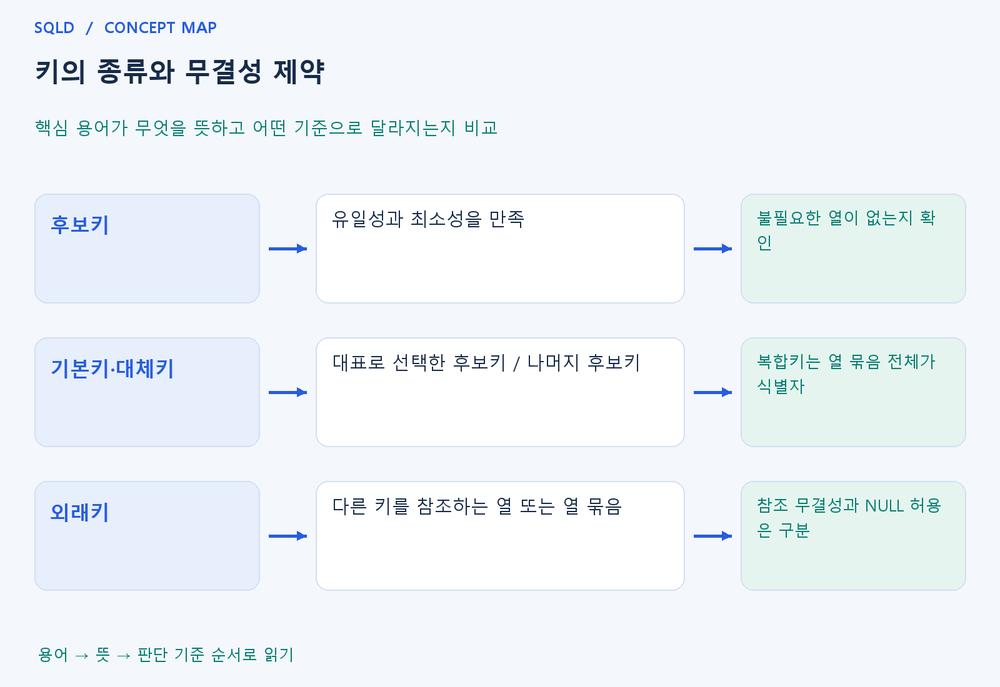

# 키의 종류와 무결성 제약

- **학습 순서**: 개념 설명 → 그림으로 원리 확인 → 예제와 풀이 → 복습 요약.

## 이 글의 목차

- [1. 개념의 뜻과 동작 원리](#1.%20%EA%B0%9C%EB%85%90%EC%9D%98%20%EB%9C%BB%EA%B3%BC%20%EB%8F%99%EC%9E%91%20%EC%9B%90%EB%A6%AC)
  - [1-1. 키가 필요한 이유와 두 조건](#1-1.%20%ED%82%A4%EA%B0%80%20%ED%95%84%EC%9A%94%ED%95%9C%20%EC%9D%B4%EC%9C%A0%EC%99%80%20%EB%91%90%20%EC%A1%B0%EA%B1%B4)
  - [1-2. 키 종류의 포함 관계](#1-2.%20%ED%82%A4%20%EC%A2%85%EB%A5%98%EC%9D%98%20%ED%8F%AC%ED%95%A8%20%EA%B4%80%EA%B3%84)
  - [1-3. 무결성과 연결하여 이해하기](#1-3.%20%EB%AC%B4%EA%B2%B0%EC%84%B1%EA%B3%BC%20%EC%97%B0%EA%B2%B0%ED%95%98%EC%97%AC%20%EC%9D%B4%ED%95%B4%ED%95%98%EA%B8%B0)
- [2. 세부 정의와 관련 규칙](#2.%20%EC%84%B8%EB%B6%80%20%EC%A0%95%EC%9D%98%EC%99%80%20%EA%B4%80%EB%A0%A8%20%EA%B7%9C%EC%B9%99)
  - [2-1. 정의와 기본 규칙](#2-1.%20%EC%A0%95%EC%9D%98%EC%99%80%20%EA%B8%B0%EB%B3%B8%20%EA%B7%9C%EC%B9%99)
- [3. 핵심 차이 한눈에 보기](#3.%20%ED%95%B5%EC%8B%AC%20%EC%B0%A8%EC%9D%B4%20%ED%95%9C%EB%88%88%EC%97%90%20%EB%B3%B4%EA%B8%B0)
- [4. 예제](#4.%20%EC%98%88%EC%A0%9C)
- [5. 복습 요약](#5.%20%EB%B3%B5%EC%8A%B5%20%EC%9A%94%EC%95%BD)
- [6. 관련 글과 추가 학습](#6.%20%EA%B4%80%EB%A0%A8%20%EA%B8%80%EA%B3%BC%20%EC%B6%94%EA%B0%80%20%ED%95%99%EC%8A%B5)

## 1. 개념의 뜻과 동작 원리

### 1-1. 키가 필요한 이유와 두 조건

- 키는 한 행을 다른 행과 구분하기 위한 열 또는 열 묶음. 이름이 같은 사람이 있어도 학번이 다르면 구분할 수 있는 것처럼 식별 기준을 정함.
- 유일성은 서로 다른 행의 키 값이 겹치지 않는 성질. 다만 현재 자료에서 우연히 중복이 없다는 사실과 앞으로도 중복을 허용하지 않는 업무 규칙은 다름.
- 최소성은 유일성을 유지하는 데 불필요한 열이 없는 성질. 학번만으로 식별되는데 이름까지 더한 묶음은 유일할 수 있어도 최소성은 만족하지 않을 수 있음.

### 1-2. 키 종류의 포함 관계

- 슈퍼키는 유일하게 구분할 수 있는 속성 집합이며 불필요한 열이 있어도 됨. 그중 최소성까지 만족한 것이 후보키이므로 모든 후보키는 슈퍼키에 해당.
- 후보키 중 대표로 선택한 것이 기본키이고 선택하지 않은 후보키는 대체키. 복합키는 여러 열을 함께 써야 식별된다는 뜻이지 각 열이 따로 키라는 뜻은 아님.
- 외래키는 다른 테이블의 기본키나 적절한 유일키 등을 참조하는 규칙. 자신의 행을 식별하는 역할과 다른 행을 가리키는 역할을 구분하면 이해하기 쉬움.

### 1-3. 무결성과 연결하여 이해하기

- 개체 무결성은 기본키의 유일성과 NULL 금지를 통해 행의 식별을 보장하는 관점. 식별값이 없거나 겹치면 어떤 행을 바꿀지 모호해질 수 있음.
- 참조 무결성은 외래키가 유효한 부모 값을 가리키게 하는 관점. 허용되는 NULL 여부와 부모 삭제·변경 시의 동작은 제약 설계와 제품 규칙을 따름.
- 도메인 무결성은 자료형·범위·허용값 같은 속성 규칙을 지키는 관점. 키가 유일하더라도 수량에 허용하지 않은 음수가 들어가면 다른 종류의 오류가 발생.
- 키는 행을 구별하는 기준이고 무결성 제약은 허용할 데이터의 규칙. 후보키는 유일성과 최소성을 모두 만족해야 하며, 그중 선택한 기본키와 외래키를 통해 행의 식별과 표 사이의 참조를 구분.

## 2. 세부 정의와 관련 규칙

### 2-1. 정의와 기본 규칙

- 후보키는 유일성과 최소성을 만족하고 기본키는 선택한 후보키, 대체키는 나머지 후보키임.
- 슈퍼키는 최소성 없이도 행을 구별하는 속성 집합임.

- 개체 무결성은 기본키의 유일성과 NULL 금지임.
- 참조 무결성은 외래키가 참조 키와 일치하거나 허용된 NULL이어야 함을 뜻함.

- 도메인 무결성은 타입과 허용 범위이며 NOT NULL, UNIQUE, CHECK, FK가 다른 역할을 함.
- SQL의 NULL 허용 세부사항은 DBMS를 확인함.

## 3. 핵심 차이 한눈에 보기

|  구분 | 핵심 뜻 | 확인할 기준 |
| --- | --- | --- |
| 후보키 | 유일성과 최소성을 만족 | 불필요한 열이 없는지 확인 |
| 기본키·대체키 | 대표로 선택한 후보키 / 나머지 후보키 | 복합키는 열 묶음 전체가 식별자 |
| 외래키 | 다른 키를 참조하는 열 또는 열 묶음 | 참조 무결성과 NULL 허용은 구분 |

## 4. 예제

- **상황**: 학번만으로 식별되는 학생에서 (학번, 이름)을 키 후보로 제시.
- **질문**: 학번만으로 학생을 구분할 수 있을 때, (학번, 이름)을 후보키라고 할 수 있는가?
- **정답**: 유일할 수 있지만 최소성은 불만족.
- **풀이 ①**: 두 학생이 같은 키를 가질 수 있는지 먼저 보고, 키에서 열 하나를 빼도 구분되는지 확인.
- **풀이 ②**: 이름을 빼도 학번만으로 구분되기 때문.

## 5. 복습 요약

- **후보키**: 유일성과 최소성을 만족. 불필요한 열이 없는지 확인.
- **기본키·대체키**: 대표로 선택한 후보키 / 나머지 후보키. 복합키는 열 묶음 전체가 식별자.
- **외래키**: 다른 키를 참조하는 열 또는 열 묶음. 참조 무결성과 NULL 허용은 구분.

## 6. 관련 글과 추가 학습

- [전체 목차](../../00_%EC%A0%84%EC%B2%B4%EB%AA%A9%EC%B0%A8.md)
- [개념별 빠른 복습표](../../%EB%B3%B5%EC%8A%B5_%ED%95%B5%EC%8B%AC%EB%B9%84%EA%B5%90%ED%91%9C.md)
- [추가 SQL 소스 안내](../../%EC%B6%94%EA%B0%80_SQL_%EC%86%8C%EC%8A%A4%EC%95%88%EB%82%B4.md)
