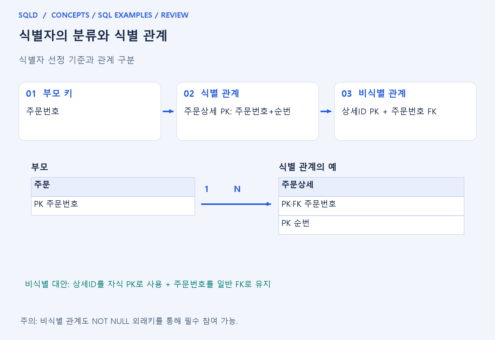
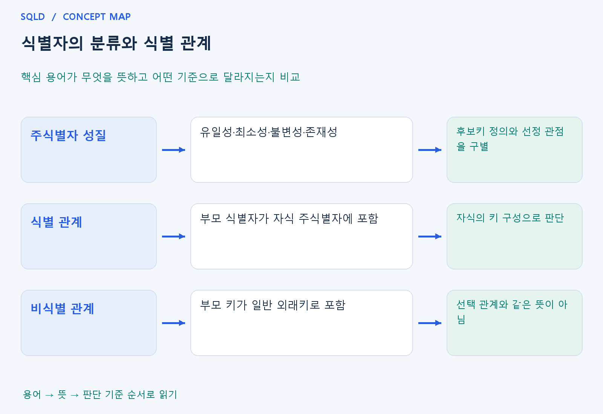

# 식별자의 분류와 식별 관계

- **학습 순서**: 개념 설명 → 그림으로 원리 확인 → 예제와 풀이 → 복습 요약.

## 이 글의 목차

- [1. 개념의 뜻과 동작 원리](#1.%20%EA%B0%9C%EB%85%90%EC%9D%98%20%EB%9C%BB%EA%B3%BC%20%EB%8F%99%EC%9E%91%20%EC%9B%90%EB%A6%AC)
  - [1-1. 주식별자를 고르는 기준](#1-1.%20%EC%A3%BC%EC%8B%9D%EB%B3%84%EC%9E%90%EB%A5%BC%20%EA%B3%A0%EB%A5%B4%EB%8A%94%20%EA%B8%B0%EC%A4%80)
  - [1-2. 식별자 분류를 읽는 기준](#1-2.%20%EC%8B%9D%EB%B3%84%EC%9E%90%20%EB%B6%84%EB%A5%98%EB%A5%BC%20%EC%9D%BD%EB%8A%94%20%EA%B8%B0%EC%A4%80)
  - [1-3. 식별 관계와 비식별 관계](#1-3.%20%EC%8B%9D%EB%B3%84%20%EA%B4%80%EA%B3%84%EC%99%80%20%EB%B9%84%EC%8B%9D%EB%B3%84%20%EA%B4%80%EA%B3%84)
- [2. 세부 정의와 관련 규칙](#2.%20%EC%84%B8%EB%B6%80%20%EC%A0%95%EC%9D%98%EC%99%80%20%EA%B4%80%EB%A0%A8%20%EA%B7%9C%EC%B9%99)
  - [2-1. 기본 용어](#2-1.%20%EA%B8%B0%EB%B3%B8%20%EC%9A%A9%EC%96%B4)
  - [2-2. 주식별자에서 확인할 성질](#2-2.%20%EC%A3%BC%EC%8B%9D%EB%B3%84%EC%9E%90%EC%97%90%EC%84%9C%20%ED%99%95%EC%9D%B8%ED%95%A0%20%EC%84%B1%EC%A7%88)
  - [2-3. 식별 관계와 비식별 관계](#2-3.%20%EC%8B%9D%EB%B3%84%20%EA%B4%80%EA%B3%84%EC%99%80%20%EB%B9%84%EC%8B%9D%EB%B3%84%20%EA%B4%80%EA%B3%84)
- [3. 핵심 차이 한눈에 보기](#3.%20%ED%95%B5%EC%8B%AC%20%EC%B0%A8%EC%9D%B4%20%ED%95%9C%EB%88%88%EC%97%90%20%EB%B3%B4%EA%B8%B0)
- [4. 예제](#4.%20%EC%98%88%EC%A0%9C)
- [5. 복습 요약](#5.%20%EB%B3%B5%EC%8A%B5%20%EC%9A%94%EC%95%BD)
- [6. 관련 글과 추가 학습](#6.%20%EA%B4%80%EB%A0%A8%20%EA%B8%80%EA%B3%BC%20%EC%B6%94%EA%B0%80%20%ED%95%99%EC%8A%B5)

## 1. 개념의 뜻과 동작 원리

### 1-1. 주식별자를 고르는 기준

- 주식별자는 엔터티의 각 인스턴스를 대표하여 구분하는 기준. 유일하게 구분되는지뿐 아니라 업무가 진행돼도 안정적으로 사용할 수 있는지도 함께 봄.
- 유일성·최소성은 구분 능력과 불필요한 속성 제거의 조건. 불변성은 값이 자주 바뀌지 않는 성질이고 존재성은 필요한 식별값이 빠지지 않는 성질.
- 이름·전화번호처럼 변하거나 겹칠 수 있는 값은 선정 시 주의. 어떤 항목이 좋은 식별자인지는 정해진 업무 규칙과 허용되는 변경을 바탕으로 판단.

### 1-2. 식별자 분류를 읽는 기준

- 주식별자·보조식별자는 대표성, 내부·외부식별자는 생성 출처, 단일·복합식별자는 속성 수를 보는 분류. 서로 다른 축이므로 동시에 여러 성격을 가질 수 있음.
- 본질·인조식별자는 업무 의미에 기반하는지, 식별 편의를 위해 추가했는지를 보는 분류. 인조식별자라고 업무 중복이 자동 방지되는 것은 아님.
- 분류 문제는 용어를 한 줄에 섞기보다 기준을 먼저 찾는 것이 중요. 속성 수를 묻는데 대표성 기준으로 답하면 같은 식별자를 보고도 틀린 판단이 됨.

### 1-3. 식별 관계와 비식별 관계

- 식별 관계는 부모의 식별자가 자식의 주식별자를 구성하는 경우. 주문상세의 키가 주문번호와 순번이면 주문번호가 식별에 참여하므로 식별 관계로 이해.
- 비식별 관계는 부모 키를 참조하지만 자식의 주식별자에 포함하지 않는 경우. 자식이 상세ID로 구분되고 주문번호가 일반 외래키이면 이 구조에 해당.
- 식별 여부와 필수 참여 여부는 별개의 질문. 일반 외래키에도 NOT NULL을 줄 수 있으므로 비식별 관계를 반드시 선택 관계라고 외우지 않음.
- 부모를 참조한다는 사실만으로 식별 관계가 되는 것은 아님. 부모의 식별자가 자식 기본키의 구성 요소인지 확인해야 하며, 필수 참여 여부와 식별 관계 여부도 별개의 기준.

## 2. 세부 정의와 관련 규칙

### 2-1. 기본 용어

- 엔터티는 관리 대상의 묶음, 인스턴스는 그 안의 한 대상임.
- **식별자**는 대상을 다른 대상과 구분할 속성 또는 속성 묶음임.
- 학교에서 이름이 같아도 학번으로 학생을 구별하는 것과 같음.

### 2-2. 주식별자에서 확인할 성질

- 유일성은 서로 다른 대상을 구분하는 성질, 최소성은 불필요한 속성을 포함하지 않는 성질, 불변성은 되도록 값이 바뀌지 않는 성질, 존재성은 식별 값이 빠지지 않는 성질임.
- 후보키의 논리적 정의인 유일성·최소성과 좋은 주식별자를 고르는 성질을 문맥에 맞게 읽음.

| 분류 기준 | 구분 | 예 |
| --- | --- | --- |
| 대표성 | 주식별자 / 보조식별자 | 대표로 쓸 학번 / 별도로 유일한 교내 이메일 |
| 생성 출처 | 내부식별자 / 외부식별자 | 자체 주문번호 / 부모에서 가져온 고객번호 |
| 속성 수 | 단일식별자 / 복합식별자 | 학번 / (주문번호, 순번) |
| 업무 의미 | 본질식별자 / 인조식별자 | 업무상 주문접수번호 / 시스템 발급 일련번호 |

- 한 식별자가 단일이며 내부이며 인조일 수 있음.
- 분류 기준이 다르므로 서로 배타적인 한 목록으로 외우지 않음.

### 2-3. 식별 관계와 비식별 관계

- 부모 주문의 키가 주문번호라고 합시다.
- 자식 주문상세의 주식별자가 `(주문번호, 순번)`이면 부모 식별자가 자식 식별자의 일부에 들어가므로 식별 관계임.
- 자식이 `상세ID`만으로 식별되고 주문번호는 일반 외래키이면 비식별 관계임.

- 비식별 관계라고 반드시 선택 참여인 것은 아님.
- 주문번호 외래키를 NOT NULL로 만들 수 있음.
- 식별 관계 여부는 **부모 키가 자식 식별자에 들어가는지**, 필수 참여는 **연결 없이 존재할 수 있는지**를 봄.

## 3. 핵심 차이 한눈에 보기

|  구분 | 핵심 뜻 | 확인할 기준 |
| --- | --- | --- |
| 주식별자 성질 | 유일성·최소성·불변성·존재성 | 후보키 정의와 선정 관점을 구별 |
| 식별 관계 | 부모 식별자가 자식 주식별자에 포함 | 자식의 키 구성으로 판단 |
| 비식별 관계 | 부모 키가 일반 외래키로 포함 | 선택 관계와 같은 뜻이 아님 |

## 4. 예제

- **상황**: 주문상세의 기본키가 (주문번호, 순번).
- **질문**: 주문상세의 기본키가 (주문번호, 순번)일 때 식별 관계인지 판단하고, 그 근거를 설명하라.
- **정답**: 주문과 주문상세는 식별 관계.
- **풀이 ①**: 주문번호가 단순한 일반 외래키인지 자식 기본키의 일부인지 확인.
- **풀이 ②**: 부모의 주문번호가 자식 기본키에 포함되기 때문.

## 5. 복습 요약

- **주식별자 성질**: 유일성·최소성·불변성·존재성. 후보키 정의와 선정 관점을 구별.
- **식별 관계**: 부모 식별자가 자식 주식별자에 포함. 자식의 키 구성으로 판단.
- **비식별 관계**: 부모 키가 일반 외래키로 포함. 선택 관계와 같은 뜻이 아님.

## 6. 관련 글과 추가 학습

- [전체 목차](../../00_%EC%A0%84%EC%B2%B4%EB%AA%A9%EC%B0%A8.md)
- [개념별 빠른 복습표](../../%EB%B3%B5%EC%8A%B5_%ED%95%B5%EC%8B%AC%EB%B9%84%EA%B5%90%ED%91%9C.md)
- [추가 SQL 소스 안내](../../%EC%B6%94%EA%B0%80_SQL_%EC%86%8C%EC%8A%A4%EC%95%88%EB%82%B4.md)
