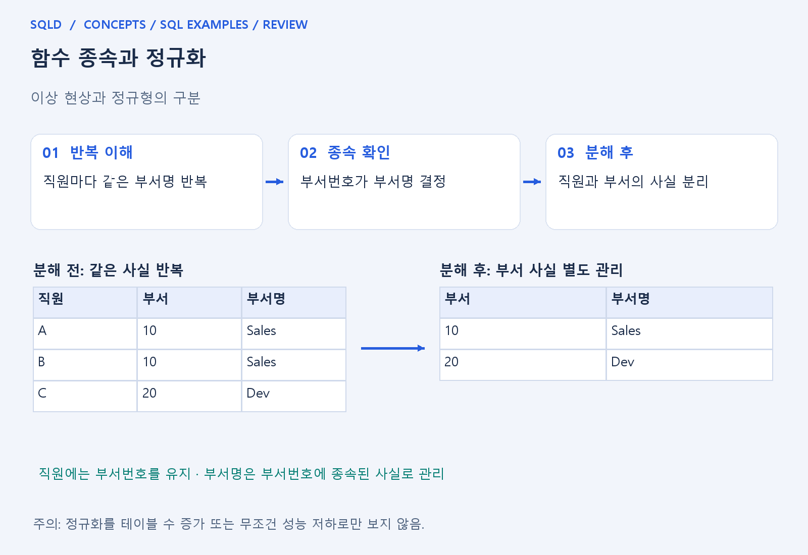
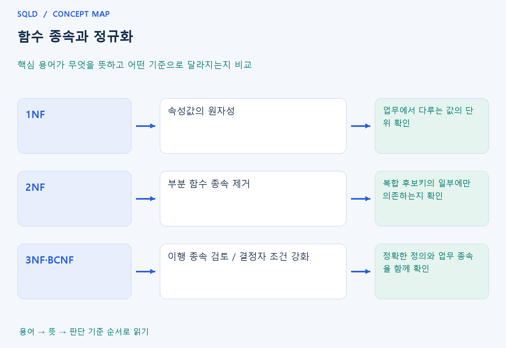

# 함수 종속과 정규화

- **학습 순서**: 개념 설명 → 그림으로 원리 확인 → 예제와 풀이 → 복습 요약.

## 이 글의 목차

- [1. 개념의 뜻과 동작 원리](#1.%20%EA%B0%9C%EB%85%90%EC%9D%98%20%EB%9C%BB%EA%B3%BC%20%EB%8F%99%EC%9E%91%20%EC%9B%90%EB%A6%AC)
  - [1-1. 함수 종속과 이상 현상](#1-1.%20%ED%95%A8%EC%88%98%20%EC%A2%85%EC%86%8D%EA%B3%BC%20%EC%9D%B4%EC%83%81%20%ED%98%84%EC%83%81)
  - [1-2. 정규화의 단계와 목적](#1-2.%20%EC%A0%95%EA%B7%9C%ED%99%94%EC%9D%98%20%EB%8B%A8%EA%B3%84%EC%99%80%20%EB%AA%A9%EC%A0%81)
  - [1-3. 분해 후에 확인할 조건](#1-3.%20%EB%B6%84%ED%95%B4%20%ED%9B%84%EC%97%90%20%ED%99%95%EC%9D%B8%ED%95%A0%20%EC%A1%B0%EA%B1%B4)
- [2. 세부 정의와 관련 규칙](#2.%20%EC%84%B8%EB%B6%80%20%EC%A0%95%EC%9D%98%EC%99%80%20%EA%B4%80%EB%A0%A8%20%EA%B7%9C%EC%B9%99)
  - [2-1. 정의와 기본 규칙](#2-1.%20%EC%A0%95%EC%9D%98%EC%99%80%20%EA%B8%B0%EB%B3%B8%20%EA%B7%9C%EC%B9%99)
- [3. 핵심 차이 한눈에 보기](#3.%20%ED%95%B5%EC%8B%AC%20%EC%B0%A8%EC%9D%B4%20%ED%95%9C%EB%88%88%EC%97%90%20%EB%B3%B4%EA%B8%B0)
- [4. 예제](#4.%20%EC%98%88%EC%A0%9C)
- [5. 복습 요약](#5.%20%EB%B3%B5%EC%8A%B5%20%EC%9A%94%EC%95%BD)
- [6. 관련 글과 추가 학습](#6.%20%EA%B4%80%EB%A0%A8%20%EA%B8%80%EA%B3%BC%20%EC%B6%94%EA%B0%80%20%ED%95%99%EC%8A%B5)

## 1. 개념의 뜻과 동작 원리

### 1-1. 함수 종속과 이상 현상

- 함수 종속 X→Y는 X값이 정해지면 Y값도 하나로 정해진다는 업무 규칙. 학번이 같으면 이름이 같아야 한다는 뜻이며 이름이 같으면 학번도 같다는 역방향은 자동 성립하지 않음.
- 서로 다른 사실을 한 표에 반복 저장하면 한 사실을 바꾸기 위해 여러 행을 수정해야 함. 일부만 바뀌면 같은 부서번호에 서로 다른 부서명이 남는 모순이 생길 수 있음.
- 삽입 이상은 다른 사실이 없어서 필요한 정보를 넣기 어려움, 갱신 이상은 중복된 내용을 함께 고쳐야 함, 삭제 이상은 한 사실을 지우며 다른 사실도 잃는 현상으로 이해.

### 1-2. 정규화의 단계와 목적

- 정규화는 함수 종속 등 데이터의 구조적 규칙에 따라 관계를 나누어 중복과 이상 현상을 줄이는 과정. 표를 많이 만드는 것 자체가 목적은 아님.
- 1NF는 한 값의 원자성을 점검하고, 2NF는 후보키 일부에만 비주요 속성이 의존하는 부분 종속을 제거. 복합키 전체가 무엇을 결정하는지부터 확인해야 함.
- 3NF는 대표적으로 비키 속성 사이의 이행 종속 문제를 줄이는 단계이며 정확한 정의에서는 주요 속성 예외를 포함. BCNF는 결정자 조건을 더 엄격하게 적용.

### 1-3. 분해 후에 확인할 조건

- 무손실 분해는 나눈 표를 다시 조인했을 때 원래 사실을 정확히 복원할 수 있다는 성질. 나누는 과정에서 가짜 행을 만들거나 원래 정보를 잃으면 안 됨.
- 종속성 보존은 원래의 제약을 분해된 표들에서 확인할 수 있는지 보는 성질. BCNF로 나눴다는 사실만으로 모든 종속이 보존된다고 단정하지 않음.
- 정규화와 성능은 함께 검토할 주제이지만, 조인이 늘었다는 이유만으로 무조건 나쁜 설계라고 보지 않음. 먼저 사실의 일관성을 정리하고 실제 읽기·변경 비용을 판단.
- 정규화는 업무에서 어떤 값이 다른 값을 결정하는지 파악해 같은 사실을 알맞은 표에 배치하는 과정. 표를 나눈 뒤에는 키로 다시 연결할 수 있어야 하며, 표의 개수보다 중복과 이상 현상의 원인을 줄이는 것이 목적.

## 2. 세부 정의와 관련 규칙

### 2-1. 정의와 기본 규칙

- X→Y는 X값이 같으면 Y값도 같아야 한다는 업무 규칙임.
- 역방향은 자동 성립하지 않음.
- 삽입·갱신·삭제 이상은 서로 다른 사실을 중복 저장할 때 생길 수 있음.

- 1NF는 원자값, 2NF는 비주요 속성의 후보키에 대한 부분 종속 제거를 점검함.
- 입문 3NF 예는 비키 결정자를 통한 이행 종속 제거임.

- 정확한 3NF는 비자명 X→A마다 X가 슈퍼키이거나 A가 주요 속성인 조건이며 BCNF는 비자명 종속의 결정자가 모두 슈퍼키인 조건임.
- 무손실 분해와 종속성 보존도 함께 고려함.

- 정보처리기사 심화 복습: 4NF는 모든 비자명 다치 종속의 결정자가 슈퍼키여야 함.
- 한 학생의 취미 목록과 사용 언어 목록이 서로 독립인데 한 표에 모든 조합을 저장하면 학생-취미와 학생-언어로 분리하는 예를 생각함.
- 5NF는 모든 비자명 조인 종속이 후보키로부터 함의되는 조건임.
- 분해 뒤 조인에서 가짜 행이 생기지 않는 무손실성도 함께 확인함.

## 3. 핵심 차이 한눈에 보기

|  구분 | 핵심 뜻 | 확인할 기준 |
| --- | --- | --- |
| 1NF | 속성값의 원자성 | 업무에서 다루는 값의 단위 확인 |
| 2NF | 부분 함수 종속 제거 | 복합 후보키의 일부에만 의존하는지 확인 |
| 3NF·BCNF | 이행 종속 검토 / 결정자 조건 강화 | 정확한 정의와 업무 종속을 함께 확인 |

## 4. 예제

- **상황**: 직원 표에 부서번호와 부서명을 반복 저장.
- **질문**: 직원마다 부서명을 반복 저장하면 어떤 수정 문제가 생기며, 표를 어떻게 나누면 좋은가?
- **정답**: 직원은 부서번호를 참조하고 부서명은 부서 표에서 관리.
- **풀이 ①**: 부서번호 하나가 부서명 하나를 결정한다는 종속 관계를 찾음.
- **풀이 ②**: 부서번호가 결정하는 사실을 한 곳에 두어 이름 변경의 중복 수정을 줄임.

## 5. 복습 요약

- **1NF**: 속성값의 원자성. 업무에서 다루는 값의 단위 확인.
- **2NF**: 부분 함수 종속 제거. 복합 후보키의 일부에만 의존하는지 확인.
- **3NF·BCNF**: 이행 종속 검토 / 결정자 조건 강화. 정확한 정의와 업무 종속을 함께 확인.

## 6. 관련 글과 추가 학습

- [전체 목차](../../00_%EC%A0%84%EC%B2%B4%EB%AA%A9%EC%B0%A8.md)
- [개념별 빠른 복습표](../../%EB%B3%B5%EC%8A%B5_%ED%95%B5%EC%8B%AC%EB%B9%84%EA%B5%90%ED%91%9C.md)
- [추가 SQL 소스 안내](../../%EC%B6%94%EA%B0%80_SQL_%EC%86%8C%EC%8A%A4%EC%95%88%EB%82%B4.md)
