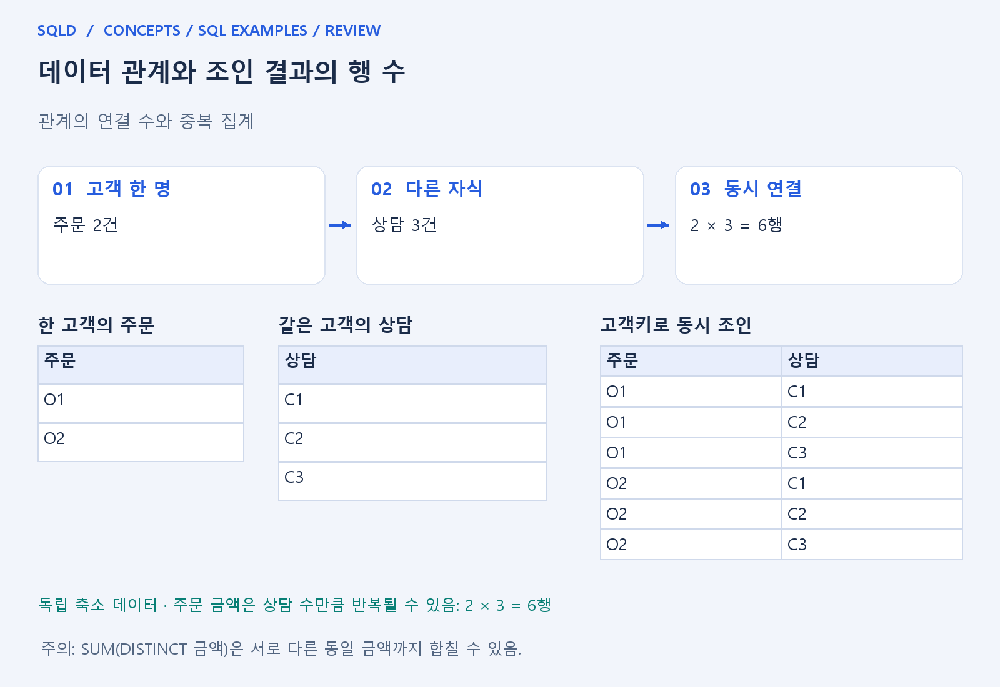
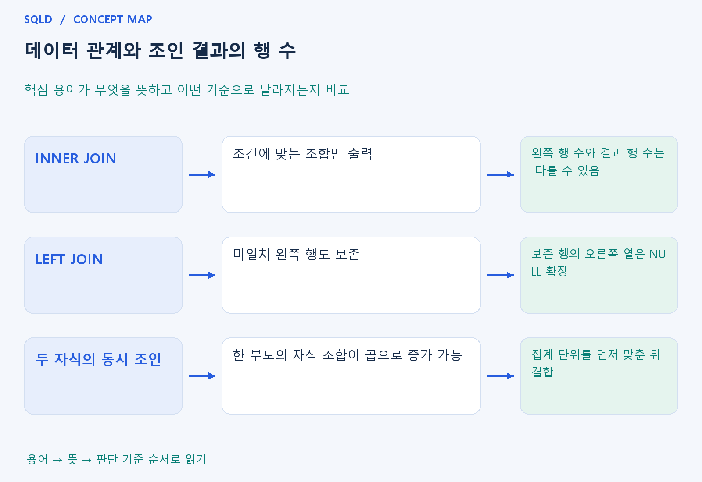

# 데이터 관계와 조인 결과의 행 수

- **학습 순서**: 개념 설명 → 그림으로 원리 확인 → 예제와 풀이 → 복습 요약.

## 이 글의 목차

- [1. 개념의 뜻과 동작 원리](#1.%20%EA%B0%9C%EB%85%90%EC%9D%98%20%EB%9C%BB%EA%B3%BC%20%EB%8F%99%EC%9E%91%20%EC%9B%90%EB%A6%AC)
  - [1-1. 조인 결과는 행의 조합](#1-1.%20%EC%A1%B0%EC%9D%B8%20%EA%B2%B0%EA%B3%BC%EB%8A%94%20%ED%96%89%EC%9D%98%20%EC%A1%B0%ED%95%A9)
  - [1-2. 관계 수가 합계에 미치는 영향](#1-2.%20%EA%B4%80%EA%B3%84%20%EC%88%98%EA%B0%80%20%ED%95%A9%EA%B3%84%EC%97%90%20%EB%AF%B8%EC%B9%98%EB%8A%94%20%EC%98%81%ED%96%A5)
  - [1-3. 중복을 피하는 설계 기준](#1-3.%20%EC%A4%91%EB%B3%B5%EC%9D%84%20%ED%94%BC%ED%95%98%EB%8A%94%20%EC%84%A4%EA%B3%84%20%EA%B8%B0%EC%A4%80)
- [2. 세부 정의와 관련 규칙](#2.%20%EC%84%B8%EB%B6%80%20%EC%A0%95%EC%9D%98%EC%99%80%20%EA%B4%80%EB%A0%A8%20%EA%B7%9C%EC%B9%99)
  - [2-1. 작은 데이터](#2-1.%20%EC%9E%91%EC%9D%80%20%EB%8D%B0%EC%9D%B4%ED%84%B0)
  - [2-2. 조인 결과를 세는 순서](#2-2.%20%EC%A1%B0%EC%9D%B8%20%EA%B2%B0%EA%B3%BC%EB%A5%BC%20%EC%84%B8%EB%8A%94%20%EC%88%9C%EC%84%9C)
  - [2-3. 서로 다른 두 개의 1:N을 한 번에 붙일 때](#2-3.%20%EC%84%9C%EB%A1%9C%20%EB%8B%A4%EB%A5%B8%20%EB%91%90%20%EA%B0%9C%EC%9D%98%201%3AN%EC%9D%84%20%ED%95%9C%20%EB%B2%88%EC%97%90%20%EB%B6%99%EC%9D%BC%20%EB%95%8C)
- [3. 핵심 차이 한눈에 보기](#3.%20%ED%95%B5%EC%8B%AC%20%EC%B0%A8%EC%9D%B4%20%ED%95%9C%EB%88%88%EC%97%90%20%EB%B3%B4%EA%B8%B0)
- [4. 예제](#4.%20%EC%98%88%EC%A0%9C)
- [5. 복습 요약](#5.%20%EB%B3%B5%EC%8A%B5%20%EC%9A%94%EC%95%BD)
- [6. 관련 글과 추가 학습](#6.%20%EA%B4%80%EB%A0%A8%20%EA%B8%80%EA%B3%BC%20%EC%B6%94%EA%B0%80%20%ED%95%99%EC%8A%B5)

## 1. 개념의 뜻과 동작 원리

### 1-1. 조인 결과는 행의 조합

- 조인은 두 표를 단순히 같은 줄끼리 붙이는 작업이 아니라 조건에 맞는 행 조합을 만드는 작업. 왼쪽 한 행에 오른쪽 두 행이 맞으면 결과도 두 행이 생김.
- 따라서 조인 결과 행 수는 어느 한 표의 행 수와 항상 같지 않음. 일치하지 않아 줄어들 수도 있고 중복 키 때문에 늘어날 수도 있음.
- 행 수를 계산할 때는 각 부모 행에 맞는 자식이 몇 개인지 세어 더함. 모든 값이 키로 유일하고 반드시 연결된다는 제약이 있는지도 함께 확인.

### 1-2. 관계 수가 합계에 미치는 영향

- 한 고객에게 주문 두 건이 있으면 고객 정보를 주문과 붙인 뒤 고객 값이 두 번 보일 수 있음. 고객당 한 번 저장된 금액을 그대로 합치면 원래 단위와 달라질 수 있음.
- 같은 고객에게 주문 두 건과 상담 세 건을 동시에 붙이면 서로 짝을 이루어 여섯 조합이 생길 수 있음. 주문 금액은 상담 수만큼 반복되어 합계가 커질 수 있음.
- 이는 SUM 함수 자체가 틀린 것이 아니라 함수에 들어간 행이 의도한 단위가 아닌 문제. 계산 전에 결과 한 행이 고객·주문·상담 중 무엇을 뜻하는지 확인해야 함.

### 1-3. 중복을 피하는 설계 기준

- 각 자식 표를 고객별로 먼저 집계한 뒤 연결하면 집계 단위를 맞출 수 있음. 필요한 결과가 고객당 한 행이라면 중간 결과도 그 단위로 만드는 방법을 검토.
- 관련 행이 있는지만 필요하면 EXISTS를 사용해 존재 여부만 검사할 수 있음. 자식 행의 상세값을 출력해야 하는 조인과 질문의 목적이 다름.
- SUM(DISTINCT 금액)은 일반적인 중복 해결책이 아님. 서로 다른 주문이 우연히 같은 금액일 때 정상 금액까지 하나로 합칠 수 있으므로 사실을 구분하는 키를 기준으로 판단.
- 관계의 차수는 조인할 때 만들 수 있는 행의 수와 연결됨. 일대다인 표 두 개를 같은 부모에 붙이면 자식끼리 조합되므로, 부모 기준 합계를 원할 때는 각 자식을 먼저 집계하는 방법을 검토.

## 2. 세부 정의와 관련 규칙

### 2-1. 작은 데이터

- 고객은 `(1, 민수), (2, 지수), (3, 하늘)`이고 주문은 `(101, 1, 1000), (102, 1, 2000), (103, 2, 3000)`임.
- 주문의 열은 주문번호, 고객번호, 금액임.
- 고객 1은 주문 2개, 고객 2는 1개, 고객 3은 0개임.

### 2-2. 조인 결과를 세는 순서

- INNER JOIN으로 고객번호를 연결하면 2+1+0=3행임.
- 고객을 왼쪽에 둔 LEFT JOIN이면 주문이 없는 고객 3도 한 행을 차지하여 2+1+1=4행임.
- 이때 주문번호와 주문금액은 NULL임.
- 고객 수 3과 조인 결과 행 수는 다를 수 있음.

- 주문에 고객번호가 있어도 외래키와 NOT NULL이 보장되지 않으면 존재하지 않는 고객번호나 NULL이 들어올 수 있음.
- '자식 수와 INNER JOIN 결과 수가 같다'고 판단하려면 유효한 부모 한 행과 반드시 연결되는지 확인해야 함.

### 2-3. 서로 다른 두 개의 1:N을 한 번에 붙일 때

- 고객 1에 주문 2개와 상담 3개를 조건 없이 함께 붙이면 고객 1 부분이 2×3=6행이 될 수 있음.
- 이 상태에서 주문 금액을 합하면 같은 주문이 상담 수만큼 반복됨.
- 먼저 각 자식 테이블을 고객별로 집계하거나 EXISTS로 존재 여부만 확인하는 방법을 검토함.
- 무조건 DISTINCT를 붙이면 서로 다른 주문의 같은 금액까지 없어질 수 있음.

## 3. 핵심 차이 한눈에 보기

|  구분 | 핵심 뜻 | 확인할 기준 |
| --- | --- | --- |
| INNER JOIN | 조건에 맞는 조합만 출력 | 왼쪽 행 수와 결과 행 수는 다를 수 있음 |
| LEFT JOIN | 미일치 왼쪽 행도 보존 | 보존 행의 오른쪽 열은 NULL 확장 |
| 두 자식의 동시 조인 | 한 부모의 자식 조합이 곱으로 증가 가능 | 집계 단위를 먼저 맞춘 뒤 결합 |

## 4. 예제

- **상황**: 한 고객의 주문 2건과 상담 3건을 고객번호로 동시 연결.
- **질문**: 고객 한 명의 주문 2건과 상담 3건을 동시에 연결하면 몇 행이며, 주문 금액 합산 시 무엇을 주의해야 하는가?
- **정답**: 결과는 해당 고객에 대해 6행.
- **풀이 ①**: 각 주문이 상담 세 건과 각각 연결되는 조합을 셈.
- **풀이 ②**: 주문마다 상담 세 건이 각각 짝을 이루므로 2×3. 주문 한 건이 세 번 반복되므로 조인 결과에서 주문 금액을 바로 합치면 중복 합산될 수 있음.

## 5. 복습 요약

- **INNER JOIN**: 조건에 맞는 조합만 출력. 왼쪽 행 수와 결과 행 수는 다를 수 있음.
- **LEFT JOIN**: 미일치 왼쪽 행도 보존. 보존 행의 오른쪽 열은 NULL 확장.
- **두 자식의 동시 조인**: 한 부모의 자식 조합이 곱으로 증가 가능. 집계 단위를 먼저 맞춘 뒤 결합.

## 6. 관련 글과 추가 학습

- [전체 목차](../../00_%EC%A0%84%EC%B2%B4%EB%AA%A9%EC%B0%A8.md)
- [개념별 빠른 복습표](../../%EB%B3%B5%EC%8A%B5_%ED%95%B5%EC%8B%AC%EB%B9%84%EA%B5%90%ED%91%9C.md)
- [추가 SQL 소스 안내](../../%EC%B6%94%EA%B0%80_SQL_%EC%86%8C%EC%8A%A4%EC%95%88%EB%82%B4.md)
