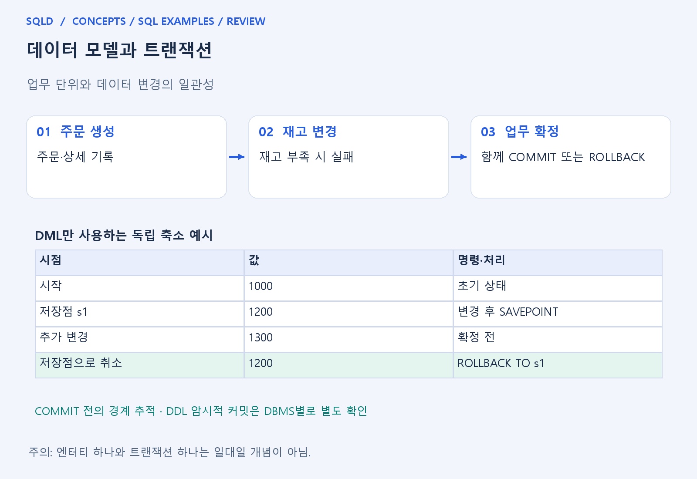
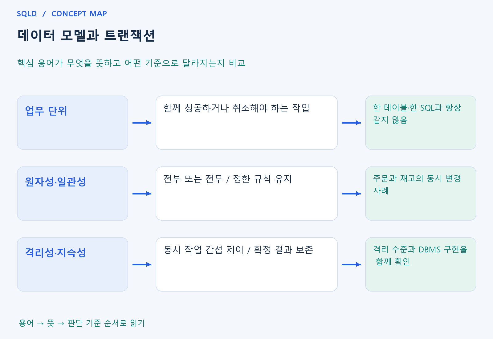

# 데이터 모델과 트랜잭션

- **학습 순서**: 개념 설명 → 그림으로 원리 확인 → 예제와 풀이 → 복습 요약.

## 이 글의 목차

- [1. 개념의 뜻과 동작 원리](#1.%20%EA%B0%9C%EB%85%90%EC%9D%98%20%EB%9C%BB%EA%B3%BC%20%EB%8F%99%EC%9E%91%20%EC%9B%90%EB%A6%AC)
  - [1-1. 트랜잭션은 업무의 완결 단위](#1-1.%20%ED%8A%B8%EB%9E%9C%EC%9E%AD%EC%85%98%EC%9D%80%20%EC%97%85%EB%AC%B4%EC%9D%98%20%EC%99%84%EA%B2%B0%20%EB%8B%A8%EC%9C%84)
  - [1-2. ACID 성질의 연결](#1-2.%20ACID%20%EC%84%B1%EC%A7%88%EC%9D%98%20%EC%97%B0%EA%B2%B0)
  - [1-3. 모델과 TCL을 구분하기](#1-3.%20%EB%AA%A8%EB%8D%B8%EA%B3%BC%20TCL%EC%9D%84%20%EA%B5%AC%EB%B6%84%ED%95%98%EA%B8%B0)
- [2. 세부 정의와 관련 규칙](#2.%20%EC%84%B8%EB%B6%80%20%EC%A0%95%EC%9D%98%EC%99%80%20%EA%B4%80%EB%A0%A8%20%EA%B7%9C%EC%B9%99)
  - [2-1. 모델과 SQL 문장의 연결](#2-1.%20%EB%AA%A8%EB%8D%B8%EA%B3%BC%20SQL%20%EB%AC%B8%EC%9E%A5%EC%9D%98%20%EC%97%B0%EA%B2%B0)
  - [2-2. 업무 모델과 TCL의 구분](#2-2.%20%EC%97%85%EB%AC%B4%20%EB%AA%A8%EB%8D%B8%EA%B3%BC%20TCL%EC%9D%98%20%EA%B5%AC%EB%B6%84)
- [3. 핵심 차이 한눈에 보기](#3.%20%ED%95%B5%EC%8B%AC%20%EC%B0%A8%EC%9D%B4%20%ED%95%9C%EB%88%88%EC%97%90%20%EB%B3%B4%EA%B8%B0)
- [4. 예제](#4.%20%EC%98%88%EC%A0%9C)
- [5. 복습 요약](#5.%20%EB%B3%B5%EC%8A%B5%20%EC%9A%94%EC%95%BD)
- [6. 관련 글과 추가 학습](#6.%20%EA%B4%80%EB%A0%A8%20%EA%B8%80%EA%B3%BC%20%EC%B6%94%EA%B0%80%20%ED%95%99%EC%8A%B5)

## 1. 개념의 뜻과 동작 원리

### 1-1. 트랜잭션은 업무의 완결 단위

- 트랜잭션은 함께 성공하거나 함께 취소되어야 하는 작업 묶음. 계좌 이체라면 출금만 남고 입금이 빠지지 않도록 두 변경을 하나의 업무 단위로 다루는 개념.
- 업무 단위는 테이블 수나 SQL 문장 수와 같지 않음. 주문 확정은 주문·상세·재고 등 여러 테이블을 바꾸면서도 한 번에 완결되어야 할 수 있음.
- 반대로 같은 테이블을 수정해도 각기 다른 업무라면 별도 트랜잭션이 될 수 있음. 경계는 무엇이 함께 확정돼야 일관된 업무 결과가 되는지를 기준으로 정함.

### 1-2. ACID 성질의 연결

- 원자성은 전체 작업을 모두 반영하거나 모두 취소하는 성질. 일관성은 실행 전후에 정한 규칙이 유지되는 성질로, 금지한 음수 재고가 남지 않는 상황을 생각하면 쉬움.
- 격리성은 동시에 실행하는 작업의 간섭을 제어하는 성질. 실제로 어떤 현상이 허용되는지는 격리 수준과 DBMS 구현에 따라 달라지므로 완전한 차단만 뜻하는 것은 아님.
- 지속성은 확정된 결과가 이후 장애에도 보존되도록 하는 성질. 로그·복구 장치 등과 연결되며 변경을 잠시 메모리에만 계산하는 것과 구별.

- 일관성은 작업을 트랜잭션으로 묶기만 하면 모든 업무 규칙이 자동 보장된다는 뜻은 아님. 키·CHECK·응용 로직 등으로 정한 불변 조건이 정상 실행 전후에 유지되도록 함께 설계해야 함.

### 1-3. 모델과 TCL을 구분하기

- 모델을 읽을 때는 주문 발생으로 어떤 엔터티의 어떤 사실이 함께 바뀌는지 확인. TCL을 읽을 때는 그 변경이 언제 확정되고 어디까지 취소되는지 확인.
- 이미 따로 COMMIT한 작업은 뒤의 ROLLBACK으로 일반적으로 함께 취소할 수 없음. 함께 취소해야 하는 변경이라면 확정 위치도 업무 경계에 맞춰야 함.
- 한 트랜잭션을 너무 크게 묶으면 잠금·대기·실패 복구 부담이 커질 수 있음. 무조건 크게 묶는 것이 아니라 완결성과 동시 처리 요구를 함께 고려.
- 트랜잭션의 범위는 표 하나가 아니라 업무가 완결되는 경계로 결정. 여러 표를 변경하더라도 모두 성공해야 한 건의 업무가 성립한다면 함께 확정하거나 함께 취소하도록 묶어야 함.

## 2. 세부 정의와 관련 규칙

### 2-1. 모델과 SQL 문장의 연결

- 주문 모델에 주문, 주문상세, 재고가 있다고 합시다.
- 주문 확정이라는 업무는 주문 생성, 주문상세 생성, 재고 차감을 함께 요구할 수 있음.
- 엔터티 하나가 트랜잭션 하나라고 정해지는 것은 아님.
- 한 트랜잭션이 여러 테이블을 바꾸기도 하고, 한 테이블을 다루는 여러 트랜잭션이 있기도 함.

### 2-2. 업무 모델과 TCL의 구분

- 모델 문제는 어떤 사건이 어느 엔터티와 관계를 함께 바꾸는지 읽음.
- 관리 구문 문제는 COMMIT·ROLLBACK·SAVEPOINT 이후 남는 데이터를 추적함.
- DDL의 암시적 커밋은 DBMS에 따라 다르므로 Oracle 기준인지 확인함.

## 3. 핵심 차이 한눈에 보기

|  구분 | 핵심 뜻 | 확인할 기준 |
| --- | --- | --- |
| 업무 단위 | 함께 성공하거나 취소해야 하는 작업 | 한 테이블·한 SQL과 항상 같지 않음 |
| 원자성·일관성 | 전부 또는 전무 / 정한 규칙 유지 | 주문과 재고의 동시 변경 사례 |
| 격리성·지속성 | 동시 작업 간섭 제어 / 확정 결과 보존 | 격리 수준과 DBMS 구현을 함께 확인 |

## 4. 예제

- **상황**: 이체에서 출금 후 입금이 실패.
- **질문**: 출금은 성공하고 입금이 실패한 이체에서 어떤 상태를 막아야 하며, 두 작업을 어떻게 묶어야 하는가?
- **정답**: 함께 취소할 수 있게 출금·입금을 하나의 트랜잭션으로 구성.
- **풀이 ①**: 출금만 남으면 송금액이 사라진 것처럼 보인다는 업무 오류를 먼저 확인.
- **풀이 ②**: 한쪽만 남으면 업무가 완결되지 않기 때문.

## 5. 복습 요약

- **업무 단위**: 함께 성공하거나 취소해야 하는 작업. 한 테이블·한 SQL과 항상 같지 않음.
- **원자성·일관성**: 전부 또는 전무 / 정한 규칙 유지. 주문과 재고의 동시 변경 사례.
- **격리성·지속성**: 동시 작업 간섭 제어 / 확정 결과 보존. 격리 수준과 DBMS 구현을 함께 확인.

## 6. 관련 글과 추가 학습

- [전체 목차](../../00_%EC%A0%84%EC%B2%B4%EB%AA%A9%EC%B0%A8.md)
- [개념별 빠른 복습표](../../%EB%B3%B5%EC%8A%B5_%ED%95%B5%EC%8B%AC%EB%B9%84%EA%B5%90%ED%91%9C.md)
- [추가 SQL 소스 안내](../../%EC%B6%94%EA%B0%80_SQL_%EC%86%8C%EC%8A%A4%EC%95%88%EB%82%B4.md)
