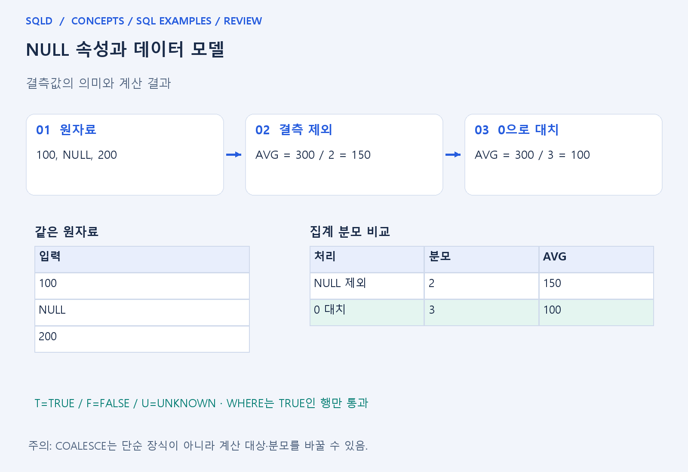
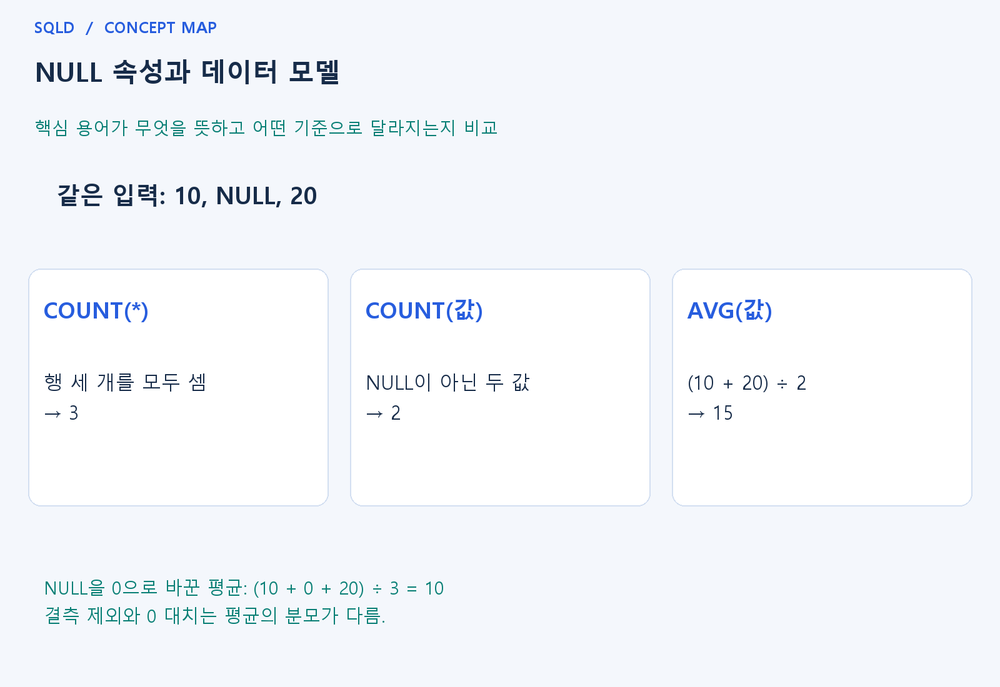

# NULL 속성과 데이터 모델

- **학습 순서**: 개념 설명 → 그림으로 원리 확인 → 예제와 풀이 → 복습 요약.

## 이 글의 목차

- [1. 개념의 뜻과 동작 원리](#1.%20%EA%B0%9C%EB%85%90%EC%9D%98%20%EB%9C%BB%EA%B3%BC%20%EB%8F%99%EC%9E%91%20%EC%9B%90%EB%A6%AC)
  - [1-1. NULL을 설계에서 구분하는 이유](#1-1.%20NULL%EC%9D%84%20%EC%84%A4%EA%B3%84%EC%97%90%EC%84%9C%20%EA%B5%AC%EB%B6%84%ED%95%98%EB%8A%94%20%EC%9D%B4%EC%9C%A0)
  - [1-2. 계산과 비교에서의 변화](#1-2.%20%EA%B3%84%EC%82%B0%EA%B3%BC%20%EB%B9%84%EA%B5%90%EC%97%90%EC%84%9C%EC%9D%98%20%EB%B3%80%ED%99%94)
  - [1-3. 관계와 기본값에 미치는 영향](#1-3.%20%EA%B4%80%EA%B3%84%EC%99%80%20%EA%B8%B0%EB%B3%B8%EA%B0%92%EC%97%90%20%EB%AF%B8%EC%B9%98%EB%8A%94%20%EC%98%81%ED%96%A5)
- [2. 세부 정의와 관련 규칙](#2.%20%EC%84%B8%EB%B6%80%20%EC%A0%95%EC%9D%98%EC%99%80%20%EA%B4%80%EB%A0%A8%20%EA%B7%9C%EC%B9%99)
  - [2-1. NULL 허용 여부의 설계 기준](#2-1.%20NULL%20%ED%97%88%EC%9A%A9%20%EC%97%AC%EB%B6%80%EC%9D%98%20%EC%84%A4%EA%B3%84%20%EA%B8%B0%EC%A4%80)
  - [2-2. NULL과 조인 결과의 관계](#2-2.%20NULL%EA%B3%BC%20%EC%A1%B0%EC%9D%B8%20%EA%B2%B0%EA%B3%BC%EC%9D%98%20%EA%B4%80%EA%B3%84)
  - [2-3. DBMS 차이](#2-3.%20DBMS%20%EC%B0%A8%EC%9D%B4)
- [3. 핵심 차이 한눈에 보기](#3.%20%ED%95%B5%EC%8B%AC%20%EC%B0%A8%EC%9D%B4%20%ED%95%9C%EB%88%88%EC%97%90%20%EB%B3%B4%EA%B8%B0)
- [4. 예제](#4.%20%EC%98%88%EC%A0%9C)
- [5. 복습 요약](#5.%20%EB%B3%B5%EC%8A%B5%20%EC%9A%94%EC%95%BD)
- [6. 관련 글과 추가 학습](#6.%20%EA%B4%80%EB%A0%A8%20%EA%B8%80%EA%B3%BC%20%EC%B6%94%EA%B0%80%20%ED%95%99%EC%8A%B5)

## 1. 개념의 뜻과 동작 원리

### 1-1. NULL을 설계에서 구분하는 이유

- NULL은 값이 아직 알려지지 않았거나 해당 값이 없는 상태 등을 표현하는 표시. 실제 의미는 각 속성의 업무 정의를 봐야 하며 숫자 0이나 빈 글자와 자동으로 같은 것은 아님.
- 아직 결정하지 않은 급여를 0으로 넣으면 실제 0원 급여와 구분할 수 없음. 이후 평균과 최솟값, 급여가 있는 직원 수를 계산할 때 결과 의미가 달라질 수 있음.
- 따라서 값이 반드시 필요한 속성은 NOT NULL 여부를 검토하고, 선택 속성은 NULL이 어떤 상태를 뜻하는지 자료 정의에 남겨야 다른 사람도 같은 뜻으로 계산할 수 있음.

### 1-2. 계산과 비교에서의 변화

- 일반적인 NULL 산술은 결측을 전파하므로 NULL에 100을 더해도 100이 되는 것이 아님. 값을 모르는 상태에 숫자를 더해도 계산 결과를 알 수 없다는 관점으로 이해.
- 일반 비교에서는 NULL이 포함되면 UNKNOWN이 될 수 있고 WHERE는 TRUE인 행만 남김. 결측인지 묻는 IS NULL과 어떤 값과 같은지 묻는 등호는 질문 자체가 다름.
- SUM·AVG·COUNT(열)은 NULL 값을 제외하는 반면 COUNT(*)는 행을 셈. NULL을 먼저 0으로 대치하면 합계가 같아도 평균의 분모가 달라질 수 있음.

### 1-3. 관계와 기본값에 미치는 영향

- 부서번호가 NULL인 직원은 일반 등호로 부서와 연결되지 않음. 직원 자체를 결과에 남겨야 한다면 LEFT JOIN처럼 미일치 행을 보존하는 방법을 검토.
- DEFAULT와 NULL은 별개 개념. 열을 생략할 때의 기본값이 있다고 명시적으로 넣은 NULL까지 항상 같은 값으로 바뀌는 것은 아님.
- Oracle의 길이 0 문자열 처리처럼 제품별 세부 차이도 존재. NULL의 공통 원리와 특정 DBMS의 문자열·정렬 동작을 구분하여 읽어야 함.
- NULL을 허용하는 설계는 값이 없는 상태의 의미를 정하는 일과 연결. 조회에서는 비교 결과와 집계 대상이 달라지므로, 결측을 0으로 바꾸는 처리가 업무 의미까지 바꾸는지 확인.

## 2. 세부 정의와 관련 규칙

### 2-1. NULL 허용 여부의 설계 기준

- 전화번호가 선택 입력인지, 급여가 아직 미정일 수 있는지, 소속 부서가 없는 직원을 허용하는지 정함.
- 반드시 필요한 값이면 NOT NULL을 고려함.
- '급여 미정'을 0으로 넣으면 실제 0원과 구별할 수 없으며 평균도 달라짐.

### 2-2. NULL과 조인 결과의 관계

- 직원의 부서번호가 NULL이면 `직원.부서번호 = 부서.부서번호` 조건의 INNER JOIN에서 일치하지 않음.
- 직원 보존이 필요하면 LEFT JOIN을 검토함.
- 반대로 LEFT JOIN 후 WHERE에 부서 쪽 조건을 두면 보존 행이 다시 제거될 수 있음.

### 2-3. DBMS 차이

- Oracle 19c의 문자열 문맥에서는 길이 0인 문자열을 NULL처럼 취급함.
- SQLite의 빈 문자열은 NULL과 다름.
- NULL의 기본 원리와 제품별 빈 문자열·연결 연산·정렬 기본값을 나누어 학습할 것.
- 실제 문제의 DBMS와 SQL을 우선함.

## 3. 핵심 차이 한눈에 보기

|  구분 | 핵심 뜻 | 확인할 기준 |
| --- | --- | --- |
| NULL | 미정·부재 등 업무상 결측 표시 | 실제 값 0과 구별 |
| 집계의 분모 | AVG·COUNT(열)은 NULL 제외 | NULL을 0으로 바꾸면 의미 변경 가능 |
| 관계의 연결 | 일반 등호에서 NULL은 일치하지 않음 | 외부 조인과 필수 속성 조건 확인 |

## 4. 예제

- **상황**: 급여가 100, NULL, 200인 세 행.
- **질문**: 급여 100, NULL, 200의 평균과 NULL을 0으로 바꾼 평균은 각각 얼마이며, 차이의 원인은 무엇인가?
- **정답**: AVG(급여)=150, NULL을 0으로 바꾸면 평균=100.
- **풀이 ①**: AVG는 NULL을 제외하므로 원래 평균의 분모는 전체 세 행이 아닌 두 값.
- **풀이 ②**: 결측 제외는 두 값, 0 대치는 세 값으로 분모가 달라짐.

## 5. 복습 요약

- **NULL**: 미정·부재 등 업무상 결측 표시. 실제 값 0과 구별.
- **집계의 분모**: AVG·COUNT(열)은 NULL 제외. NULL을 0으로 바꾸면 의미 변경 가능.
- **관계의 연결**: 일반 등호에서 NULL은 일치하지 않음. 외부 조인과 필수 속성 조건 확인.

## 6. 관련 글과 추가 학습

- [전체 목차](../../00_%EC%A0%84%EC%B2%B4%EB%AA%A9%EC%B0%A8.md)
- [개념별 빠른 복습표](../../%EB%B3%B5%EC%8A%B5_%ED%95%B5%EC%8B%AC%EB%B9%84%EA%B5%90%ED%91%9C.md)
- [추가 SQL 소스 안내](../../%EC%B6%94%EA%B0%80_SQL_%EC%86%8C%EC%8A%A4%EC%95%88%EB%82%B4.md)
