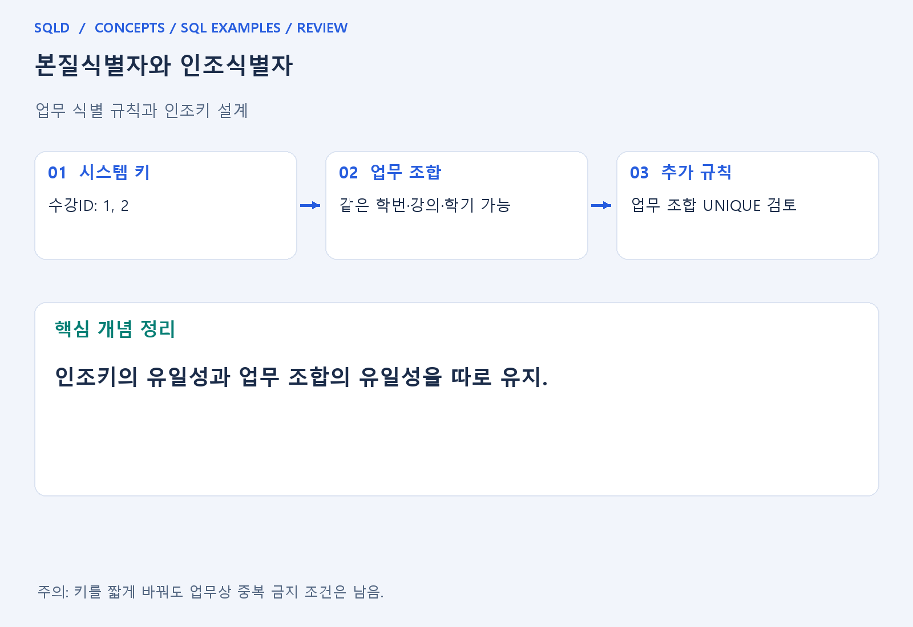
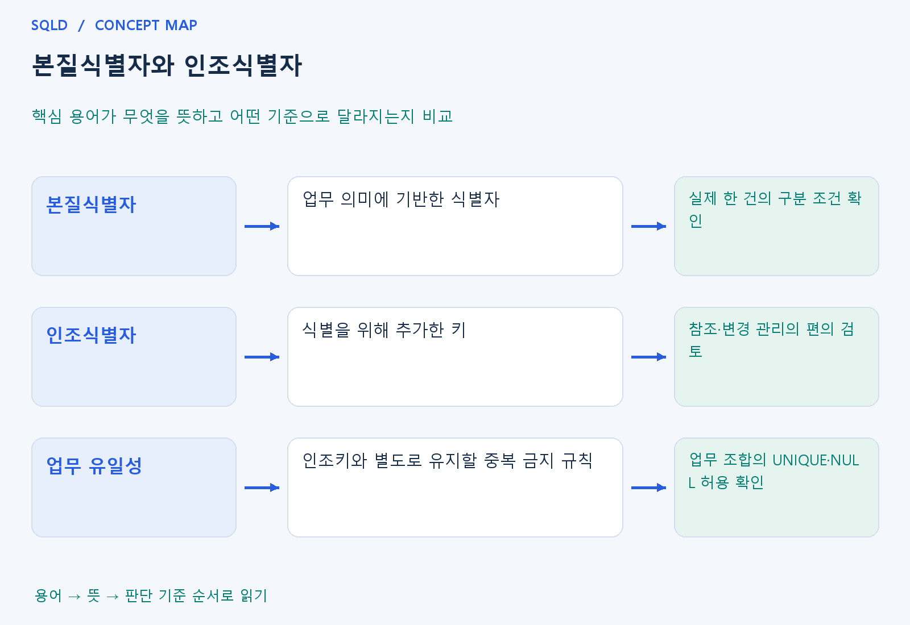

# 본질식별자와 인조식별자

- **학습 순서**: 개념 설명 → 그림으로 원리 확인 → 예제와 풀이 → 복습 요약.

## 이 글의 목차

- [1. 개념의 뜻과 동작 원리](#1.%20%EA%B0%9C%EB%85%90%EC%9D%98%20%EB%9C%BB%EA%B3%BC%20%EB%8F%99%EC%9E%91%20%EC%9B%90%EB%A6%AC)
  - [1-1. 두 식별자의 의미](#1-1.%20%EB%91%90%20%EC%8B%9D%EB%B3%84%EC%9E%90%EC%9D%98%20%EC%9D%98%EB%AF%B8)
  - [1-2. 인조키가 해결하지 못하는 문제](#1-2.%20%EC%9D%B8%EC%A1%B0%ED%82%A4%EA%B0%80%20%ED%95%B4%EA%B2%B0%ED%95%98%EC%A7%80%20%EB%AA%BB%ED%95%98%EB%8A%94%20%EB%AC%B8%EC%A0%9C)
  - [1-3. 설계 판단 순서](#1-3.%20%EC%84%A4%EA%B3%84%20%ED%8C%90%EB%8B%A8%20%EC%88%9C%EC%84%9C)
- [2. 세부 정의와 관련 규칙](#2.%20%EC%84%B8%EB%B6%80%20%EC%A0%95%EC%9D%98%EC%99%80%20%EA%B4%80%EB%A0%A8%20%EA%B7%9C%EC%B9%99)
  - [2-1. 식별자 선택의 고려 사항](#2-1.%20%EC%8B%9D%EB%B3%84%EC%9E%90%20%EC%84%A0%ED%83%9D%EC%9D%98%20%EA%B3%A0%EB%A0%A4%20%EC%82%AC%ED%95%AD)
  - [2-2. 식별자 판단 절차](#2-2.%20%EC%8B%9D%EB%B3%84%EC%9E%90%20%ED%8C%90%EB%8B%A8%20%EC%A0%88%EC%B0%A8)
- [3. 핵심 차이 한눈에 보기](#3.%20%ED%95%B5%EC%8B%AC%20%EC%B0%A8%EC%9D%B4%20%ED%95%9C%EB%88%88%EC%97%90%20%EB%B3%B4%EA%B8%B0)
- [4. 예제](#4.%20%EC%98%88%EC%A0%9C)
- [5. 복습 요약](#5.%20%EB%B3%B5%EC%8A%B5%20%EC%9A%94%EC%95%BD)
- [6. 관련 글과 추가 학습](#6.%20%EA%B4%80%EB%A0%A8%20%EA%B8%80%EA%B3%BC%20%EC%B6%94%EA%B0%80%20%ED%95%99%EC%8A%B5)

## 1. 개념의 뜻과 동작 원리

### 1-1. 두 식별자의 의미

- 본질식별자는 업무 자체의 의미로 대상을 구분하는 기준. 시스템을 만들기 전에도 존재하는 주문접수번호나 업무 조합 등이 후보가 될 수 있음.
- 인조식별자는 식별을 위해 인위적으로 추가한 키. 길거나 여러 열로 구성된 업무 식별자 대신 일련번호를 붙이면 참조와 관리가 단순해질 수 있음.
- 어느 방식이 항상 좋은 것은 아님. 업무키의 변경 가능성, 외래키의 크기, 의미 전달, 중복 검사, 운영 편의 등 서로 다른 요구를 함께 비교해야 함.

### 1-2. 인조키가 해결하지 못하는 문제

- 각 행의 ID만 다르면 기본키 제약은 만족. 하지만 같은 학번·강의·학기로 중복 수강 행이 들어가도 인조 ID가 서로 다르다면 기본키는 이를 막지 못함.
- 업무가 금지하는 중복은 그 업무 조합의 유일성으로 따로 표현해야 함. 한 건의 정확한 단위가 재수강·분반·학기에 따라 달라지는지도 먼저 정해야 함.
- 이처럼 행을 시스템에서 구분하는 문제와 실제 업무를 중복 기록하지 않는 문제는 연결되지만 같은 질문이 아님. 인조키를 추가해도 원래 업무 제약은 남을 수 있음.

### 1-3. 설계 판단 순서

- 먼저 무엇을 한 건으로 볼지와 업무상 유일한 조합을 찾음. 그다음 대표 키를 업무 조합으로 쓸지 별도 ID로 쓸지 결정하면 목적과 구현을 구분하기 쉬움.
- 인조키를 썼다면 필요한 UNIQUE와 NOT NULL 등으로 업무 규칙을 보완. NULL을 허용하는 UNIQUE 동작은 제품별 세부 조건도 확인.
- 다른 표의 외래키와 변경 전파도 함께 고려. 기본키를 바꾸면 참조 방식이 달라질 수 있지만 그 사실만으로 원래의 업무 의미까지 바뀌는 것은 아님.
- 인조식별자는 행을 간단히 구별하는 기술적 기준이고 본질식별자는 업무에서 대상을 구별하는 기준. 인조 키를 도입해도 업무상 중복을 막아야 한다면 해당 속성 조합에 별도 유일성 규칙이 필요.

## 2. 세부 정의와 관련 규칙

### 2-1. 식별자 선택의 고려 사항

- 업무 식별자가 길거나 여러 속성으로 구성되고 값이 바뀔 가능성이 있다면 별도 일련번호가 참조와 관리에 편리할 수 있음.
- 하지만 일련번호를 만들었다고 업무 중복 규칙이 사라지는 것은 아님.

### 2-2. 식별자 판단 절차

- 업무에서 무엇을 한 건으로 보는지 확인함.
- 원래의 업무 식별 조건을 찾음.
- 새 일련번호를 추가했을 때 중복 입력이 가능한지 봄.
- 업무 제약을 유일성과 NULL 허용 규칙으로 보완함.

## 3. 핵심 차이 한눈에 보기

|  구분 | 핵심 뜻 | 확인할 기준 |
| --- | --- | --- |
| 본질식별자 | 업무 의미에 기반한 식별자 | 실제 한 건의 구분 조건 확인 |
| 인조식별자 | 식별을 위해 추가한 키 | 참조·변경 관리의 편의 검토 |
| 업무 유일성 | 인조키와 별도로 유지할 중복 금지 규칙 | 업무 조합의 UNIQUE·NULL 허용 확인 |

## 4. 예제

- **상황**: 수강ID가 달라도 같은 학번·강의·학기를 두 번 입력.
- **질문**: 서로 다른 수강ID로 같은 학생·강의·학기가 두 번 입력된다면, 수강ID 기본키만으로 중복을 막을 수 있는가?
- **정답**: 업무 조합의 유일성 제약을 별도로 검토.
- **풀이 ①**: 두 행의 인조 ID가 다르다는 사실과 실제 수강 내용이 같다는 사실을 구분.
- **풀이 ②**: 인조 ID의 유일성은 중복 수강이라는 업무 규칙을 대신하지 못함. 따라서 인조 ID 기본키만으로는 같은 업무 조합의 재입력을 막을 수 없음.

## 5. 복습 요약

- **본질식별자**: 업무 의미에 기반한 식별자. 실제 한 건의 구분 조건 확인.
- **인조식별자**: 식별을 위해 추가한 키. 참조·변경 관리의 편의 검토.
- **업무 유일성**: 인조키와 별도로 유지할 중복 금지 규칙. 업무 조합의 UNIQUE·NULL 허용 확인.

## 6. 관련 글과 추가 학습

- [전체 목차](../../00_%EC%A0%84%EC%B2%B4%EB%AA%A9%EC%B0%A8.md)
- [개념별 빠른 복습표](../../%EB%B3%B5%EC%8A%B5_%ED%95%B5%EC%8B%AC%EB%B9%84%EA%B5%90%ED%91%9C.md)
- [추가 SQL 소스 안내](../../%EC%B6%94%EA%B0%80_SQL_%EC%86%8C%EC%8A%A4%EC%95%88%EB%82%B4.md)
