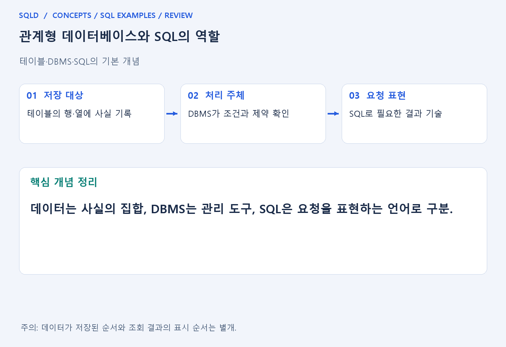
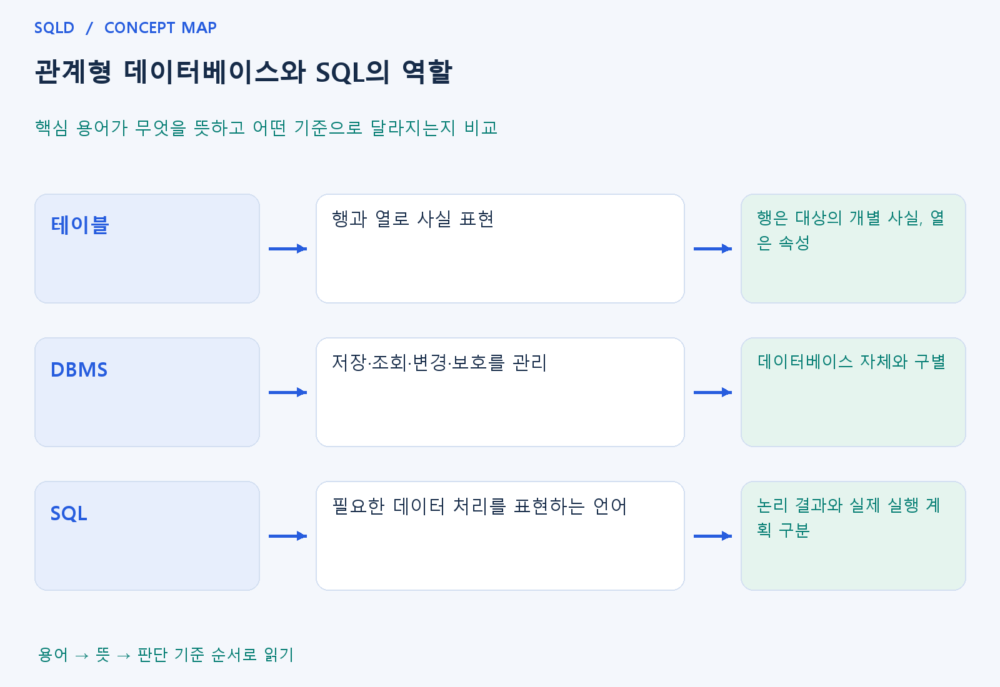

# 관계형 데이터베이스와 SQL의 역할

- **학습 순서**: 개념 설명 → 그림으로 원리 확인 → 예제와 풀이 → 복습 요약.

## 이 글의 목차

- [1. 개념의 뜻과 동작 원리](#1.%20%EA%B0%9C%EB%85%90%EC%9D%98%20%EB%9C%BB%EA%B3%BC%20%EB%8F%99%EC%9E%91%20%EC%9B%90%EB%A6%AC)
  - [1-1. 관계형 데이터베이스의 기본 구조](#1-1.%20%EA%B4%80%EA%B3%84%ED%98%95%20%EB%8D%B0%EC%9D%B4%ED%84%B0%EB%B2%A0%EC%9D%B4%EC%8A%A4%EC%9D%98%20%EA%B8%B0%EB%B3%B8%20%EA%B5%AC%EC%A1%B0)
  - [1-2. SQL의 처리 방식](#1-2.%20SQL%EC%9D%98%20%EC%B2%98%EB%A6%AC%20%EB%B0%A9%EC%8B%9D)
  - [1-3. 행과 결과의 특징](#1-3.%20%ED%96%89%EA%B3%BC%20%EA%B2%B0%EA%B3%BC%EC%9D%98%20%ED%8A%B9%EC%A7%95)
- [2. 세부 정의와 관련 규칙](#2.%20%EC%84%B8%EB%B6%80%20%EC%A0%95%EC%9D%98%EC%99%80%20%EA%B4%80%EB%A0%A8%20%EA%B7%9C%EC%B9%99)
  - [2-1. 정의와 기본 규칙](#2-1.%20%EC%A0%95%EC%9D%98%EC%99%80%20%EA%B8%B0%EB%B3%B8%20%EA%B7%9C%EC%B9%99)
- [3. 핵심 차이 한눈에 보기](#3.%20%ED%95%B5%EC%8B%AC%20%EC%B0%A8%EC%9D%B4%20%ED%95%9C%EB%88%88%EC%97%90%20%EB%B3%B4%EA%B8%B0)
- [4. 예제](#4.%20%EC%98%88%EC%A0%9C)
- [5. 복습 요약](#5.%20%EB%B3%B5%EC%8A%B5%20%EC%9A%94%EC%95%BD)
- [6. 관련 글과 추가 학습](#6.%20%EA%B4%80%EB%A0%A8%20%EA%B8%80%EA%B3%BC%20%EC%B6%94%EA%B0%80%20%ED%95%99%EC%8A%B5)

## 1. 개념의 뜻과 동작 원리

### 1-1. 관계형 데이터베이스의 기본 구조

- 관계형 데이터베이스는 행과 열로 이루어진 관계를 중심으로 사실을 표현. 행은 기록한 개별 사실, 열은 그 사실을 설명하는 속성이므로 행의 단위를 먼저 이해해야 함.
- 같은 학생의 이름과 소속을 여러 표에 제각각 적기보다 식별키로 연결하면 정보의 주인을 분명하게 나눌 수 있음. 키와 제약조건이 표 사이 관계의 일관성을 돕는 역할.
- 데이터베이스는 자료의 집합이고 DBMS는 그 자료를 관리하는 소프트웨어. SQL은 DBMS에 원하는 조회·변경을 표현하는 언어이므로 세 개념을 같은 대상으로 보지 않음.

### 1-2. SQL의 처리 방식

- SQL은 어떤 결과가 필요한지를 설명하는 선언적 성격의 언어. 사용자가 모든 행을 어떤 반복문으로 읽을지 직접 적기보다 조건과 결과 형태를 명시.
- DBMS는 요청을 해석하고 제약·권한을 확인하며 실행 계획을 선택. 같은 논리 결과라도 자료량·인덱스·통계에 따라 실제 읽기 순서는 달라질 수 있음.
- 설명에 사용하는 FROM→WHERE 같은 논리 순서와 엔진의 실제 물리 실행 순서는 구분. 결과를 이해하기 위한 순서를 실제 작업의 고정 순서라고 단정하지 않음.

### 1-3. 행과 결과의 특징

- 표에서 행의 표시 순서는 저장 사실 자체의 의미가 아님. 결과 순서가 필요하면 ORDER BY로 지정하며 기본키가 있다고 자동 정렬되는 것은 아님.
- SQL 조회는 기본적으로 중복된 결과 행을 허용할 수 있음. 관계대수의 집합 성질과 SQL의 출력 규칙을 그대로 같은 것으로 생각하면 DISTINCT 해석에서 틀리기 쉬움.
- NULL, 키, 자료형의 역할을 함께 이해해야 표를 정확히 읽을 수 있음. 숫자처럼 보이는 값이라도 식별자인지 수량인지에 따라 허용할 연산과 비교 의미가 달라짐.
- 관계형 데이터베이스는 표와 키로 사실과 연결을 표현하고, SQL은 원하는 결과나 변경 내용을 선언하는 언어. SELECT의 결과는 저장된 열일 수도 있고 계산한 값일 수도 있으므로 결과표와 원본표를 구분.

## 2. 세부 정의와 관련 규칙

### 2-1. 정의와 기본 규칙


- 여러 프로그램이 같은 데이터를 안전하게 사용하려면 중복, 권한, 동시 변경, 복구를 관리해야 함.
- DBMS는 이 일을 돕음.

- 관계형 데이터베이스는 테이블과 키, 관계로 사실을 표현함.
- 행은 개별 사실이고 열은 그 사실의 속성임.

- SQL은 DBMS에 어떤 결과가 필요한지 설명하는 선언적 언어임.
- 실제 데이터를 읽는 순서는 DBMS가 실행 계획으로 정함.



## 3. 핵심 차이 한눈에 보기

|  구분 | 핵심 뜻 | 확인할 기준 |
| --- | --- | --- |
| 테이블 | 행과 열로 사실 표현 | 행은 대상의 개별 사실, 열은 속성 |
| DBMS | 저장·조회·변경·보호를 관리 | 데이터베이스 자체와 구별 |
| SQL | 필요한 데이터 처리를 표현하는 언어 | 논리 결과와 실제 실행 계획 구분 |



## 4. 예제

- **상황**: 두 묶음의 수량 2개와 3개를 더해 하나의 결과 열로 표시하려는 상황.
- **질문**: 2개와 3개를 합친 수량을 total이라는 열 이름으로 확인하려면, 아래 SELECT의 결과는 무엇인가?
- **실행 기준**: SQLite 확인용. 입력 데이터와 필요한 객체를 코드 안에 포함.

```sql
SELECT 2+3 AS total;
```

- **결과**: total=5.
- **풀이 ①**: SELECT 뒤의 2+3을 계산하고 AS 뒤의 이름을 결과 열 제목으로 사용.
- **풀이 ②**: SELECT는 계산한 값도 결과로 보여 줄 수 있음.

- [예제 소스](../../short_examples/n12.sql)

## 5. 복습 요약

- **테이블**: 행과 열로 사실 표현. 행은 대상의 개별 사실, 열은 속성.
- **DBMS**: 저장·조회·변경·보호를 관리. 데이터베이스 자체와 구별.
- **SQL**: 필요한 데이터 처리를 표현하는 언어. 논리 결과와 실제 실행 계획 구분.

## 6. 관련 글과 추가 학습

- [전체 목차](../../00_%EC%A0%84%EC%B2%B4%EB%AA%A9%EC%B0%A8.md)
- [개념별 빠른 복습표](../../%EB%B3%B5%EC%8A%B5_%ED%95%B5%EC%8B%AC%EB%B9%84%EA%B5%90%ED%91%9C.md)
- [추가 SQL 소스 안내](../../%EC%B6%94%EA%B0%80_SQL_%EC%86%8C%EC%8A%A4%EC%95%88%EB%82%B4.md)
