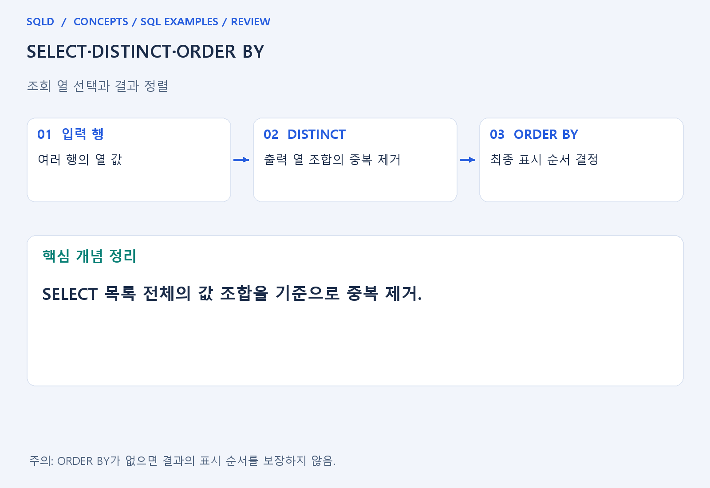
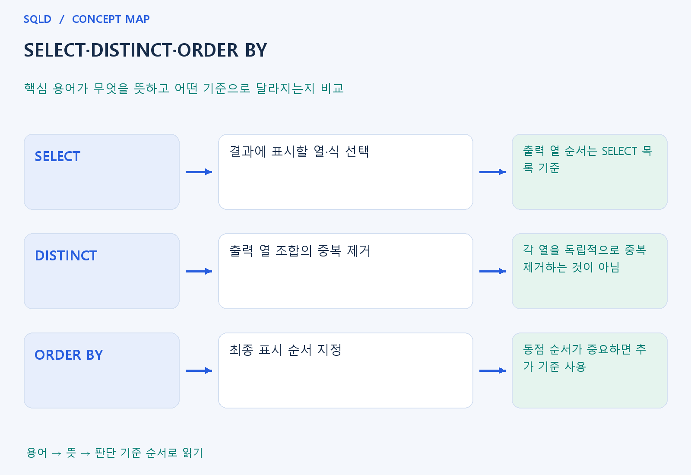

# SELECT·DISTINCT·ORDER BY

- **학습 순서**: 개념 설명 → 그림으로 원리 확인 → 예제와 풀이 → 복습 요약.

## 이 글의 목차

- [1. 개념의 뜻과 동작 원리](#1.%20%EA%B0%9C%EB%85%90%EC%9D%98%20%EB%9C%BB%EA%B3%BC%20%EB%8F%99%EC%9E%91%20%EC%9B%90%EB%A6%AC)
  - [1-1. 조회 열과 계산 결과 선택](#1-1.%20%EC%A1%B0%ED%9A%8C%20%EC%97%B4%EA%B3%BC%20%EA%B3%84%EC%82%B0%20%EA%B2%B0%EA%B3%BC%20%EC%84%A0%ED%83%9D)
  - [1-2. DISTINCT의 중복 판단](#1-2.%20DISTINCT%EC%9D%98%20%EC%A4%91%EB%B3%B5%20%ED%8C%90%EB%8B%A8)
  - [1-3. ORDER BY의 정렬 기준](#1-3.%20ORDER%20BY%EC%9D%98%20%EC%A0%95%EB%A0%AC%20%EA%B8%B0%EC%A4%80)
- [2. 세부 정의와 관련 규칙](#2.%20%EC%84%B8%EB%B6%80%20%EC%A0%95%EC%9D%98%EC%99%80%20%EA%B4%80%EB%A0%A8%20%EA%B7%9C%EC%B9%99)
  - [2-1. 정의와 기본 규칙](#2-1.%20%EC%A0%95%EC%9D%98%EC%99%80%20%EA%B8%B0%EB%B3%B8%20%EA%B7%9C%EC%B9%99)
- [3. 핵심 차이 한눈에 보기](#3.%20%ED%95%B5%EC%8B%AC%20%EC%B0%A8%EC%9D%B4%20%ED%95%9C%EB%88%88%EC%97%90%20%EB%B3%B4%EA%B8%B0)
- [4. 예제](#4.%20%EC%98%88%EC%A0%9C)
- [5. 복습 요약](#5.%20%EB%B3%B5%EC%8A%B5%20%EC%9A%94%EC%95%BD)
- [6. 관련 글과 추가 학습](#6.%20%EA%B4%80%EB%A0%A8%20%EA%B8%80%EA%B3%BC%20%EC%B6%94%EA%B0%80%20%ED%95%99%EC%8A%B5)

## 1. 개념의 뜻과 동작 원리

### 1-1. 조회 열과 계산 결과 선택

- SELECT는 최종 결과에 어떤 열과 계산식을 보여 줄지 정하는 부분. 원본 표의 모든 열을 바꾸는 명령이 아니라 조회 결과의 모양을 구성하는 명령으로 이해.
- AS는 결과 열이나 테이블에 별칭을 붙여 식의 의미를 읽기 쉽게 함. 별칭을 붙였다고 원본 데이터의 열 이름이 영구적으로 바뀌는 것은 아님.
- 출력 열 순서는 SELECT 목록에 적은 순서. 행 순서는 별도 정렬 조건의 문제이므로 열 선택 순서와 행의 표시 순서를 분리해서 읽어야 함.

### 1-2. DISTINCT의 중복 판단

- DISTINCT는 SELECT에 표시한 열들의 전체 값 조합을 기준으로 같은 결과 행을 하나로 줄임. 부서와 직급을 함께 조회하면 두 값이 모두 같은 조합인지 확인.
- 부서 중복을 먼저 제거하고 직급 중복을 따로 제거하는 식으로 동작하지 않음. 원본 여러 행이 출력 열을 줄인 뒤 같은 조합으로 보일 수 있다는 점이 핵심.
- 중복 제거는 문제의 단위에 맞을 때만 사용. 조인으로 금액이 반복된 상황에서 무조건 DISTINCT를 붙이면 서로 다른 사실까지 사라질 수 있음.

### 1-3. ORDER BY의 정렬 기준

- ORDER BY는 최종 결과를 나열하는 순서를 지정. ASC는 오름차순, DESC는 내림차순이며 여러 기준을 적으면 앞 기준이 같은 행을 뒤 기준으로 비교.
- 동점인 행의 순서까지 일정해야 한다면 유일한 키 등 추가 기준을 사용. 급여만 정렬했을 때 같은 급여인 직원들의 내부 순서를 임의로 가정하지 않음.
- NULL의 기본 정렬 위치와 문자열 대소문자·언어 비교는 DBMS와 설정에 따라 다를 수 있음. SQLD 문제에 제품이나 옵션이 나오면 그 조건을 우선 확인.
- SELECT는 출력할 열과 식을 정하고 DISTINCT는 그 출력 열 전체가 같은 행을 줄임. ORDER BY는 마지막에 보여 줄 순서를 정하므로 중복 제거 기준과 정렬 기준을 서로 구분.

## 2. 세부 정의와 관련 규칙

### 2-1. 정의와 기본 규칙


- SELECT는 출력 열과 식을 정하고 AS는 결과 이름을 붙임.
- FROM은 원본 표를 정함.

- ORDER BY가 없으면 결과 순서는 보장되지 않음.
- 동점까지 재현하려면 기본키 등 추가 정렬 기준을 둠.

- DISTINCT는 SELECT한 모든 열의 조합에 적용됨.
- WHERE에서 행을 고르는 시점과 SELECT에서 별칭을 만드는 논리 시점을 구분함.



## 3. 핵심 차이 한눈에 보기

|  구분 | 핵심 뜻 | 확인할 기준 |
| --- | --- | --- |
| SELECT | 결과에 표시할 열·식 선택 | 출력 열 순서는 SELECT 목록 기준 |
| DISTINCT | 출력 열 조합의 중복 제거 | 각 열을 독립적으로 중복 제거하는 것이 아님 |
| ORDER BY | 최종 표시 순서 지정 | 동점 순서가 중요하면 추가 기준 사용 |



## 4. 예제

- **상황**: 세 행의 값이 2, 1, 2이며, 서로 다른 값의 목록을 만들려는 상황.
- **질문**: 값 2, 1, 2에서 중복을 없애고 작은 값부터 출력하면 몇 행이 어떤 순서로 나오는가?
- **실행 기준**: SQLite 확인용. 입력 데이터와 필요한 객체를 코드 안에 포함.

```sql
WITH t(v) AS (VALUES (2),(1),(2))
SELECT DISTINCT v FROM t ORDER BY v;
```

- **결과**: 1, 2 두 행.
- **풀이 ①**: 입력 세 행 중 값 2가 반복된다는 점을 먼저 확인.
- **풀이 ②**: DISTINCT로 같은 출력값을 줄인 뒤 오름차순 표시.

- [예제 소스](../../short_examples/n13.sql)

## 5. 복습 요약

- **SELECT**: 결과에 표시할 열·식 선택. 출력 열 순서는 SELECT 목록 기준.
- **DISTINCT**: 출력 열 조합의 중복 제거. 각 열을 독립적으로 중복 제거하는 것이 아님.
- **ORDER BY**: 최종 표시 순서 지정. 동점 순서가 중요하면 추가 기준 사용.

## 6. 관련 글과 추가 학습

- [전체 목차](../../00_%EC%A0%84%EC%B2%B4%EB%AA%A9%EC%B0%A8.md)
- [개념별 빠른 복습표](../../%EB%B3%B5%EC%8A%B5_%ED%95%B5%EC%8B%AC%EB%B9%84%EA%B5%90%ED%91%9C.md)
- [추가 SQL 소스 안내](../../%EC%B6%94%EA%B0%80_SQL_%EC%86%8C%EC%8A%A4%EC%95%88%EB%82%B4.md)
