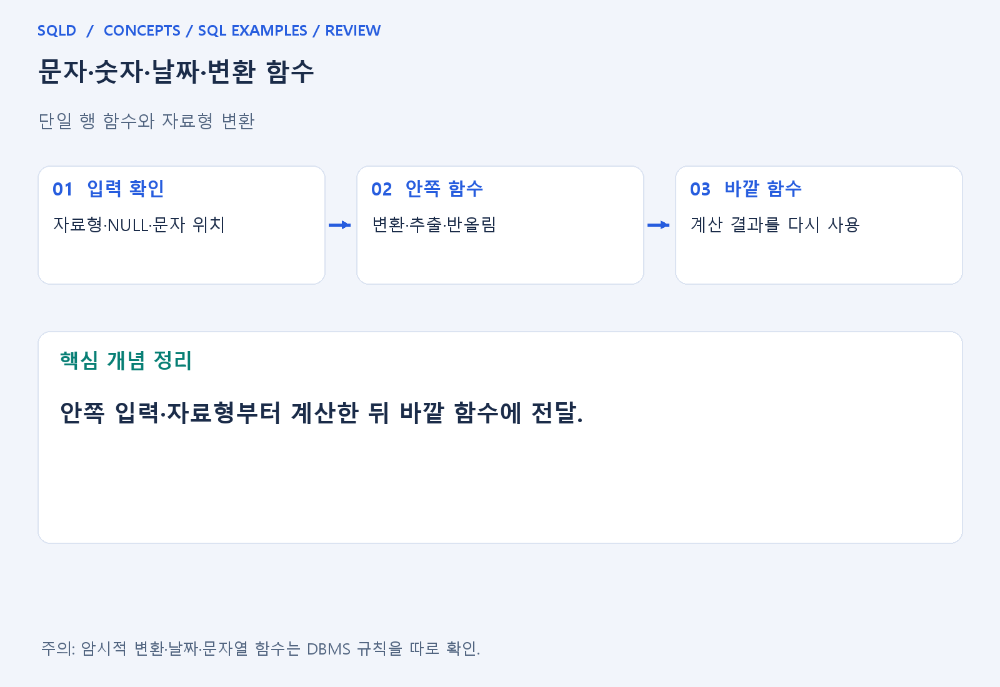
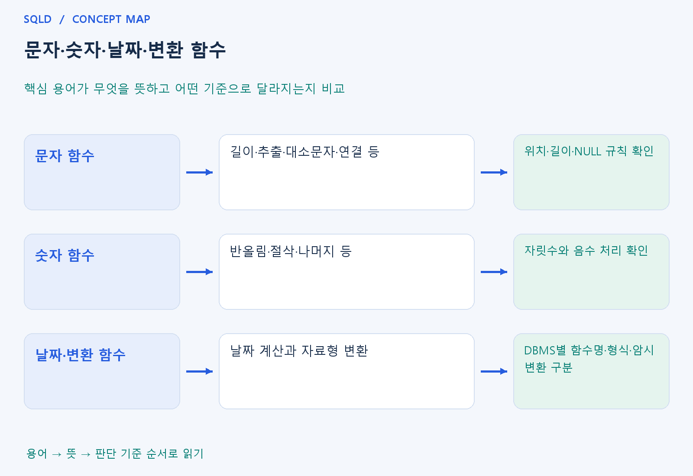

# 문자·숫자·날짜·변환 함수

- **학습 순서**: 개념 설명 → 그림으로 원리 확인 → 예제와 풀이 → 복습 요약.

## 이 글의 목차

- [1. 개념의 뜻과 동작 원리](#1.%20%EA%B0%9C%EB%85%90%EC%9D%98%20%EB%9C%BB%EA%B3%BC%20%EB%8F%99%EC%9E%91%20%EC%9B%90%EB%A6%AC)
  - [1-1. 단일 행 함수의 역할](#1-1.%20%EB%8B%A8%EC%9D%BC%20%ED%96%89%20%ED%95%A8%EC%88%98%EC%9D%98%20%EC%97%AD%ED%95%A0)
  - [1-2. 문자·숫자·날짜 함수의 차이](#1-2.%20%EB%AC%B8%EC%9E%90%C2%B7%EC%88%AB%EC%9E%90%C2%B7%EB%82%A0%EC%A7%9C%20%ED%95%A8%EC%88%98%EC%9D%98%20%EC%B0%A8%EC%9D%B4)
  - [1-3. 중첩 함수와 형 변환](#1-3.%20%EC%A4%91%EC%B2%A9%20%ED%95%A8%EC%88%98%EC%99%80%20%ED%98%95%20%EB%B3%80%ED%99%98)
- [2. 세부 정의와 관련 규칙](#2.%20%EC%84%B8%EB%B6%80%20%EC%A0%95%EC%9D%98%EC%99%80%20%EA%B4%80%EB%A0%A8%20%EA%B7%9C%EC%B9%99)
  - [2-1. 정의와 기본 규칙](#2-1.%20%EC%A0%95%EC%9D%98%EC%99%80%20%EA%B8%B0%EB%B3%B8%20%EA%B7%9C%EC%B9%99)
- [3. 핵심 차이 한눈에 보기](#3.%20%ED%95%B5%EC%8B%AC%20%EC%B0%A8%EC%9D%B4%20%ED%95%9C%EB%88%88%EC%97%90%20%EB%B3%B4%EA%B8%B0)
- [4. 예제](#4.%20%EC%98%88%EC%A0%9C)
- [5. 복습 요약](#5.%20%EB%B3%B5%EC%8A%B5%20%EC%9A%94%EC%95%BD)
- [6. 관련 글과 추가 학습](#6.%20%EA%B4%80%EB%A0%A8%20%EA%B8%80%EA%B3%BC%20%EC%B6%94%EA%B0%80%20%ED%95%99%EC%8A%B5)

## 1. 개념의 뜻과 동작 원리

### 1-1. 단일 행 함수의 역할

- 단일 행 함수는 입력 행의 값이나 식에 계산을 적용하는 도구. 문자 일부를 뽑거나 숫자를 반올림하는 것은 여러 행을 하나의 그룹으로 합치는 집계와 역할이 다름.
- 함수를 읽을 때는 입력의 자료형, 인수의 뜻, 반환 자료형을 확인. 숫자처럼 보이는 문자와 실제 숫자는 계산·정렬·변환에서 다른 동작을 보일 수 있음.
- NULL 입력이 결과에 어떤 영향을 주는지도 확인. 어떤 함수가 NULL을 그대로 반환하는지, 대체하거나 특별 처리하는지는 함수와 제품의 정의를 따름.

### 1-2. 문자·숫자·날짜 함수의 차이

- 문자 함수는 길이·추출·연결·대소문자·공백 처리 등을 수행. 시작 위치와 길이의 기준을 반대로 읽으면 같은 문자열에서도 결과가 달라짐.
- 숫자 함수는 반올림·절삭·절댓값·나머지 등을 수행. 반올림과 절삭은 목적이 다르며 자릿수가 음수인 경우의 처리도 제품 문법과 함께 확인.
- 날짜 함수는 날짜를 문자로 바꾸는 것과 날짜끼리 차이나 기간을 계산하는 것을 구분. 화면에 보이는 형식이 같아도 내부 자료형이 같다는 보장은 없음.

### 1-3. 중첩 함수와 형 변환

- 함수가 중첩되면 가장 안쪽의 계산 결과가 바깥 함수의 입력이 됨. 순서를 복잡하게 외우기보다 중간 결과를 한 줄씩 적어 자료형이 어떻게 바뀌는지 확인.
- 명시적 변환은 바꿀 형과 형식을 적고, 암시적 변환은 DBMS가 규칙에 따라 수행. 암시적 변환에 기대면 실행 설정이나 제품이 바뀔 때 결과가 달라질 수 있음.
- Oracle·SQL Server·SQLite는 함수 이름과 날짜 형식, 문자열 위치 등의 세부 규칙이 다름. 공통 목적과 특정 함수의 문법을 분리하여 익히는 것이 안전.
- 함수는 입력값을 받아 규칙에 따라 결과값을 돌려줌. 문자·숫자·날짜의 자료형과 변환 규칙을 먼저 확인해야 하며, 화면에 비슷하게 표시되어도 문자열과 숫자가 같은 자료형인 것은 아님.

## 2. 세부 정의와 관련 규칙

### 2-1. 정의와 기본 규칙


- UPPER/LOWER는 대소문자, SUBSTR은 부분 문자열, LENGTH는 길이를 구함.
- 문자열 위치는 언어 배열처럼 0부터라고 가정하지 않음.

- ROUND와 ABS 등 수치 함수는 타입과 반올림 규칙을 확인함.
- SQLite에서는 7/2가 정수 계산일 수 있으므로 7.0/2처럼 타입을 의도적으로 정함.

- 날짜는 DBMS 차이가 큼.
- SQLite date/strftime 예제와 Oracle DATE·TO_DATE·TO_CHAR, SQL Server DATEADD/CONVERT를 구별함.
- 암시적 변환에 의존하지 않는 것이 좋음.



## 3. 핵심 차이 한눈에 보기

|  구분 | 핵심 뜻 | 확인할 기준 |
| --- | --- | --- |
| 문자 함수 | 길이·추출·대소문자·연결 등 | 위치·길이·NULL 규칙 확인 |
| 숫자 함수 | 반올림·절삭·나머지 등 | 자릿수와 음수 처리 확인 |
| 날짜·변환 함수 | 날짜 계산과 자료형 변환 | DBMS별 함수명·형식·암시 변환 구분 |



## 4. 예제

- **상황**: 소문자 이름과 소수 값을 보고서에 맞게 변환하려는 상황. 입력은 sql과 1.26.
- **질문**: 문자열 sql과 숫자 1.26에 각 함수를 적용하면 출력값은 무엇이며, 어느 입력에 어느 함수가 적용되는가?
- **실행 기준**: SQLite 확인용. 입력 데이터와 필요한 객체를 코드 안에 포함.

```sql
SELECT UPPER('sql') AS word, ROUND(1.26,1) AS n;
```

- **결과**: word=SQL, n=1.3.
- **풀이 ①**: UPPER는 문자 입력을 대문자로 바꾸고 ROUND의 두 번째 인수는 반올림할 소수 자릿수를 정함.
- **풀이 ②**: 각 함수가 자신의 입력값을 변환.

- [예제 소스](../../short_examples/n14.sql)

## 5. 복습 요약

- **문자 함수**: 길이·추출·대소문자·연결 등. 위치·길이·NULL 규칙 확인.
- **숫자 함수**: 반올림·절삭·나머지 등. 자릿수와 음수 처리 확인.
- **날짜·변환 함수**: 날짜 계산과 자료형 변환. DBMS별 함수명·형식·암시 변환 구분.

## 6. 관련 글과 추가 학습

- [전체 목차](../../00_%EC%A0%84%EC%B2%B4%EB%AA%A9%EC%B0%A8.md)
- [개념별 빠른 복습표](../../%EB%B3%B5%EC%8A%B5_%ED%95%B5%EC%8B%AC%EB%B9%84%EA%B5%90%ED%91%9C.md)
- [추가 SQL 소스 안내](../../%EC%B6%94%EA%B0%80_SQL_%EC%86%8C%EC%8A%A4%EC%95%88%EB%82%B4.md)
