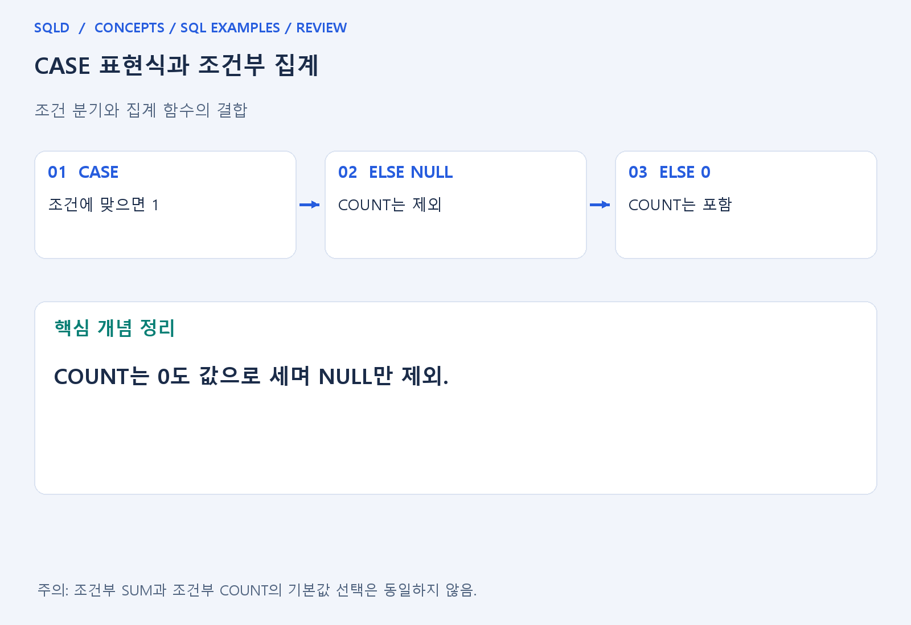
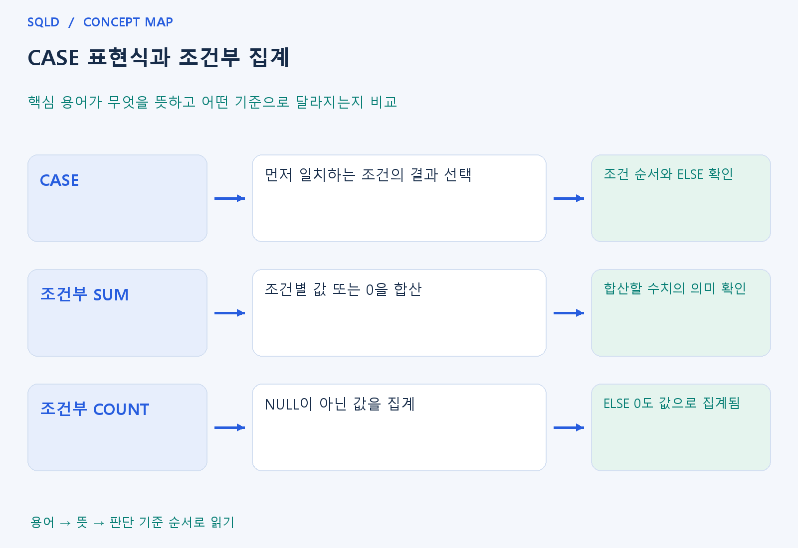

# CASE 표현식과 조건부 집계

- **학습 순서**: 개념 설명 → 그림으로 원리 확인 → 예제와 풀이 → 복습 요약.

## 이 글의 목차

- [1. 개념의 뜻과 동작 원리](#1.%20%EA%B0%9C%EB%85%90%EC%9D%98%20%EB%9C%BB%EA%B3%BC%20%EB%8F%99%EC%9E%91%20%EC%9B%90%EB%A6%AC)
  - [1-1. CASE가 조건을 고르는 방식](#1-1.%20CASE%EA%B0%80%20%EC%A1%B0%EA%B1%B4%EC%9D%84%20%EA%B3%A0%EB%A5%B4%EB%8A%94%20%EB%B0%A9%EC%8B%9D)
  - [1-2. 조건부 집계가 되는 원리](#1-2.%20%EC%A1%B0%EA%B1%B4%EB%B6%80%20%EC%A7%91%EA%B3%84%EA%B0%80%20%EB%90%98%EB%8A%94%20%EC%9B%90%EB%A6%AC)
  - [1-3. 조건과 결과를 읽는 기준](#1-3.%20%EC%A1%B0%EA%B1%B4%EA%B3%BC%20%EA%B2%B0%EA%B3%BC%EB%A5%BC%20%EC%9D%BD%EB%8A%94%20%EA%B8%B0%EC%A4%80)
- [2. 세부 정의와 관련 규칙](#2.%20%EC%84%B8%EB%B6%80%20%EC%A0%95%EC%9D%98%EC%99%80%20%EA%B4%80%EB%A0%A8%20%EA%B7%9C%EC%B9%99)
  - [2-1. 정의와 기본 규칙](#2-1.%20%EC%A0%95%EC%9D%98%EC%99%80%20%EA%B8%B0%EB%B3%B8%20%EA%B7%9C%EC%B9%99)
- [3. 핵심 차이 한눈에 보기](#3.%20%ED%95%B5%EC%8B%AC%20%EC%B0%A8%EC%9D%B4%20%ED%95%9C%EB%88%88%EC%97%90%20%EB%B3%B4%EA%B8%B0)
- [4. 예제](#4.%20%EC%98%88%EC%A0%9C)
- [5. 복습 요약](#5.%20%EB%B3%B5%EC%8A%B5%20%EC%9A%94%EC%95%BD)
- [6. 관련 글과 추가 학습](#6.%20%EA%B4%80%EB%A0%A8%20%EA%B8%80%EA%B3%BC%20%EC%B6%94%EA%B0%80%20%ED%95%99%EC%8A%B5)

## 1. 개념의 뜻과 동작 원리

### 1-1. CASE가 조건을 고르는 방식

- CASE는 조건에 따라 서로 다른 값을 만들어 주는 표현식. 행을 삭제하는 WHERE와 달리 같은 행에서 출력값이나 계산값을 바꾸는 데 쓰는 개념.
- 검색 CASE는 WHEN의 조건을 순서대로 검사하여 처음 TRUE인 분기의 결과를 선택. 앞 조건이 넓으면 뒤 조건에 도달하지 않을 수 있으므로 순서가 중요.
- 어느 조건도 맞지 않으면 ELSE를 사용하고, ELSE를 생략하면 일반적으로 NULL이 됨. 조건을 만족하지 않는 경우에 어떤 값을 만들지까지 포함해 읽어야 함.

### 1-2. 조건부 집계가 되는 원리

- 집계 함수 안에 CASE를 넣으면 먼저 각 행의 조건별 값을 만든 뒤 그 결과를 집계. 조건에 맞는 매출만 남겨 SUM하면 원하는 범주의 합계가 되는 원리.
- SUM에서 제외할 행을 0으로 바꾸는 것과 COUNT에서 제외할 행을 0으로 바꾸는 것은 다름. SUM은 0을 더해도 합이 같지만 COUNT는 0도 값으로 셈.
- COUNT로 조건 만족 행만 세려면 그 밖의 행을 NULL로 만드는 방법을 검토. 실제로 0이라는 값이 필요한 계산과 집계 대상에서 제외하는 의도를 구분해야 함.

### 1-3. 조건과 결과를 읽는 기준

- NULL 관련 일반 비교는 UNKNOWN이 될 수 있으므로 결측을 잡는 조건은 IS NULL 등 적절한 검사를 사용. CASE의 WHEN도 TRUE로 판정되는 분기를 고르는 점을 기억.
- 분기마다 서로 다른 자료형을 반환하면 제품의 형 변환 규칙이 적용되거나 오류가 날 수 있음. 점수 숫자와 안내 문자를 섞을 때 결과 형을 확인.
- CASE는 표에 조건별 열을 만들거나 분류 기준을 표현할 때 유용하지만, 조인으로 생긴 잘못된 행 단위 자체를 자동으로 고쳐 주는 도구는 아님.
- CASE는 조건에 따라 하나의 값을 선택하는 표현식이고 집계 함수는 여러 행의 값을 모으는 함수. 둘을 합치면 조건에 맞는 행을 표시한 뒤 합산할 수 있으며 ELSE와 NULL 처리에 따라 결과가 달라짐.

## 2. 세부 정의와 관련 규칙

### 2-1. 정의와 기본 규칙


- 검색 CASE는 WHEN 조건을, 단순 CASE는 기준값과 비교값을 사용함.
- 처음 TRUE인 WHEN을 선택하고 ELSE를 생략하면 나머지는 NULL임.

- SUM(CASE WHEN 조건 THEN 1 ELSE 0 END)는 조건 개수를 세는 대표 식임.
- COUNT(CASE WHEN 조건 THEN 1 END)도 NULL 제외를 이용함.

- COUNT의 ELSE 0은 0도 값이므로 모든 행을 셈.
- CASE의 반환 타입도 DBMS의 타입 호환 규칙을 따름.



## 3. 핵심 차이 한눈에 보기

|  구분 | 핵심 뜻 | 확인할 기준 |
| --- | --- | --- |
| CASE | 먼저 일치하는 조건의 결과 선택 | 조건 순서와 ELSE 확인 |
| 조건부 SUM | 조건별 값 또는 0을 합산 | 합산할 수치의 의미 확인 |
| 조건부 COUNT | NULL이 아닌 값을 집계 | ELSE 0도 값으로 집계됨 |



## 4. 예제

- **상황**: 입력값은 1과 2이며, 조건 v=2를 만족하는 행의 개수를 합계로 구하려는 상황.
- **질문**: 값 1과 2 중 v=2인 행의 수를 CASE와 SUM으로 구하면 얼마인가? 각 행이 어떤 값으로 바뀌는지도 설명하라.
- **실행 기준**: SQLite 확인용. 입력 데이터와 필요한 객체를 코드 안에 포함.

```sql
WITH t(v) AS (VALUES (1),(2))
SELECT SUM(CASE WHEN v=2 THEN 1 ELSE 0 END) FROM t;
```

- **결과**: 결과는 1.
- **풀이 ①**: v=1인 행은 ELSE의 0, v=2인 행은 THEN의 1로 바뀜.
- **풀이 ②**: 조건에 맞는 행을 1, 나머지를 0으로 바꾸어 합산.

- [예제 소스](../../short_examples/n15.sql)

## 5. 복습 요약

- **CASE**: 먼저 일치하는 조건의 결과 선택. 조건 순서와 ELSE 확인.
- **조건부 SUM**: 조건별 값 또는 0을 합산. 합산할 수치의 의미 확인.
- **조건부 COUNT**: NULL이 아닌 값을 집계. ELSE 0도 값으로 집계됨.

## 6. 관련 글과 추가 학습

- [전체 목차](../../00_%EC%A0%84%EC%B2%B4%EB%AA%A9%EC%B0%A8.md)
- [개념별 빠른 복습표](../../%EB%B3%B5%EC%8A%B5_%ED%95%B5%EC%8B%AC%EB%B9%84%EA%B5%90%ED%91%9C.md)
- [추가 SQL 소스 안내](../../%EC%B6%94%EA%B0%80_SQL_%EC%86%8C%EC%8A%A4%EC%95%88%EB%82%B4.md)
