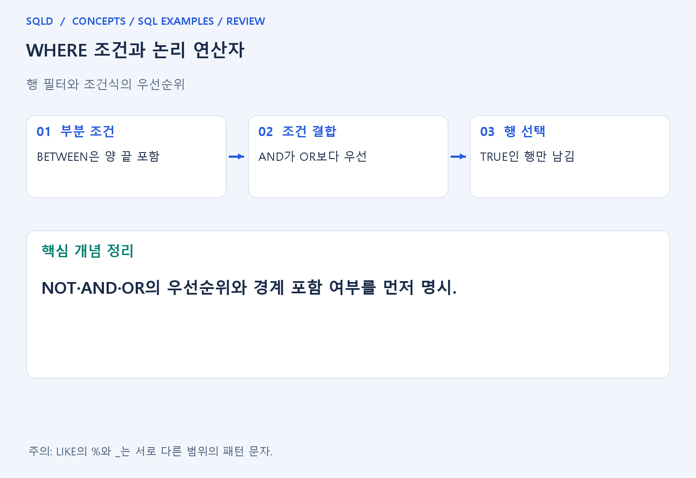
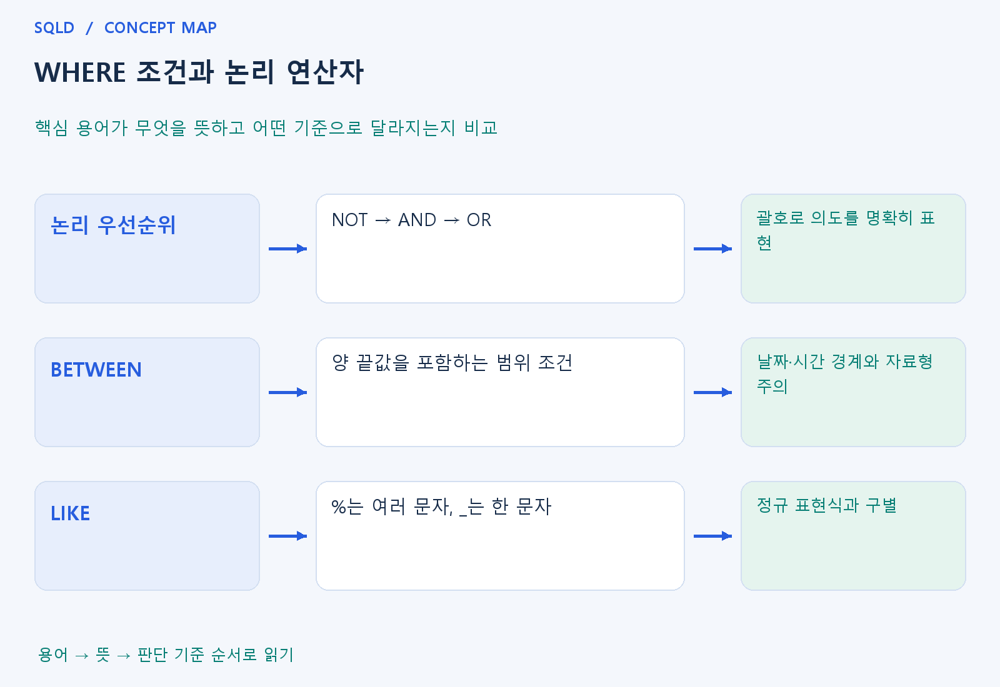

# WHERE 조건과 논리 연산자

- **학습 순서**: 개념 설명 → 그림으로 원리 확인 → 예제와 풀이 → 복습 요약.

## 이 글의 목차

- [1. 개념의 뜻과 동작 원리](#1.%20%EA%B0%9C%EB%85%90%EC%9D%98%20%EB%9C%BB%EA%B3%BC%20%EB%8F%99%EC%9E%91%20%EC%9B%90%EB%A6%AC)
  - [1-1. WHERE가 행을 선택하는 기준](#1-1.%20WHERE%EA%B0%80%20%ED%96%89%EC%9D%84%20%EC%84%A0%ED%83%9D%ED%95%98%EB%8A%94%20%EA%B8%B0%EC%A4%80)
  - [1-2. 논리 연산과 괄호](#1-2.%20%EB%85%BC%EB%A6%AC%20%EC%97%B0%EC%82%B0%EA%B3%BC%20%EA%B4%84%ED%98%B8)
  - [1-3. 범위·목록·패턴 조건](#1-3.%20%EB%B2%94%EC%9C%84%C2%B7%EB%AA%A9%EB%A1%9D%C2%B7%ED%8C%A8%ED%84%B4%20%EC%A1%B0%EA%B1%B4)
- [2. 세부 정의와 관련 규칙](#2.%20%EC%84%B8%EB%B6%80%20%EC%A0%95%EC%9D%98%EC%99%80%20%EA%B4%80%EB%A0%A8%20%EA%B7%9C%EC%B9%99)
  - [2-1. 정의와 기본 규칙](#2-1.%20%EC%A0%95%EC%9D%98%EC%99%80%20%EA%B8%B0%EB%B3%B8%20%EA%B7%9C%EC%B9%99)
- [3. 핵심 차이 한눈에 보기](#3.%20%ED%95%B5%EC%8B%AC%20%EC%B0%A8%EC%9D%B4%20%ED%95%9C%EB%88%88%EC%97%90%20%EB%B3%B4%EA%B8%B0)
- [4. 예제](#4.%20%EC%98%88%EC%A0%9C)
- [5. 복습 요약](#5.%20%EB%B3%B5%EC%8A%B5%20%EC%9A%94%EC%95%BD)
- [6. 관련 글과 추가 학습](#6.%20%EA%B4%80%EB%A0%A8%20%EA%B8%80%EA%B3%BC%20%EC%B6%94%EA%B0%80%20%ED%95%99%EC%8A%B5)

## 1. 개념의 뜻과 동작 원리

### 1-1. WHERE가 행을 선택하는 기준

- WHERE는 입력 행마다 조건을 검사하여 필요한 행만 남기는 절. 조건이 TRUE여야 통과하며 FALSE와 UNKNOWN은 남지 않는다는 점이 핵심.
- 비교 연산자는 두 값의 같음·크기·범위를 판단하고 논리 연산자는 여러 조건을 결합. 값을 비교하는 일과 그 비교 결과들을 합치는 일은 다른 단계.
- 원본에서 행을 지우는 명령이 아니라 조회·변경 대상 범위를 정하는 조건으로 이해. SELECT의 WHERE에 걸리지 않은 행도 원본에는 그대로 존재.

### 1-2. 논리 연산과 괄호

- 일반적인 우선순위는 NOT, AND, OR 순서. A OR B AND C는 기본적으로 A OR (B AND C)이므로 사람의 문장 읽기 순서와 다를 수 있음.
- 여러 조건이 섞이면 괄호로 업무 의도를 드러내는 것이 중요. 괄호를 추가하는 것은 보기 좋게 꾸미는 일이 아니라 어떤 행을 고를지 정의하는 일.
- UNKNOWN을 함께 계산해야 NULL 행을 정확히 판단할 수 있음. 예를 들어 FALSE AND UNKNOWN은 FALSE지만 TRUE AND UNKNOWN은 UNKNOWN이라는 차이를 확인.

### 1-3. 범위·목록·패턴 조건

- BETWEEN은 양 끝값을 포함하는 범위 조건. 날짜에 시간이 들어 있다면 마지막 날짜의 0시만 포함하는 등 의도와 다른 경계가 생길 수 있어 자료형과 시간 범위를 확인.
- IN은 값 목록 중 일치 여부를 묻는 조건이고 LIKE는 문자열 패턴을 묻는 조건. LIKE의 %는 길이 0 이상의 여러 문자, _는 한 문자를 나타냄.
- NOT IN 목록의 NULL이나 NULL에 대한 일반 비교는 직관과 다른 결과를 만들 수 있음. 결측을 검사할 때는 IS NULL과 IS NOT NULL을 사용.
- WHERE는 행마다 조건을 검사해 TRUE인 행만 남김. 여러 조건을 연결할 때는 비교 범위와 AND·OR의 우선순위를 먼저 확인하고, 의도한 묶음을 괄호로 드러내면 해석 오류를 줄일 수 있음.

## 2. 세부 정의와 관련 규칙

### 2-1. 정의와 기본 규칙


- WHERE는 TRUE인 행만 남김.
- AND는 함께 만족, OR는 하나 이상 만족, NOT은 논리를 반전하지만 UNKNOWN은 그대로 UNKNOWN임.

- AND가 OR보다 먼저 묶이므로 의도에 맞게 괄호를 씀.
- BETWEEN은 양끝 포함이고 IN 목록의 중복은 원래 행을 복제하지 않음.

- LIKE의 %는 0개 이상 글자, _는 한 글자임.
- 실제 %와 _를 찾으려면 ESCAPE 규칙을 명시할 수 있음.



## 3. 핵심 차이 한눈에 보기

|  구분 | 핵심 뜻 | 확인할 기준 |
| --- | --- | --- |
| 논리 우선순위 | NOT → AND → OR | 괄호로 의도를 명확히 표현 |
| BETWEEN | 양 끝값을 포함하는 범위 조건 | 날짜·시간 경계와 자료형 주의 |
| LIKE | %는 여러 문자, _는 한 문자 | 정규 표현식과 구별 |



## 4. 예제

- **상황**: 값 1, 2, 3 중 지정한 범위 안의 값만 조회하려는 상황.
- **질문**: 값 1, 2, 3 중 BETWEEN 1 AND 2를 통과하는 값은 무엇인가? 경계값도 포함되는가?
- **실행 기준**: SQLite 확인용. 입력 데이터와 필요한 객체를 코드 안에 포함.

```sql
WITH t(v) AS (VALUES (1),(2),(3))
SELECT v FROM t WHERE v BETWEEN 1 AND 2 ORDER BY v;
```

- **결과**: 1, 2 두 행.
- **풀이 ①**: 하한 1과 상한 2를 포함해 각 값을 범위와 비교.
- **풀이 ②**: BETWEEN은 양 끝을 포함.

- [예제 소스](../../short_examples/n16.sql)

## 5. 복습 요약

- **논리 우선순위**: NOT → AND → OR. 괄호로 의도를 명확히 표현.
- **BETWEEN**: 양 끝값을 포함하는 범위 조건. 날짜·시간 경계와 자료형 주의.
- **LIKE**: %는 여러 문자, _는 한 문자. 정규 표현식과 구별.

## 6. 관련 글과 추가 학습

- [전체 목차](../../00_%EC%A0%84%EC%B2%B4%EB%AA%A9%EC%B0%A8.md)
- [개념별 빠른 복습표](../../%EB%B3%B5%EC%8A%B5_%ED%95%B5%EC%8B%AC%EB%B9%84%EA%B5%90%ED%91%9C.md)
- [추가 SQL 소스 안내](../../%EC%B6%94%EA%B0%80_SQL_%EC%86%8C%EC%8A%A4%EC%95%88%EB%82%B4.md)
