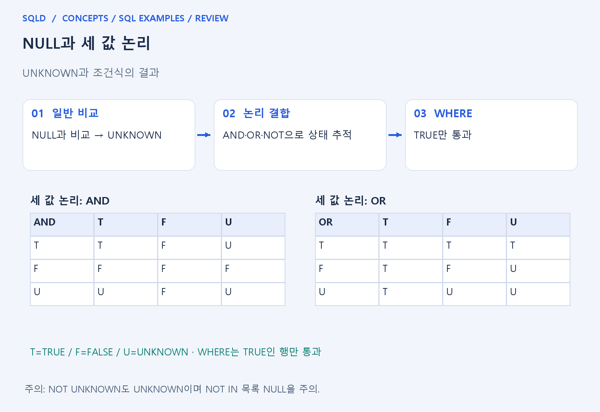
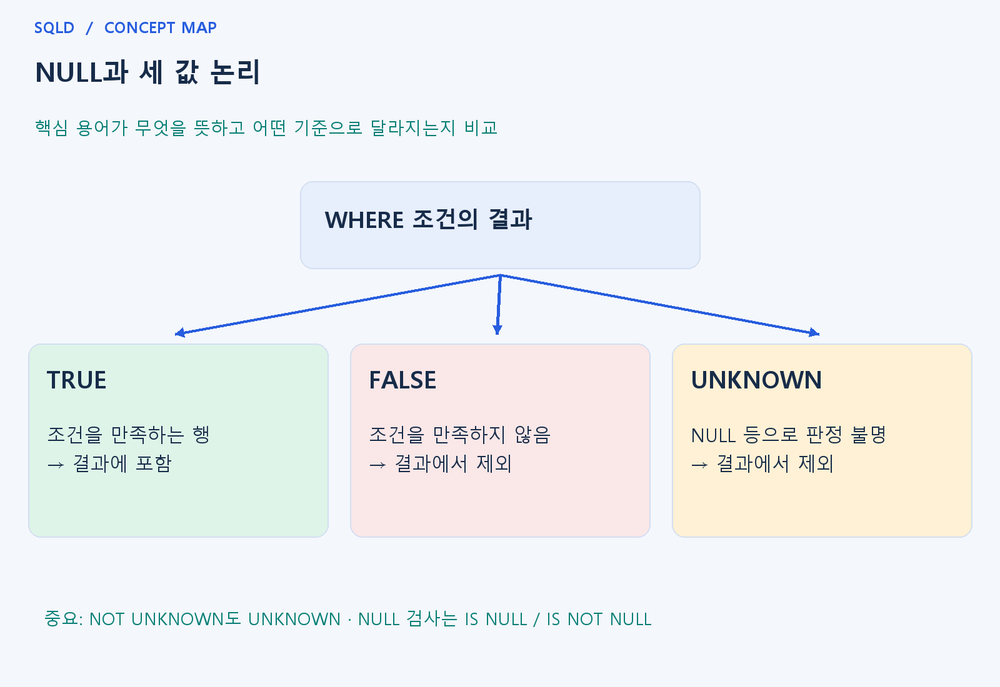

# NULL과 세 값 논리

- **학습 순서**: 개념 설명 → 그림으로 원리 확인 → 예제와 풀이 → 복습 요약.

## 이 글의 목차

- [1. 개념의 뜻과 동작 원리](#1.%20%EA%B0%9C%EB%85%90%EC%9D%98%20%EB%9C%BB%EA%B3%BC%20%EB%8F%99%EC%9E%91%20%EC%9B%90%EB%A6%AC)
  - [1-1. 세 값 논리가 필요한 이유](#1-1.%20%EC%84%B8%20%EA%B0%92%20%EB%85%BC%EB%A6%AC%EA%B0%80%20%ED%95%84%EC%9A%94%ED%95%9C%20%EC%9D%B4%EC%9C%A0)
  - [1-2. AND·OR·NOT의 판단 원리](#1-2.%20AND%C2%B7OR%C2%B7NOT%EC%9D%98%20%ED%8C%90%EB%8B%A8%20%EC%9B%90%EB%A6%AC)
  - [1-3. 조회와 집합 처리에서 주의할 점](#1-3.%20%EC%A1%B0%ED%9A%8C%EC%99%80%20%EC%A7%91%ED%95%A9%20%EC%B2%98%EB%A6%AC%EC%97%90%EC%84%9C%20%EC%A3%BC%EC%9D%98%ED%95%A0%20%EC%A0%90)
- [2. 세부 정의와 관련 규칙](#2.%20%EC%84%B8%EB%B6%80%20%EC%A0%95%EC%9D%98%EC%99%80%20%EA%B4%80%EB%A0%A8%20%EA%B7%9C%EC%B9%99)
  - [2-1. 정의와 기본 규칙](#2-1.%20%EC%A0%95%EC%9D%98%EC%99%80%20%EA%B8%B0%EB%B3%B8%20%EA%B7%9C%EC%B9%99)
- [3. 핵심 차이 한눈에 보기](#3.%20%ED%95%B5%EC%8B%AC%20%EC%B0%A8%EC%9D%B4%20%ED%95%9C%EB%88%88%EC%97%90%20%EB%B3%B4%EA%B8%B0)
- [4. 예제](#4.%20%EC%98%88%EC%A0%9C)
- [5. 복습 요약](#5.%20%EB%B3%B5%EC%8A%B5%20%EC%9A%94%EC%95%BD)
- [6. 관련 글과 추가 학습](#6.%20%EA%B4%80%EB%A0%A8%20%EA%B8%80%EA%B3%BC%20%EC%B6%94%EA%B0%80%20%ED%95%99%EC%8A%B5)

## 1. 개념의 뜻과 동작 원리

### 1-1. 세 값 논리가 필요한 이유

- NULL은 비교할 값이 알려지지 않았다는 뜻을 포함하므로 일반 비교를 항상 참이나 거짓으로 단정할 수 없음. 이때의 판단 상태가 UNKNOWN.
- NULL=1이 UNKNOWN인 이유는 1이 아닌 값이라고 확인된 것이 아니라, 어떤 값인지 모르기 때문. 같은 이유로 NULL=NULL도 일반 등호에서는 TRUE라고 판정하지 않음.
- IS NULL은 값의 같음을 묻는 연산이 아니라 결측 표시인지 묻는 검사. 일반 비교와 질문이 다르므로 결측 조회에 IS NULL을 쓰는 것.

### 1-2. AND·OR·NOT의 판단 원리

- AND는 모두 참이어야 하므로 하나가 확실히 FALSE이면 다른 쪽이 UNKNOWN이어도 전체는 FALSE. 한쪽 TRUE와 다른 쪽 UNKNOWN이면 전체를 확정할 수 없음.
- OR는 하나라도 TRUE이면 전체가 TRUE이므로 TRUE OR UNKNOWN은 TRUE. FALSE OR UNKNOWN은 나머지 조건에 달려 있어 UNKNOWN으로 남음.
- NOT은 UNKNOWN을 FALSE로 바꾸지 않음. 알 수 없는 명제의 반대도 알 수 없으므로 NOT UNKNOWN은 UNKNOWN이라는 규칙을 기억.

### 1-3. 조회와 집합 처리에서 주의할 점

- WHERE는 TRUE만 남기므로 UNKNOWN 행도 제외. NULL 비교가 조건을 만족하지 않는 것처럼 보이더라도 내부 판정이 FALSE인 것과는 구별해야 함.
- NOT IN의 비교 목록에 NULL이 있으면 제외하려던 값이 아닌 행도 UNKNOWN이 되어 빠질 수 있음. 목록의 결측 제거 또는 목적에 맞는 NOT EXISTS를 검토.
- GROUP BY의 NULL 묶음과 UNION의 중복 제거는 일반 등호 비교와 다른 규칙으로 처리. NULL이 있는 행이 묶인다고 NULL=NULL이 TRUE가 되는 것은 아님.
- NULL은 값이 없거나 알려지지 않은 상태이므로 일반 비교로 같은 값인지 확인하지 않음. IS NULL로 결측 여부를 검사하고, WHERE에서 UNKNOWN은 FALSE와 마찬가지로 선택되지 않는다는 점을 연결해 이해.

## 2. 세부 정의와 관련 규칙

### 2-1. 정의와 기본 규칙


- NULL과의 일반 비교는 UNKNOWN이며 WHERE는 UNKNOWN을 남기지 않음.
- NULL 확인은 IS NULL 또는 IS NOT NULL임.

- 숫자+NULL은 보통 NULL임.
- COALESCE는 왼쪽부터 처음 NULL이 아닌 값을 반환하고 NULLIF는 두 값이 같으면 NULL임.

- NOT IN 목록에 NULL이 있으면 예상 밖의 0행이 나올 수 있음.
- Oracle은 빈 문자열을 NULL로 취급하는 특성이 있어 SQLite의 빈 문자열과 구분해야 함.



## 3. 핵심 차이 한눈에 보기

|  구분 | 핵심 뜻 | 확인할 기준 |
| --- | --- | --- |
| 일반 비교 | NULL과의 비교 결과는 UNKNOWN | NULL 검사는 IS NULL 사용 |
| NOT UNKNOWN | 여전히 UNKNOWN | 참·거짓 두 값만으로 계산하지 않음 |
| WHERE·NOT IN | TRUE만 선택 / 목록 NULL에 주의 | EXISTS와의 차이를 조건별 검토 |



## 4. 예제

- **상황**: 값 1과 NULL이 있으며, 값이 비어 있는 행의 수를 확인하려는 상황.
- **질문**: 값 1과 NULL 중 결측인 행을 고르면 COUNT(*)는 얼마인가? = NULL 대신 IS NULL을 쓰는 이유도 생각하라.
- **실행 기준**: SQLite 확인용. 입력 데이터와 필요한 객체를 코드 안에 포함.

```sql
WITH t(v) AS (VALUES (1),(NULL))
SELECT COUNT(*) FROM t WHERE v IS NULL;
```

- **결과**: 결과는 1.
- **풀이 ①**: WHERE의 IS NULL 검사에서 NULL 행만 TRUE가 됨.
- **풀이 ②**: 결측 한 행을 IS NULL로 선택. = NULL은 TRUE가 되지 않아 결측 행을 선택하는 조건으로 사용할 수 없음.

- [예제 소스](../../short_examples/n17.sql)

## 5. 복습 요약

- **일반 비교**: NULL과의 비교 결과는 UNKNOWN. NULL 검사는 IS NULL 사용.
- **NOT UNKNOWN**: 여전히 UNKNOWN. 참·거짓 두 값만으로 계산하지 않음.
- **WHERE·NOT IN**: TRUE만 선택 / 목록 NULL에 주의. EXISTS와의 차이를 조건별 검토.

## 6. 관련 글과 추가 학습

- [전체 목차](../../00_%EC%A0%84%EC%B2%B4%EB%AA%A9%EC%B0%A8.md)
- [개념별 빠른 복습표](../../%EB%B3%B5%EC%8A%B5_%ED%95%B5%EC%8B%AC%EB%B9%84%EA%B5%90%ED%91%9C.md)
- [추가 SQL 소스 안내](../../%EC%B6%94%EA%B0%80_SQL_%EC%86%8C%EC%8A%A4%EC%95%88%EB%82%B4.md)
