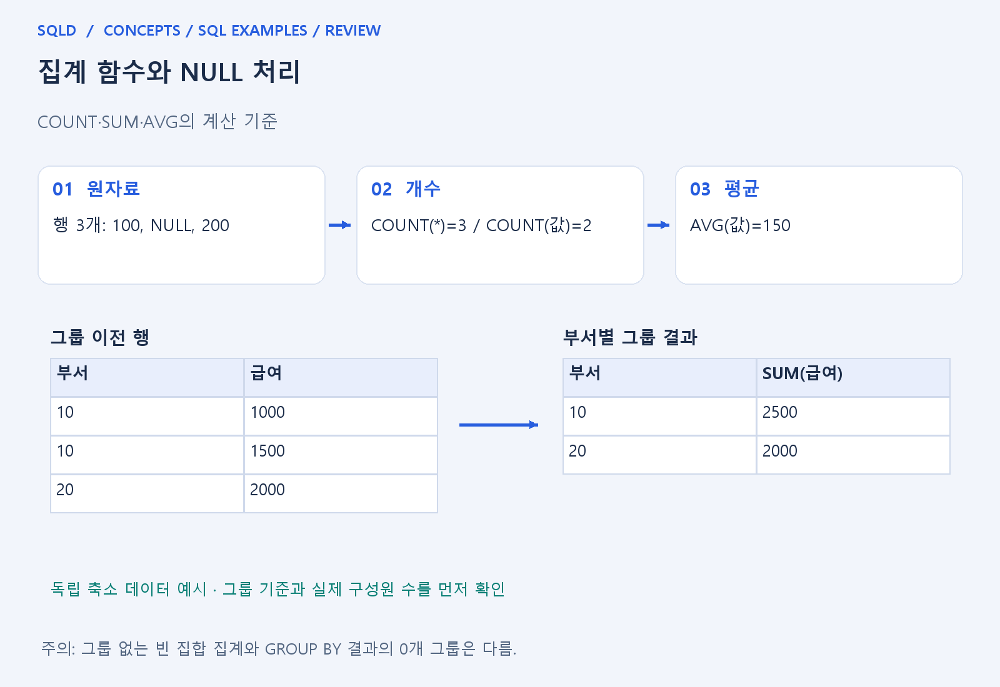
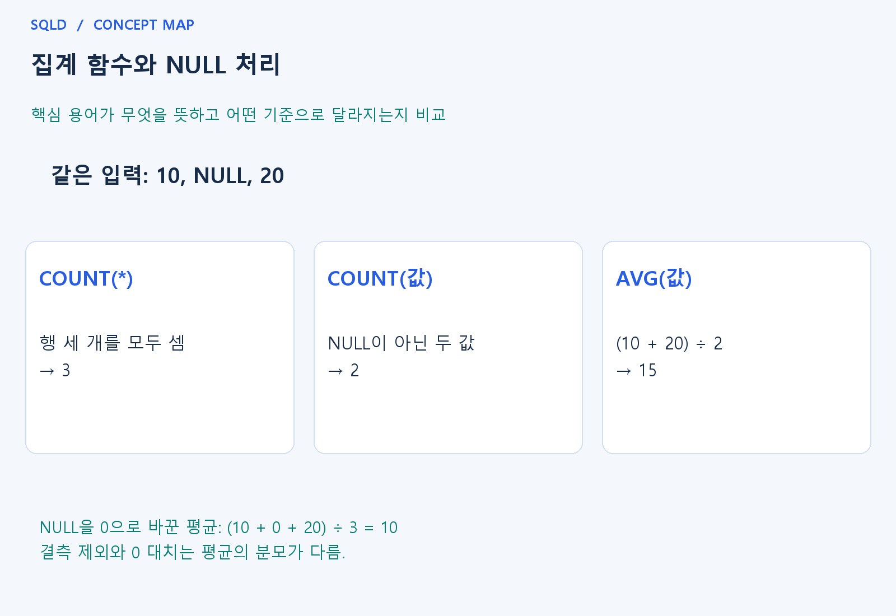

# 집계 함수와 NULL 처리

- **학습 순서**: 개념 설명 → 그림으로 원리 확인 → 예제와 풀이 → 복습 요약.

## 이 글의 목차

- [1. 개념의 뜻과 동작 원리](#1.%20%EA%B0%9C%EB%85%90%EC%9D%98%20%EB%9C%BB%EA%B3%BC%20%EB%8F%99%EC%9E%91%20%EC%9B%90%EB%A6%AC)
  - [1-1. 집계 함수의 역할](#1-1.%20%EC%A7%91%EA%B3%84%20%ED%95%A8%EC%88%98%EC%9D%98%20%EC%97%AD%ED%95%A0)
  - [1-2. NULL과 분모의 차이](#1-2.%20NULL%EA%B3%BC%20%EB%B6%84%EB%AA%A8%EC%9D%98%20%EC%B0%A8%EC%9D%B4)
  - [1-3. 빈 집합과 중복의 해석](#1-3.%20%EB%B9%88%20%EC%A7%91%ED%95%A9%EA%B3%BC%20%EC%A4%91%EB%B3%B5%EC%9D%98%20%ED%95%B4%EC%84%9D)
- [2. 세부 정의와 관련 규칙](#2.%20%EC%84%B8%EB%B6%80%20%EC%A0%95%EC%9D%98%EC%99%80%20%EA%B4%80%EB%A0%A8%20%EA%B7%9C%EC%B9%99)
  - [2-1. 정의와 기본 규칙](#2-1.%20%EC%A0%95%EC%9D%98%EC%99%80%20%EA%B8%B0%EB%B3%B8%20%EA%B7%9C%EC%B9%99)
- [3. 핵심 차이 한눈에 보기](#3.%20%ED%95%B5%EC%8B%AC%20%EC%B0%A8%EC%9D%B4%20%ED%95%9C%EB%88%88%EC%97%90%20%EB%B3%B4%EA%B8%B0)
- [4. 예제](#4.%20%EC%98%88%EC%A0%9C)
- [5. 복습 요약](#5.%20%EB%B3%B5%EC%8A%B5%20%EC%9A%94%EC%95%BD)
- [6. 관련 글과 추가 학습](#6.%20%EA%B4%80%EB%A0%A8%20%EA%B8%80%EA%B3%BC%20%EC%B6%94%EA%B0%80%20%ED%95%99%EC%8A%B5)

## 1. 개념의 뜻과 동작 원리

### 1-1. 집계 함수의 역할

- 집계 함수는 여러 행의 값을 하나의 요약값으로 바꾸는 함수. GROUP BY가 있으면 그룹마다 계산하고 없으면 조회 대상 전체를 하나의 집계 대상으로 이해.
- COUNT는 개수, SUM은 합계, AVG는 평균, MIN·MAX는 최솟값·최댓값을 계산. 이름만 외우기보다 어떤 행과 값이 계산에 들어가는지 확인하는 것이 중요.
- 집계 전 WHERE가 행을 제거하면 집계 대상도 달라짐. 같은 함수라도 앞의 필터·조인·중복 여부에 따라 결과가 달라지는 이유가 여기에 있음.

### 1-2. NULL과 분모의 차이

- COUNT(*)는 행의 존재를 세므로 모든 열이 NULL로 보이는 보존 행도 포함. COUNT(열)은 해당 열의 값이 NULL이 아닌 행만 세며 실제 값 0은 포함.
- SUM·AVG는 일반적으로 해당 열의 NULL 값을 제외. 특히 AVG는 전체 행 수가 아니라 비NULL 값 수가 분모가 되므로 먼저 분모를 확인해야 함.
- NULL을 0으로 바꿔도 SUM은 같아 보일 수 있지만 AVG는 관측값 수가 늘어 달라질 수 있음. 대치는 계산 편의가 아니라 업무 의미의 선택.

### 1-3. 빈 집합과 중복의 해석

- 그룹 없는 빈 입력의 집계에서 COUNT는 0, SUM·AVG 등은 보통 NULL이 됨. 반면 GROUP BY로 구성할 그룹 자체가 없으면 결과 행이 0개일 수 있음.
- DISTINCT를 집계 인수에 쓰면 해당 값의 중복을 제거한 뒤 계산. 서로 다른 사건이 같은 금액을 가질 수 있으므로 사실의 중복과 값의 중복을 구분.
- 외부 조인 뒤 실제 자식 수가 필요하면 NULL이 될 수 없는 자식 키의 COUNT를 검토. COUNT(*)는 실제 자식이 없는 보존 행도 세기 때문.
- 집계 결과를 읽을 때는 먼저 행의 수와 실제 값의 수를 구분. COUNT(*)는 행 자체를 세지만 COUNT(열)과 AVG(열)는 그 열의 NULL을 제외하므로, 같은 입력에서도 개수와 평균의 분모가 달라짐.

## 2. 세부 정의와 관련 규칙

### 2-1. 정의와 기본 규칙


- COUNT(*)는 행을 세고 COUNT(열)는 NULL 아닌 값을 셈.
- 0도 값이므로 셈.
- COUNT(DISTINCT 열)는 구별되는 NULL 아닌 값을 셈.

- SUM/AVG/MIN/MAX는 일반적으로 NULL 입력을 제외함.
- AVG의 분모는 전체 행 수가 아니라 해당 식의 NULL 아닌 값 수임.

- GROUP BY 없는 빈 입력 집계는 결과 한 행을 만들며 COUNT는0, SUM과AVG는NULL임.
- 그룹을 만들 대상 자체가 없는 GROUP BY 결과와 구분함.



## 3. 핵심 차이 한눈에 보기

|  구분 | 핵심 뜻 | 확인할 기준 |
| --- | --- | --- |
| COUNT(*) | 결과의 행 수 집계 | NULL 확장 행도 포함 |
| COUNT(열) | 해당 열의 비NULL 값 수 | 0은 결측이 아니므로 포함 |
| SUM·AVG | 비NULL 값을 기준으로 계산 | AVG의 분모와 빈 집합 결과 확인 |



## 4. 예제

- **상황**: 측정값 10, NULL, 20을 저장한 세 행에서 개수와 평균을 비교하려는 상황.
- **질문**: 10, NULL, 20 세 행에서 COUNT(*), COUNT(v), AVG(v)는 각각 얼마인가?
- **실행 기준**: SQLite 확인용. 입력 데이터와 필요한 객체를 코드 안에 포함.

```sql
WITH t(v) AS (VALUES (10),(NULL),(20))
SELECT COUNT(*), COUNT(v), AVG(v) FROM t;
```

- **결과**: 행 수 3, 값 수 2, 평균 15.
- **풀이 ①**: 전체 행은 세 개지만 숫자가 들어 있는 v는 10과 20 두 개.
- **풀이 ②**: NULL은 행에는 포함되지만 COUNT(v)와 AVG(v)에서는 제외.

- [예제 소스](../../short_examples/n18.sql)

## 5. 복습 요약

- **COUNT(*)**: 결과의 행 수 집계. NULL 확장 행도 포함.
- **COUNT(열)**: 해당 열의 비NULL 값 수. 0은 결측이 아니므로 포함.
- **SUM·AVG**: 비NULL 값을 기준으로 계산. AVG의 분모와 빈 집합 결과 확인.

## 6. 관련 글과 추가 학습

- [전체 목차](../../00_%EC%A0%84%EC%B2%B4%EB%AA%A9%EC%B0%A8.md)
- [개념별 빠른 복습표](../../%EB%B3%B5%EC%8A%B5_%ED%95%B5%EC%8B%AC%EB%B9%84%EA%B5%90%ED%91%9C.md)
- [추가 SQL 소스 안내](../../%EC%B6%94%EA%B0%80_SQL_%EC%86%8C%EC%8A%A4%EC%95%88%EB%82%B4.md)
