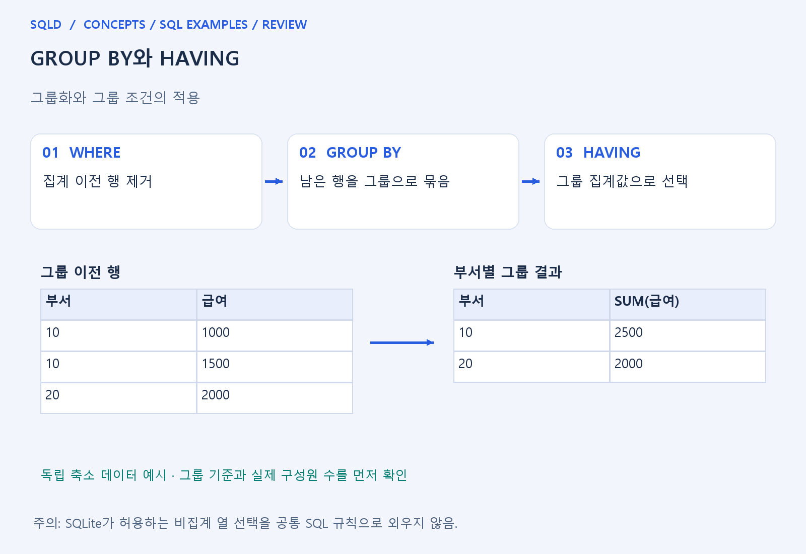
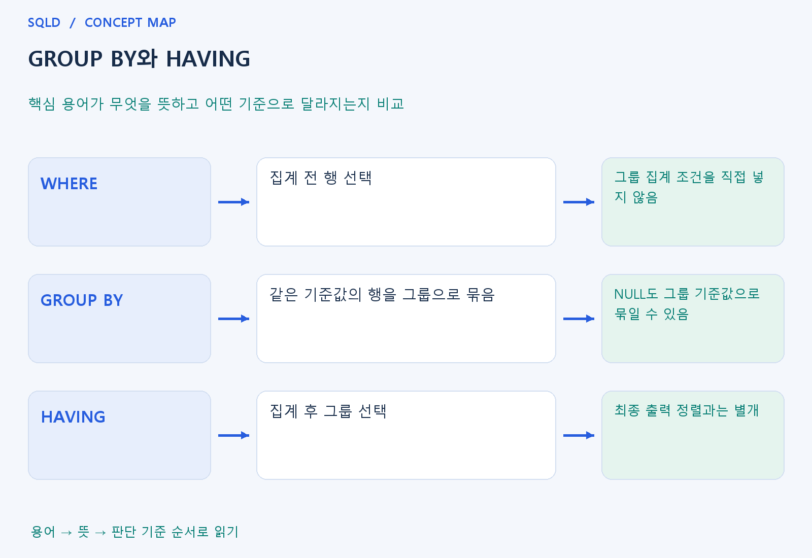

# GROUP BY와 HAVING

- **학습 순서**: 개념 설명 → 그림으로 원리 확인 → 예제와 풀이 → 복습 요약.

## 이 글의 목차

- [1. 개념의 뜻과 동작 원리](#1.%20%EA%B0%9C%EB%85%90%EC%9D%98%20%EB%9C%BB%EA%B3%BC%20%EB%8F%99%EC%9E%91%20%EC%9B%90%EB%A6%AC)
  - [1-1. GROUP BY의 의미](#1-1.%20GROUP%20BY%EC%9D%98%20%EC%9D%98%EB%AF%B8)
  - [1-2. WHERE와 HAVING의 차이](#1-2.%20WHERE%EC%99%80%20HAVING%EC%9D%98%20%EC%B0%A8%EC%9D%B4)
  - [1-3. NULL·정렬·처리 단계](#1-3.%20NULL%C2%B7%EC%A0%95%EB%A0%AC%C2%B7%EC%B2%98%EB%A6%AC%20%EB%8B%A8%EA%B3%84)
- [2. 세부 정의와 관련 규칙](#2.%20%EC%84%B8%EB%B6%80%20%EC%A0%95%EC%9D%98%EC%99%80%20%EA%B4%80%EB%A0%A8%20%EA%B7%9C%EC%B9%99)
  - [2-1. 정의와 기본 규칙](#2-1.%20%EC%A0%95%EC%9D%98%EC%99%80%20%EA%B8%B0%EB%B3%B8%20%EA%B7%9C%EC%B9%99)
- [3. 핵심 차이 한눈에 보기](#3.%20%ED%95%B5%EC%8B%AC%20%EC%B0%A8%EC%9D%B4%20%ED%95%9C%EB%88%88%EC%97%90%20%EB%B3%B4%EA%B8%B0)
- [4. 예제](#4.%20%EC%98%88%EC%A0%9C)
- [5. 복습 요약](#5.%20%EB%B3%B5%EC%8A%B5%20%EC%9A%94%EC%95%BD)
- [6. 관련 글과 추가 학습](#6.%20%EA%B4%80%EB%A0%A8%20%EA%B8%80%EA%B3%BC%20%EC%B6%94%EA%B0%80%20%ED%95%99%EC%8A%B5)

## 1. 개념의 뜻과 동작 원리

### 1-1. GROUP BY의 의미

- GROUP BY는 지정한 기준값이 같은 행들을 묶는 절. 부서별 급여 합계를 원하면 부서가 기준이고 각 그룹에 속한 급여들이 집계 대상이 됨.
- 그룹 기준이 여러 열이면 열별로 따로 묶는 것이 아니라 전체 조합이 같은 행을 묶음. 부서와 직급을 함께 쓰면 부서·직급 조합마다 결과가 생김.
- 일반적인 그룹 조회에서는 SELECT의 비집계 열이 그룹 기준과 일관되어야 함. 그룹 안에서 하나로 정해지지 않은 값을 임의로 출력하는 제품의 예외를 공통 규칙으로 외우지 않음.

### 1-2. WHERE와 HAVING의 차이

- WHERE는 그룹을 만들기 전에 개별 행을 고름. 급여가 일정 값 이상인 직원만 남긴 뒤 부서별로 합치면 집계에 들어가는 구성원부터 달라짐.
- HAVING은 이미 만든 그룹의 집계 결과 등으로 그룹을 고름. 직원 수가 두 명 이상인 부서를 남기는 질문처럼 그룹 수준의 조건에 연결.
- 두 절은 위치만 다른 같은 필터가 아님. 같은 숫자를 조건에 쓰더라도 행 제거인지 그룹 제거인지에 따라 의미와 결과가 달라질 수 있음.

### 1-3. NULL·정렬·처리 단계

- GROUP BY에서 NULL도 하나의 그룹 기준으로 묶일 수 있음. 이를 일반 등호 비교의 NULL 규칙과 혼동하지 않아야 함.
- 설명용 논리 흐름은 입력·조인→WHERE→GROUP BY→HAVING→출력과 정렬로 이해. 엔진의 실제 물리 실행이 반드시 이 순서라는 뜻은 아님.
- GROUP BY 자체가 최종 출력 순서를 보장하지 않음. 부서 순서·합계 순서가 필요하면 ORDER BY를 별도로 지정.
- GROUP BY는 결과 한 행의 단위를 개별 행에서 그룹으로 바꿈. WHERE로 원본 행을 고른 뒤 그룹을 만들고 HAVING으로 그룹을 고른다는 논리적 흐름을 잡으면 두 조건절의 역할을 구별하기 쉬움.

## 2. 세부 정의와 관련 규칙

### 2-1. 정의와 기본 규칙


- WHERE는 그룹 전 개별 행, GROUP BY는 그룹 구성, HAVING은 그룹 결과 조건임.
- SQL 쓰기 순서와 논리 처리 순서를 분리해 이해함.

- 일반적인 이식성 있는 SQL에서는 SELECT의 비집계 열을 GROUP BY에 맞춤.
- SQLite가 허용하는 비그룹 bare column에 의존하지 않음.

- GROUP BY는 NULL들도 하나의 그룹으로 묶음.
- SELECT의 COALESCE 표시값과 실제 그룹 기준을 혼동하지 않음.



## 3. 핵심 차이 한눈에 보기

|  구분 | 핵심 뜻 | 확인할 기준 |
| --- | --- | --- |
| WHERE | 집계 전 행 선택 | 그룹 집계 조건을 직접 넣지 않음 |
| GROUP BY | 같은 기준값의 행을 그룹으로 묶음 | NULL도 그룹 기준값으로 묶일 수 있음 |
| HAVING | 집계 후 그룹 선택 | 최종 출력 정렬과는 별개 |



## 4. 예제

- **상황**: 부서 10에는 값 1, 2가 있고 부서 20에는 값 3이 있는 상황.
- **질문**: 부서 10에 두 행, 부서 20에 한 행이 있을 때 두 행 이상인 부서만 남기면 어떤 부서와 개수가 나오는가?
- **실행 기준**: SQLite 확인용. 입력 데이터와 필요한 객체를 코드 안에 포함.

```sql
WITH t(d,v) AS (VALUES (10,1),(10,2),(20,3))
SELECT d,COUNT(*) FROM t GROUP BY d
HAVING COUNT(*)>=2;
```

- **결과**: 10번 그룹, 개수 2.
- **풀이 ①**: 부서번호 d로 묶으면 10번 그룹은 두 행, 20번 그룹은 한 행.
- **풀이 ②**: 그룹을 만든 뒤 두 행 이상인 그룹만 선택.

- [예제 소스](../../short_examples/n19.sql)

## 5. 복습 요약

- **WHERE**: 집계 전 행 선택. 그룹 집계 조건을 직접 넣지 않음.
- **GROUP BY**: 같은 기준값의 행을 그룹으로 묶음. NULL도 그룹 기준값으로 묶일 수 있음.
- **HAVING**: 집계 후 그룹 선택. 최종 출력 정렬과는 별개.

## 6. 관련 글과 추가 학습

- [전체 목차](../../00_%EC%A0%84%EC%B2%B4%EB%AA%A9%EC%B0%A8.md)
- [개념별 빠른 복습표](../../%EB%B3%B5%EC%8A%B5_%ED%95%B5%EC%8B%AC%EB%B9%84%EA%B5%90%ED%91%9C.md)
- [추가 SQL 소스 안내](../../%EC%B6%94%EA%B0%80_SQL_%EC%86%8C%EC%8A%A4%EC%95%88%EB%82%B4.md)
