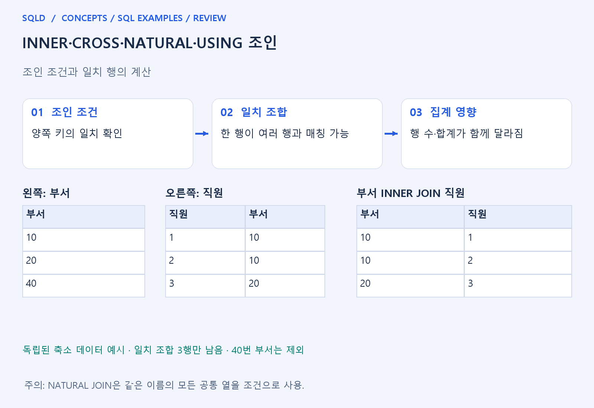
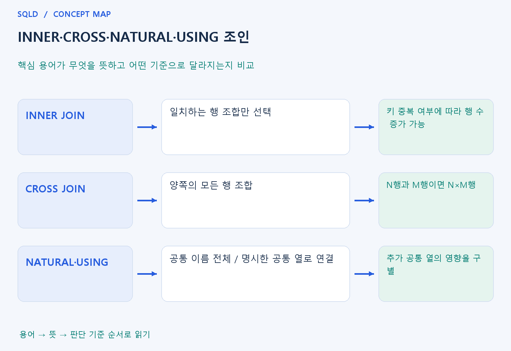

# INNER·CROSS·NATURAL·USING 조인

- **학습 순서**: 개념 설명 → 그림으로 원리 확인 → 예제와 풀이 → 복습 요약.

## 이 글의 목차

- [1. 개념의 뜻과 동작 원리](#1.%20%EA%B0%9C%EB%85%90%EC%9D%98%20%EB%9C%BB%EA%B3%BC%20%EB%8F%99%EC%9E%91%20%EC%9B%90%EB%A6%AC)
  - [1-1. 조인의 기본 원리](#1-1.%20%EC%A1%B0%EC%9D%B8%EC%9D%98%20%EA%B8%B0%EB%B3%B8%20%EC%9B%90%EB%A6%AC)
  - [1-2. ON·USING·NATURAL의 연결 기준](#1-2.%20ON%C2%B7USING%C2%B7NATURAL%EC%9D%98%20%EC%97%B0%EA%B2%B0%20%EA%B8%B0%EC%A4%80)
  - [1-3. 행 수와 합계의 판단](#1-3.%20%ED%96%89%20%EC%88%98%EC%99%80%20%ED%95%A9%EA%B3%84%EC%9D%98%20%ED%8C%90%EB%8B%A8)
- [2. 세부 정의와 관련 규칙](#2.%20%EC%84%B8%EB%B6%80%20%EC%A0%95%EC%9D%98%EC%99%80%20%EA%B4%80%EB%A0%A8%20%EA%B7%9C%EC%B9%99)
  - [2-1. 정의와 기본 규칙](#2-1.%20%EC%A0%95%EC%9D%98%EC%99%80%20%EA%B8%B0%EB%B3%B8%20%EA%B7%9C%EC%B9%99)
- [3. 핵심 차이 한눈에 보기](#3.%20%ED%95%B5%EC%8B%AC%20%EC%B0%A8%EC%9D%B4%20%ED%95%9C%EB%88%88%EC%97%90%20%EB%B3%B4%EA%B8%B0)
- [4. 예제](#4.%20%EC%98%88%EC%A0%9C)
- [5. 복습 요약](#5.%20%EB%B3%B5%EC%8A%B5%20%EC%9A%94%EC%95%BD)
- [6. 관련 글과 추가 학습](#6.%20%EA%B4%80%EB%A0%A8%20%EA%B8%80%EA%B3%BC%20%EC%B6%94%EA%B0%80%20%ED%95%99%EC%8A%B5)

## 1. 개념의 뜻과 동작 원리

### 1-1. 조인의 기본 원리

- 조인은 표 사이에서 관련된 행을 찾아 하나의 결과로 연결하는 방법. 각 표의 같은 줄을 붙이는 것이 아니라 조인 조건을 만족하는 조합을 찾는 작업.
- INNER JOIN은 조건에 맞는 조합만 남김. 왼쪽 한 행이 오른쪽 여러 행과 일치하면 결과에 여러 번 나타나므로 테이블의 키·중복 제약을 먼저 확인.
- CROSS JOIN은 모든 조합을 만듦. 왼쪽 N행과 오른쪽 M행이면 N×M행이며, 조건을 빠뜨린 조인이 의도치 않은 큰 결과를 만드는 이유도 이 관점으로 이해.

### 1-2. ON·USING·NATURAL의 연결 기준

- ON은 서로 어떤 조건으로 연결할지 명시. 열 이름이 달라도 비교할 수 있고 등호뿐 아니라 필요한 비교 조건을 표현할 수 있음.
- USING은 양쪽에 같은 이름으로 존재하는 특정 열을 지정해 연결. NATURAL JOIN은 같은 이름의 공통 열들을 자동으로 연결 기준에 사용한다는 차이.
- NATURAL JOIN에서는 새 공통 열이 생기면 조건의 의미가 바뀔 수 있음. 이름이 같다는 이유가 업무상 같은 관계를 뜻하는지도 함께 확인해야 함.

### 1-3. 행 수와 합계의 판단

- 결과 행 수는 각 행의 매칭 개수에 달림. 유일한 키로 한 번만 연결되는 경우와 일반 열의 중복으로 여러 번 연결되는 경우를 구분.
- 조인 뒤 SUM이 예상보다 크면 입력 금액보다 먼저 결과 한 행의 단위를 확인. 같은 금액이 여러 조합에 반복되어 들어갔을 수 있음.
- 자식 표를 먼저 같은 단위로 집계하거나 존재 여부만 확인하는 식으로 목적에 맞게 설계. 결과가 많다는 이유만으로 무조건 DISTINCT를 붙이지 않음.
- 조인은 조건을 만족하는 행의 조합을 만드는 과정이므로 원본 키 값이 반복되면 결과도 늘 수 있음. INNER JOIN의 조건, CROSS JOIN의 모든 조합, NATURAL·USING의 공통 열 규칙을 구분해 연결 기준을 확인.

## 2. 세부 정의와 관련 규칙

### 2-1. 정의와 기본 규칙


- INNER JOIN은 ON조건이 TRUE인 쌍을 생성함.
- 외래키가 있다고 ON 조건이 자동으로 작성되는 것은 아님.

- 일대다 관계에서는 같은 왼쪽 행이 여러 번 나옴.
- 조인 후 집계의 기준 단위가 직원인지 보너스인지 확인함.

- CROSS JOIN은 가능한 모든 쌍을 생성함.
- 조인 조건 누락과 조인 후 중복을 DISTINCT로 무작정 숨기지 말고 데이터 관계를 먼저 점검함.

- USING은 양쪽에서 같은 이름의 연결 열을 명시하는 조인 표현이고 NATURAL JOIN은 같은 이름의 열을 자동 연결 기준으로 삼음.
- 같은 이름의 열이 추가되면 자연 조인 의미가 바뀔 수 있어 연결 기준을 직접 확인해야 함.
- ON으로 작성한 명확한 조건부터 익히세요.



## 3. 핵심 차이 한눈에 보기

|  구분 | 핵심 뜻 | 확인할 기준 |
| --- | --- | --- |
| INNER JOIN | 일치하는 행 조합만 선택 | 키 중복 여부에 따라 행 수 증가 가능 |
| CROSS JOIN | 양쪽의 모든 행 조합 | N행과 M행이면 N×M행 |
| NATURAL·USING | 공통 이름 전체 / 명시한 공통 열로 연결 | 추가 공통 열의 영향을 구별 |



## 4. 예제

- **상황**: 왼쪽 a의 ID는 1, 2이고 오른쪽 b에는 ID 1이 두 행 있는 상황.
- **질문**: a의 ID가 1, 2이고 b의 ID가 1, 1일 때 내부 조인 결과는 몇 행이며, a의 2는 남는가?
- **실행 기준**: SQLite 확인용. 입력 데이터와 필요한 객체를 코드 안에 포함.

```sql
WITH a(id) AS (VALUES (1),(2)),
     b(id) AS (VALUES (1),(1))
SELECT a.id,b.id FROM a JOIN b ON a.id=b.id;
```

- **결과**: (1,1)이 두 행.
- **풀이 ①**: a의 1은 b의 첫 번째 1과 두 번째 1에 각각 일치하고 a의 2는 짝이 없음.
- **풀이 ②**: 왼쪽 1에 맞는 오른쪽 1이 두 개라 두 조합이 생성. a의 2는 일치하는 행이 없어 내부 조인 결과에 포함되지 않음.

- [예제 소스](../../short_examples/n20.sql)

## 5. 복습 요약

- **INNER JOIN**: 일치하는 행 조합만 선택. 키 중복 여부에 따라 행 수 증가 가능.
- **CROSS JOIN**: 양쪽의 모든 행 조합. N행과 M행이면 N×M행.
- **NATURAL·USING**: 공통 이름 전체 / 명시한 공통 열로 연결. 추가 공통 열의 영향을 구별.

## 6. 관련 글과 추가 학습

- [전체 목차](../../00_%EC%A0%84%EC%B2%B4%EB%AA%A9%EC%B0%A8.md)
- [개념별 빠른 복습표](../../%EB%B3%B5%EC%8A%B5_%ED%95%B5%EC%8B%AC%EB%B9%84%EA%B5%90%ED%91%9C.md)
- [추가 SQL 소스 안내](../../%EC%B6%94%EA%B0%80_SQL_%EC%86%8C%EC%8A%A4%EC%95%88%EB%82%B4.md)
