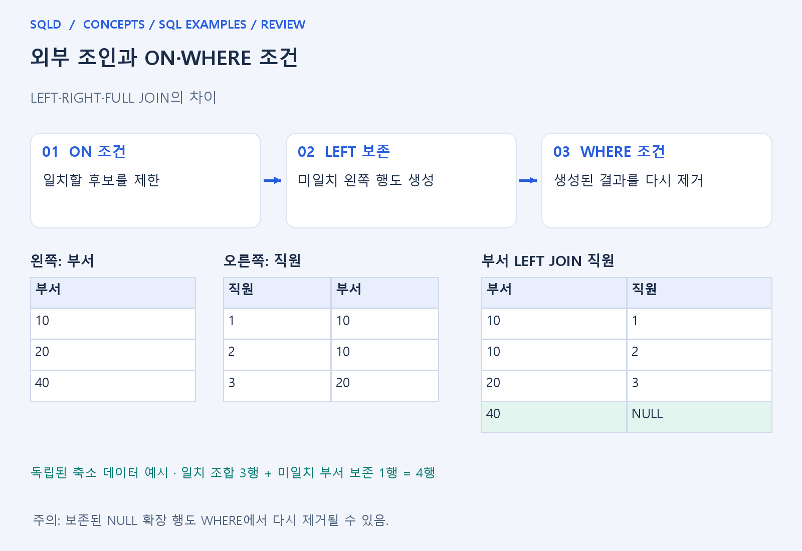
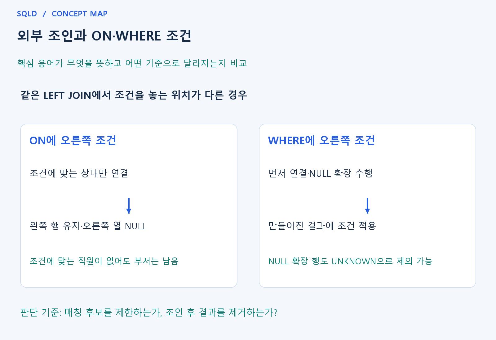

# 외부 조인과 ON·WHERE 조건

- **학습 순서**: 개념 설명 → 그림으로 원리 확인 → 예제와 풀이 → 복습 요약.

## 이 글의 목차

- [1. 개념의 뜻과 동작 원리](#1.%20%EA%B0%9C%EB%85%90%EC%9D%98%20%EB%9C%BB%EA%B3%BC%20%EB%8F%99%EC%9E%91%20%EC%9B%90%EB%A6%AC)
  - [1-1. 외부 조인이 필요한 상황](#1-1.%20%EC%99%B8%EB%B6%80%20%EC%A1%B0%EC%9D%B8%EC%9D%B4%20%ED%95%84%EC%9A%94%ED%95%9C%20%EC%83%81%ED%99%A9)
  - [1-2. ON과 WHERE의 적용 위치](#1-2.%20ON%EA%B3%BC%20WHERE%EC%9D%98%20%EC%A0%81%EC%9A%A9%20%EC%9C%84%EC%B9%98)
  - [1-3. NULL과 개수를 읽는 방법](#1-3.%20NULL%EA%B3%BC%20%EA%B0%9C%EC%88%98%EB%A5%BC%20%EC%9D%BD%EB%8A%94%20%EB%B0%A9%EB%B2%95)
- [2. 세부 정의와 관련 규칙](#2.%20%EC%84%B8%EB%B6%80%20%EC%A0%95%EC%9D%98%EC%99%80%20%EA%B4%80%EB%A0%A8%20%EA%B7%9C%EC%B9%99)
  - [2-1. 정의와 기본 규칙](#2-1.%20%EC%A0%95%EC%9D%98%EC%99%80%20%EA%B8%B0%EB%B3%B8%20%EA%B7%9C%EC%B9%99)
- [3. 핵심 차이 한눈에 보기](#3.%20%ED%95%B5%EC%8B%AC%20%EC%B0%A8%EC%9D%B4%20%ED%95%9C%EB%88%88%EC%97%90%20%EB%B3%B4%EA%B8%B0)
- [4. 예제](#4.%20%EC%98%88%EC%A0%9C)
- [5. 복습 요약](#5.%20%EB%B3%B5%EC%8A%B5%20%EC%9A%94%EC%95%BD)
- [6. 관련 글과 추가 학습](#6.%20%EA%B4%80%EB%A0%A8%20%EA%B8%80%EA%B3%BC%20%EC%B6%94%EA%B0%80%20%ED%95%99%EC%8A%B5)

## 1. 개념의 뜻과 동작 원리

### 1-1. 외부 조인이 필요한 상황

- INNER JOIN은 짝이 맞는 행만 보여 주므로 주문이 없는 고객이나 직원이 없는 부서가 결과에서 사라질 수 있음. 이런 대상도 남겨야 할 때 외부 조인을 사용.
- LEFT JOIN은 왼쪽, RIGHT JOIN은 오른쪽, FULL OUTER JOIN은 양쪽의 미일치 행을 보존. 보존한다는 말은 원본 한 행당 반드시 결과 한 행만 나온다는 뜻은 아님.
- 미일치 행은 없는 쪽의 열을 NULL로 채워 결과를 만듦. 이 NULL은 원본에 저장되어 있던 값과 달리 연결할 상대가 없어서 만들어진 표시일 수 있음.

### 1-2. ON과 WHERE의 적용 위치

- ON은 어떤 상대 행을 일치로 인정할지 정하는 단계. ON에 맞는 상대가 없어도 왼쪽 보존이 필요한 LEFT JOIN은 왼쪽 행을 NULL 확장하여 남길 수 있음.
- WHERE는 조인으로 만든 결과를 다시 검사하는 단계. 오른쪽 급여 조건이 NULL 확장 행에서 UNKNOWN이면 그 행은 WHERE를 통과하지 못함.
- 따라서 외부 조인에서 ON의 조건을 WHERE로 옮기면 결과가 바뀔 수 있음. 후보를 제한하는 일과 이미 만든 결과를 제거하는 일의 차이가 핵심.

### 1-3. NULL과 개수를 읽는 방법

- 외부 조인 결과의 NULL은 실제 자식의 값이 결측인 경우와 자식 자체가 없는 경우를 구분해서 읽어야 함. 자식의 비NULL 키가 있는지 확인하면 구별에 도움.
- COUNT(*)는 미일치 대상의 NULL 확장 행도 셈. 실제 자식 수를 원하면 NULL이 될 수 없는 자식 키의 COUNT를 검토해야 함.
- 보존 방향은 테이블을 어디에 적었는지와 함께 확인. FROM과 JOIN 위치를 바꾸면서 LEFT를 그대로 두면 보존 대상도 바뀔 수 있음.
- 먼저 남길 기준표를 정하고 ON으로 연결 상대를 찾은 뒤, 짝이 없으면 상대 열을 NULL로 채우는 흐름. 이후 WHERE가 보존된 행까지 제거할 수 있으므로, 행을 남기는 규칙과 실제 자식 수를 세는 규칙을 함께 확인.

## 2. 세부 정의와 관련 규칙

### 2-1. 정의와 기본 규칙


- LEFT JOIN은 왼쪽, RIGHT JOIN은 오른쪽, FULL OUTER JOIN은 양쪽의 미매칭 행을 보존함.
- 없는 쪽 열은 NULL로 확장함.

- ON은 매칭 후보 조건이고 WHERE는 매칭 후 결과 필터임.
- 오른쪽 열의 WHERE조건이 NULL 확장 행을 제거할 수 있음.

- COUNT(*)는 NULL 확장 행도 세므로 실제 자식 수는 NOT NULL인 자식 키 COUNT를 쓰는 경우가 많음.
- 직원 부재와 직원 급여 NULL도 구분함.



## 3. 핵심 차이 한눈에 보기

|  구분 | 핵심 뜻 | 확인할 기준 |
| --- | --- | --- |
| LEFT·RIGHT·FULL | 왼쪽·오른쪽·양쪽의 미일치 행 보존 | 테이블 배치와 보존 방향 확인 |
| ON | 일치 후보를 정하는 조건 | 일치하지 않아도 보존 행 생성 가능 |
| WHERE | 조인 결과를 다시 필터 | 오른쪽 조건이 NULL 확장 행을 제거할 수 있음 |



## 4. 예제

- **상황**: a에는 ID 1, 2가 있고 b에는 ID 1만 있는 상황. a의 행을 모두 남겨 연결.
- **질문**: a의 ID 1, 2를 모두 남기면서 b의 ID 1을 연결하면 두 번째 행은 어떻게 표시되는가? INNER JOIN과도 비교하라.
- **실행 기준**: SQLite 확인용. 입력 데이터와 필요한 객체를 코드 안에 포함.

```sql
WITH a(id) AS (VALUES (1),(2)),
     b(id) AS (VALUES (1))
SELECT a.id,b.id FROM a LEFT JOIN b ON a.id=b.id
ORDER BY a.id;
```

- **결과**: (1,1), (2,NULL).
- **풀이 ①**: a의 1은 b의 1과 연결하고 a의 2는 오른쪽 짝을 찾지 못함.
- **풀이 ②**: 오른쪽 짝이 없는 왼쪽 2도 남음. INNER JOIN이라면 (2,NULL) 행은 남지 않음.

- [예제 소스](../../short_examples/n21.sql)

## 5. 복습 요약

- **LEFT·RIGHT·FULL**: 왼쪽·오른쪽·양쪽의 미일치 행 보존. 테이블 배치와 보존 방향 확인.
- **ON**: 일치 후보를 정하는 조건. 일치하지 않아도 보존 행 생성 가능.
- **WHERE**: 조인 결과를 다시 필터. 오른쪽 조건이 NULL 확장 행을 제거할 수 있음.

## 6. 관련 글과 추가 학습

- [전체 목차](../../00_%EC%A0%84%EC%B2%B4%EB%AA%A9%EC%B0%A8.md)
- [개념별 빠른 복습표](../../%EB%B3%B5%EC%8A%B5_%ED%95%B5%EC%8B%AC%EB%B9%84%EA%B5%90%ED%91%9C.md)
- [추가 SQL 소스 안내](../../%EC%B6%94%EA%B0%80_SQL_%EC%86%8C%EC%8A%A4%EC%95%88%EB%82%B4.md)
