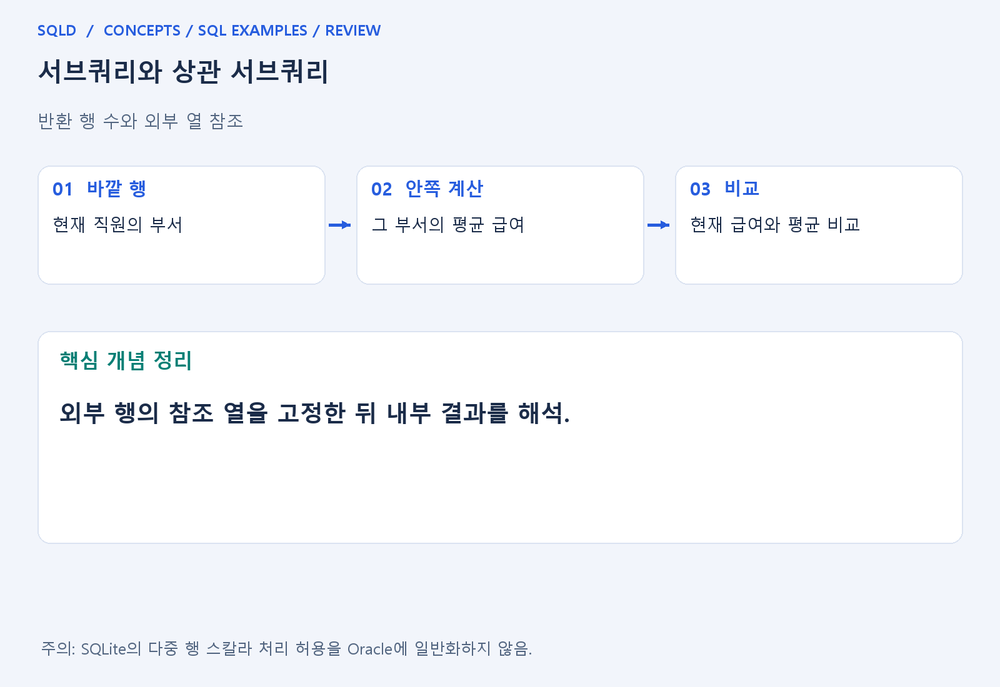
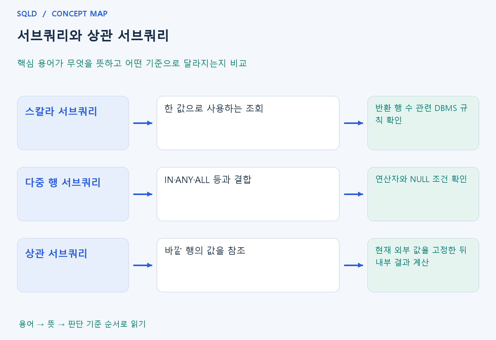

# 서브쿼리와 상관 서브쿼리

- **학습 순서**: 개념 설명 → 그림으로 원리 확인 → 예제와 풀이 → 복습 요약.

## 이 글의 목차

- [1. 개념의 뜻과 동작 원리](#1.%20%EA%B0%9C%EB%85%90%EC%9D%98%20%EB%9C%BB%EA%B3%BC%20%EB%8F%99%EC%9E%91%20%EC%9B%90%EB%A6%AC)
  - [1-1. 서브쿼리의 기본 역할](#1-1.%20%EC%84%9C%EB%B8%8C%EC%BF%BC%EB%A6%AC%EC%9D%98%20%EA%B8%B0%EB%B3%B8%20%EC%97%AD%ED%95%A0)
  - [1-2. 독립·상관 서브쿼리](#1-2.%20%EB%8F%85%EB%A6%BD%C2%B7%EC%83%81%EA%B4%80%20%EC%84%9C%EB%B8%8C%EC%BF%BC%EB%A6%AC)
  - [1-3. 연산자와 NULL의 확인](#1-3.%20%EC%97%B0%EC%82%B0%EC%9E%90%EC%99%80%20NULL%EC%9D%98%20%ED%99%95%EC%9D%B8)
- [2. 세부 정의와 관련 규칙](#2.%20%EC%84%B8%EB%B6%80%20%EC%A0%95%EC%9D%98%EC%99%80%20%EA%B4%80%EB%A0%A8%20%EA%B7%9C%EC%B9%99)
  - [2-1. 정의와 기본 규칙](#2-1.%20%EC%A0%95%EC%9D%98%EC%99%80%20%EA%B8%B0%EB%B3%B8%20%EA%B7%9C%EC%B9%99)
- [3. 핵심 차이 한눈에 보기](#3.%20%ED%95%B5%EC%8B%AC%20%EC%B0%A8%EC%9D%B4%20%ED%95%9C%EB%88%88%EC%97%90%20%EB%B3%B4%EA%B8%B0)
- [4. 예제](#4.%20%EC%98%88%EC%A0%9C)
- [5. 복습 요약](#5.%20%EB%B3%B5%EC%8A%B5%20%EC%9A%94%EC%95%BD)
- [6. 관련 글과 추가 학습](#6.%20%EA%B4%80%EB%A0%A8%20%EA%B8%80%EA%B3%BC%20%EC%B6%94%EA%B0%80%20%ED%95%99%EC%8A%B5)

## 1. 개념의 뜻과 동작 원리

### 1-1. 서브쿼리의 기본 역할

- 서브쿼리는 다른 SQL 안에 들어 있는 조회. 바깥 조회가 판단하거나 계산하는 데 필요한 값을 먼저 구하는 도구로 이해하면 쉬움.
- 어디에 쓰느냐에 따라 필요한 결과 형태가 다름. 하나의 값 자리에서는 스칼라 결과가 필요하고 IN처럼 목록을 비교하는 곳에서는 여러 행을 사용할 수 있음.
- 결과의 열 수·행 수를 함께 확인해야 함. 스칼라 위치에 여러 행이 나오는 상황의 처리는 DBMS별 차이가 있어 SQLite의 허용을 Oracle에 적용하지 않음.

### 1-2. 독립·상관 서브쿼리

- 독립적인 서브쿼리는 바깥 행의 열을 참조하지 않고 필요한 결과를 정의. 전체 직원 평균처럼 바깥의 각 직원과 관계없이 같은 기준을 구하는 경우를 생각.
- 상관 서브쿼리는 바깥의 현재 행에서 값을 받아 내부 조건에 사용. 부서별 평균과 현재 직원 급여를 비교한다면 바깥 직원의 부서를 고정해 내부를 읽음.
- 논리적 이해를 위해 바깥 행마다 계산한다고 생각할 수 있지만, 실제 DBMS가 반드시 같은 횟수로 반복 실행한다는 뜻은 아님. 실행 계획 최적화와 구분.

### 1-3. 연산자와 NULL의 확인

- 단일 행 비교 연산자와 다중 행 연산자의 목적을 구분. IN은 목록 일치, ANY·ALL은 각각 어떤 값 또는 모든 값과의 비교 조건으로 해석.
- 비교 목록에 NULL이 들어가면 TRUE·FALSE만으로 답을 계산할 수 없을 수 있음. 특히 NOT IN은 일치하지 않는 값도 UNKNOWN 때문에 제외되는 상황에 주의.
- 같은 결과를 조인으로 바꿀 때는 행 복제 여부를 확인. 서브쿼리의 질문이 값 하나인지 존재 여부인지에 따라 적절한 표현이 달라짐.
- 서브쿼리는 다른 SQL 안에서 결과를 제공하며 결과의 행·열 수에 맞는 연산자를 사용해야 함. 바깥 행을 참조하는 상관 서브쿼리는 그 행과 연결된 조건으로 이해하되, 실제 실행 횟수는 최적화에 따라 달라질 수 있음.

## 2. 세부 정의와 관련 규칙

### 2-1. 정의와 기본 규칙


- 서브쿼리는 SELECT 안에 포함된 조회임.
- 위치에 따라 스칼라 식, FROM의 인라인 뷰, 조건의 값 목록 등 역할이 다름.

- 스칼라 서브쿼리는 한 열의 한 값 자리임.
- 0행이면NULL, 여러 행이면Oracle등에서오류이며SQLite는첫행을사용하는차이가있음.
- 의도한 단일행성을 보장함.

- 상관 서브쿼리는 바깥 행의 열을 참조함.
- 부서별 평균과 현재 직원 급여를 비교할 때 어떤 이름이 바깥 별칭인지 표시할 것.



## 3. 핵심 차이 한눈에 보기

|  구분 | 핵심 뜻 | 확인할 기준 |
| --- | --- | --- |
| 스칼라 서브쿼리 | 한 값으로 사용하는 조회 | 반환 행 수 관련 DBMS 규칙 확인 |
| 다중 행 서브쿼리 | IN·ANY·ALL 등과 결합 | 연산자와 NULL 조건 확인 |
| 상관 서브쿼리 | 바깥 행의 값을 참조 | 현재 외부 값을 고정한 뒤 내부 결과 계산 |



## 4. 예제

- **상황**: 입력값 1, 2, 6 중 전체 평균을 초과한 값만 찾으려는 상황.
- **질문**: 값 1, 2, 6에서 전체 평균보다 큰 값만 선택하면 무엇이 남는가? 평균 계산과 행 선택을 나누어 풀어라.
- **실행 기준**: SQLite 확인용. 입력 데이터와 필요한 객체를 코드 안에 포함.

```sql
WITH t(v) AS (VALUES (1),(2),(6))
SELECT v FROM t WHERE v>(SELECT AVG(v) FROM t);
```

- **결과**: 6 한 행.
- **풀이 ①**: 안쪽 조회의 평균은 (1+2+6)/3=3.
- **풀이 ②**: 평균 3보다 큰 값만 선택.

- [예제 소스](../../short_examples/n22.sql)

## 5. 복습 요약

- **스칼라 서브쿼리**: 한 값으로 사용하는 조회. 반환 행 수 관련 DBMS 규칙 확인.
- **다중 행 서브쿼리**: IN·ANY·ALL 등과 결합. 연산자와 NULL 조건 확인.
- **상관 서브쿼리**: 바깥 행의 값을 참조. 현재 외부 값을 고정한 뒤 내부 결과 계산.

## 6. 관련 글과 추가 학습

- [전체 목차](../../00_%EC%A0%84%EC%B2%B4%EB%AA%A9%EC%B0%A8.md)
- [개념별 빠른 복습표](../../%EB%B3%B5%EC%8A%B5_%ED%95%B5%EC%8B%AC%EB%B9%84%EA%B5%90%ED%91%9C.md)
- [추가 SQL 소스 안내](../../%EC%B6%94%EA%B0%80_SQL_%EC%86%8C%EC%8A%A4%EC%95%88%EB%82%B4.md)
