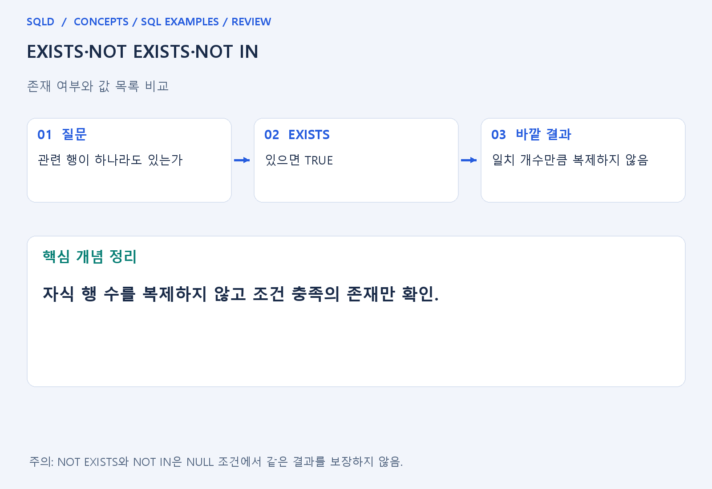
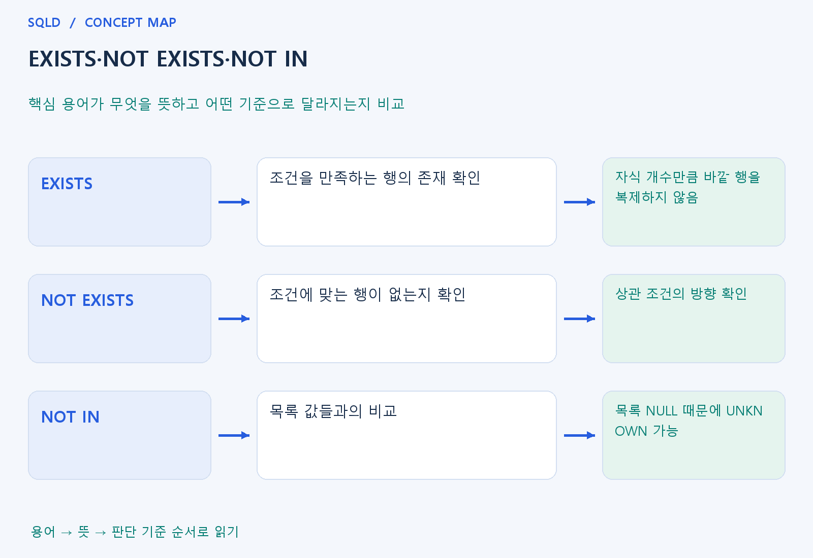

# EXISTS·NOT EXISTS·NOT IN

- **학습 순서**: 개념 설명 → 그림으로 원리 확인 → 예제와 풀이 → 복습 요약.

## 이 글의 목차

- [1. 개념의 뜻과 동작 원리](#1.%20%EA%B0%9C%EB%85%90%EC%9D%98%20%EB%9C%BB%EA%B3%BC%20%EB%8F%99%EC%9E%91%20%EC%9B%90%EB%A6%AC)
  - [1-1. EXISTS의 판단 대상](#1-1.%20EXISTS%EC%9D%98%20%ED%8C%90%EB%8B%A8%20%EB%8C%80%EC%83%81)
  - [1-2. NOT EXISTS와 상관 조건](#1-2.%20NOT%20EXISTS%EC%99%80%20%EC%83%81%EA%B4%80%20%EC%A1%B0%EA%B1%B4)
  - [1-3. IN·NOT IN과의 차이](#1-3.%20IN%C2%B7NOT%20IN%EA%B3%BC%EC%9D%98%20%EC%B0%A8%EC%9D%B4)
- [2. 세부 정의와 관련 규칙](#2.%20%EC%84%B8%EB%B6%80%20%EC%A0%95%EC%9D%98%EC%99%80%20%EA%B4%80%EB%A0%A8%20%EA%B7%9C%EC%B9%99)
  - [2-1. 정의와 기본 규칙](#2-1.%20%EC%A0%95%EC%9D%98%EC%99%80%20%EA%B8%B0%EB%B3%B8%20%EA%B7%9C%EC%B9%99)
- [3. 핵심 차이 한눈에 보기](#3.%20%ED%95%B5%EC%8B%AC%20%EC%B0%A8%EC%9D%B4%20%ED%95%9C%EB%88%88%EC%97%90%20%EB%B3%B4%EA%B8%B0)
- [4. 예제](#4.%20%EC%98%88%EC%A0%9C)
- [5. 복습 요약](#5.%20%EB%B3%B5%EC%8A%B5%20%EC%9A%94%EC%95%BD)
- [6. 관련 글과 추가 학습](#6.%20%EA%B4%80%EB%A0%A8%20%EA%B8%80%EA%B3%BC%20%EC%B6%94%EA%B0%80%20%ED%95%99%EC%8A%B5)

## 1. 개념의 뜻과 동작 원리

### 1-1. EXISTS의 판단 대상

- EXISTS는 내부 조회가 조건을 만족하는 행을 하나라도 반환하는지 묻는 조건. 값의 크기나 행의 개수를 바깥에 직접 가져오는 것이 목적이 아님.
- 내부 SELECT에 상수 1을 쓰는 표현도 존재 여부를 묻는다는 의도를 드러내는 방식. 반환한 값이 1이어야 참이라는 의미로 이해하지 않음.
- 자식이 세 행 있다고 바깥 부모를 세 번 복제하지 않음. 상세값 없이 관련 기록 유무만 확인할 때 조인과 달라지는 핵심 특징.

### 1-2. NOT EXISTS와 상관 조건

- NOT EXISTS는 내부 조건에 맞는 행이 하나도 없는지를 확인. 주문이 없는 고객처럼 부재를 묻는 질문에 연결하여 생각하면 쉬움.
- 어떤 부모와 연결된 자식을 검사할지는 내부의 상관 조건이 정함. 그 연결 조건이 빠지면 특정 부모의 부재가 아니라 자식 전체의 존재를 검사할 수 있음.
- NULL을 포함한 값 비교가 내부 조건에서 어떻게 평가되는지는 여전히 중요. NOT EXISTS라는 이름만으로 모든 잘못된 연결 조건이 자동 해결되는 것은 아님.

### 1-3. IN·NOT IN과의 차이

- IN은 값이 목록에 있는지를 비교하고 EXISTS는 조건을 만족하는 행이 있는지 확인. 목적이 비슷해 보여도 비교할 값과 연결 기준이 다를 수 있음.
- NOT IN의 목록에 NULL이 있으면 일반 비교의 UNKNOWN이 결과에 영향을 줌. NOT EXISTS와 바꿀 때는 원하는 NULL 처리까지 포함해 뜻이 같은지 검토.
- 성능은 무조건 어느 문법이 빠르다고 외우지 않음. 먼저 결과 의미와 중복·NULL 조건이 맞는지 확인하고 실제 계획과 자료를 보고 비교.
- EXISTS는 일치하는 행의 존재를 확인하고 NOT EXISTS는 그 부재를 확인. NOT IN은 비교 목록에 NULL이 있을 때 UNKNOWN의 영향을 받을 수 있으므로, 존재 검사와 값 목록 비교를 같은 방식으로 해석하지 않도록 주의.

## 2. 세부 정의와 관련 규칙

### 2-1. 정의와 기본 규칙


- EXISTS는 안쪽 결과가 한 행 이상 존재하는지 검사함.
- SELECT한 숫자보다 행이 있는지가 중요함.

- NOT EXISTS는 일치하는 행이 없는지 검사함.
- NULL이 있을 때 NOT IN과 결과가 달라질 수 있어 목적을 먼저 정함.

- 모든 필수 과목 수강은 미수강 필수 과목이 하나도 없다는 이중 NOT EXISTS로 표현할 수 있음.
- 필수 목록이 비어 있을 때의 논리도 따로 생각함.



## 3. 핵심 차이 한눈에 보기

|  구분 | 핵심 뜻 | 확인할 기준 |
| --- | --- | --- |
| EXISTS | 조건을 만족하는 행의 존재 확인 | 자식 개수만큼 바깥 행을 복제하지 않음 |
| NOT EXISTS | 조건에 맞는 행이 없는지 확인 | 상관 조건의 방향 확인 |
| NOT IN | 목록 값들과의 비교 | 목록 NULL 때문에 UNKNOWN 가능 |



## 4. 예제

- **상황**: 전체 목록 a에는 ID 1, 2가 있고 확인 목록 b에는 ID 1만 있는 상황.
- **질문**: a의 ID 1, 2 중 b의 ID 1에 없는 것만 고르면 무엇이 남는가? 각 a 행에서 존재 여부를 확인하라.
- **실행 기준**: SQLite 확인용. 입력 데이터와 필요한 객체를 코드 안에 포함.

```sql
WITH a(id) AS (VALUES (1),(2)), b(id) AS (VALUES (1))
SELECT id FROM a WHERE NOT EXISTS
(SELECT 1 FROM b WHERE b.id=a.id);
```

- **결과**: 2 한 행.
- **풀이 ①**: a의 1은 b에서 짝을 찾지만 a의 2와 같은 b 행은 없음.
- **풀이 ②**: 자신과 일치하는 b 행이 없는 a만 선택.

- [예제 소스](../../short_examples/n23.sql)

## 5. 복습 요약

- **EXISTS**: 조건을 만족하는 행의 존재 확인. 자식 개수만큼 바깥 행을 복제하지 않음.
- **NOT EXISTS**: 조건에 맞는 행이 없는지 확인. 상관 조건의 방향 확인.
- **NOT IN**: 목록 값들과의 비교. 목록 NULL 때문에 UNKNOWN 가능.

## 6. 관련 글과 추가 학습

- [전체 목차](../../00_%EC%A0%84%EC%B2%B4%EB%AA%A9%EC%B0%A8.md)
- [개념별 빠른 복습표](../../%EB%B3%B5%EC%8A%B5_%ED%95%B5%EC%8B%AC%EB%B9%84%EA%B5%90%ED%91%9C.md)
- [추가 SQL 소스 안내](../../%EC%B6%94%EA%B0%80_SQL_%EC%86%8C%EC%8A%A4%EC%95%88%EB%82%B4.md)
