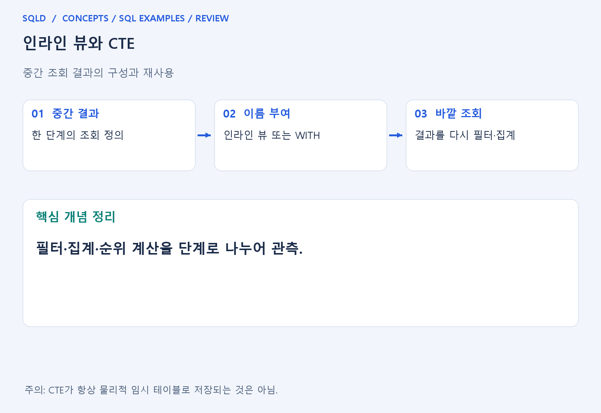
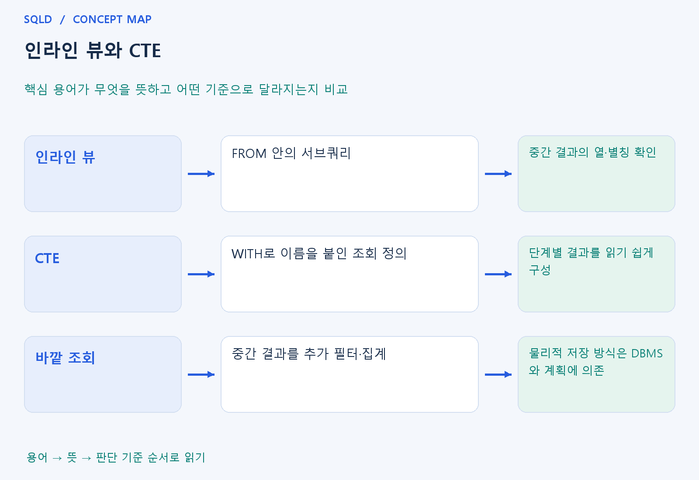

# 인라인 뷰와 CTE

- **학습 순서**: 개념 설명 → 그림으로 원리 확인 → 예제와 풀이 → 복습 요약.

## 이 글의 목차

- [1. 개념의 뜻과 동작 원리](#1.%20%EA%B0%9C%EB%85%90%EC%9D%98%20%EB%9C%BB%EA%B3%BC%20%EB%8F%99%EC%9E%91%20%EC%9B%90%EB%A6%AC)
  - [1-1. 중간 결과를 나누는 이유](#1-1.%20%EC%A4%91%EA%B0%84%20%EA%B2%B0%EA%B3%BC%EB%A5%BC%20%EB%82%98%EB%88%84%EB%8A%94%20%EC%9D%B4%EC%9C%A0)
  - [1-2. 단계를 나누어야 하는 경우](#1-2.%20%EB%8B%A8%EA%B3%84%EB%A5%BC%20%EB%82%98%EB%88%84%EC%96%B4%EC%95%BC%20%ED%95%98%EB%8A%94%20%EA%B2%BD%EC%9A%B0)
  - [1-3. CTE·뷰·물리 저장 구분](#1-3.%20CTE%C2%B7%EB%B7%B0%C2%B7%EB%AC%BC%EB%A6%AC%20%EC%A0%80%EC%9E%A5%20%EA%B5%AC%EB%B6%84)
- [2. 세부 정의와 관련 규칙](#2.%20%EC%84%B8%EB%B6%80%20%EC%A0%95%EC%9D%98%EC%99%80%20%EA%B4%80%EB%A0%A8%20%EA%B7%9C%EC%B9%99)
  - [2-1. 정의와 기본 규칙](#2-1.%20%EC%A0%95%EC%9D%98%EC%99%80%20%EA%B8%B0%EB%B3%B8%20%EA%B7%9C%EC%B9%99)
- [3. 핵심 차이 한눈에 보기](#3.%20%ED%95%B5%EC%8B%AC%20%EC%B0%A8%EC%9D%B4%20%ED%95%9C%EB%88%88%EC%97%90%20%EB%B3%B4%EA%B8%B0)
- [4. 예제](#4.%20%EC%98%88%EC%A0%9C)
- [5. 복습 요약](#5.%20%EB%B3%B5%EC%8A%B5%20%EC%9A%94%EC%95%BD)
- [6. 관련 글과 추가 학습](#6.%20%EA%B4%80%EB%A0%A8%20%EA%B8%80%EA%B3%BC%20%EC%B6%94%EA%B0%80%20%ED%95%99%EC%8A%B5)

## 1. 개념의 뜻과 동작 원리

### 1-1. 중간 결과를 나누는 이유

- 복잡한 조회는 집계하고 다시 비교하거나 순위를 만든 뒤 필터하는 여러 단계로 구성될 수 있음. 중간 결과를 명확히 나누면 각 단계의 행 단위와 열 의미를 확인하기 쉬움.
- 인라인 뷰는 FROM에 서브쿼리를 두어 그 결과를 표처럼 사용하는 방식. 중간 결과에 별칭을 붙여 바깥 조회에서 열을 참조.
- CTE는 WITH로 조회 정의에 이름을 붙이는 방식. 한 문장의 계산 흐름을 여러 이름 있는 단계로 정리할 수 있어 가독성과 설명에 도움.

### 1-2. 단계를 나누어야 하는 경우

- 현재 조회 단계에서 바로 WHERE로 사용할 수 없는 계산 결과를 바깥 단계에서 검사할 수 있음. 순위를 먼저 구한 뒤 그 순위로 상위 대상을 고르는 흐름이 대표적.
- 자식 표를 먼저 부모 단위로 집계한 후 다른 표와 붙이면 조인의 중복 계산을 줄일 수 있음. 문법 단축보다 원하는 단위를 명확히 하는 용도가 중요.
- 중간 결과의 SELECT 목록이 바깥에서 사용할 수 있는 열을 정함. 원본의 모든 열이 언제나 바깥까지 자동 전달된다고 생각하지 않음.

### 1-3. CTE·뷰·물리 저장 구분

- CTE는 일반적으로 그 SQL 문장의 범위에서 사용하는 이름 있는 조회 정의. 데이터베이스 객체로 저장한 일반 뷰와 수명·관리 방식이 다름.
- 인라인 뷰나 CTE로 적었다고 결과를 반드시 임시 파일이나 테이블에 저장하는 것은 아님. 병합·구체화 등 물리 처리는 DBMS와 실행 계획에 따라 달라질 수 있음.
- 논리적 단계를 나누었다는 사실과 성능이 좋아졌다는 결론을 구분. 의미를 먼저 맞춘 뒤 자료 규모와 실제 실행 방식을 검토.
- 인라인 뷰와 CTE는 중간 조회 결과를 하나의 표처럼 다루게 함. 복잡한 계산을 단계별로 나누는 표현 방법이며, 이름을 붙였다는 이유만으로 결과가 항상 물리적으로 저장되거나 성능이 좋아지는 것은 아님.

## 2. 세부 정의와 관련 규칙

### 2-1. 정의와 기본 규칙


- FROM(SELECT...)는 인라인 뷰이고 WITH 이름 AS(...)는 문장 안에서 사용할 조회 이름을 정의함.

- CTE가 결과를 반드시 물리 저장한다고 일반화하지 않음.
- DBMS의 최적화에 따라 인라인 처리나 저장 방식이 달라질 수 있음.

- 복잡한 집계는 기준단위를 먼저 맞춘 CTE로 나누고 바깥에서 조인하면 중복을 추적하기 쉽음.
- CTE의 유효 범위는해당문장임.



## 3. 핵심 차이 한눈에 보기

|  구분 | 핵심 뜻 | 확인할 기준 |
| --- | --- | --- |
| 인라인 뷰 | FROM 안의 서브쿼리 | 중간 결과의 열·별칭 확인 |
| CTE | WITH로 이름을 붙인 조회 정의 | 단계별 결과를 읽기 쉽게 구성 |
| 바깥 조회 | 중간 결과를 추가 필터·집계 | 물리적 저장 방식은 DBMS와 계획에 의존 |



## 4. 예제

- **상황**: 원본 값 1, 2를 두 배로 변환한 중간 결과를 만든 뒤 합계를 구하려는 상황.
- **질문**: x의 값 1, 2를 두 배로 만든 y의 값을 모두 더하면 얼마인가? 중간 결과도 적어라.
- **실행 기준**: SQLite 확인용. 입력 데이터와 필요한 객체를 코드 안에 포함.

```sql
WITH x(v) AS (VALUES (1),(2)),
     y(v) AS (SELECT v*2 FROM x)
SELECT SUM(v) FROM y;
```

- **결과**: 결과는 6.
- **풀이 ①**: 첫 번째 CTE x는 1과 2를 제공하고 두 번째 CTE y는 각 값을 두 배로 변환.
- **풀이 ②**: 중간 결과 2와 4를 만든 뒤 합산.

- [예제 소스](../../short_examples/n24.sql)

## 5. 복습 요약

- **인라인 뷰**: FROM 안의 서브쿼리. 중간 결과의 열·별칭 확인.
- **CTE**: WITH로 이름을 붙인 조회 정의. 단계별 결과를 읽기 쉽게 구성.
- **바깥 조회**: 중간 결과를 추가 필터·집계. 물리적 저장 방식은 DBMS와 계획에 의존.

## 6. 관련 글과 추가 학습

- [전체 목차](../../00_%EC%A0%84%EC%B2%B4%EB%AA%A9%EC%B0%A8.md)
- [개념별 빠른 복습표](../../%EB%B3%B5%EC%8A%B5_%ED%95%B5%EC%8B%AC%EB%B9%84%EA%B5%90%ED%91%9C.md)
- [추가 SQL 소스 안내](../../%EC%B6%94%EA%B0%80_SQL_%EC%86%8C%EC%8A%A4%EC%95%88%EB%82%B4.md)
