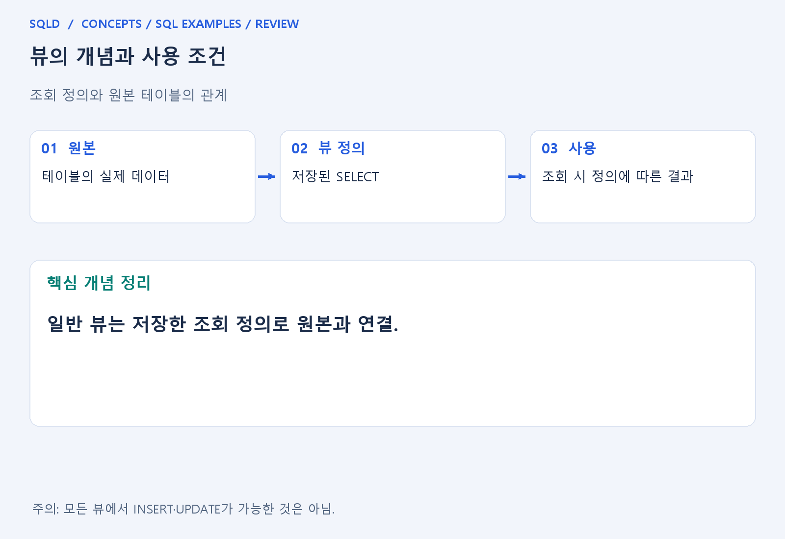
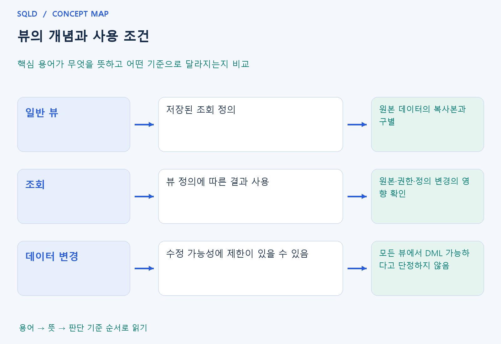

# 뷰의 개념과 사용 조건

- **학습 순서**: 개념 설명 → 그림으로 원리 확인 → 예제와 풀이 → 복습 요약.

## 이 글의 목차

- [1. 개념의 뜻과 동작 원리](#1.%20%EA%B0%9C%EB%85%90%EC%9D%98%20%EB%9C%BB%EA%B3%BC%20%EB%8F%99%EC%9E%91%20%EC%9B%90%EB%A6%AC)
  - [1-1. 일반 뷰의 의미](#1-1.%20%EC%9D%BC%EB%B0%98%20%EB%B7%B0%EC%9D%98%20%EC%9D%98%EB%AF%B8)
  - [1-2. 뷰가 유용한 이유](#1-2.%20%EB%B7%B0%EA%B0%80%20%EC%9C%A0%EC%9A%A9%ED%95%9C%20%EC%9D%B4%EC%9C%A0)
  - [1-3. 수정 가능성의 주의점](#1-3.%20%EC%88%98%EC%A0%95%20%EA%B0%80%EB%8A%A5%EC%84%B1%EC%9D%98%20%EC%A3%BC%EC%9D%98%EC%A0%90)
- [2. 세부 정의와 관련 규칙](#2.%20%EC%84%B8%EB%B6%80%20%EC%A0%95%EC%9D%98%EC%99%80%20%EA%B4%80%EB%A0%A8%20%EA%B7%9C%EC%B9%99)
  - [2-1. 정의와 기본 규칙](#2-1.%20%EC%A0%95%EC%9D%98%EC%99%80%20%EA%B8%B0%EB%B3%B8%20%EA%B7%9C%EC%B9%99)
- [3. 핵심 차이 한눈에 보기](#3.%20%ED%95%B5%EC%8B%AC%20%EC%B0%A8%EC%9D%B4%20%ED%95%9C%EB%88%88%EC%97%90%20%EB%B3%B4%EA%B8%B0)
- [4. 예제](#4.%20%EC%98%88%EC%A0%9C)
- [5. 복습 요약](#5.%20%EB%B3%B5%EC%8A%B5%20%EC%9A%94%EC%95%BD)
- [6. 관련 글과 추가 학습](#6.%20%EA%B4%80%EB%A0%A8%20%EA%B8%80%EA%B3%BC%20%EC%B6%94%EA%B0%80%20%ED%95%99%EC%8A%B5)

## 1. 개념의 뜻과 동작 원리

### 1-1. 일반 뷰의 의미

- 일반 뷰는 SELECT 정의를 이름으로 저장하여 표처럼 조회하게 하는 객체. 원본 데이터의 모든 값을 별도로 복사해 둔 결과표라고 이해하면 안 됨.
- 여러 표의 연결이나 필요한 열·행 선택을 뷰 정의에 숨기면 사용자는 반복되는 조회 구조를 간단한 이름으로 사용할 수 있음.
- 어떤 원본을 어떻게 선택하는지가 정의의 핵심. 일반 뷰와 결과를 별도 저장·갱신하는 물리화 뷰의 성격을 같은 것으로 보지 않음.

### 1-2. 뷰가 유용한 이유

- 복잡한 조인과 계산을 공통 정의로 관리하면 여러 사용자가 같은 기준의 조회를 사용할 수 있음. 다만 기준을 바꾸면 뷰를 사용하는 작업에도 영향이 생길 수 있음.
- 특정 열이나 행만 보여 주는 추상화에 활용할 수 있지만, 실제 접근 제어는 권한 설계와 제품 규칙까지 함께 확인해야 함.
- 일반 뷰는 원본과 연결되어 있으므로 원본 변경·삭제나 정의 변경의 영향을 받을 수 있음. 뷰 이름이 남는다는 사실만으로 모든 조회가 계속 유효한 것은 아님.

### 1-3. 수정 가능성의 주의점

- 뷰를 통한 INSERT·UPDATE·DELETE는 뷰 구조와 DBMS의 규칙에 따라 제한될 수 있음. 집계·중복 제거·여러 표의 조인처럼 원본 행 대응이 복잡한 경우를 특히 확인.
- 뷰의 결과 한 행을 바꿀 때 원본의 어느 행을 수정해야 하는지가 명확한지 생각하면 제한 이유를 이해하기 쉬움.
- 모든 뷰는 수정 불가 또는 모든 뷰는 수정 가능이라는 단정은 피함. 일반 원리와 실제 제품의 수정 가능한 뷰 조건을 나누어 학습.
- 일반 뷰는 조회 정의를 저장해 표처럼 참조하게 하는 객체. 원본 데이터에 대한 창구 역할을 하므로 조회 단순화와 접근 범위 조절에 활용할 수 있지만, 갱신 가능 여부는 뷰의 구조와 DBMS 규칙에 따라 확인.

## 2. 세부 정의와 관련 규칙

### 2-1. 정의와 기본 규칙


- 뷰는 SELECT 정의를 저장한 논리적 관점임.
- 일반 뷰와 결과를 보관하는 물리화 뷰를 구분함.

- 뷰는 복잡한 조회를 단순화하고 노출 열을 제한할 수 있지만 권한 설정 없이 모든 보안 문제를 자동 해결하지는 않음.

- 집계 뷰나 조인 뷰의 갱신 가능성은 제품별 제약이 있음.
- 프로시저와 트리거는 서버 내부의 절차적 동작이며 SQL 방언과 트랜잭션 부작용을 확인하는 심화 주제임.



## 3. 핵심 차이 한눈에 보기

|  구분 | 핵심 뜻 | 확인할 기준 |
| --- | --- | --- |
| 일반 뷰 | 저장된 조회 정의 | 원본 데이터의 복사본과 구별 |
| 조회 | 뷰 정의에 따른 결과 사용 | 원본·권한·정의 변경의 영향 확인 |
| 데이터 변경 | 수정 가능성에 제한이 있을 수 있음 | 모든 뷰에서 DML 가능하다고 단정하지 않음 |



## 4. 예제

- **상황**: 고정값 1을 조회하는 정의에 v라는 뷰 이름을 붙여 사용하는 상황.
- **질문**: 1을 n이라는 열로 조회하는 뷰 v를 만든 뒤 v에서 n을 읽으면 무엇이 출력되는가?
- **실행 기준**: SQLite 확인용. 입력 데이터와 필요한 객체를 코드 안에 포함.

```sql
CREATE VIEW v AS SELECT 1 AS n;
SELECT n FROM v;
```

- **결과**: n=1.
- **풀이 ①**: CREATE VIEW는 조회 정의에 v라는 이름을 붙이고 이후 SELECT는 그 정의를 사용.
- **풀이 ②**: 저장한 조회 정의를 뷰 이름으로 사용.

- [예제 소스](../../short_examples/n25.sql)

## 5. 복습 요약

- **일반 뷰**: 저장된 조회 정의. 원본 데이터의 복사본과 구별.
- **조회**: 뷰 정의에 따른 결과 사용. 원본·권한·정의 변경의 영향 확인.
- **데이터 변경**: 수정 가능성에 제한이 있을 수 있음. 모든 뷰에서 DML 가능하다고 단정하지 않음.

## 6. 관련 글과 추가 학습

- [전체 목차](../../00_%EC%A0%84%EC%B2%B4%EB%AA%A9%EC%B0%A8.md)
- [개념별 빠른 복습표](../../%EB%B3%B5%EC%8A%B5_%ED%95%B5%EC%8B%AC%EB%B9%84%EA%B5%90%ED%91%9C.md)
- [추가 SQL 소스 안내](../../%EC%B6%94%EA%B0%80_SQL_%EC%86%8C%EC%8A%A4%EC%95%88%EB%82%B4.md)
