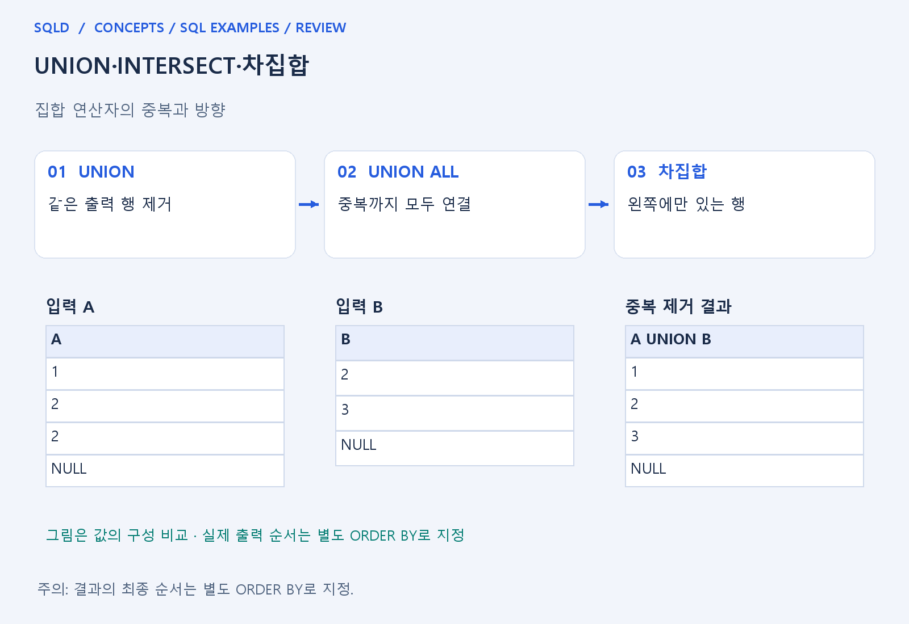
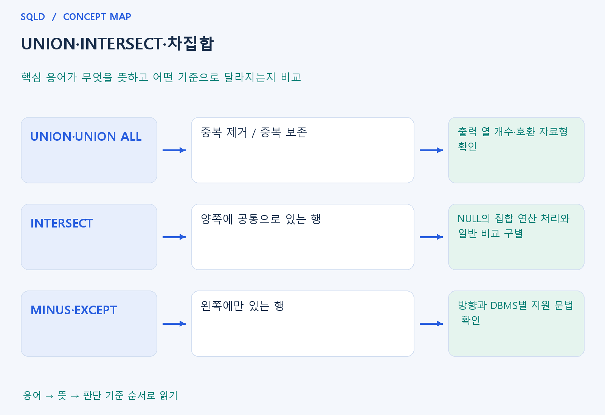

# UNION·INTERSECT·차집합

- **학습 순서**: 개념 설명 → 그림으로 원리 확인 → 예제와 풀이 → 복습 요약.

## 이 글의 목차

- [1. 개념의 뜻과 동작 원리](#1.%20%EA%B0%9C%EB%85%90%EC%9D%98%20%EB%9C%BB%EA%B3%BC%20%EB%8F%99%EC%9E%91%20%EC%9B%90%EB%A6%AC)
  - [1-1. 집합 연산의 공통 조건](#1-1.%20%EC%A7%91%ED%95%A9%20%EC%97%B0%EC%82%B0%EC%9D%98%20%EA%B3%B5%ED%86%B5%20%EC%A1%B0%EA%B1%B4)
  - [1-2. 각 연산자의 차이](#1-2.%20%EA%B0%81%20%EC%97%B0%EC%82%B0%EC%9E%90%EC%9D%98%20%EC%B0%A8%EC%9D%B4)
  - [1-3. 중복과 정렬의 주의점](#1-3.%20%EC%A4%91%EB%B3%B5%EA%B3%BC%20%EC%A0%95%EB%A0%AC%EC%9D%98%20%EC%A3%BC%EC%9D%98%EC%A0%90)
- [2. 세부 정의와 관련 규칙](#2.%20%EC%84%B8%EB%B6%80%20%EC%A0%95%EC%9D%98%EC%99%80%20%EA%B4%80%EB%A0%A8%20%EA%B7%9C%EC%B9%99)
  - [2-1. 정의와 기본 규칙](#2-1.%20%EC%A0%95%EC%9D%98%EC%99%80%20%EA%B8%B0%EB%B3%B8%20%EA%B7%9C%EC%B9%99)
- [3. 핵심 차이 한눈에 보기](#3.%20%ED%95%B5%EC%8B%AC%20%EC%B0%A8%EC%9D%B4%20%ED%95%9C%EB%88%88%EC%97%90%20%EB%B3%B4%EA%B8%B0)
- [4. 예제](#4.%20%EC%98%88%EC%A0%9C)
- [5. 복습 요약](#5.%20%EB%B3%B5%EC%8A%B5%20%EC%9A%94%EC%95%BD)
- [6. 관련 글과 추가 학습](#6.%20%EA%B4%80%EB%A0%A8%20%EA%B8%80%EA%B3%BC%20%EC%B6%94%EA%B0%80%20%ED%95%99%EC%8A%B5)

## 1. 개념의 뜻과 동작 원리

### 1-1. 집합 연산의 공통 조건

- 집합 연산은 두 조회 결과를 행 단위로 합치거나 공통·차이를 구하는 연산. 조인처럼 열을 옆으로 붙이는 것이 아니라 결과 행 구성을 비교.
- 양쪽 결과의 열 개수와 대응 위치의 자료형이 연산 가능한지 확인해야 함. 열 이름이 같다는 사실보다 어떤 위치의 값끼리 비교되는지가 중요.
- 중복 제거를 하는 연산에서 같은 행인지는 출력 열의 전체 조합으로 판단. 일반 등호의 NULL 비교와 집합 연산의 NULL 중복 처리는 구별.

### 1-2. 각 연산자의 차이

- UNION은 양쪽 행을 합치면서 중복을 제거하고 UNION ALL은 중복을 그대로 남김. 모든 거래를 보존할지 고유 조합만 원할지에 따라 선택이 달라짐.
- INTERSECT는 양쪽에 공통으로 있는 결과 행을 구함. 차집합은 왼쪽 결과 중 오른쪽에 없는 것을 구하므로 어느 결과를 왼쪽에 두는지가 중요.
- Oracle의 MINUS와 다른 제품의 EXCEPT처럼 지원 문법이 다를 수 있음. 연산의 목적과 특정 DBMS에서 쓰는 이름을 나누어 기억.

### 1-3. 중복과 정렬의 주의점

- 한 표에 같은 값이 두 번 있어도 중복 제거 연산에서는 한 결과로 줄 수 있음. UNION ALL에서는 원래 등장한 횟수가 남는다는 점이 집계에 영향.
- 집합 연산 결과가 어떤 순서로 보이는지는 별도 문제. 결과를 원하는 순서로 표시하려면 최종 ORDER BY를 확인하며 내부 처리 결과를 정렬 보장으로 보지 않음.
- 여러 집합 연산자가 섞이면 제품의 우선순위와 괄호를 확인. 복잡한 식은 어느 두 결과를 먼저 비교하는지 단계로 나누어 이해.
- 집합 연산은 위아래 조회 결과를 행 방향으로 결합하므로 대응하는 열 수와 자료형을 맞춰야 함. UNION의 중복 제거와 UNION ALL의 중복 유지를 구분하고, 표시 순서는 최종 ORDER BY로 지정.

## 2. 세부 정의와 관련 규칙

### 2-1. 정의와 기본 규칙


- UNION은 중복 제거, UNION ALL은 보존임.
- INTERSECT는 공통값, EXCEPT 또는 Oracle의 MINUS는 왼쪽에만 있는 값임.

- 대응 열의 개수와 타입 호환성을 확인하고 전체 정렬은 마지막 ORDER BY에서 지정함.
- 열 이름보다 열의 위치가 연결 기준임.

- 집합 연산의 중복 판정은 NULL들을 같은 중복값으로 다룸.
- WHERE의 NULL=NULL과 구분하고 제품별 지원 범위도 확인함.



## 3. 핵심 차이 한눈에 보기

|  구분 | 핵심 뜻 | 확인할 기준 |
| --- | --- | --- |
| UNION·UNION ALL | 중복 제거 / 중복 보존 | 출력 열 개수·호환 자료형 확인 |
| INTERSECT | 양쪽에 공통으로 있는 행 | NULL의 집합 연산 처리와 일반 비교 구별 |
| MINUS·EXCEPT | 왼쪽에만 있는 행 | 방향과 DBMS별 지원 문법 확인 |



## 4. 예제

- **상황**: 조회 결과 1, 1, 2를 하나의 결과로 합치되 중복을 없애려는 상황.
- **질문**: 1, 1, 2를 UNION으로 합쳐 정렬하면 몇 행이 남는가? UNION ALL로 바꾸면 어떻게 달라지는가?
- **실행 기준**: SQLite 확인용. 입력 데이터와 필요한 객체를 코드 안에 포함.

```sql
SELECT 1 AS v UNION SELECT 1 UNION SELECT 2 ORDER BY v;
```

- **결과**: 1, 2 두 행.
- **풀이 ①**: UNION은 각 결과를 합치면서 출력값이 같은 1을 하나로 줄임.
- **풀이 ②**: UNION은 같은 출력 행을 하나로 줄임. UNION ALL이면 중복된 1도 남아 1, 1, 2의 세 행이 됨.

- [예제 소스](../../short_examples/n26.sql)

## 5. 복습 요약

- **UNION·UNION ALL**: 중복 제거 / 중복 보존. 출력 열 개수·호환 자료형 확인.
- **INTERSECT**: 양쪽에 공통으로 있는 행. NULL의 집합 연산 처리와 일반 비교 구별.
- **MINUS·EXCEPT**: 왼쪽에만 있는 행. 방향과 DBMS별 지원 문법 확인.

## 6. 관련 글과 추가 학습

- [전체 목차](../../00_%EC%A0%84%EC%B2%B4%EB%AA%A9%EC%B0%A8.md)
- [개념별 빠른 복습표](../../%EB%B3%B5%EC%8A%B5_%ED%95%B5%EC%8B%AC%EB%B9%84%EA%B5%90%ED%91%9C.md)
- [추가 SQL 소스 안내](../../%EC%B6%94%EA%B0%80_SQL_%EC%86%8C%EC%8A%A4%EC%95%88%EB%82%B4.md)
