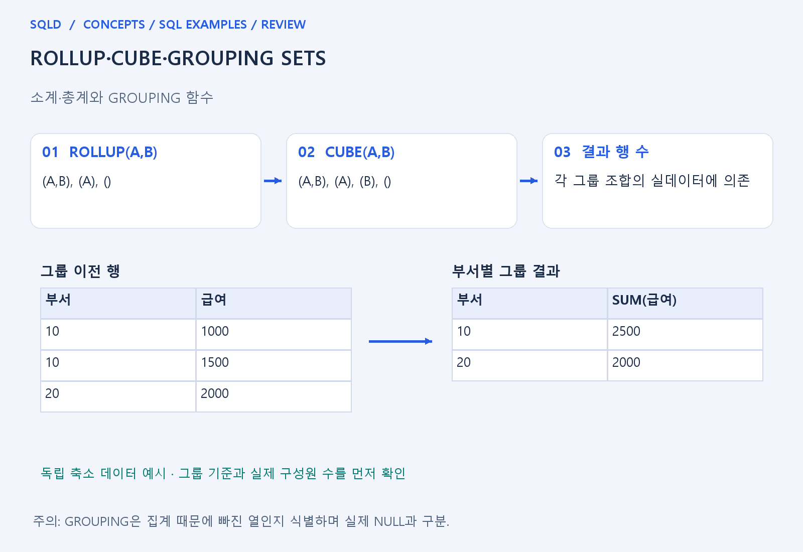
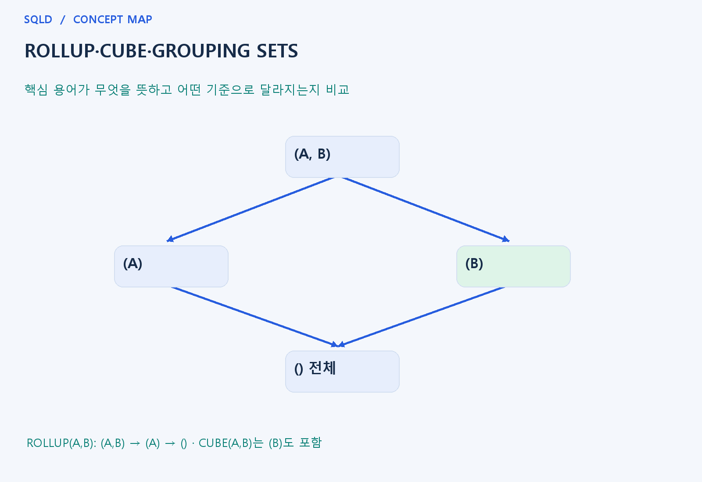

# ROLLUP·CUBE·GROUPING SETS

- **학습 순서**: 개념 설명 → 그림으로 원리 확인 → 예제와 풀이 → 복습 요약.

## 이 글의 목차

- [1. 개념의 뜻과 동작 원리](#1.%20%EA%B0%9C%EB%85%90%EC%9D%98%20%EB%9C%BB%EA%B3%BC%20%EB%8F%99%EC%9E%91%20%EC%9B%90%EB%A6%AC)
  - [1-1. 소계와 총계가 필요한 이유](#1-1.%20%EC%86%8C%EA%B3%84%EC%99%80%20%EC%B4%9D%EA%B3%84%EA%B0%80%20%ED%95%84%EC%9A%94%ED%95%9C%20%EC%9D%B4%EC%9C%A0)
  - [1-2. ROLLUP·CUBE·GROUPING SETS](#1-2.%20ROLLUP%C2%B7CUBE%C2%B7GROUPING%20SETS)
  - [1-3. NULL과 GROUPING의 구분](#1-3.%20NULL%EA%B3%BC%20GROUPING%EC%9D%98%20%EA%B5%AC%EB%B6%84)
- [2. 세부 정의와 관련 규칙](#2.%20%EC%84%B8%EB%B6%80%20%EC%A0%95%EC%9D%98%EC%99%80%20%EA%B4%80%EB%A0%A8%20%EA%B7%9C%EC%B9%99)
  - [2-1. 정의와 기본 규칙](#2-1.%20%EC%A0%95%EC%9D%98%EC%99%80%20%EA%B8%B0%EB%B3%B8%20%EA%B7%9C%EC%B9%99)
- [3. 핵심 차이 한눈에 보기](#3.%20%ED%95%B5%EC%8B%AC%20%EC%B0%A8%EC%9D%B4%20%ED%95%9C%EB%88%88%EC%97%90%20%EB%B3%B4%EA%B8%B0)
- [4. 예제](#4.%20%EC%98%88%EC%A0%9C)
- [5. 복습 요약](#5.%20%EB%B3%B5%EC%8A%B5%20%EC%9A%94%EC%95%BD)
- [6. 관련 글과 추가 학습](#6.%20%EA%B4%80%EB%A0%A8%20%EA%B8%80%EA%B3%BC%20%EC%B6%94%EA%B0%80%20%ED%95%99%EC%8A%B5)

## 1. 개념의 뜻과 동작 원리

### 1-1. 소계와 총계가 필요한 이유

- 일반 GROUP BY는 지정한 기준의 집계 한 종류를 만듦. 보고서에서 부서·직급별 합계와 부서별 합계, 전체 합계를 함께 보려면 여러 집계 수준이 필요.
- ROLLUP·CUBE·GROUPING SETS는 여러 그룹 기준을 한 질의에 표현하는 도구. 함수 이름만 외우기보다 어떤 열 조합으로 그룹을 만드는지 먼저 적어 보면 쉬움.
- 그룹 조합 수는 집계 기준의 종류 수이지 출력 행 수 자체가 아님. 각 조합마다 실데이터에 몇 개 그룹이 있는지를 더해야 실제 결과 행 수가 됨.

### 1-2. ROLLUP·CUBE·GROUPING SETS

- ROLLUP(A,B)는 (A,B), (A), ()처럼 작성 순서의 계층을 따라 소계와 총계를 구성. 열 순서를 바꾸면 중간 소계 기준도 바뀔 수 있음.
- CUBE(A,B)는 위 조합에 (B)도 포함해 가능한 부분집합을 구성. 중복 없는 n개 단순 열을 기준으로 ROLLUP은 n+1수준, CUBE는 2의 n승 조합으로 이해.
- GROUPING SETS는 필요한 그룹 기준을 직접 명시하는 방식. 모든 소계를 만들기보다 보고서가 요구하는 조합만 선택할 때 연결해 생각.

### 1-3. NULL과 GROUPING의 구분

- 집계 기준에서 빠진 열은 결과에서 NULL처럼 표시될 수 있음. 원자료 자체의 NULL과 화면 표시가 같아도 왜 생겼는지가 다름.
- GROUPING(열)은 해당 열이 그 집계 행의 기준에서 제외되었는지 식별하는 데 사용. 실제 결측값과 소계 표시를 구분해야 라벨과 추가 집계가 맞음.
- SQLite는 이 문법을 그대로 지원하지 않으므로 UNION ALL로 원리를 표현할 수 있음. 이를 Oracle 전용 그룹 구문의 실제 실행 검증과 혼동하지 않음.
- 소계 함수는 어떤 열 조합으로 그룹을 만들지 확장하는 기능. 그룹 기준의 수와 실제 출력 행 수는 다르며, 소계 표시용 NULL은 원본 NULL과 구분할 수 있도록 GROUPING 계열의 의미를 함께 확인.

## 2. 세부 정의와 관련 규칙

### 2-1. 정의와 기본 규칙

- ROLLUP(A,B)는 (A,B), (A), ()의 계층 소계이고 CUBE(A,B)는 (B)도 추가한 네 조합임.
- 중복 없는 n개 열이면 ROLLUP은 n+1수준, CUBE는 2의 n승 조합임.

- GROUPING SETS는 원하는 그룹 조합을 명시함.
- 실제 값 NULL과 집계 때문에 생긴 NULL은 GROUPING(열)로 구별함.

- SQLite는 이 세 문법을 직접 지원하지 않음.
- 실행 예제는 UNION ALL로 소계 원리를 만들고, Oracle 원문은 dialect_reference 폴더에 별도로 제공함.

## 3. 핵심 차이 한눈에 보기

|  구분 | 핵심 뜻 | 확인할 기준 |
| --- | --- | --- |
| ROLLUP(A,B) | (A,B), (A), () | 작성한 열 순서의 계층적 소계 |
| CUBE(A,B) | (A,B), (A), (B), () | 가능한 그룹 조합 생성 |
| GROUPING | 해당 열이 집계 기준에서 빠졌는지 식별 | 실제 NULL과 집계 표시 NULL 구분 |

## 4. 예제

- **상황**: A값이 한 종류이고 B값은 두 종류인 데이터에 ROLLUP(A,B) 적용.
- **질문**: A가 한 종류, B가 두 종류일 때 ROLLUP(A,B)의 그룹 기준과 실제 결과 행 수는 각각 얼마인가?
- **정답**: 그룹 기준은 (A,B), (A), () 세 종류.
- **풀이 ①**: 상세 (A,B)는 두 그룹, A 소계는 한 그룹, 전체 합계는 한 그룹.
- **풀이 ②**: 조합 수는 3이지만 이 데이터의 결과는 2+1+1=4행.

## 5. 복습 요약

- **ROLLUP(A,B)**: (A,B), (A), (). 작성한 열 순서의 계층적 소계.
- **CUBE(A,B)**: (A,B), (A), (B), (). 가능한 그룹 조합 생성.
- **GROUPING**: 해당 열이 집계 기준에서 빠졌는지 식별. 실제 NULL과 집계 표시 NULL 구분.

## 6. 관련 글과 추가 학습

- [전체 목차](../../00_%EC%A0%84%EC%B2%B4%EB%AA%A9%EC%B0%A8.md)
- [개념별 빠른 복습표](../../%EB%B3%B5%EC%8A%B5_%ED%95%B5%EC%8B%AC%EB%B9%84%EA%B5%90%ED%91%9C.md)
- [추가 SQL 소스 안내](../../%EC%B6%94%EA%B0%80_SQL_%EC%86%8C%EC%8A%A4%EC%95%88%EB%82%B4.md)
