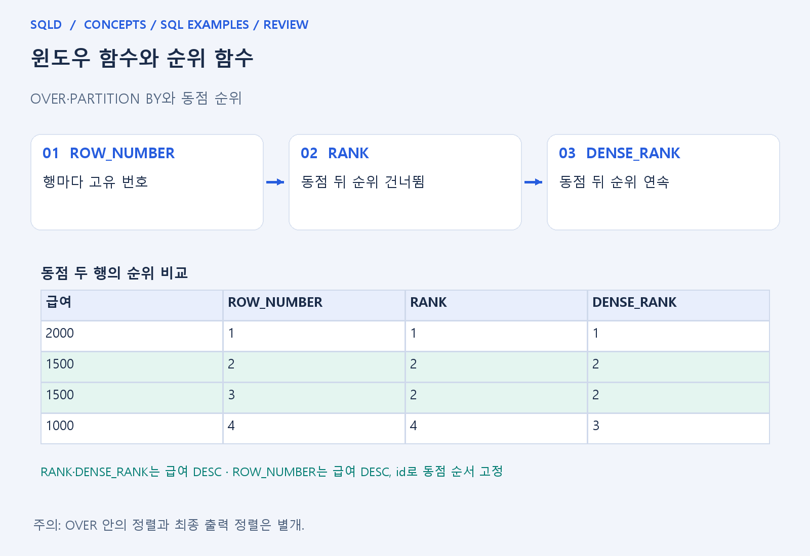
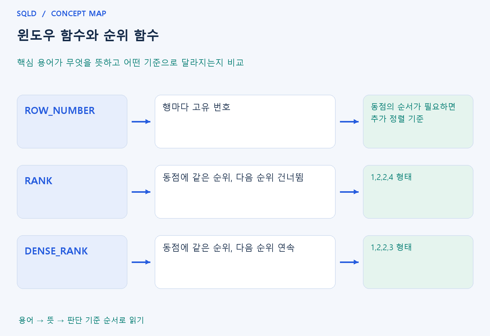

# 윈도우 함수와 순위 함수

- **학습 순서**: 개념 설명 → 그림으로 원리 확인 → 예제와 풀이 → 복습 요약.

## 이 글의 목차

- [1. 개념의 뜻과 동작 원리](#1.%20%EA%B0%9C%EB%85%90%EC%9D%98%20%EB%9C%BB%EA%B3%BC%20%EB%8F%99%EC%9E%91%20%EC%9B%90%EB%A6%AC)
  - [1-1. 윈도우 함수와 집계 함수의 차이](#1-1.%20%EC%9C%88%EB%8F%84%EC%9A%B0%20%ED%95%A8%EC%88%98%EC%99%80%20%EC%A7%91%EA%B3%84%20%ED%95%A8%EC%88%98%EC%9D%98%20%EC%B0%A8%EC%9D%B4)
  - [1-2. 세 순위 함수의 차이](#1-2.%20%EC%84%B8%20%EC%88%9C%EC%9C%84%20%ED%95%A8%EC%88%98%EC%9D%98%20%EC%B0%A8%EC%9D%B4)
  - [1-3. 정렬과 필터 단계](#1-3.%20%EC%A0%95%EB%A0%AC%EA%B3%BC%20%ED%95%84%ED%84%B0%20%EB%8B%A8%EA%B3%84)
- [2. 세부 정의와 관련 규칙](#2.%20%EC%84%B8%EB%B6%80%20%EC%A0%95%EC%9D%98%EC%99%80%20%EA%B4%80%EB%A0%A8%20%EA%B7%9C%EC%B9%99)
  - [2-1. 정의와 기본 규칙](#2-1.%20%EC%A0%95%EC%9D%98%EC%99%80%20%EA%B8%B0%EB%B3%B8%20%EA%B7%9C%EC%B9%99)
- [3. 핵심 차이 한눈에 보기](#3.%20%ED%95%B5%EC%8B%AC%20%EC%B0%A8%EC%9D%B4%20%ED%95%9C%EB%88%88%EC%97%90%20%EB%B3%B4%EA%B8%B0)
- [4. 예제](#4.%20%EC%98%88%EC%A0%9C)
- [5. 복습 요약](#5.%20%EB%B3%B5%EC%8A%B5%20%EC%9A%94%EC%95%BD)
- [6. 관련 글과 추가 학습](#6.%20%EA%B4%80%EB%A0%A8%20%EA%B8%80%EA%B3%BC%20%EC%B6%94%EA%B0%80%20%ED%95%99%EC%8A%B5)

## 1. 개념의 뜻과 동작 원리

### 1-1. 윈도우 함수와 집계 함수의 차이

- 윈도우 함수는 현재 행과 관련된 행 집합을 참조해 값을 계산하면서 원래 행들을 유지하는 방식. GROUP BY처럼 그룹마다 한 행으로 줄이는 집계와 결과 모양이 다름.
- OVER는 어떤 행 범위에서 계산할지 지정하는 부분. PARTITION BY는 독립적으로 계산할 그룹, OVER 안의 ORDER BY는 그룹 안의 계산 순서를 정함.
- 부서별 순위를 원하면 부서마다 순위를 다시 시작하도록 파티션을 설정. 파티션이 없으면 전체 결과를 하나의 계산 집합으로 볼 수 있음.

### 1-2. 세 순위 함수의 차이

- ROW_NUMBER는 각 행에 서로 다른 번호를 부여. 동점인 행의 순서까지 일정해야 한다면 유일한 키 등 추가 기준을 함께 사용.
- RANK는 동점에 같은 순위를 주고 그만큼 다음 순위를 건너뜀. DENSE_RANK는 동점에 같은 순위를 주되 다음 순위를 연속으로 부여.
- 무조건 어느 함수가 더 좋은 것이 아니라 상위 두 행인지 상위 두 순위인지 목적을 먼저 정해야 함. 동점을 모두 포함하는지에 따라 결과 수가 달라짐.

### 1-3. 정렬과 필터 단계

- OVER 안의 ORDER BY는 함수 계산 기준이며 최종 화면 정렬을 보장하지 않음. 결과 표시 순서는 바깥 ORDER BY로 따로 정함.
- 동점 판정에 키까지 넣으면 원래 같은 순위로 묶고 싶던 급여 동점이 사라질 수 있음. 순위용 기준과 고유 행 순서 기준을 구분.
- 윈도우 결과로 필터할 때는 일반적으로 바깥 조회 등 적절한 단계를 사용. WHERE가 윈도우 계산 이전의 행 선택 단계라는 점과 연결하여 이해.
- 윈도우 함수는 원본 행을 유지하면서 행들의 묶음에 계산값을 붙임. PARTITION BY로 계산 범위, ORDER BY로 계산 순서를 정하고, 순위 함수에서는 동점 뒤 순위를 건너뛰는지가 핵심 구분 기준.

## 2. 세부 정의와 관련 규칙

### 2-1. 정의와 기본 규칙


- 윈도우 함수는 OVER로 대상 창을 정하며 일반 GROUP BY와 달리 입력 행을 축약하지 않음.
- PARTITION BY는 창을 나누고 ORDER BY는 창 안의 순서를 정함.

- RANK는 동점 뒤 순위 건너뜀, DENSE_RANK는 동점 뒤 바로 다음 순위, ROW_NUMBER는 행마다 다른 번호임.
- 어느 열로 동점을 정했는지 확인함.

- 창 안 ORDER BY는 최종 행 순서를 보장하지 않음.
- 윈도우 결과 필터는 인라인 뷰나 CTE의 바깥 WHERE로 옮김.



## 3. 핵심 차이 한눈에 보기

|  구분 | 핵심 뜻 | 확인할 기준 |
| --- | --- | --- |
| ROW_NUMBER | 행마다 고유 번호 | 동점의 순서가 필요하면 추가 정렬 기준 |
| RANK | 동점에 같은 순위, 다음 순위 건너뜀 | 1,2,2,4 형태 |
| DENSE_RANK | 동점에 같은 순위, 다음 순위 연속 | 1,2,2,3 형태 |



## 4. 예제

- **상황**: 점수 100, 90, 90, 80에서 공동 순위를 두 방식으로 계산하려는 상황.
- **질문**: 100, 90, 90, 80을 내림차순으로 놓을 때 80의 RANK와 DENSE_RANK는 각각 얼마인가?
- **실행 기준**: SQLite 확인용. 입력 데이터와 필요한 객체를 코드 안에 포함.

```sql
WITH t(v) AS (VALUES (100),(90),(90),(80))
SELECT v,RANK() OVER(ORDER BY v DESC),
DENSE_RANK() OVER(ORDER BY v DESC)
FROM t ORDER BY v DESC;
```

- **결과**: 80의 RANK=4, DENSE_RANK=3.
- **풀이 ①**: 100이 1위이고 90 두 행이 공동 2위이므로 마지막 80의 위치를 두 방식으로 판단.
- **풀이 ②**: 동점 뒤 순위를 건너뛰는지가 차이.

- [예제 소스](../../short_examples/n28.sql)

## 5. 복습 요약

- **ROW_NUMBER**: 행마다 고유 번호. 동점의 순서가 필요하면 추가 정렬 기준.
- **RANK**: 동점에 같은 순위, 다음 순위 건너뜀. 1,2,2,4 형태.
- **DENSE_RANK**: 동점에 같은 순위, 다음 순위 연속. 1,2,2,3 형태.

## 6. 관련 글과 추가 학습

- [전체 목차](../../00_%EC%A0%84%EC%B2%B4%EB%AA%A9%EC%B0%A8.md)
- [개념별 빠른 복습표](../../%EB%B3%B5%EC%8A%B5_%ED%95%B5%EC%8B%AC%EB%B9%84%EA%B5%90%ED%91%9C.md)
- [추가 SQL 소스 안내](../../%EC%B6%94%EA%B0%80_SQL_%EC%86%8C%EC%8A%A4%EC%95%88%EB%82%B4.md)
