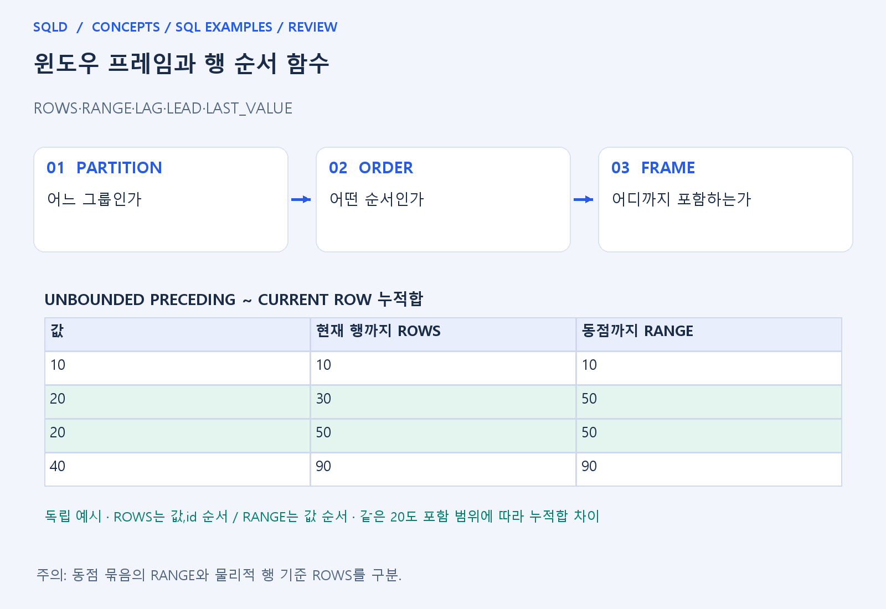
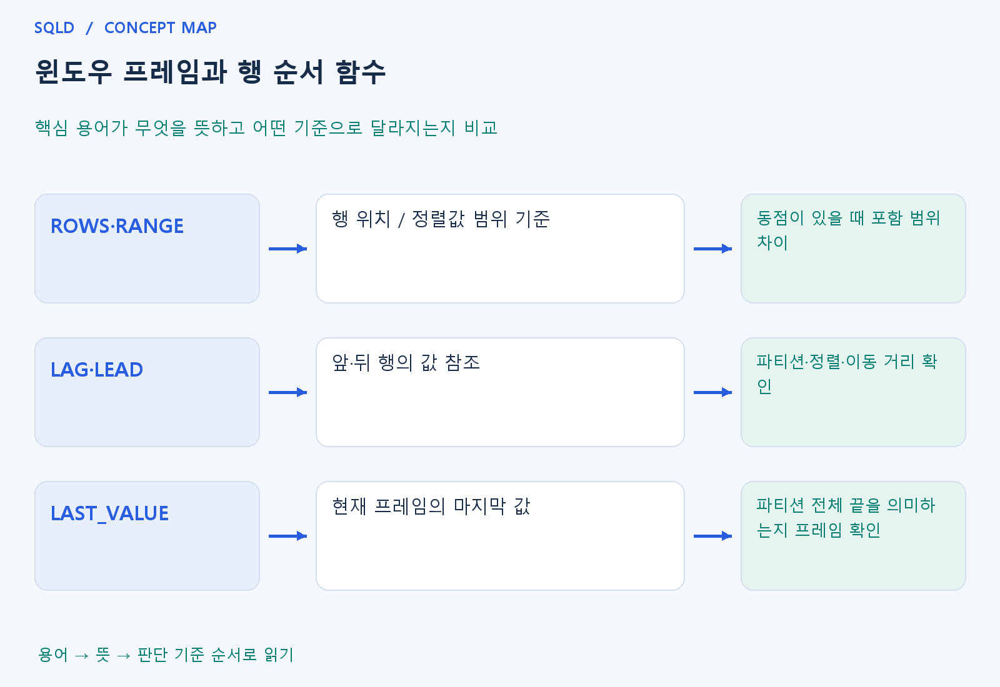

# 윈도우 프레임과 행 순서 함수

- **학습 순서**: 개념 설명 → 그림으로 원리 확인 → 예제와 풀이 → 복습 요약.

## 이 글의 목차

- [1. 개념의 뜻과 동작 원리](#1.%20%EA%B0%9C%EB%85%90%EC%9D%98%20%EB%9C%BB%EA%B3%BC%20%EB%8F%99%EC%9E%91%20%EC%9B%90%EB%A6%AC)
  - [1-1. 프레임이 필요한 이유](#1-1.%20%ED%94%84%EB%A0%88%EC%9E%84%EC%9D%B4%20%ED%95%84%EC%9A%94%ED%95%9C%20%EC%9D%B4%EC%9C%A0)
  - [1-2. ROWS와 RANGE의 기준](#1-2.%20ROWS%EC%99%80%20RANGE%EC%9D%98%20%EA%B8%B0%EC%A4%80)
  - [1-3. 행 순서 함수의 읽기](#1-3.%20%ED%96%89%20%EC%88%9C%EC%84%9C%20%ED%95%A8%EC%88%98%EC%9D%98%20%EC%9D%BD%EA%B8%B0)
- [2. 세부 정의와 관련 규칙](#2.%20%EC%84%B8%EB%B6%80%20%EC%A0%95%EC%9D%98%EC%99%80%20%EA%B4%80%EB%A0%A8%20%EA%B7%9C%EC%B9%99)
  - [2-1. 정의와 기본 규칙](#2-1.%20%EC%A0%95%EC%9D%98%EC%99%80%20%EA%B8%B0%EB%B3%B8%20%EA%B7%9C%EC%B9%99)
- [3. 핵심 차이 한눈에 보기](#3.%20%ED%95%B5%EC%8B%AC%20%EC%B0%A8%EC%9D%B4%20%ED%95%9C%EB%88%88%EC%97%90%20%EB%B3%B4%EA%B8%B0)
- [4. 예제](#4.%20%EC%98%88%EC%A0%9C)
- [5. 복습 요약](#5.%20%EB%B3%B5%EC%8A%B5%20%EC%9A%94%EC%95%BD)
- [6. 관련 글과 추가 학습](#6.%20%EA%B4%80%EB%A0%A8%20%EA%B8%80%EA%B3%BC%20%EC%B6%94%EA%B0%80%20%ED%95%99%EC%8A%B5)

## 1. 개념의 뜻과 동작 원리

### 1-1. 프레임이 필요한 이유

- 파티션이 계산할 큰 그룹이라면 프레임은 현재 행을 기준으로 실제로 포함할 작은 범위. 같은 부서라도 현재 행까지 누적할지 전체를 볼지에 따라 값이 달라짐.
- 프레임의 시작과 끝을 먼저 읽으면 SUM·AVG·FIRST_VALUE·LAST_VALUE 등이 무엇을 대상으로 하는지 이해할 수 있음.
- 모든 윈도우 함수가 프레임에 똑같이 영향을 받는 것은 아님. 함수 종류와 DBMS가 제공하는 기본 프레임·지원 조건을 함께 확인해야 함.

### 1-2. ROWS와 RANGE의 기준

- ROWS는 정렬된 행의 위치를 기준으로 범위를 다루는 방식. 동점 행이 있어도 어떤 행까지 포함하는지가 계산에 중요하므로 정렬 안정성을 검토.
- RANGE는 정렬값의 범위와 동점 묶음을 다루는 관점. CURRENT ROW까지라는 표현도 동점이 있으면 ROWS와 포함 행이 달라질 수 있음.
- 따라서 같은 값이 반복될 때 누적합이 한 행씩 증가하는지 동점 묶음마다 함께 증가하는지 비교하면 차이를 이해하기 쉬움.

### 1-3. 행 순서 함수의 읽기

- LAG·LEAD는 정한 파티션과 순서에서 이전·다음 위치의 값을 가져옴. 이전 날짜와 같다는 뜻은 아니므로 정렬 열과 이동 거리를 확인.
- LAST_VALUE는 현재 프레임의 마지막 값을 의미. 기본 프레임의 끝이 현재 행 부근이면 파티션 전체의 마지막 값과 다를 수 있음.
- 파티션 끝의 값이 필요하다면 함수 이름만 보고 판단하지 말고 프레임 끝을 확인. UNBOUNDED FOLLOWING 등 필요한 범위를 명시하는 이유가 여기에 있음.
- 윈도우의 정렬은 계산 순서를 정하고 프레임은 각 행에서 계산에 포함할 구간을 정함. ROWS와 RANGE를 구분하며 동점이 있는 경우 계산 순서를 확정할 열과 최종 출력 정렬도 따로 확인.

## 2. 세부 정의와 관련 규칙

### 2-1. 정의와 기본 규칙


- ROWS는 행 위치를, RANGE는 정렬값 범위와 동점 묶음을 기준으로 프레임을 정함.
- UNBOUNDED PRECEDING은 처음부터, CURRENT ROW는 현재 경계, FOLLOWING은 뒤쪽을 뜻함.

- 프레임을 받는 윈도우 집계 함수의 기본 경계를 제품 문서에서 확인함.
- 동점을 포함한 RANGE 누적합이 ROWS 누적합과 다를 수 있음.

- LAG와 LEAD는 이전·다음 행 값을 읽으며 행이 없을 때 기본값을 줌.
- LAST_VALUE는 현재 프레임의 마지막 값이므로 전체 마지막 값을 원하면 끝 경계를 명시함.



## 3. 핵심 차이 한눈에 보기

|  구분 | 핵심 뜻 | 확인할 기준 |
| --- | --- | --- |
| ROWS·RANGE | 행 위치 / 정렬값 범위 기준 | 동점이 있을 때 포함 범위 차이 |
| LAG·LEAD | 앞·뒤 행의 값 참조 | 파티션·정렬·이동 거리 확인 |
| LAST_VALUE | 현재 프레임의 마지막 값 | 파티션 전체 끝을 의미하는지 프레임 확인 |



## 4. 예제

- **상황**: id 1, 2, 3의 값이 각각 1, 1, 2이며 id 순서로 누적합을 구하려는 상황.
- **질문**: id 순서의 값이 1, 1, 2일 때 현재 행까지의 누적합은 어떻게 변하는가?
- **실행 기준**: SQLite 확인용. 입력 데이터와 필요한 객체를 코드 안에 포함.

```sql
WITH t(id,v) AS (VALUES (1,1),(2,1),(3,2))
SELECT v,SUM(v) OVER
(ORDER BY id ROWS UNBOUNDED PRECEDING)
FROM t ORDER BY id;
```

- **결과**: 누적합은 1, 2, 4.
- **풀이 ①**: 첫 행은 1, 둘째 행은 앞의 1에 현재 1을 더함.
- **풀이 ②**: 정한 행 순서에서 현재 행까지 더함. 셋째 행은 1+1+2=4이므로 누적합은 1→2→4로 증가.

- [예제 소스](../../short_examples/n29.sql)

## 5. 복습 요약

- **ROWS·RANGE**: 행 위치 / 정렬값 범위 기준. 동점이 있을 때 포함 범위 차이.
- **LAG·LEAD**: 앞·뒤 행의 값 참조. 파티션·정렬·이동 거리 확인.
- **LAST_VALUE**: 현재 프레임의 마지막 값. 파티션 전체 끝을 의미하는지 프레임 확인.

## 6. 관련 글과 추가 학습

- [전체 목차](../../00_%EC%A0%84%EC%B2%B4%EB%AA%A9%EC%B0%A8.md)
- [개념별 빠른 복습표](../../%EB%B3%B5%EC%8A%B5_%ED%95%B5%EC%8B%AC%EB%B9%84%EA%B5%90%ED%91%9C.md)
- [추가 SQL 소스 안내](../../%EC%B6%94%EA%B0%80_SQL_%EC%86%8C%EC%8A%A4%EC%95%88%EB%82%B4.md)
