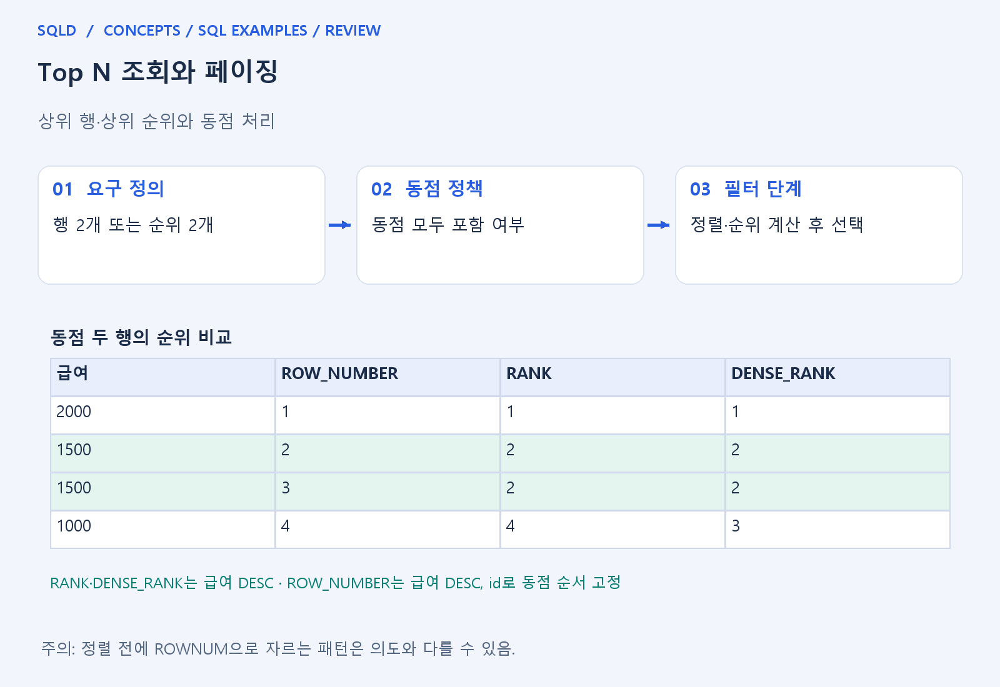
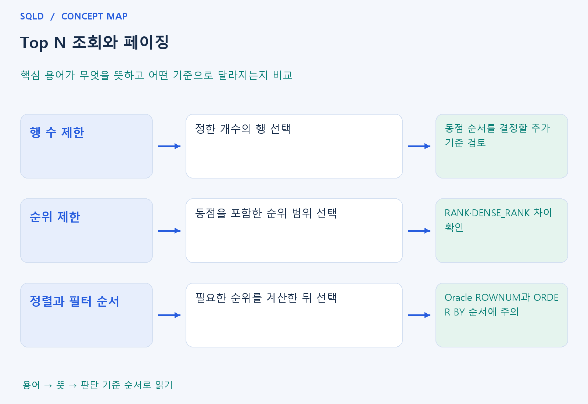

# Top N 조회와 페이징

- **학습 순서**: 개념 설명 → 그림으로 원리 확인 → 예제와 풀이 → 복습 요약.

## 이 글의 목차

- [1. 개념의 뜻과 동작 원리](#1.%20%EA%B0%9C%EB%85%90%EC%9D%98%20%EB%9C%BB%EA%B3%BC%20%EB%8F%99%EC%9E%91%20%EC%9B%90%EB%A6%AC)
  - [1-1. Top N에서 먼저 정할 것](#1-1.%20Top%20N%EC%97%90%EC%84%9C%20%EB%A8%BC%EC%A0%80%20%EC%A0%95%ED%95%A0%20%EA%B2%83)
  - [1-2. 정렬과 제한의 관계](#1-2.%20%EC%A0%95%EB%A0%AC%EA%B3%BC%20%EC%A0%9C%ED%95%9C%EC%9D%98%20%EA%B4%80%EA%B3%84)
  - [1-3. 페이징과 일관성](#1-3.%20%ED%8E%98%EC%9D%B4%EC%A7%95%EA%B3%BC%20%EC%9D%BC%EA%B4%80%EC%84%B1)
- [2. 세부 정의와 관련 규칙](#2.%20%EC%84%B8%EB%B6%80%20%EC%A0%95%EC%9D%98%EC%99%80%20%EA%B4%80%EB%A0%A8%20%EA%B7%9C%EC%B9%99)
  - [2-1. 정의와 기본 규칙](#2-1.%20%EC%A0%95%EC%9D%98%EC%99%80%20%EA%B8%B0%EB%B3%B8%20%EA%B7%9C%EC%B9%99)
- [3. 핵심 차이 한눈에 보기](#3.%20%ED%95%B5%EC%8B%AC%20%EC%B0%A8%EC%9D%B4%20%ED%95%9C%EB%88%88%EC%97%90%20%EB%B3%B4%EA%B8%B0)
- [4. 예제](#4.%20%EC%98%88%EC%A0%9C)
- [5. 복습 요약](#5.%20%EB%B3%B5%EC%8A%B5%20%EC%9A%94%EC%95%BD)
- [6. 관련 글과 추가 학습](#6.%20%EA%B4%80%EB%A0%A8%20%EA%B8%80%EA%B3%BC%20%EC%B6%94%EA%B0%80%20%ED%95%99%EC%8A%B5)

## 1. 개념의 뜻과 동작 원리

### 1-1. Top N에서 먼저 정할 것

- Top N은 어떤 기준으로 상위 대상을 고를지 정하는 조회. 정렬 기준, N의 의미, 동점 처리 정책 세 가지를 먼저 분명히 해야 함.
- 상위 두 행은 결과를 두 행으로 제한하는 질문. 상위 두 순위는 동점 때문에 세 행 이상이 나올 수 있어 같은 요청으로 볼 수 없음.
- 동점 사이에서도 일정한 두 행이 필요하면 키 등 추가 정렬 기준을 사용. 다만 추가 키가 순위 함수의 동점 정의까지 바꾸지 않도록 구분.

### 1-2. 정렬과 제한의 관계

- 먼저 잘라낸 뒤 정렬하면 전체에서 가장 큰 값들을 고른 결과와 다를 수 있음. 원하는 순서의 대상들을 정한 뒤 제한하는 논리 흐름을 확인해야 함.
- Oracle의 ROWNUM, FETCH FIRST와 SQLite의 LIMIT 등은 제품별 문법과 적용 규칙이 다름. 모양이 비슷하다고 모든 처리를 동일하게 읽지 않음.
- 순위가 필요한 경우 인라인 뷰나 CTE로 순위 계산과 필터 단계를 나눌 수 있음. 어느 단계에서 행이 제외되는지를 보면 결과를 덜 헷갈리게 읽을 수 있음.

### 1-3. 페이징과 일관성

- 페이징은 일정 순서의 결과를 구간으로 나누어 보여 주는 방식. 정렬 기준이 없거나 동점 순서가 불안정하면 페이지 사이에 중복·누락처럼 보일 수 있음.
- 조회 사이에 데이터가 추가·삭제되는 상황도 결과 위치에 영향을 줄 수 있음. 화면 표시 방식과 일관성 요구를 함께 고려해야 함.
- 행 제한 문법을 외우기 전에 무엇을 한 건으로 선택할지 확인. 조인으로 같은 업무 대상이 여러 행으로 늘어난 뒤 제한하면 의도와 다른 대상을 고를 수 있음.
- 상위 조회는 먼저 무엇을 기준으로 정렬할지 결정한 뒤 행 수나 순위를 제한하는 과정. 동점의 포함 범위를 확인하고 페이지 간 일관된 결과가 필요하면 같은 정렬값을 구별할 추가 기준을 둠.

## 2. 세부 정의와 관련 규칙

### 2-1. 정의와 기본 규칙


- 상위 N행과 상위 N순위는 동점에서 달라짐.
- ROW_NUMBER는 행 수 제한, RANK와 DENSE_RANK는 순위 기준을 표현할 수 있음.

- SQLite LIMIT/OFFSET, Oracle FETCH FIRST 또는 ROWNUM, SQL Server TOP 또는 OFFSET FETCH 등 제품별 표현이 다름.
- Oracle ROWNUM은 정렬 전에 선택될 수 있어 정렬을 안쪽 조회에 두는 고전 패턴도 익힘.

- 페이지를 재현하려면 유일한 정렬 기준이 필요함.
- 큰 OFFSET은 많은 행을 건너뛰는 비용이 있어 키 기준 다음 페이지 검색도 실무 확장으로 검토함.



## 3. 핵심 차이 한눈에 보기

|  구분 | 핵심 뜻 | 확인할 기준 |
| --- | --- | --- |
| 행 수 제한 | 정한 개수의 행 선택 | 동점 순서를 결정할 추가 기준 검토 |
| 순위 제한 | 동점을 포함한 순위 범위 선택 | RANK·DENSE_RANK 차이 확인 |
| 정렬과 필터 순서 | 필요한 순위를 계산한 뒤 선택 | Oracle ROWNUM과 ORDER BY 순서에 주의 |



## 4. 예제

- **상황**: 값 30, 20, 20, 10에서 큰 값부터 두 행을 조회하려는 상황.
- **질문**: 30, 20, 20, 10을 내림차순으로 정렬해 LIMIT 2로 제한하면 몇 행인가? 공동 순위를 모두 포함하는가?
- **실행 기준**: SQLite 확인용. 입력 데이터와 필요한 객체를 코드 안에 포함.

```sql
WITH t(v) AS (VALUES (30),(20),(20),(10))
SELECT v FROM t ORDER BY v DESC LIMIT 2;
```

- **결과**: 30, 20 두 행.
- **풀이 ①**: 정렬 결과에서 앞의 두 행만 선택하므로 30과 20 하나를 가져옴.
- **풀이 ②**: 이 SQLite 문장은 두 순위가 아니라 두 행을 제한. 공동 2위라는 이유로 다른 20까지 포함하지는 않음.

- [예제 소스](../../short_examples/n30.sql)

## 5. 복습 요약

- **행 수 제한**: 정한 개수의 행 선택. 동점 순서를 결정할 추가 기준 검토.
- **순위 제한**: 동점을 포함한 순위 범위 선택. RANK·DENSE_RANK 차이 확인.
- **정렬과 필터 순서**: 필요한 순위를 계산한 뒤 선택. Oracle ROWNUM과 ORDER BY 순서에 주의.

## 6. 관련 글과 추가 학습

- [전체 목차](../../00_%EC%A0%84%EC%B2%B4%EB%AA%A9%EC%B0%A8.md)
- [개념별 빠른 복습표](../../%EB%B3%B5%EC%8A%B5_%ED%95%B5%EC%8B%AC%EB%B9%84%EA%B5%90%ED%91%9C.md)
- [추가 SQL 소스 안내](../../%EC%B6%94%EA%B0%80_SQL_%EC%86%8C%EC%8A%A4%EC%95%88%EB%82%B4.md)
