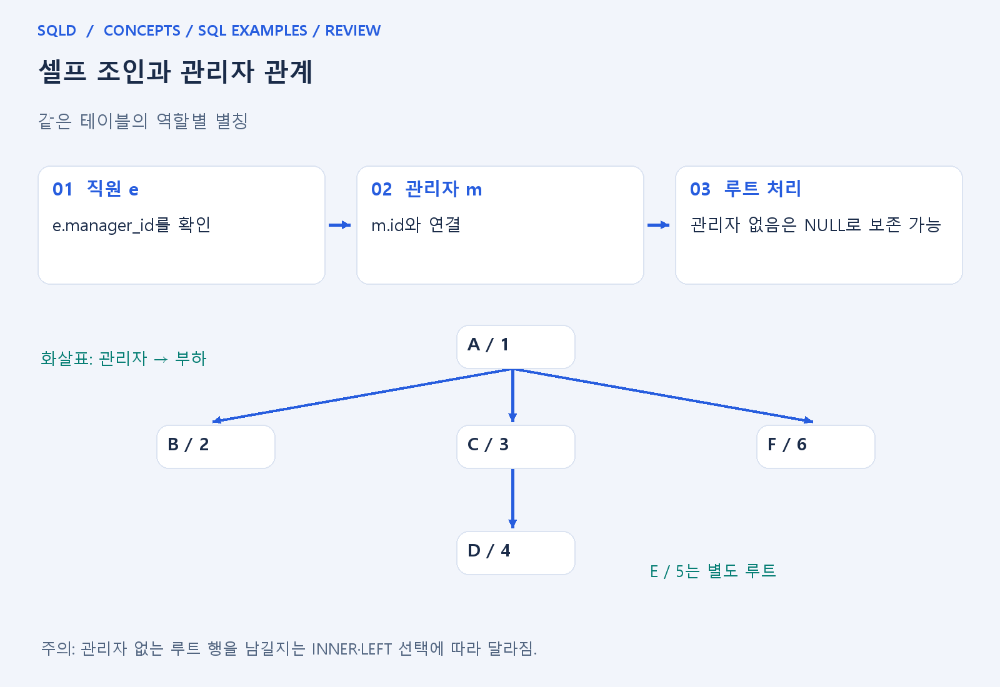
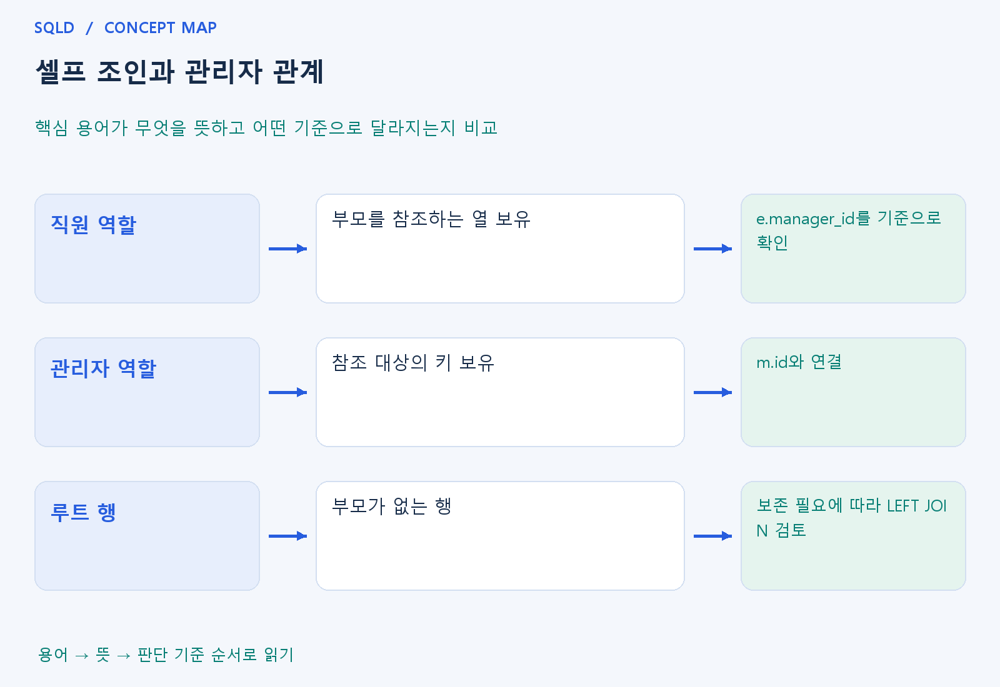

# 셀프 조인과 관리자 관계

- **학습 순서**: 개념 설명 → 그림으로 원리 확인 → 예제와 풀이 → 복습 요약.

## 이 글의 목차

- [1. 개념의 뜻과 동작 원리](#1.%20%EA%B0%9C%EB%85%90%EC%9D%98%20%EB%9C%BB%EA%B3%BC%20%EB%8F%99%EC%9E%91%20%EC%9B%90%EB%A6%AC)
  - [1-1. 셀프 조인이 필요한 이유](#1-1.%20%EC%85%80%ED%94%84%20%EC%A1%B0%EC%9D%B8%EC%9D%B4%20%ED%95%84%EC%9A%94%ED%95%9C%20%EC%9D%B4%EC%9C%A0)
  - [1-2. 연결 방향을 읽는 기준](#1-2.%20%EC%97%B0%EA%B2%B0%20%EB%B0%A9%ED%96%A5%EC%9D%84%20%EC%9D%BD%EB%8A%94%20%EA%B8%B0%EC%A4%80)
  - [1-3. 루트와 미일치 행](#1-3.%20%EB%A3%A8%ED%8A%B8%EC%99%80%20%EB%AF%B8%EC%9D%BC%EC%B9%98%20%ED%96%89)
- [2. 세부 정의와 관련 규칙](#2.%20%EC%84%B8%EB%B6%80%20%EC%A0%95%EC%9D%98%EC%99%80%20%EA%B4%80%EB%A0%A8%20%EA%B7%9C%EC%B9%99)
  - [2-1. 정의와 기본 규칙](#2-1.%20%EC%A0%95%EC%9D%98%EC%99%80%20%EA%B8%B0%EB%B3%B8%20%EA%B7%9C%EC%B9%99)
- [3. 핵심 차이 한눈에 보기](#3.%20%ED%95%B5%EC%8B%AC%20%EC%B0%A8%EC%9D%B4%20%ED%95%9C%EB%88%88%EC%97%90%20%EB%B3%B4%EA%B8%B0)
- [4. 예제](#4.%20%EC%98%88%EC%A0%9C)
- [5. 복습 요약](#5.%20%EB%B3%B5%EC%8A%B5%20%EC%9A%94%EC%95%BD)
- [6. 관련 글과 추가 학습](#6.%20%EA%B4%80%EB%A0%A8%20%EA%B8%80%EA%B3%BC%20%EC%B6%94%EA%B0%80%20%ED%95%99%EC%8A%B5)

## 1. 개념의 뜻과 동작 원리

### 1-1. 셀프 조인이 필요한 이유

- 셀프 조인은 같은 테이블을 서로 다른 역할로 두 번 이상 참조하여 연결하는 방법. 테이블을 실제로 복사하는 명령이 아니라 조회에서 역할을 나누는 것.
- 직원 표에 관리자번호가 있고 그 관리자가 같은 직원 표의 한 행이라면 직원 역할과 관리자 역할을 따로 두어 이름 등 필요한 값을 연결할 수 있음.
- 같은 열 이름이 반복되므로 별칭이 중요. e는 직원, m은 관리자처럼 뜻을 고정하고 모든 참조를 역할 기준으로 읽으면 방향을 덜 헷갈리게 됨.

### 1-2. 연결 방향을 읽는 기준

- 직원 e의 manager_id는 부모를 가리키는 값이고 관리자 m의 id는 참조 대상의 키. 일반적인 연결은 e.manager_id=m.id로 이해.
- 직원의 id와 관리자의 manager_id를 반대로 연결하면 다른 관계를 조회할 수 있음. 어느 행이 참조를 보유하고 어느 행이 참조 대상인지 먼저 확인.
- 자기 자신과 같은 id를 연결하는 조건을 무조건 쓰는 것도 아님. 셀프 조인이라는 이름은 같은 행만 연결하라는 뜻이 아니라 같은 표의 두 역할을 사용한다는 뜻.

### 1-3. 루트와 미일치 행

- 최상위 관리자는 자신의 관리자번호가 NULL일 수 있음. INNER JOIN이면 연결할 관리자 행이 없어 그 직원이 빠질 수 있고 LEFT JOIN이면 직원은 남길 수 있음.
- 직원 한 명의 바로 위 관리자 조회와 전체 조직 계층 탐색은 다른 질문. 여러 깊이를 따라가려면 재귀나 계층형 질의 등 추가 구조가 필요.
- 출력 한 행이 직원인지 직원·관리자 조합인지 정하고 읽음. 같은 표를 사용해도 키·관계의 개수에 따라 결과 행 수는 달라질 수 있음.
- 셀프 조인은 한 표를 서로 다른 역할로 두 번 읽는 조인. 별칭으로 직원과 관리자 역할을 나누고 연결할 열을 정한 뒤, 관리자가 없는 최상위 직원도 남길지에 따라 내부·외부 조인을 선택.

## 2. 세부 정의와 관련 규칙

### 2-1. 정의와 기본 규칙


- 셀프 조인은 같은 표를 서로 다른 별칭으로 사용하는 조인임.
- 같은 물리 표라도 논리 역할을 구분함.

- e.manager_id=m.id는 현재 직원의 관리자 번호를 관리자 행의 키에 연결함.
- e.id=m.manager_id로 뒤집으면 다른 관계를 읽음.

- 관리자가 없는 루트도 표시하려면 직원쪽을 보존하는 외부 조인을 사용함.
- 계층의 모든 깊이를 반복 탐색하려면 재귀 또는 계층형 문법이 필요함.



## 3. 핵심 차이 한눈에 보기

|  구분 | 핵심 뜻 | 확인할 기준 |
| --- | --- | --- |
| 직원 역할 | 부모를 참조하는 열 보유 | e.manager_id를 기준으로 확인 |
| 관리자 역할 | 참조 대상의 키 보유 | m.id와 연결 |
| 루트 행 | 부모가 없는 행 | 보존 필요에 따라 LEFT JOIN 검토 |



## 4. 예제

- **상황**: 직원 1은 관리자가 없고 직원 2의 관리자는 직원 1인 상황.
- **질문**: 직원 1의 관리자가 없고 직원 2의 관리자가 1일 때 두 직원을 모두 조회한 결과는 무엇인가?
- **실행 기준**: SQLite 확인용. 입력 데이터와 필요한 객체를 코드 안에 포함.

```sql
WITH e(id,mgr) AS (VALUES (1,NULL),(2,1))
SELECT x.id,m.id FROM e x LEFT JOIN e m ON x.mgr=m.id
ORDER BY x.id;
```

- **결과**: (1,NULL), (2,1).
- **풀이 ①**: x는 직원, m은 관리자 역할이며 x.mgr와 m.id를 비교.
- **풀이 ②**: 같은 표를 직원 x와 관리자 m 역할로 나눔.

- [예제 소스](../../short_examples/n31.sql)

## 5. 복습 요약

- **직원 역할**: 부모를 참조하는 열 보유. e.manager_id를 기준으로 확인.
- **관리자 역할**: 참조 대상의 키 보유. m.id와 연결.
- **루트 행**: 부모가 없는 행. 보존 필요에 따라 LEFT JOIN 검토.

## 6. 관련 글과 추가 학습

- [전체 목차](../../00_%EC%A0%84%EC%B2%B4%EB%AA%A9%EC%B0%A8.md)
- [개념별 빠른 복습표](../../%EB%B3%B5%EC%8A%B5_%ED%95%B5%EC%8B%AC%EB%B9%84%EA%B5%90%ED%91%9C.md)
- [추가 SQL 소스 안내](../../%EC%B6%94%EA%B0%80_SQL_%EC%86%8C%EC%8A%A4%EC%95%88%EB%82%B4.md)
