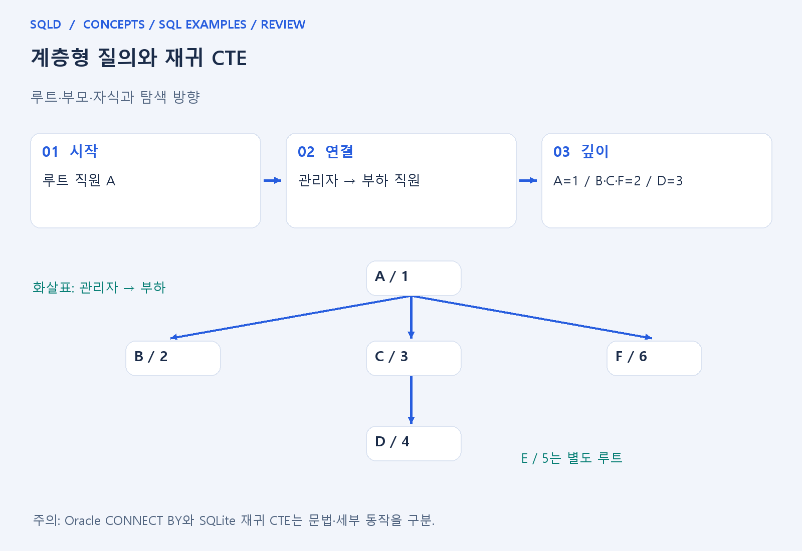
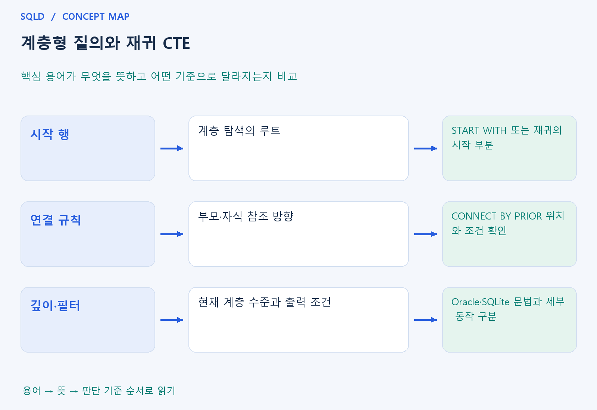

# 계층형 질의와 재귀 CTE

- **학습 순서**: 개념 설명 → 그림으로 원리 확인 → 예제와 풀이 → 복습 요약.

## 이 글의 목차

- [1. 개념의 뜻과 동작 원리](#1.%20%EA%B0%9C%EB%85%90%EC%9D%98%20%EB%9C%BB%EA%B3%BC%20%EB%8F%99%EC%9E%91%20%EC%9B%90%EB%A6%AC)
  - [1-1. 계층 구조의 기본 용어](#1-1.%20%EA%B3%84%EC%B8%B5%20%EA%B5%AC%EC%A1%B0%EC%9D%98%20%EA%B8%B0%EB%B3%B8%20%EC%9A%A9%EC%96%B4)
  - [1-2. 시작과 반복 연결](#1-2.%20%EC%8B%9C%EC%9E%91%EA%B3%BC%20%EB%B0%98%EB%B3%B5%20%EC%97%B0%EA%B2%B0)
  - [1-3. 필터와 순환의 주의점](#1-3.%20%ED%95%84%ED%84%B0%EC%99%80%20%EC%88%9C%ED%99%98%EC%9D%98%20%EC%A3%BC%EC%9D%98%EC%A0%90)
- [2. 세부 정의와 관련 규칙](#2.%20%EC%84%B8%EB%B6%80%20%EC%A0%95%EC%9D%98%EC%99%80%20%EA%B4%80%EB%A0%A8%20%EA%B7%9C%EC%B9%99)
  - [2-1. 정의와 기본 규칙](#2-1.%20%EC%A0%95%EC%9D%98%EC%99%80%20%EA%B8%B0%EB%B3%B8%20%EA%B7%9C%EC%B9%99)
- [3. 핵심 차이 한눈에 보기](#3.%20%ED%95%B5%EC%8B%AC%20%EC%B0%A8%EC%9D%B4%20%ED%95%9C%EB%88%88%EC%97%90%20%EB%B3%B4%EA%B8%B0)
- [4. 예제](#4.%20%EC%98%88%EC%A0%9C)
- [5. 복습 요약](#5.%20%EB%B3%B5%EC%8A%B5%20%EC%9A%94%EC%95%BD)
- [6. 관련 글과 추가 학습](#6.%20%EA%B4%80%EB%A0%A8%20%EA%B8%80%EA%B3%BC%20%EC%B6%94%EA%B0%80%20%ED%95%99%EC%8A%B5)

## 1. 개념의 뜻과 동작 원리

### 1-1. 계층 구조의 기본 용어

- 계층은 부모와 자식이 이어지는 구조. 루트는 시작 기준이 되는 최상위 대상, 깊이는 그 시작점에서 얼마나 내려왔는지를 나타내는 관점.
- 직원-관리자처럼 같은 종류의 대상이 반복해서 연결되면 한 번의 셀프 조인으로는 바로 위 관계만 보게 됨. 여러 단계를 따라가기 위해 계층 탐색을 사용.
- 어느 행이 루트이고 어느 열이 부모를 가리키는지 먼저 정해야 함. 시작점이 바뀌면 같은 자료에서도 탐색 범위와 깊이의 의미가 달라짐.

### 1-2. 시작과 반복 연결

- Oracle의 START WITH는 시작 행, CONNECT BY는 부모·자식 연결을 표현하는 부분으로 읽음. PRIOR가 어느 쪽 열에 붙는지에 따라 따라가는 방향을 확인.
- 재귀 CTE는 시작 결과와 그 결과에서 다음 대상을 만드는 재귀 부분으로 이해. 한 단계의 결과를 이용해 다음 단계를 만드는 반복 구조가 핵심.
- 계층형 문법과 재귀 CTE는 목적이 비슷해도 문법과 세부 처리 규칙이 같지는 않음. 사용 제품과 문제의 조건을 확인하여 해석해야 함.

### 1-3. 필터와 순환의 주의점

- 출력에서 어떤 행을 숨기는 조건과 다음 자식으로 내려갈 연결 조건은 구분. 특정 행을 결과에서 뺀다고 그 아래의 모든 행이 항상 같은 방식으로 없어지는 것은 아님.
- 부모 참조가 잘못되어 이미 방문한 대상을 다시 만나는 순환이 생길 수 있음. 순환 검사와 종료 조건은 계층 탐색이 끝나도록 하는 중요한 조건.
- 깊이·경로·형제 순서를 보여 주는 기능도 제품별로 확인. 일반 정렬과 계층 안의 형제 정렬을 같은 것으로 무조건 처리하지 않음.
- 계층 조회는 시작 행을 고르는 부분과 부모·자식으로 다음 행을 찾는 부분으로 구성. 재귀 CTE도 시작 결과에서 반복 결과를 만들어 나가므로 종료 조건과 순환 관계를 함께 확인해야 함.

## 2. 세부 정의와 관련 규칙

### 2-1. 정의와 기본 규칙


- 루트와 부모-자식 연결 조건, 종료 또는 순환 방지 규칙이 필요함.
- 한 단계 셀프 조인만으로 모든 깊이를 자동 탐색하지는 않음.

- SQLite WITH RECURSIVE는 기준 조회와 재귀 조회를 UNION ALL 등으로 결합함.
- 이 교재의 조직 데이터에는 순환이 없음.

- Oracle START WITH는 루트, CONNECT BY는 연결 조건, PRIOR는 부모 행의 식을 뜻함.
- PRIOR id=manager_id는 부모 id와 현재 후보의 manager_id를 비교하여 아래로 내려감.
- LEVEL과 ORDER SIBLINGS BY도 확인함.



## 3. 핵심 차이 한눈에 보기

|  구분 | 핵심 뜻 | 확인할 기준 |
| --- | --- | --- |
| 시작 행 | 계층 탐색의 루트 | START WITH 또는 재귀의 시작 부분 |
| 연결 규칙 | 부모·자식 참조 방향 | CONNECT BY PRIOR 위치와 조건 확인 |
| 깊이·필터 | 현재 계층 수준과 출력 조건 | Oracle·SQLite 문법과 세부 동작 구분 |



## 4. 예제

- **상황**: 시작값 1에서 다음 정수를 반복 생성하되 생성 범위를 제한하려는 상황.
- **질문**: 시작값 1에서 n<3일 때 n+1을 반복하면 어떤 값이 생성되며, 4는 왜 나오지 않는가?
- **실행 기준**: SQLite 확인용. 입력 데이터와 필요한 객체를 코드 안에 포함.

```sql
WITH RECURSIVE t(n) AS (
SELECT 1 UNION ALL SELECT n+1 FROM t WHERE n<3)
SELECT n FROM t ORDER BY n;
```

- **결과**: 1, 2, 3.
- **풀이 ①**: 시작 부분이 1을 만들고 반복 부분은 1에서 2, 2에서 3을 생성.
- **풀이 ②**: 시작값 1에서 조건을 만족하는 동안 다음 단계를 생성. n=3에서는 n<3이 거짓이므로 다음 값 4를 만들지 않음.

- [예제 소스](../../short_examples/n32.sql)

## 5. 복습 요약

- **시작 행**: 계층 탐색의 루트. START WITH 또는 재귀의 시작 부분.
- **연결 규칙**: 부모·자식 참조 방향. CONNECT BY PRIOR 위치와 조건 확인.
- **깊이·필터**: 현재 계층 수준과 출력 조건. Oracle·SQLite 문법과 세부 동작 구분.

## 6. 관련 글과 추가 학습

- [전체 목차](../../00_%EC%A0%84%EC%B2%B4%EB%AA%A9%EC%B0%A8.md)
- [개념별 빠른 복습표](../../%EB%B3%B5%EC%8A%B5_%ED%95%B5%EC%8B%AC%EB%B9%84%EA%B5%90%ED%91%9C.md)
- [추가 SQL 소스 안내](../../%EC%B6%94%EA%B0%80_SQL_%EC%86%8C%EC%8A%A4%EC%95%88%EB%82%B4.md)
