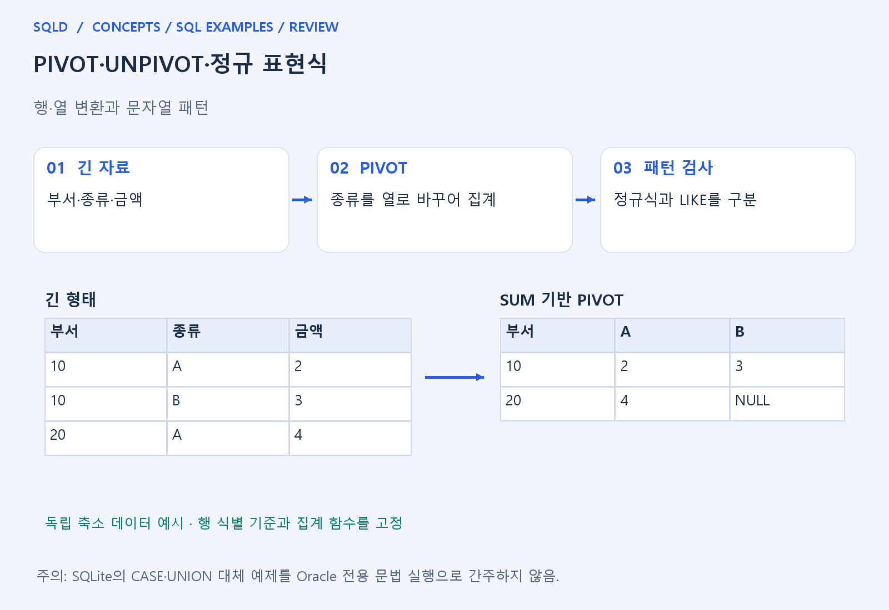
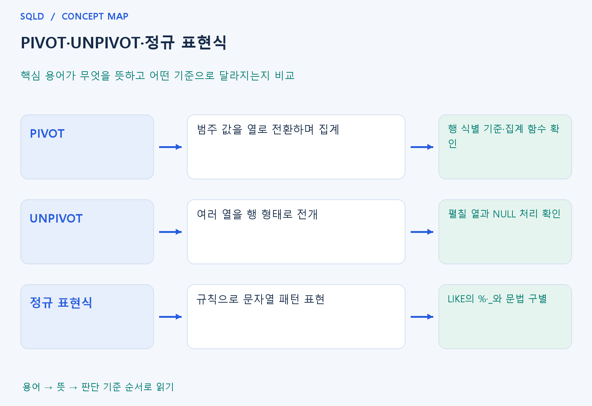

# PIVOT·UNPIVOT·정규 표현식

- **학습 순서**: 개념 설명 → 그림으로 원리 확인 → 예제와 풀이 → 복습 요약.

## 이 글의 목차

- [1. 개념의 뜻과 동작 원리](#1.%20%EA%B0%9C%EB%85%90%EC%9D%98%20%EB%9C%BB%EA%B3%BC%20%EB%8F%99%EC%9E%91%20%EC%9B%90%EB%A6%AC)
  - [1-1. PIVOT과 UNPIVOT의 목적](#1-1.%20PIVOT%EA%B3%BC%20UNPIVOT%EC%9D%98%20%EB%AA%A9%EC%A0%81)
  - [1-2. 집계와 NULL 처리](#1-2.%20%EC%A7%91%EA%B3%84%EC%99%80%20NULL%20%EC%B2%98%EB%A6%AC)
  - [1-3. 정규 표현식의 읽기](#1-3.%20%EC%A0%95%EA%B7%9C%20%ED%91%9C%ED%98%84%EC%8B%9D%EC%9D%98%20%EC%9D%BD%EA%B8%B0)
- [2. 세부 정의와 관련 규칙](#2.%20%EC%84%B8%EB%B6%80%20%EC%A0%95%EC%9D%98%EC%99%80%20%EA%B4%80%EB%A0%A8%20%EA%B7%9C%EC%B9%99)
  - [2-1. 정의와 기본 규칙](#2-1.%20%EC%A0%95%EC%9D%98%EC%99%80%20%EA%B8%B0%EB%B3%B8%20%EA%B7%9C%EC%B9%99)
- [3. 핵심 차이 한눈에 보기](#3.%20%ED%95%B5%EC%8B%AC%20%EC%B0%A8%EC%9D%B4%20%ED%95%9C%EB%88%88%EC%97%90%20%EB%B3%B4%EA%B8%B0)
- [4. 예제](#4.%20%EC%98%88%EC%A0%9C)
- [5. 복습 요약](#5.%20%EB%B3%B5%EC%8A%B5%20%EC%9A%94%EC%95%BD)
- [6. 관련 글과 추가 학습](#6.%20%EA%B4%80%EB%A0%A8%20%EA%B8%80%EA%B3%BC%20%EC%B6%94%EA%B0%80%20%ED%95%99%EC%8A%B5)

## 1. 개념의 뜻과 동작 원리

### 1-1. PIVOT과 UNPIVOT의 목적

- PIVOT은 행에 있던 범주값을 열로 펼치며 집계하여 보고서 모양을 바꾸는 방식. 분기별 매출을 분기 열로 보여 주는 구조를 생각하면 쉬움.
- 어떤 열이 행을 구분하고 어떤 값이 새 열이 되며 무엇을 합칠지 정해야 함. 같은 부서·분기 행이 여러 개라면 집계 함수에 따라 결과가 달라짐.
- UNPIVOT은 여러 열에 나뉜 값을 행으로 펼치는 방식. 정해진 모양 변환이지 언제나 원본을 손실 없이 되돌리는 역연산이라고 볼 수는 없음.

### 1-2. 집계와 NULL 처리

- 집계 과정에서 원래의 여러 상세행이 하나가 되면 개별행 정보가 사라질 수 있음. 따라서 집계한 PIVOT 결과를 다시 펼쳐도 이전 상세행 수가 복원되지 않을 수 있음.
- 표에 없는 조합을 NULL로 표시할지 다른 값으로 채울지 구분. 값이 없다는 사실과 실제 합계 0은 업무에서 다른 의미일 수 있음.
- UNPIVOT의 NULL 포함·제외 규칙과 자료형 제한은 제품 문법을 확인. SQLite의 CASE·UNION 대체 설명을 Oracle 전용 구문의 실제 실행으로 간주하지 않음.

### 1-3. 정규 표현식의 읽기

- 정규 표현식은 문자열이 어떤 패턴을 가지는지 표현하는 규칙. 시작·끝, 반복 횟수, 문자 집합 등을 결합해 단순 부분 일치보다 세밀한 조건을 나타낼 수 있음.
- LIKE의 %·_와 정규식의 기호는 다름. 같은 기호처럼 보여도 어느 문법에서 어떤 의미로 사용되는지부터 확인해야 함.
- REGEXP 관련 함수의 반환형과 사용 위치는 DBMS별로 다를 수 있음. 조건 함수와 문자열 추출·치환 함수를 구분해 읽으면 코드 해석이 쉬움.
- PIVOT은 행의 구분값을 열로 펼치고 UNPIVOT은 여러 열을 행으로 모으는 표현 변환. 정규 표현식은 문자열의 패턴을 찾는 별도 기능이므로, 데이터 모양을 바꾸는 작업과 값의 모양을 검사하는 작업을 구분.

## 2. 세부 정의와 관련 규칙

### 2-1. 정의와 기본 규칙

- PIVOT은 열 값을 새 열로 바꾸면서 보통 집계를 수행하고 UNPIVOT은 여러 열을 행으로 바꿈.
- Oracle UNPIVOT은 기본 NULL 제외 등 세부 규칙을 확인함.

- 조건부 집계와 UNION ALL로 변환의 기본 원리를 실습할 수 있음.
- Oracle 전용 PIVOT과 UNPIVOT 코드는 별도 참고 파일에 둠.

- 정규식의 ^는 시작, $는 끝, [0-9]는 숫자 범위, +는 앞 패턴 1회 이상임.
- REGEXP_LIKE 등은 제품별 함수이며 SQLite 기본 설치에 같은 함수가 자동 등록되어 있지는 않음.

## 3. 핵심 차이 한눈에 보기

|  구분 | 핵심 뜻 | 확인할 기준 |
| --- | --- | --- |
| PIVOT | 범주 값을 열로 전환하며 집계 | 행 식별 기준·집계 함수 확인 |
| UNPIVOT | 여러 열을 행 형태로 전개 | 펼칠 열과 NULL 처리 확인 |
| 정규 표현식 | 규칙으로 문자열 패턴 표현 | LIKE의 %·_와 문법 구별 |

## 4. 예제

- **상황**: 부서 10의 분기 A 금액 2, 분기 B 금액 3을 열로 펼침.
- **질문**: 부서 10의 분기 A=2, B=3을 분기별 열로 펼치면 행과 열은 어떻게 구성되는가?
- **정답**: 한 행에 부서=10, A=2, B=3으로 표시.
- **풀이 ①**: 부서는 결과 행의 기준으로 남기고 분기 A와 B를 각각 열 이름으로 배치.
- **풀이 ②**: 분기를 열로 바꾸고 부서를 행의 기준으로 유지하는 것이 PIVOT의 기본 아이디어.

## 5. 복습 요약

- **PIVOT**: 범주 값을 열로 전환하며 집계. 행 식별 기준·집계 함수 확인.
- **UNPIVOT**: 여러 열을 행 형태로 전개. 펼칠 열과 NULL 처리 확인.
- **정규 표현식**: 규칙으로 문자열 패턴 표현. LIKE의 %·_와 문법 구별.

## 6. 관련 글과 추가 학습

- [전체 목차](../../00_%EC%A0%84%EC%B2%B4%EB%AA%A9%EC%B0%A8.md)
- [개념별 빠른 복습표](../../%EB%B3%B5%EC%8A%B5_%ED%95%B5%EC%8B%AC%EB%B9%84%EA%B5%90%ED%91%9C.md)
- [추가 SQL 소스 안내](../../%EC%B6%94%EA%B0%80_SQL_%EC%86%8C%EC%8A%A4%EC%95%88%EB%82%B4.md)
