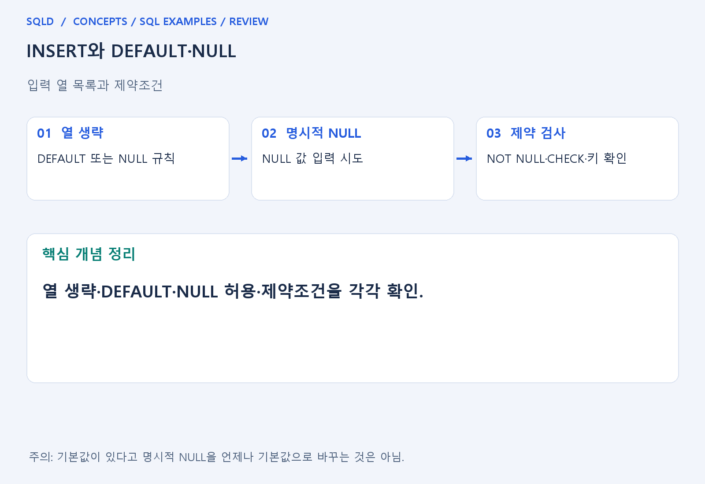
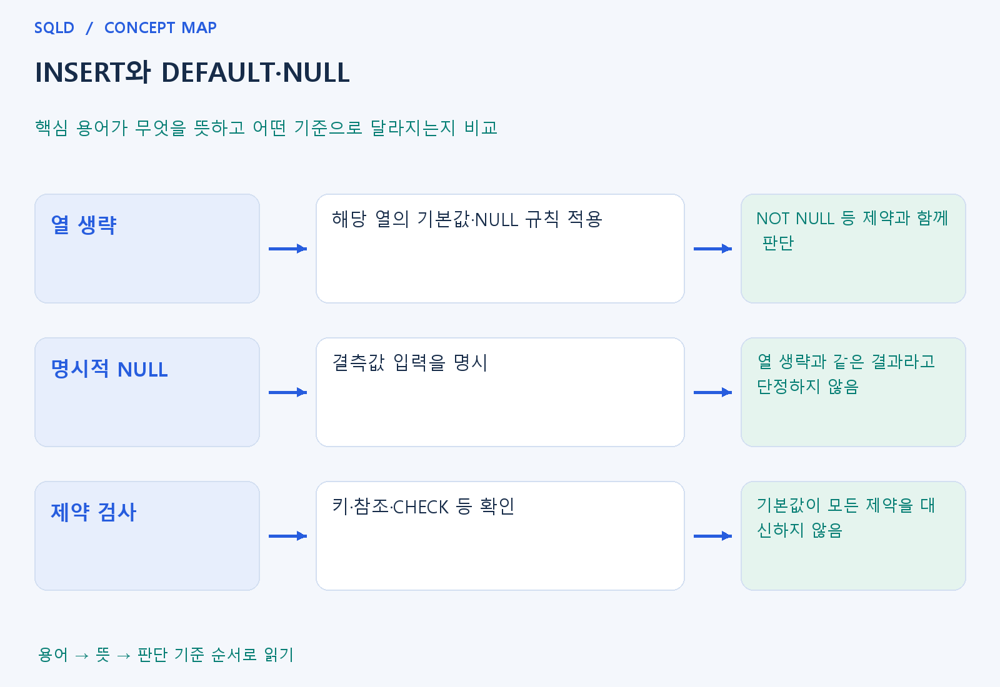

# INSERT와 DEFAULT·NULL

- **학습 순서**: 개념 설명 → 그림으로 원리 확인 → 예제와 풀이 → 복습 요약.

## 이 글의 목차

- [1. 개념의 뜻과 동작 원리](#1.%20%EA%B0%9C%EB%85%90%EC%9D%98%20%EB%9C%BB%EA%B3%BC%20%EB%8F%99%EC%9E%91%20%EC%9B%90%EB%A6%AC)
  - [1-1. INSERT의 기본 역할](#1-1.%20INSERT%EC%9D%98%20%EA%B8%B0%EB%B3%B8%20%EC%97%AD%ED%95%A0)
  - [1-2. 열 생략·DEFAULT·NULL](#1-2.%20%EC%97%B4%20%EC%83%9D%EB%9E%B5%C2%B7DEFAULT%C2%B7NULL)
  - [1-3. 입력 성공과 확정의 차이](#1-3.%20%EC%9E%85%EB%A0%A5%20%EC%84%B1%EA%B3%B5%EA%B3%BC%20%ED%99%95%EC%A0%95%EC%9D%98%20%EC%B0%A8%EC%9D%B4)
- [2. 세부 정의와 관련 규칙](#2.%20%EC%84%B8%EB%B6%80%20%EC%A0%95%EC%9D%98%EC%99%80%20%EA%B4%80%EB%A0%A8%20%EA%B7%9C%EC%B9%99)
  - [2-1. 정의와 기본 규칙](#2-1.%20%EC%A0%95%EC%9D%98%EC%99%80%20%EA%B8%B0%EB%B3%B8%20%EA%B7%9C%EC%B9%99)
- [3. 핵심 차이 한눈에 보기](#3.%20%ED%95%B5%EC%8B%AC%20%EC%B0%A8%EC%9D%B4%20%ED%95%9C%EB%88%88%EC%97%90%20%EB%B3%B4%EA%B8%B0)
- [4. 예제](#4.%20%EC%98%88%EC%A0%9C)
- [5. 복습 요약](#5.%20%EB%B3%B5%EC%8A%B5%20%EC%9A%94%EC%95%BD)
- [6. 관련 글과 추가 학습](#6.%20%EA%B4%80%EB%A0%A8%20%EA%B8%80%EA%B3%BC%20%EC%B6%94%EA%B0%80%20%ED%95%99%EC%8A%B5)

## 1. 개념의 뜻과 동작 원리

### 1-1. INSERT의 기본 역할

- INSERT는 테이블에 새로운 행을 추가하는 DML. 기존 행의 값을 고치는 UPDATE와 달리 한 건의 새로운 사실을 기록하는 명령으로 이해.
- 열 목록을 적으면 입력값이 그 순서의 열에 대응. 열 목록 없이 값을 넣는 문법은 테이블의 열 정의와 제품 규칙에 의존하므로 대응을 더 주의해서 확인.
- 입력값은 자료형과 제약조건 검사를 통과해야 함. 값 개수가 맞아도 키 중복이나 금지한 NULL 때문에 입력이 실패할 수 있음.

### 1-2. 열 생략·DEFAULT·NULL

- 열을 생략하면 해당 열의 기본값이나 NULL 규칙이 적용될 수 있음. DEFAULT는 생략된 입력 등을 정한 기본값으로 채우기 위한 설계 요소.
- 명시적 NULL은 결측값을 넣겠다고 지정한 것. 기본값이 있다는 이유만으로 이 NULL도 언제나 기본값으로 교체된다고 생각하지 않음.
- NOT NULL 열에 유효한 기본값도 없고 값을 주지 않으면 정상 입력이 어려울 수 있음. 기본값과 제약조건은 서로 대신하는 기능이 아님.

### 1-3. 입력 성공과 확정의 차이

- 한 문장이 실행됐다는 사실과 트랜잭션이 확정됐다는 사실을 구분. 자동 커밋·명시적 트랜잭션 등 실행 환경에 따라 이후 취소 가능성이 달라질 수 있음.
- 외래키가 있으면 참조 대상이 유효한지 확인하며 기본키·유일성 제약은 중복을 검사. CHECK와 자료형은 허용값 범위를 확인하는 역할.
- 다른 조회 결과를 INSERT로 입력할 때는 출력 열의 수·순서·형이 대상 열과 맞는지 확인. 조회 결과의 표시용 별칭만 보고 대응을 판단하지 않음.
- INSERT에서 값을 생략한 경우와 NULL을 명시한 경우는 구분해야 함. DEFAULT는 생략한 값을 채우는 규칙이고 NOT NULL은 결측 허용 여부를 제한하므로, 기본값이 있다고 모든 NULL이 자동으로 대체된다고 생각하지 않도록 주의.

## 2. 세부 정의와 관련 규칙

### 2-1. 정의와 기본 규칙


- INSERT INTO 표(열목록) VALUES(값목록)은 열 순서와 값 순서를 맞춰 한 행을 생성함.
- 열 목록을 명시하면 구조 변화와 순서 착오를 줄임.

- 생략한 열은 정의한 기본값이나 NULL 규칙을 따름.
- NULL을 직접 넣는 것과 열을 생략하는 것은 다름.

- 문자열은 작은따옴표를 쓰고 SQL 문자열 안의 작은따옴표는 두 번 써 이스케이프함.
- 응용프로그램 입력은 문자열 결합 대신 바인딩 매개변수를 사용함.



## 3. 핵심 차이 한눈에 보기

|  구분 | 핵심 뜻 | 확인할 기준 |
| --- | --- | --- |
| 열 생략 | 해당 열의 기본값·NULL 규칙 적용 | NOT NULL 등 제약과 함께 판단 |
| 명시적 NULL | 결측값 입력을 명시 | 열 생략과 같은 결과라고 단정하지 않음 |
| 제약 검사 | 키·참조·CHECK 등 확인 | 기본값이 모든 제약을 대신하지 않음 |



## 4. 예제

- **상황**: 열 n에 기본값 7을 정의하고 별도 값을 지정하지 않은 행을 입력하는 상황.
- **질문**: 기본값이 7인 열에 DEFAULT VALUES로 행을 추가하면 어떤 값이 저장되는가?
- **실행 기준**: SQLite 확인용. 입력 데이터와 필요한 객체를 코드 안에 포함.

```sql
CREATE TABLE t(n INTEGER DEFAULT 7);
INSERT INTO t DEFAULT VALUES;
SELECT n FROM t;
```

- **결과**: n=7.
- **풀이 ①**: 열값을 직접 지정하지 않았으므로 열 정의의 DEFAULT 7을 확인.
- **풀이 ②**: 열값을 생략하여 정의한 기본값을 사용.

- [예제 소스](../../short_examples/n34.sql)

## 5. 복습 요약

- **열 생략**: 해당 열의 기본값·NULL 규칙 적용. NOT NULL 등 제약과 함께 판단.
- **명시적 NULL**: 결측값 입력을 명시. 열 생략과 같은 결과라고 단정하지 않음.
- **제약 검사**: 키·참조·CHECK 등 확인. 기본값이 모든 제약을 대신하지 않음.

## 6. 관련 글과 추가 학습

- [전체 목차](../../00_%EC%A0%84%EC%B2%B4%EB%AA%A9%EC%B0%A8.md)
- [개념별 빠른 복습표](../../%EB%B3%B5%EC%8A%B5_%ED%95%B5%EC%8B%AC%EB%B9%84%EA%B5%90%ED%91%9C.md)
- [추가 SQL 소스 안내](../../%EC%B6%94%EA%B0%80_SQL_%EC%86%8C%EC%8A%A4%EC%95%88%EB%82%B4.md)
