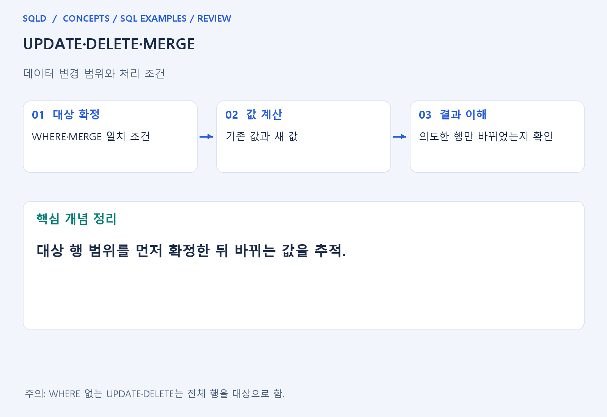
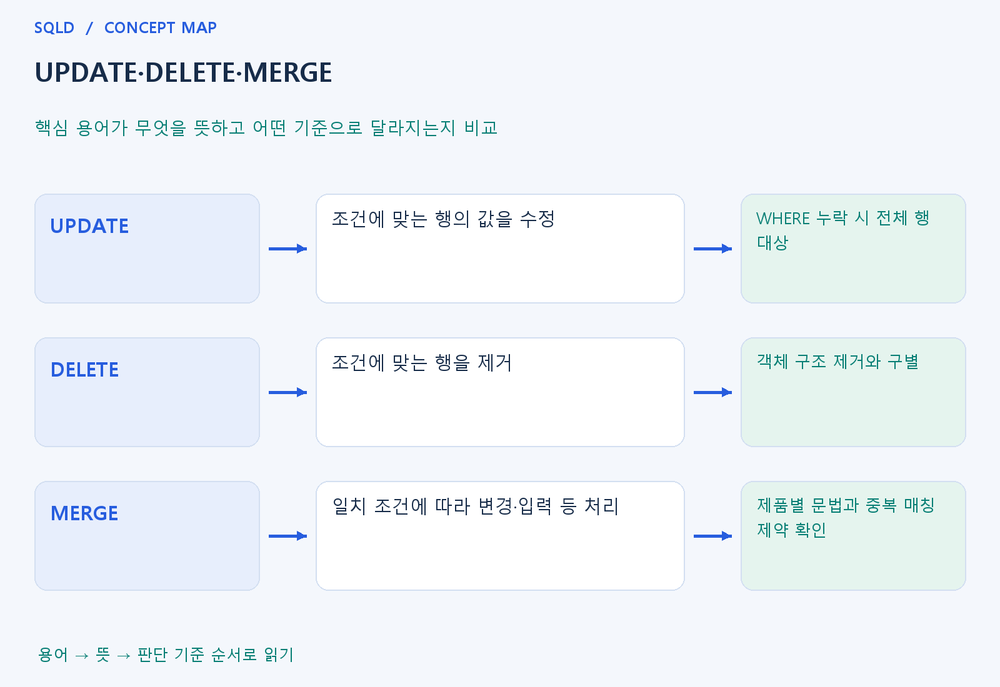

# UPDATE·DELETE·MERGE

- **학습 순서**: 개념 설명 → 그림으로 원리 확인 → 예제와 풀이 → 복습 요약.

## 이 글의 목차

- [1. 개념의 뜻과 동작 원리](#1.%20%EA%B0%9C%EB%85%90%EC%9D%98%20%EB%9C%BB%EA%B3%BC%20%EB%8F%99%EC%9E%91%20%EC%9B%90%EB%A6%AC)
  - [1-1. 변경 대상과 변경 내용](#1-1.%20%EB%B3%80%EA%B2%BD%20%EB%8C%80%EC%83%81%EA%B3%BC%20%EB%B3%80%EA%B2%BD%20%EB%82%B4%EC%9A%A9)
  - [1-2. DELETE·TRUNCATE·DROP의 차이](#1-2.%20DELETE%C2%B7TRUNCATE%C2%B7DROP%EC%9D%98%20%EC%B0%A8%EC%9D%B4)
  - [1-3. MERGE를 읽는 기준](#1-3.%20MERGE%EB%A5%BC%20%EC%9D%BD%EB%8A%94%20%EA%B8%B0%EC%A4%80)
- [2. 세부 정의와 관련 규칙](#2.%20%EC%84%B8%EB%B6%80%20%EC%A0%95%EC%9D%98%EC%99%80%20%EA%B4%80%EB%A0%A8%20%EA%B7%9C%EC%B9%99)
  - [2-1. 정의와 기본 규칙](#2-1.%20%EC%A0%95%EC%9D%98%EC%99%80%20%EA%B8%B0%EB%B3%B8%20%EA%B7%9C%EC%B9%99)
- [3. 핵심 차이 한눈에 보기](#3.%20%ED%95%B5%EC%8B%AC%20%EC%B0%A8%EC%9D%B4%20%ED%95%9C%EB%88%88%EC%97%90%20%EB%B3%B4%EA%B8%B0)
- [4. 예제](#4.%20%EC%98%88%EC%A0%9C)
- [5. 복습 요약](#5.%20%EB%B3%B5%EC%8A%B5%20%EC%9A%94%EC%95%BD)
- [6. 관련 글과 추가 학습](#6.%20%EA%B4%80%EB%A0%A8%20%EA%B8%80%EA%B3%BC%20%EC%B6%94%EA%B0%80%20%ED%95%99%EC%8A%B5)

## 1. 개념의 뜻과 동작 원리

### 1-1. 변경 대상과 변경 내용

- UPDATE는 행의 값을 바꾸고 DELETE는 행 자체를 제거. 두 명령 모두 어떤 행을 대상으로 하는지와 무엇이 달라지는지를 분리해 읽어야 함.
- WHERE는 대상 행을 정하는 조건이며 빠지면 일반적으로 전체 행이 대상. 계산식이 맞아도 대상 범위가 틀리면 업무 의도와 다른 결과가 됨.
- NULL이 포함된 산술이나 조건은 변경에도 영향을 줌. 급여에 100을 더해도 NULL 급여가 자동으로 100이 되는 것은 아님.

### 1-2. DELETE·TRUNCATE·DROP의 차이

- DELETE는 행을 지우며 WHERE로 일부를 고를 수 있음. 테이블 구조와 다른 행은 남으므로 객체 자체를 제거하는 DROP과 구별.
- TRUNCATE는 일반적으로 구조를 남기고 전체 행을 제거하는 DDL로 분류. WHERE로 원하는 일부 행만 지우는 DELETE와 목적이 다름.
- DDL과 DML의 커밋·롤백 동작은 DBMS별로 확인. 특정 제품의 TRUNCATE 성질을 모든 DBMS에 적용하는 식으로 외우지 않음.

### 1-3. MERGE를 읽는 기준

- MERGE는 원본과 대상의 일치 조건에 따라 변경·입력 등의 동작을 나누는 명령. 먼저 어떤 키·조건으로 같은 대상을 판단하는지 확인.
- 일치한 경우와 일치하지 않은 경우에 실행할 동작은 문법과 제품에 따라 다를 수 있음. 하나의 일반 이름만 보고 모든 분기 기능이 같다고 생각하지 않음.
- 원본이 대상 한 행과 여러 번 매칭되는 상황 등에는 제약이 있을 수 있음. 결과 한 건의 단위와 중복 여부를 함께 점검해야 함.
- 데이터 변경은 대상 행을 선택하는 조건과 실제 변경할 내용을 나누어 읽음. UPDATE·DELETE의 WHERE는 영향 범위를 결정하고 MERGE는 일치 여부에 따른 동작을 정의하므로 변경 전 대상과 변경 후 값을 구분.

## 2. 세부 정의와 관련 규칙

### 2-1. 정의와 기본 규칙


- UPDATE는 SET으로 바꿀 값을 정하고 WHERE로 대상을 제한함.
- DELETE도 WHERE가 없으면 전체 행을 대상으로 함.

- 쓰기 전에 같은 조건의 SELECT로 대상을 확인하고 필요하면 트랜잭션을 사용함.
- 연습 데이터에서 의도한 행 수를 바꾸는지 검사함.

- MERGE는 소스와 대상을 매칭하여 조건별 UPDATE와 INSERT 등을 처리하는 제품별 문법임.
- SQLite ON CONFLICT는 유일성 충돌 기반 UPSERT이며 MERGE와 모든 의미가 같지는 않음.



## 3. 핵심 차이 한눈에 보기

|  구분 | 핵심 뜻 | 확인할 기준 |
| --- | --- | --- |
| UPDATE | 조건에 맞는 행의 값을 수정 | WHERE 누락 시 전체 행 대상 |
| DELETE | 조건에 맞는 행을 제거 | 객체 구조 제거와 구별 |
| MERGE | 일치 조건에 따라 변경·입력 등 처리 | 제품별 문법과 중복 매칭 제약 확인 |



## 4. 예제

- **상황**: 값 1과 2가 저장되어 있고, 1인 값만 10 증가시키려는 상황.
- **질문**: 값 1, 2 중 1에만 10을 더하면 최종 정렬 결과는 무엇인가? 바뀌지 않는 행도 확인하라.
- **실행 기준**: SQLite 확인용. 입력 데이터와 필요한 객체를 코드 안에 포함.

```sql
CREATE TABLE t(v INTEGER);
INSERT INTO t VALUES(1),(2);
UPDATE t SET v=v+10 WHERE v=1;
SELECT v FROM t ORDER BY v;
```

- **결과**: 2, 11.
- **풀이 ①**: WHERE v=1을 만족하는 첫 행만 변경 대상이며 2는 그대로 남음.
- **풀이 ②**: 조건에 맞는 1만 11로 바뀜.

- [예제 소스](../../short_examples/n35.sql)

## 5. 복습 요약

- **UPDATE**: 조건에 맞는 행의 값을 수정. WHERE 누락 시 전체 행 대상.
- **DELETE**: 조건에 맞는 행을 제거. 객체 구조 제거와 구별.
- **MERGE**: 일치 조건에 따라 변경·입력 등 처리. 제품별 문법과 중복 매칭 제약 확인.

## 6. 관련 글과 추가 학습

- [전체 목차](../../00_%EC%A0%84%EC%B2%B4%EB%AA%A9%EC%B0%A8.md)
- [개념별 빠른 복습표](../../%EB%B3%B5%EC%8A%B5_%ED%95%B5%EC%8B%AC%EB%B9%84%EA%B5%90%ED%91%9C.md)
- [추가 SQL 소스 안내](../../%EC%B6%94%EA%B0%80_SQL_%EC%86%8C%EC%8A%A4%EC%95%88%EB%82%B4.md)
