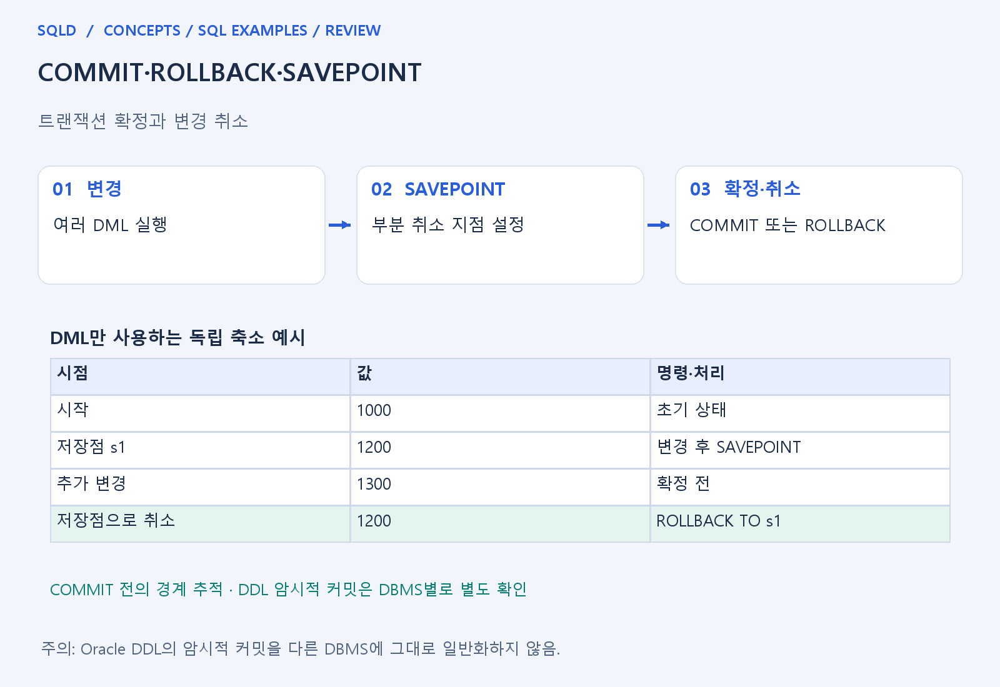
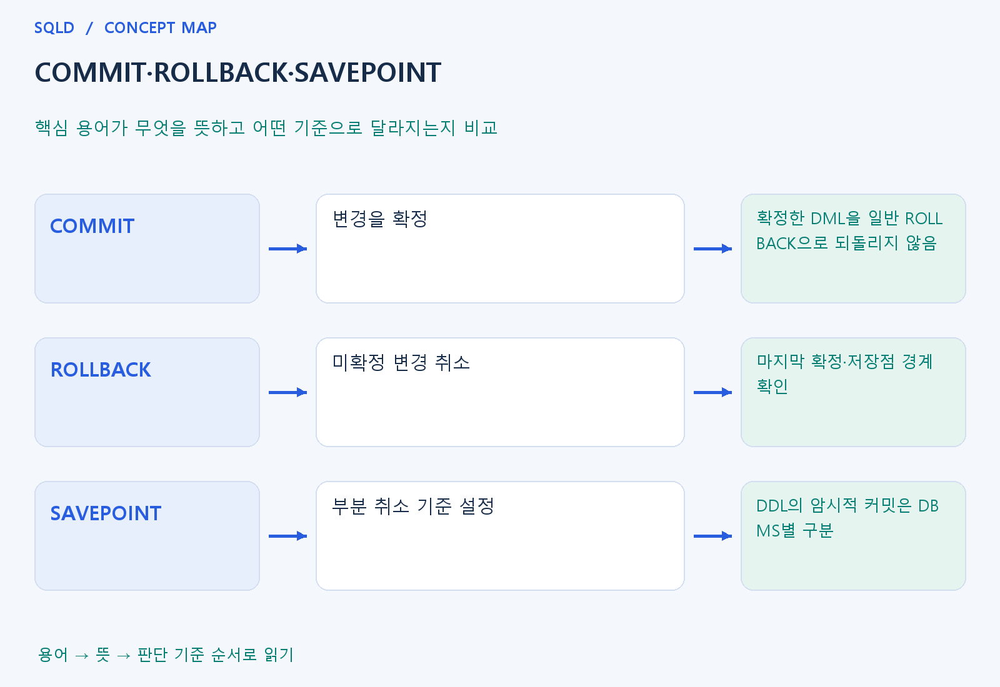

# COMMIT·ROLLBACK·SAVEPOINT

- **학습 순서**: 개념 설명 → 그림으로 원리 확인 → 예제와 풀이 → 복습 요약.

## 이 글의 목차

- [1. 개념의 뜻과 동작 원리](#1.%20%EA%B0%9C%EB%85%90%EC%9D%98%20%EB%9C%BB%EA%B3%BC%20%EB%8F%99%EC%9E%91%20%EC%9B%90%EB%A6%AC)
  - [1-1. 확정과 취소의 의미](#1-1.%20%ED%99%95%EC%A0%95%EA%B3%BC%20%EC%B7%A8%EC%86%8C%EC%9D%98%20%EC%9D%98%EB%AF%B8)
  - [1-2. SAVEPOINT의 역할](#1-2.%20SAVEPOINT%EC%9D%98%20%EC%97%AD%ED%95%A0)
  - [1-3. 환경과 DDL의 차이](#1-3.%20%ED%99%98%EA%B2%BD%EA%B3%BC%20DDL%EC%9D%98%20%EC%B0%A8%EC%9D%B4)
- [2. 세부 정의와 관련 규칙](#2.%20%EC%84%B8%EB%B6%80%20%EC%A0%95%EC%9D%98%EC%99%80%20%EA%B4%80%EB%A0%A8%20%EA%B7%9C%EC%B9%99)
  - [2-1. 정의와 기본 규칙](#2-1.%20%EC%A0%95%EC%9D%98%EC%99%80%20%EA%B8%B0%EB%B3%B8%20%EA%B7%9C%EC%B9%99)
- [3. 핵심 차이 한눈에 보기](#3.%20%ED%95%B5%EC%8B%AC%20%EC%B0%A8%EC%9D%B4%20%ED%95%9C%EB%88%88%EC%97%90%20%EB%B3%B4%EA%B8%B0)
- [4. 예제](#4.%20%EC%98%88%EC%A0%9C)
- [5. 복습 요약](#5.%20%EB%B3%B5%EC%8A%B5%20%EC%9A%94%EC%95%BD)
- [6. 관련 글과 추가 학습](#6.%20%EA%B4%80%EB%A0%A8%20%EA%B8%80%EA%B3%BC%20%EC%B6%94%EA%B0%80%20%ED%95%99%EC%8A%B5)

## 1. 개념의 뜻과 동작 원리

### 1-1. 확정과 취소의 의미

- COMMIT은 현재 트랜잭션의 변경을 확정하는 명령. ROLLBACK은 아직 확정하지 않은 변경을 취소하는 명령으로 이해.
- 변경한 문장이 여러 개라면 어떤 시점부터 하나의 트랜잭션인지 먼저 확인. 데이터의 최종값만 보지 말고 확정 명령 사이의 경계를 따라가야 함.
- 이미 COMMIT한 변경은 뒤의 일반 ROLLBACK으로 되돌릴 수 없음. 취소 명령이 모든 과거 작업을 거꾸로 실행하는 기능은 아님.

### 1-2. SAVEPOINT의 역할

- SAVEPOINT는 트랜잭션 안에 부분 취소의 기준점을 설정. 그 이후의 변경만 되돌리고 앞의 변경은 남기려는 상황에서 연결해 생각.
- ROLLBACK TO 저장점은 해당 지점까지의 부분 취소이고 전체 ROLLBACK과 범위가 다름. 저장점까지 돌아갔다고 자동으로 COMMIT된 것으로 보지 않음.
- 저장점 이름과 순서를 함께 추적하면 어떤 값이 남는지 판단하기 쉬움. 여러 변경을 한 번에 외우기보다 변경·저장점·확정을 시간순으로 표시.

### 1-3. 환경과 DDL의 차이

- 자동 커밋 여부에 따라 문장 뒤 바로 확정될 수 있으므로 예제의 연결 설정을 확인. 같은 SQL 문자열도 트랜잭션 경계가 다르면 취소 결과가 달라질 수 있음.
- Oracle의 DDL은 암시적 커밋과 연결되는 특성이 있으므로 일반 DML만 있는 흐름과 구분. 다른 DBMS의 DDL 취소 가능성을 동일하다고 단정하지 않음.
- 격리 수준은 동시에 실행되는 다른 작업을 어떻게 볼지와 연결되며, COMMIT·ROLLBACK은 변경의 확정·취소와 연결. 관련되어도 같은 개념은 아님.
- 트랜잭션 제어는 변경 내용을 언제 확정하고 어디까지 되돌릴지 정하는 일. COMMIT은 확정, ROLLBACK은 취소, SAVEPOINT는 중간 복귀 지점이며, 자동 확정과 DDL의 처리 규칙은 실행 환경별로 확인.

## 2. 세부 정의와 관련 규칙

### 2-1. 정의와 기본 규칙


- 트랜잭션은 하나의 논리적 작업 단위임.
- 원자성·일관성·격리성·지속성인 ACID를 계좌 이체 같은 사례와 연결함.

- COMMIT은 확정, ROLLBACK은 취소, SAVEPOINT는 중간 지점임.
- ROLLBACK TO는 그 지점 이후 작업을 취소함.
- 자동커밋과 명시적 트랜잭션을 구분함.

- DDL의 암시적 커밋과 롤백 가능 여부는 제품별임.
- Oracle 규칙을 SQLite의 BEGIN/ROLLBACK 결과와 혼동하지 않음.
- 모든 제품의 TRUNCATE가 롤백 불가라고 일반화하면 안 됨.



## 3. 핵심 차이 한눈에 보기

|  구분 | 핵심 뜻 | 확인할 기준 |
| --- | --- | --- |
| COMMIT | 변경을 확정 | 확정한 DML을 일반 ROLLBACK으로 되돌리지 않음 |
| ROLLBACK | 미확정 변경 취소 | 마지막 확정·저장점 경계 확인 |
| SAVEPOINT | 부분 취소 기준 설정 | DDL의 암시적 커밋은 DBMS별 구분 |



## 4. 예제

- **상황**: 빈 표에서 트랜잭션을 시작해 한 행을 넣었지만 입력을 취소하려는 상황.
- **질문**: 트랜잭션 안에서 한 행을 넣고 COMMIT 없이 ROLLBACK하면 최종 행 수는 얼마인가?
- **실행 기준**: SQLite 확인용. 입력 데이터와 필요한 객체를 코드 안에 포함.

```sql
CREATE TABLE t(v INTEGER);
BEGIN;
INSERT INTO t VALUES(1);
ROLLBACK;
SELECT COUNT(*) FROM t;
```

- **결과**: 행 수 0.
- **풀이 ①**: 테이블 생성 뒤 BEGIN부터 시작한 입력 작업이 취소되는 범위에 들어감.
- **풀이 ②**: 확정하지 않은 입력을 취소.

- [예제 소스](../../short_examples/n36.sql)

## 5. 복습 요약

- **COMMIT**: 변경을 확정. 확정한 DML을 일반 ROLLBACK으로 되돌리지 않음.
- **ROLLBACK**: 미확정 변경 취소. 마지막 확정·저장점 경계 확인.
- **SAVEPOINT**: 부분 취소 기준 설정. DDL의 암시적 커밋은 DBMS별 구분.

## 6. 관련 글과 추가 학습

- [전체 목차](../../00_%EC%A0%84%EC%B2%B4%EB%AA%A9%EC%B0%A8.md)
- [개념별 빠른 복습표](../../%EB%B3%B5%EC%8A%B5_%ED%95%B5%EC%8B%AC%EB%B9%84%EA%B5%90%ED%91%9C.md)
- [추가 SQL 소스 안내](../../%EC%B6%94%EA%B0%80_SQL_%EC%86%8C%EC%8A%A4%EC%95%88%EB%82%B4.md)
