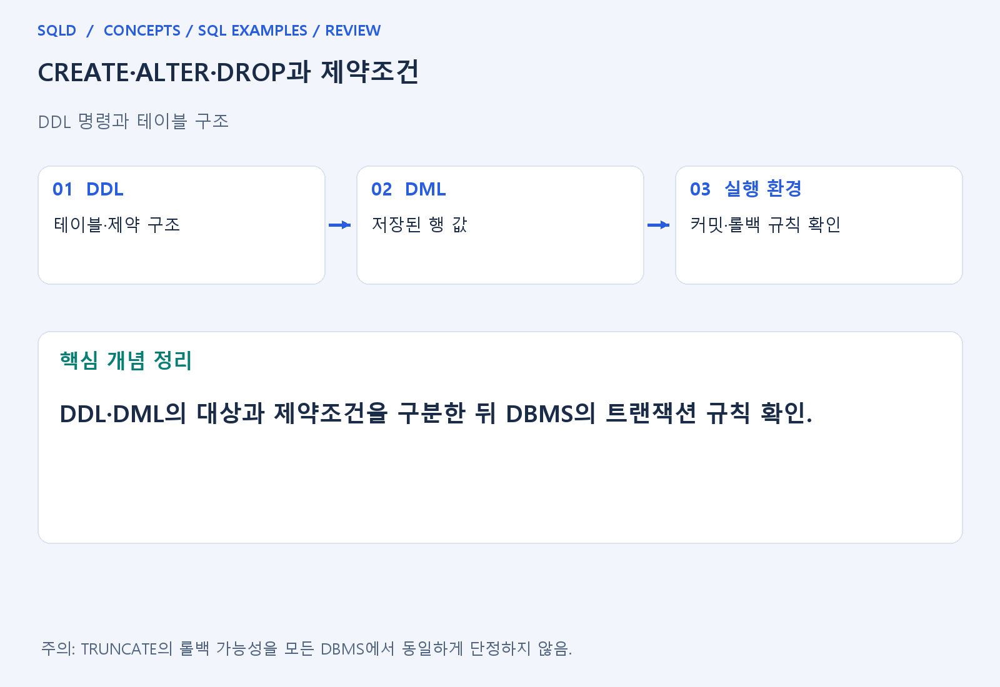
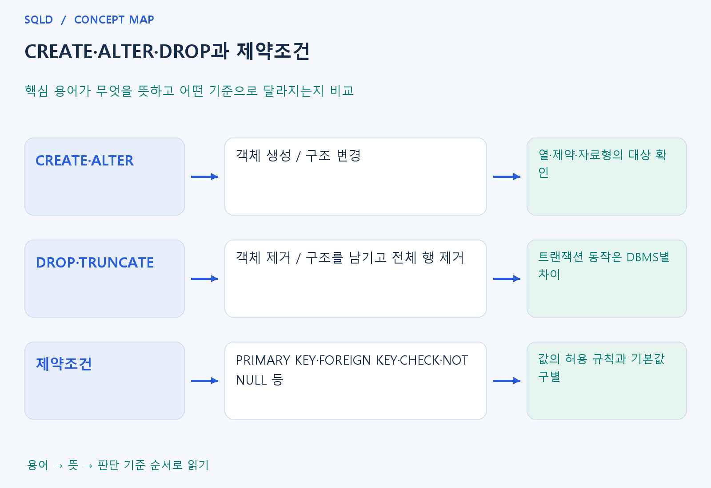

# CREATE·ALTER·DROP과 제약조건

- **학습 순서**: 개념 설명 → 그림으로 원리 확인 → 예제와 풀이 → 복습 요약.

## 이 글의 목차

- [1. 개념의 뜻과 동작 원리](#1.%20%EA%B0%9C%EB%85%90%EC%9D%98%20%EB%9C%BB%EA%B3%BC%20%EB%8F%99%EC%9E%91%20%EC%9B%90%EB%A6%AC)
  - [1-1. DDL이 다루는 대상](#1-1.%20DDL%EC%9D%B4%20%EB%8B%A4%EB%A3%A8%EB%8A%94%20%EB%8C%80%EC%83%81)
  - [1-2. 주요 제약조건의 역할](#1-2.%20%EC%A3%BC%EC%9A%94%20%EC%A0%9C%EC%95%BD%EC%A1%B0%EA%B1%B4%EC%9D%98%20%EC%97%AD%ED%95%A0)
  - [1-3. 구조 변경을 읽는 기준](#1-3.%20%EA%B5%AC%EC%A1%B0%20%EB%B3%80%EA%B2%BD%EC%9D%84%20%EC%9D%BD%EB%8A%94%20%EA%B8%B0%EC%A4%80)
- [2. 세부 정의와 관련 규칙](#2.%20%EC%84%B8%EB%B6%80%20%EC%A0%95%EC%9D%98%EC%99%80%20%EA%B4%80%EB%A0%A8%20%EA%B7%9C%EC%B9%99)
  - [2-1. 정의와 기본 규칙](#2-1.%20%EC%A0%95%EC%9D%98%EC%99%80%20%EA%B8%B0%EB%B3%B8%20%EA%B7%9C%EC%B9%99)
- [3. 핵심 차이 한눈에 보기](#3.%20%ED%95%B5%EC%8B%AC%20%EC%B0%A8%EC%9D%B4%20%ED%95%9C%EB%88%88%EC%97%90%20%EB%B3%B4%EA%B8%B0)
- [4. 예제](#4.%20%EC%98%88%EC%A0%9C)
- [5. 복습 요약](#5.%20%EB%B3%B5%EC%8A%B5%20%EC%9A%94%EC%95%BD)
- [6. 관련 글과 추가 학습](#6.%20%EA%B4%80%EB%A0%A8%20%EA%B8%80%EA%B3%BC%20%EC%B6%94%EA%B0%80%20%ED%95%99%EC%8A%B5)

## 1. 개념의 뜻과 동작 원리

### 1-1. DDL이 다루는 대상

- DDL은 데이터베이스 객체의 구조를 정의·변경하는 명령의 범주. CREATE로 만들고 ALTER로 구조를 바꾸며 DROP으로 객체를 제거하는 흐름으로 이해.
- 테이블 구조는 열 이름·자료형뿐 아니라 키·허용값·필수값 등 저장 규칙도 포함. 행을 넣기 전에 어떤 사실을 어떻게 관리할지 정하는 단계와 연결.
- 데이터 값을 바꾸는 DML과 목적이 다르지만 실제 커밋·롤백 동작은 제품별로 확인. 구조 명령이라는 분류만으로 모든 실행 특성을 결정하지 않음.

### 1-2. 주요 제약조건의 역할

- PRIMARY KEY는 대표 식별, UNIQUE는 유일성, FOREIGN KEY는 참조의 유효성, NOT NULL은 필수값, CHECK는 조건식으로 표현한 허용 규칙에 연결.
- CHECK에서 일반 비교와 NULL의 UNKNOWN 처리를 이해해야 함. 업무상 값 자체가 꼭 있어야 한다면 CHECK만으로 NOT NULL까지 대체된다고 보지 않음.
- DEFAULT는 입력을 보완하는 기본값이며 잘못된 모든 값을 자동 수정하는 기능이 아님. 각 제약이 맡는 역할을 따로 설명할 수 있어야 함.

### 1-3. 구조 변경을 읽는 기준

- ALTER의 대상이 열인지 제약인지, 기존 행이 새 규칙을 만족하는지 확인. 이미 저장된 데이터와 충돌하면 구조 변경이 제한되거나 별도 처리가 필요할 수 있음.
- DROP은 객체를 제거하는 작업이므로 행만 삭제하는 DELETE와 다름. 다른 객체가 참조하고 있다면 종속성 처리 규칙도 함께 확인.
- 테이블 정의의 문법과 지원 옵션은 DBMS별로 차이. 제약의 공통 목적을 먼저 익히고 제품의 정확한 구문을 그 위에 연결.
- DDL은 표의 구조를 만들거나 바꾸고 제약조건은 그 구조에 들어올 데이터의 규칙을 강제. 기본키·유일성·NOT NULL·참조 규칙을 나누어 확인하면 구조 변경이 입력과 삭제에 미칠 영향을 이해하기 쉬움.

## 2. 세부 정의와 관련 규칙

### 2-1. 정의와 기본 규칙


- CREATE TABLE은 열 이름·자료형·제약조건을 정의함.
- 기본키는 테이블당 한 제약이지만 여러 열로 구성할 수 있음.

- NOT NULL은 결측 금지, UNIQUE는 유일성, CHECK는 조건 위반 제한, REFERENCES는 외래키 연결임.
- CHECK만으로 NULL을 금지했다고 생각하면 안 됨.

- ALTER TABLE로 구조를 바꾸고 DROP TABLE로 객체를 없앰.
- SQLite의 동적 타입·INTEGER PRIMARY KEY와 Oracle의 NUMBER/VARCHAR2 타입 차이를 별도 표에서 확인할 것.



## 3. 핵심 차이 한눈에 보기

|  구분 | 핵심 뜻 | 확인할 기준 |
| --- | --- | --- |
| CREATE·ALTER | 객체 생성 / 구조 변경 | 열·제약·자료형의 대상 확인 |
| DROP·TRUNCATE | 객체 제거 / 구조를 남기고 전체 행 제거 | 트랜잭션 동작은 DBMS별 차이 |
| 제약조건 | PRIMARY KEY·FOREIGN KEY·CHECK·NOT NULL 등 | 값의 허용 규칙과 기본값 구별 |



## 4. 예제

- **상황**: id는 기본키, name은 필수 열인 표에 ID 1과 이름 A를 저장하는 상황.
- **질문**: id가 기본키이고 name이 NOT NULL일 때 (1, A)를 넣은 뒤 id=1을 조회하면 무엇이 나오는가? 두 제약의 역할도 설명하라.
- **실행 기준**: SQLite 확인용. 입력 데이터와 필요한 객체를 코드 안에 포함.

```sql
CREATE TABLE t(id INTEGER PRIMARY KEY,name TEXT NOT NULL);
INSERT INTO t VALUES(1,'A');
SELECT name FROM t WHERE id=1;
```

- **결과**: 이름 A.
- **풀이 ①**: id=1은 행을 찾는 식별값이고 이름 A는 필수값 조건을 만족.
- **풀이 ②**: 키와 필수값 규칙을 만족하는 행이 입력됨. 기본키는 ID의 중복·NULL을 막고 NOT NULL은 이름의 결측을 막음.

- [예제 소스](../../short_examples/n37.sql)

## 5. 복습 요약

- **CREATE·ALTER**: 객체 생성 / 구조 변경. 열·제약·자료형의 대상 확인.
- **DROP·TRUNCATE**: 객체 제거 / 구조를 남기고 전체 행 제거. 트랜잭션 동작은 DBMS별 차이.
- **제약조건**: PRIMARY KEY·FOREIGN KEY·CHECK·NOT NULL 등. 값의 허용 규칙과 기본값 구별.

## 6. 관련 글과 추가 학습

- [전체 목차](../../00_%EC%A0%84%EC%B2%B4%EB%AA%A9%EC%B0%A8.md)
- [개념별 빠른 복습표](../../%EB%B3%B5%EC%8A%B5_%ED%95%B5%EC%8B%AC%EB%B9%84%EA%B5%90%ED%91%9C.md)
- [추가 SQL 소스 안내](../../%EC%B6%94%EA%B0%80_SQL_%EC%86%8C%EC%8A%A4%EC%95%88%EB%82%B4.md)
