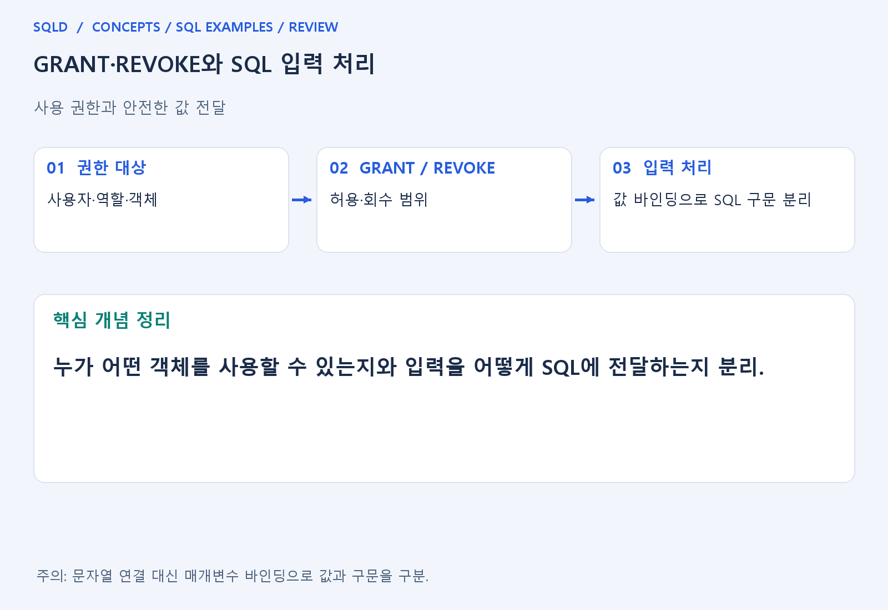
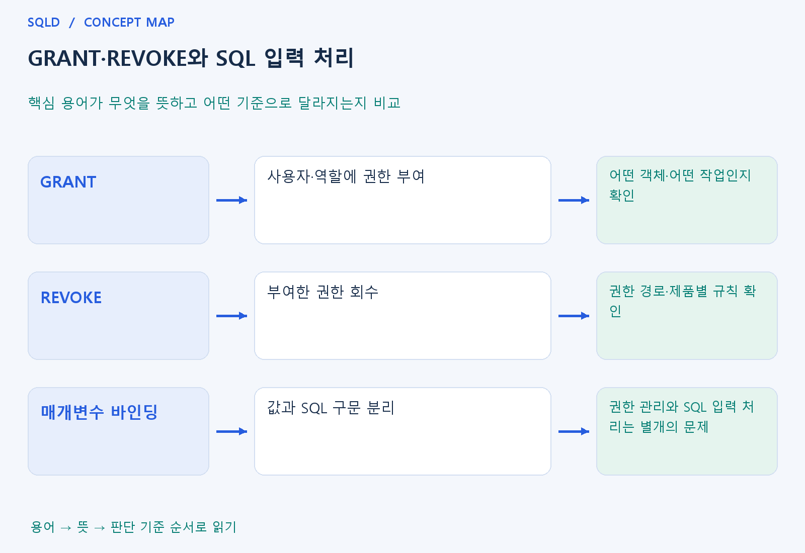

# GRANT·REVOKE와 SQL 입력 처리

- **학습 순서**: 개념 설명 → 그림으로 원리 확인 → 예제와 풀이 → 복습 요약.

## 이 글의 목차

- [1. 개념의 뜻과 동작 원리](#1.%20%EA%B0%9C%EB%85%90%EC%9D%98%20%EB%9C%BB%EA%B3%BC%20%EB%8F%99%EC%9E%91%20%EC%9B%90%EB%A6%AC)
  - [1-1. 권한 관리의 기본 단위](#1-1.%20%EA%B6%8C%ED%95%9C%20%EA%B4%80%EB%A6%AC%EC%9D%98%20%EA%B8%B0%EB%B3%B8%20%EB%8B%A8%EC%9C%84)
  - [1-2. 역할과 권한 경로](#1-2.%20%EC%97%AD%ED%95%A0%EA%B3%BC%20%EA%B6%8C%ED%95%9C%20%EA%B2%BD%EB%A1%9C)
  - [1-3. SQL 입력 처리와의 구분](#1-3.%20SQL%20%EC%9E%85%EB%A0%A5%20%EC%B2%98%EB%A6%AC%EC%99%80%EC%9D%98%20%EA%B5%AC%EB%B6%84)
- [2. 세부 정의와 관련 규칙](#2.%20%EC%84%B8%EB%B6%80%20%EC%A0%95%EC%9D%98%EC%99%80%20%EA%B4%80%EB%A0%A8%20%EA%B7%9C%EC%B9%99)
  - [2-1. 정의와 기본 규칙](#2-1.%20%EC%A0%95%EC%9D%98%EC%99%80%20%EA%B8%B0%EB%B3%B8%20%EA%B7%9C%EC%B9%99)
- [3. 핵심 차이 한눈에 보기](#3.%20%ED%95%B5%EC%8B%AC%20%EC%B0%A8%EC%9D%B4%20%ED%95%9C%EB%88%88%EC%97%90%20%EB%B3%B4%EA%B8%B0)
- [4. 예제](#4.%20%EC%98%88%EC%A0%9C)
- [5. 복습 요약](#5.%20%EB%B3%B5%EC%8A%B5%20%EC%9A%94%EC%95%BD)
- [6. 관련 글과 추가 학습](#6.%20%EA%B4%80%EB%A0%A8%20%EA%B8%80%EA%B3%BC%20%EC%B6%94%EA%B0%80%20%ED%95%99%EC%8A%B5)

## 1. 개념의 뜻과 동작 원리

### 1-1. 권한 관리의 기본 단위

- 권한은 누가 어떤 객체에서 어떤 작업을 할 수 있는지 정하는 규칙. 데이터를 알고 있다는 것과 그 데이터를 조회·수정할 수 있다는 것은 별개.
- GRANT는 권한 부여, REVOKE는 권한 회수에 사용하는 명령. 대상 사용자·역할, 객체, 작업의 종류를 각각 확인해야 범위를 정확히 읽을 수 있음.
- 조회만 필요한 계정에 수정·삭제까지 허용할 필요는 없음. 목적에 필요한 권한을 구분하여 관리한다는 원리를 먼저 이해.

### 1-2. 역할과 권한 경로

- 역할은 여러 사용자에게 필요한 권한을 묶어 관리하는 데 사용하는 단위. 사용자에게 직접 준 권한과 역할 등을 통한 권한 경로가 다를 수 있음.
- 한 경로의 권한을 회수했다고 다른 경로로 받은 허용까지 항상 사라진다고 단정하지 않음. 실제 제품의 권한 평가와 회수 규칙을 확인.
- 권한을 다시 전달할 수 있는 옵션 등은 단순히 그 객체를 사용하는 권한과 다른 조건. 문제에서 부여 대상과 옵션을 구분해 읽어야 함.

### 1-3. SQL 입력 처리와의 구분

- 권한 관리는 허용된 작업 범위를 정하고 매개변수 바인딩은 입력값을 SQL 구문과 분리하는 방식. 둘은 안전한 데이터 사용에 관련되지만 같은 기능은 아님.
- 사용자 입력을 문자열로 이어 붙이면 입력이 값이 아니라 구문의 일부처럼 해석될 위험. 바인딩은 값의 전달과 명령 구조를 구분하는 데 도움.
- 바인딩을 사용해도 계정 권한이 자동으로 줄어드는 것은 아니며 권한을 좁혀도 잘못 만든 SQL 구조가 자동으로 바뀌는 것은 아님. 두 계층을 따로 관리.
- 권한 제어는 사용자가 어떤 객체에 어떤 작업을 할 수 있는지 정하는 일. 입력값 바인딩은 SQL 문장 구조와 값을 분리하는 방법이므로, 조회 권한만 주는 것과 안전하게 값을 전달하는 것은 함께 적용할 서로 다른 통제.

## 2. 세부 정의와 관련 규칙

### 2-1. 정의와 기본 규칙

- GRANT는 권한 부여, REVOKE는 회수임.
- 최소 권한 원칙에 따라 조회·변경·객체 생성 권한을 업무별로 분리함.
- SQLite에는 Oracle식 사용자 GRANT 체계가 없음.

- 사용자 입력을 SQL 문자열에 이어 붙이면 SQL 주입 위험이 있음.
- 값은 매개변수 바인딩으로 코드와 구분함.
- 표 이름이나 정렬 방향은 값 바인딩으로 대체할 수 없으므로 허용 목록을 사용함.

- 암호는 평문 저장 대신 안전한 비밀번호 해시 등 응용 보안 설계를 따름.
- 백업과 로그의 접근도 통제함.
- 아래 SQL은 고정된 학습용 값만 사용함.

## 3. 핵심 차이 한눈에 보기

|  구분 | 핵심 뜻 | 확인할 기준 |
| --- | --- | --- |
| GRANT | 사용자·역할에 권한 부여 | 어떤 객체·어떤 작업인지 확인 |
| REVOKE | 부여한 권한 회수 | 권한 경로·제품별 규칙 확인 |
| 매개변수 바인딩 | 값과 SQL 구문 분리 | 권한 관리와 SQL 입력 처리는 별개의 문제 |

## 4. 예제

- **상황**: 분석용 사용자는 직원 정보를 조회만 해야 함.
- **질문**: 직원을 조회만 하는 분석 계정에 필요한 권한은 무엇이며, 검색값 바인딩만으로 수정 권한까지 제한할 수 있는가?
- **정답**: 조회 권한과 수정·삭제 권한을 구분하여 부여.
- **풀이 ①**: 업무가 요구하는 작업은 조회이므로 수정·삭제 권한의 필요성을 별도로 판단.
- **풀이 ②**: GRANT·REVOKE는 허용 범위, 바인딩은 값 전달 방식이라는 서로 다른 문제. 바인딩은 수정 권한을 회수하지 않으므로 수정·삭제 권한 제한은 별도로 설정.

## 5. 복습 요약

- **GRANT**: 사용자·역할에 권한 부여. 어떤 객체·어떤 작업인지 확인.
- **REVOKE**: 부여한 권한 회수. 권한 경로·제품별 규칙 확인.
- **매개변수 바인딩**: 값과 SQL 구문 분리. 권한 관리와 SQL 입력 처리는 별개의 문제.

## 6. 관련 글과 추가 학습

- [전체 목차](../../00_%EC%A0%84%EC%B2%B4%EB%AA%A9%EC%B0%A8.md)
- [개념별 빠른 복습표](../../%EB%B3%B5%EC%8A%B5_%ED%95%B5%EC%8B%AC%EB%B9%84%EA%B5%90%ED%91%9C.md)
- [추가 SQL 소스 안내](../../%EC%B6%94%EA%B0%80_SQL_%EC%86%8C%EC%8A%A4%EC%95%88%EB%82%B4.md)
