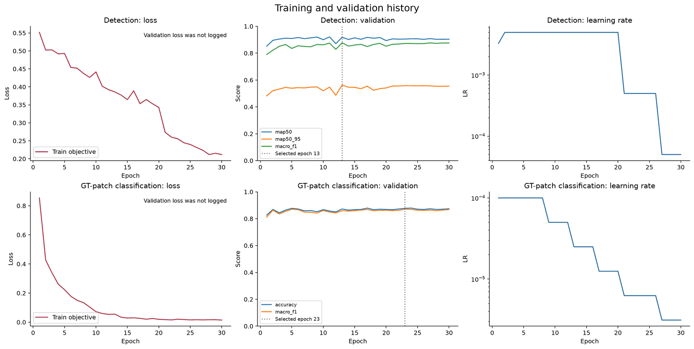
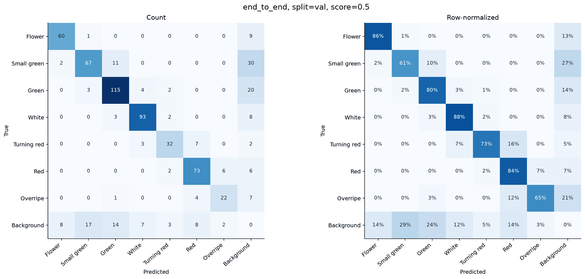
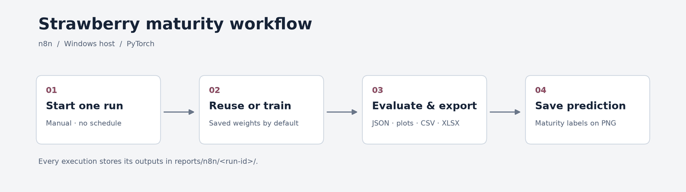

밀집된 딸기 사진에서 열매 위치를 찾고, 각 열매가 어느 성숙 단계에 있는지 표시하는 프로그램을 만들었다. [Kim 외의 논문](https://doi.org/10.7236/IJIBC.2024.16.4.133)을 바탕으로 MobileNetV3-Large 기반 Faster R-CNN과 DenseNet-121을 연결했다. 두 모델을 학습시킨 뒤 n8n에서 검증 지표, 혼동행렬, 엑셀과 예측 이미지를 한 번에 저장할 수 있게 했다.

구현 중 가장 먼저 해결해야 했던 문제는 데이터에 있었다. 소형 녹색 딸기 **673개가 변환 과정에서 전부 누락**됐다. 이를 복구한 뒤에는 딸기를 찾는 성능과 성숙도를 올바르게 분류하는 성능을 따로 측정했다.

## 두 모델이 맡는 일

Faster R-CNN은 원본 사진에서 열매 후보의 좌표와 탐지 점수를 반환한다. torchvision의 MobileNetV3-Large FPN 모델을 사용했고, 기본 MultiScaleRoIAlign으로 후보 영역의 특징을 추출한다. COCO 사전학습 가중치로 초기화한 뒤 출력 헤드를 배경과 딸기 두 클래스로 바꿨다.

DenseNet-121은 탐지 박스를 원본 이미지에서 자른 RGB 패치를 받는다. 입력은 224×224로 맞추고 ImageNet 평균과 표준편차로 정규화했다. 최종 헤드는 꽃, 소형 녹색, 녹색, 흰색, 착색 중, 빨강, 과숙의 7개 성숙도를 출력한다.

분류기는 정답 박스로 자른 패치로 학습하지만, 실제 추론에서는 탐지기가 예측한 박스를 받는다. 박스가 조금만 작아도 익은 부분이나 주변 모양이 잘릴 수 있다. 정답 패치 정확도와 예측 박스의 성숙도 mAP를 함께 기록한 이유다. 추론에서 결과를 그릴 때도 앞에서 그린 선이 겹치는 다음 패치에 들어가지 않도록 분류를 먼저 하고 원본 복사본에 표시한다.

## 누락된 라벨을 찾아 데이터 다시 만들기

[KGCV_Strawberry](https://github.com/DigitalAgUMN/KGCV_Strawberry)의 LabelMe JSON을 `random`과 `tagged` 폴더에서 읽었다. 태그가 있는 라벨에는 뒤에 수치가 붙으므로 쉼표 앞부분만 꺼내고 소문자로 바꿨다.

초기 변환기는 `small green`을 알고 있었지만 실제 라벨인 `small g`를 처리하지 못했다. 결과적으로 분류기에는 소형 녹색이 한 장도 들어가지 않았고, 탐지기 학습에서도 해당 딸기의 박스가 빠졌다. 원본 라벨과 변환 후 CSV를 클래스별로 세어 원인을 확인했다.

~~~python
name = raw_label.split(",", 1)[0].strip().lower()
if name not in maturity_label_map:
    raise ValueError(f"Unknown maturity label: {raw_label}")
class_id = maturity_label_map[name]  # small g → 1
~~~

두 점으로 표현된 사각형을 이미지 경계 안으로 제한하고 COCO의 `[x, y, width, height]` 형식으로 저장했다. 경계를 적용한 뒤 면적이 0이 된 박스 5개를 제외해 1,477장과 유효 박스 3,992개를 확보했다. 분류 CSV에는 파일명과 클래스에 더해 `image_id`와 `annotation_id`를 기록했다.

데이터는 **원본 이미지 단위**로 학습 1,033장, 검증 222장, 테스트 222장으로 나눴다. 같은 사진에서 나온 패치가 서로 다른 분할에 들어가면 배경과 조명 정보가 겹칠 수 있다. 내용이 완전히 같은 이미지 파일도 같은 분할에 배치하고, 탐지와 분류가 `splits.json`을 공유하도록 했다. 다른 시점의 같은 식물까지 분리하려면 식물 ID나 촬영 세션을 기준으로 분할을 다시 설계해야 한다.

## 중단된 학습 바로잡기

첫 전체 학습에서는 Faster R-CNN이 완료된 뒤 DenseNet 학습이 `ReduceLROnPlateau`의 `verbose` 인자 오류로 중단됐다. 프로젝트에 남아 있던 학습 함수는 전체 실행 명령이 전달하는 `accum_steps`와 `use_amp`도 받지 못했다. CLI와 학습 함수의 인자를 맞추고, 현재 PyTorch API에 맞춰 학습률은 로그에 직접 기록했다. [PyTorch 스케줄러 문서](https://docs.pytorch.org/docs/stable/generated/torch.optim.lr_scheduler.ReduceLROnPlateau.html)

CUDA에서는 AMP를 사용했고, 작은 배치를 여러 번 쌓아 한 번의 optimizer step을 수행했다. 각 배치의 평균 손실에 샘플 수를 곱한 뒤 누적 구간에 실제로 들어온 샘플 수로 gradient를 나눴다. 마지막 배치가 짧아도 정규화가 맞는다. 탐지 학습에는 박스 좌표를 함께 바꾸는 좌우 반전을 적용했고, 분류 학습에는 색조를 유지하는 반전과 클래스 빈도 기반 손실 가중치를 사용했다.

최적 가중치의 선택 기준은 탐지 검증 AP50:95와 분류 검증 macro F1이다. 아래 명령은 새 폴더에서 학습하고 검증 결과를 저장한다.

~~~powershell
python main.py prepare
python main.py train_all --save_dir checkpoints_blog_run
python main.py evaluate --split val --det_weights checkpoints_blog_run/best_detection_model.pth --cls_weights checkpoints_blog_run/best_classification_model.pth --output reports/blog_run/evaluation.json
~~~

## 손실이 줄어도 검증 성능은 정체됐다

탐지 최적 가중치는 13에폭에서 나왔다. 30에폭까지 학습 손실은 0.3860에서 0.2118로 줄었지만 검증 AP50:95는 56.23%에서 55.47%로 낮아졌다. 분류 모델은 23에폭에서 검증 정확도 87.73%, macro F1 87.08%였다.

| 검증 범위 | AP50 | AP50:95 | Macro F1 |
|---|---:|---:|---:|
| 위치만 평가한 딸기 탐지 | 91.83% | 56.23% | 87.73% |
| 정답 박스에서 자른 JPEG 패치 분류 | — | — | 87.08% |
| 예측 박스와 성숙도를 모두 평가 | 77.19% | 48.10% | 78.03% |

AP50은 예측 박스와 정답 박스가 IoU 0.50 이상일 때 매칭한다. AP50:95는 기준을 0.50부터 0.95까지 높여가며 평균을 낸다. 두 지표의 차이는 열매를 대략 찾는 경우에 비해 박스를 정밀하게 맞추는 경우가 적다는 신호다. 전체 평가에서는 박스와 성숙도 둘 다 맞아야 정답으로 인정하고, 탐지 점수에 최대 분류 확률을 곱해 예측의 순위를 매겼다.

전체 평가에서 소형 녹색 110개 중 67개를 올바르게 찾고 분류했다. 11개는 녹색으로 예측됐고 30개는 결합 점수 0.5와 IoU 0.5 기준으로 대응 예측이 없었다. 이 클래스는 성숙도 경계뿐 아니라 탐지와 점수 단계도 살펴봐야 한다.

논문 표의 mAP50과 mAP50:95는 각각 63%, 58%다. 이 구현의 전체 검증 수치는 앞의 값이 더 높고 뒤의 값이 더 낮다. 분할과 평가 설정이 같다는 근거가 없어 직접 재현에 성공했다고 보기는 어렵다.

## 동일한 검증 세트에서 개선 후보 비교하기

| 실험 | 전체 mAP50 | 전체 mAP50:95 |
|---|---:|---:|
| 기본 가중치, 탐지 크기 800 | 77.19% | 48.10% |
| 분류 좌우 반전 TTA | 77.07% | 47.80% |
| 탐지 크기 1,024 | 76.33% | 48.07% |
| Label smoothing과 위치 증강을 적용한 분류기 추가 학습 | 75.60% | 46.53% |

크기 1,024에서는 탐지 AP50:95가 56.23%에서 58.15%로 올랐지만 전체 성숙도 mAP는 거의 그대로였다. 추가 학습 모델은 학습 정확도가 99%에 가까웠지만 검증 macro F1이 기존 모델을 넘지 못했다. 기존 가중치를 채택했다.

다음 실험 후보는 실제 탐지기가 만든 예측 패치를 분류 훈련에 넣는 것이다. 학습 이미지의 예측 박스를 정답과 IoU로 매칭하고, 대응되는 박스에만 성숙도 라벨을 부여하면 추론에서 볼 법한 패치로 연습할 수 있다. 이 실험에는 학습 분할의 사진만 사용해야 한다.

## n8n으로 평가, 보고서, 이미지 저장 자동화하기

n8n은 Windows에서 Python CLI의 실행 순서를 관리한다. 수동 시작 후 첫 노드는 설정을 읽고 가중치를 확인한다. 새 학습을 선택하면 데이터 준비와 학습을 호출하고 해당 실행 폴더에 체크포인트를 저장한다. 평가 노드는 지표 JSON, 그래프, CSV, 엑셀을 저장하고, 마지막 노드는 지정한 사진에 박스와 성숙도를 그려 `maturity_prediction.png`를 만든다.

기본 모드는 기존 최적 체크포인트를 사용해 검증 보고서와 예측 이미지를 만든다. 각 단계의 로그와 산출물을 같은 실행 ID 아래에서 확인할 수 있다. Execute Command 노드는 셀프 호스팅한 n8n이 실행되는 호스트에서 명령을 호출하도록 구성했다. [가져오기 안내](https://docs.n8n.io/workflows/export-import/) · [Execute Command 노드](https://docs.n8n.io/integrations/builtin/core-nodes/n8n-nodes-base.executecommand/)
