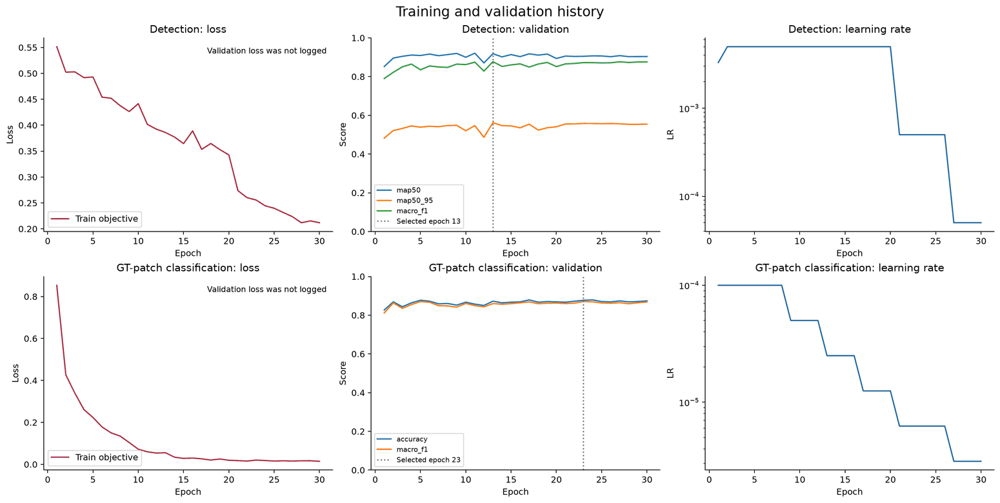

[이전 · 모델 연결](./03-detection-and-classification.md) · [시리즈 목차](./index.md) · [다음 · 평가와 결과](./05-evaluation-and-results.md)

## 탐지 학습이 끝난 뒤 분류기가 멈췄다

첫 실행에서는 Faster R-CNN이 학습을 마쳤지만 DenseNet 학습 시작 단계에서 `ReduceLROnPlateau`가 `verbose` 인자를 받지 않는다는 오류가 났다. 실행 명령과 일부 오래된 Python 함수의 인자도 맞지 않았다. 호출부와 시그니처에 `accum_steps`, `use_amp`를 맞추고, 현재 API에서 지원하는 인자만 스케줄러에 넘겼다. 학습률은 에폭 기록에 직접 남겼다. [PyTorch 스케줄러 문서](https://docs.pytorch.org/docs/stable/generated/torch.optim.lr_scheduler.ReduceLROnPlateau.html)

~~~python
import torch

optimizer = torch.optim.AdamW(classifier.parameters(), lr=1e-4)
scheduler = torch.optim.lr_scheduler.ReduceLROnPlateau(
    optimizer, mode="max", factor=0.5, patience=3
)

# 검증이 끝난 뒤의 코드
scheduler.step(val_metrics["macro_f1"])
learning_rate = optimizer.param_groups[0]["lr"]
~~~

## 메모리에 맞는 배치를 쓰고 손실을 누적하기

탐지 입력은 사진 한 장이 크기 때문에 작은 배치로 순전파한다. CUDA에서는 AMP를 사용하고, 메모리에 들어가는 배치를 여러 번 누적한 뒤 optimizer step을 호출했다. 배치마다 샘플 수가 다를 수 있으므로 평균 손실에 해당 배치의 샘플 수를 곱해 역전파한 다음, optimizer step 전에 실제로 누적된 샘플 수로 gradient를 나눴다. 이렇게 하면 끝부분 배치가 짧을 때도 샘플 기준으로 정규화된다.

~~~python
from training_utils import optimizer_step

sample_count = len(images)
with torch.autocast(device_type=device.type, enabled=use_amp):
    loss = sum(model(images, targets).values())

scaler.scale(loss * sample_count).backward()
window_samples += sample_count

if (step + 1) % accum_steps == 0 or step + 1 == len(loader):
    optimizer_step(model, optimizer, scaler, window_samples)
    window_samples = 0
~~~

`optimizer_step`에서 AMP scale을 먼저 풀고, 누적 샘플 수로 나눈 후 gradient clipping과 파라미터 갱신을 수행한다. 이 코드는 탐지 학습 루프의 핵심 부분이다.

## 마지막 에폭과 최적 에폭이 달랐다

탐지기는 검증 AP50:95가 가장 높았던 **13에폭**, 분류기는 정답 패치 검증 macro F1이 가장 높았던 **23에폭**을 저장했다. 탐지 학습 손실은 13에폭 0.3860에서 30에폭 0.2118로 줄었지만 검증 AP50:95는 56.23%에서 55.47%로 낮아졌다. 에폭을 고를 때는 학습 손실 곡선과 실제 관심 지표를 함께 봐야 한다.

처음 따라 할 때는 아래처럼 각 모델이 한 에폭씩 끝나고 체크포인트를 쓰는지 확인한다. 별도 폴더를 사용한다.

~~~powershell
python main.py train_all --output_dir dataset_practice --save_dir checkpoints_practice --det_epochs 1 --cls_epochs 1 --no_xlsx
~~~

[다음 · 평가와 결과](./05-evaluation-and-results.md)
