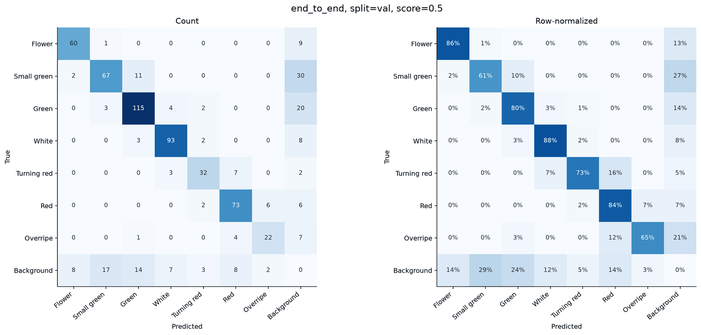

[이전 · 학습과 오류 해결](./04-training-and-debugging.md) · [시리즈 목차](./index.md) · [다음 · n8n과 예측 이미지](./06-n8n-and-inference.md)

## 위치만 맞춘 경우와 성숙도까지 맞춘 경우

검증 이미지 222장에서 최적 체크포인트를 사용해 세 가지 질문을 따로 확인했다.

| 평가 범위 | AP50 | AP50:95 | Macro F1 |
|---|---:|---:|---:|
| 딸기를 찾고 위치가 맞았는가 | 91.83% | 56.23% | 87.73% |
| 정답 JPEG 패치의 성숙도를 맞혔는가 | — | — | 87.08% |
| 찾은 위치와 성숙도가 모두 맞았는가 | 77.19% | 48.10% | 78.03% |

박스가 같은 이미지를 가리키는지 확인하는 기준은 IoU다. 클래스별로 예측을 점수순으로 정렬하고, 같은 이미지에서 아직 매칭되지 않은 정답 중 가장 많이 겹치는 박스와 연결했다. 두 예측이 같은 정답 박스를 중복으로 가져갈 수 없다. 논문에서 사용한 AP50은 IoU 0.50을 사용하고, AP50:95는 0.50부터 0.95까지 0.05 간격의 AP를 평균한다. 이 구현에서는 101개 recall 지점에서 정밀도를 보간했다. [평가 지표와 논문 표 1](https://doi.org/10.7236/IJIBC.2024.16.4.133)

~~~python
from torchvision.ops import box_iou

# prediction은 길이 4의 박스, gt_boxes는 같은 이미지의 해당 클래스 박스다.
ious = box_iou(prediction.reshape(1, 4), gt_boxes)[0]
available = [
    (float(iou), index)
    for index, iou in enumerate(ious)
    if index not in matched and float(iou) >= iou_threshold
]
best_match = max(available, default=None)
if best_match is not None:
    matched.add(best_match[1])
~~~

전체 평가에서는 탐지 점수와 최대 성숙도 확률을 곱해 예측을 정렬한다. 분류기가 잘 맞혀도 박스가 정답 위치를 충분히 덮지 않으면 높은 IoU 기준에서는 실패한다.

## 혼동행렬이 보여주는 개선 지점

행은 정답, 열은 예측이다. 결합 점수 0.5, IoU 0.5에서 소형 녹색 110개 중 67개가 맞았고, 11개는 녹색으로 예측됐으며, 30개에는 대응 예측이 없었다. 이 경우 성숙도 혼동과 탐지 누락을 각각 살펴봐야 한다. 위치를 먼저 맞추는 혼동행렬과 클래스를 먼저 구분하는 AP는 목적이 다르다.

## 논문 수치와 개선 실험

논문은 mAP50 **63%**, mAP50:95 **58%**를 보고했다. 이번 검증에서는 IoU 0.50에서 **77.19%**, 여러 IoU 기준의 평균에서 **48.10%**가 나왔다. 논문과 분할, 박스·점수 처리 설정이 같다는 근거가 없으므로 우열보다는 박스를 더 정확히 맞춰야 한다는 내부 진단에 사용했다.

| 검증 실험 | 전체 mAP50 | 전체 mAP50:95 |
|---|---:|---:|
| 입력 800, 기존 최적 가중치 | 77.19% | 48.10% |
| 분류 좌우 반전 TTA | 77.07% | 47.80% |
| 탐지 입력 1,024 | 76.33% | 48.07% |
| 분류기 추가 학습 | 75.60% | 46.53% |

탐지에 1,024 해상도를 쓰면 탐지 AP50:95는 56.23%에서 58.15%로 올랐지만 성숙도까지 포함한 mAP는 거의 같았다. 따라서 현재 워크플로우는 기존 모델을 사용한다. 다음 실험으로 예측 박스에 가까운 패치를 만들어 분류기를 학습시킨다면 학습 분할 안에서만 패치를 생성하고, 같은 검증 분할에서 전체 mAP를 비교할 수 있다.

[다음 · n8n과 예측 이미지](./06-n8n-and-inference.md)
