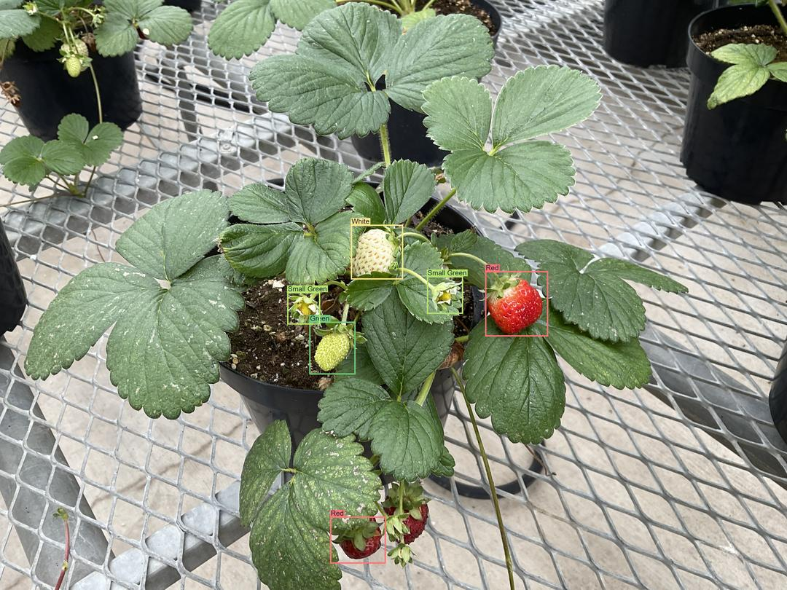

[이전 · 평가와 결과](./05-evaluation-and-results.md) · [시리즈 목차](./index.md)

## n8n과 Python이 맡는 역할

n8n은 시작점과 각 단계의 순서를 관리한다. 모델 학습과 실제 예측은 Python CLI가 수행한다. `workflow/run_stage.py`가 세 단계의 인자를 정하고, 같은 실행 ID 아래에 로그와 산출물을 저장한다. 실패한 단계에서 반환 코드가 0이 아니면 뒤 노드는 실행되지 않는다.

~~~python
import subprocess
import sys

# run_stage.py의 호출 방식을 간단히 옮긴 예제
args = [
    sys.executable, "-X", "utf8", "main.py", "inference",
    "--image", source_image,
    "--det_weights", detection_checkpoint,
    "--cls_weights", classification_checkpoint,
    "--threshold", ".001",
    "--maturity_threshold", "0.5",
    "--output", output_png,
]
subprocess.run(args, cwd=project_root, check=True)
~~~

n8n에서는 Manual Trigger가 다음 세 Execute Command 노드를 차례로 실행한다. 첫 노드가 분할과 가중치를 확인한다. 두 번째 노드가 평가 JSON, 그래프, CSV, Excel을 저장한다. 마지막 노드가 사진 한 장을 추론해 PNG를 저장한다. 별도의 학습을 선택한 경우에만 첫 단계에서 `train_all`을 실행한다. 이 구성은 n8n과 CUDA 환경을 같은 Windows 호스트에서 실행할 때 사용했다. [Execute Command 노드 문서](https://docs.n8n.io/integrations/builtin/core-nodes/n8n-nodes-base.executecommand)

## 실제 실행 결과

검증 분할의 `img_12.jpg`에 학습된 두 모델의 예측을 겹쳐 그린 사진이다. 이미지 속 클래스는 모델이 예측한 값이다. 원본은 Qi Yang과 Zhenong Jin의 [KGCV_Strawberry 데이터셋](https://doi.org/10.5281/zenodo.10957909)에서 가져왔다. [CC BY 4.0](https://creativecommons.org/licenses/by/4.0/)을 따르며 박스와 클래스 텍스트를 추가하고 게시용 크기로 축소했다.

n8n에서 가져오기와 실행을 확인했다. 기본 가중치로 검증 222장을 평가하고, 끝 단계에서 원본 해상도 4,032×3,024의 PNG와 보고서를 만들었다. `reports/n8n/<실행 ID>/`에 아래 결과가 들어간다.

- `evaluation.json`과 `metrics/performance_report.xlsx`
- 학습 곡선·혼동행렬 등의 PNG/SVG와 에폭별 CSV
- `maturity_prediction.png`, `evaluate.log`, `inference.log`

같은 작업을 n8n 없이 확인하려면 프로젝트 루트에서 각 단계를 같은 ID로 실행한다.

~~~powershell
python workflow/run_stage.py prepare --run-id example
python workflow/run_stage.py evaluate --run-id example
python workflow/run_stage.py image --run-id example
~~~

[시리즈 첫 페이지로 돌아가기](./index.md)
