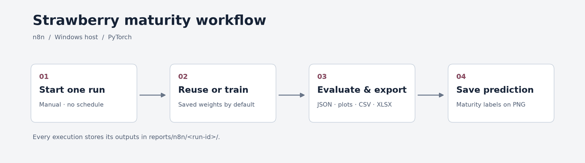

이 워크플로우를 실행하면 **딸기 위치와 성숙도가 표시된 이미지**, 그리고 그 모델의 **평가 보고서**가 한 실행 폴더에 저장된다. [Kim 외의 딸기 성숙도 분류 논문](https://doi.org/10.7236/IJIBC.2024.16.4.133)을 구현한 프로그램을 n8n으로 연결한 결과다.

| n8n 노드 | Python에서 하는 일 | 결과 |
|---|---|---|
| Manual Trigger | 한 번의 실행 시작 | 실행 ID |
| Prepare and optionally train | 가중치 확인. 설정에 따라 `train_all` 실행 | 탐지·분류 체크포인트 |
| Evaluate and export metrics | `evaluate` 실행 | 평가 JSON, 그래프, CSV, Excel |
| Save prediction PNG | `inference` 실행 | `maturity_prediction.png` |

기본 설정은 이미 학습한 최적 가중치를 불러온다. 윗줄의 노드들은 프로그램을 호출하는 순서다. 모델 안에서는 **원본 사진 → Faster R-CNN으로 박스 탐지 → 박스 패치 자르기 → DenseNet-121로 성숙도 분류** 순서로 처리한다.

## 챕터 목차

1. [논문을 읽고 구현 범위를 정하기](./01-paper-and-problem.md) — 논문의 전개, 모델의 역할, 재현 기준
2. [LabelMe 데이터와 누락된 673개 라벨](./02-data-and-labels.md) — 좌표 변환, `small g` 복구, 원본 이미지별 분할
3. [Faster R-CNN과 DenseNet-121 연결](./03-detection-and-classification.md) — 탐지 헤드, RoI Align, 패치 전처리
4. [학습 오류 해결과 최적 모델 선택](./04-training-and-debugging.md) — 스케줄러 호환성, AMP와 gradient accumulation
5. [mAP와 혼동행렬로 결과 해석](./05-evaluation-and-results.md) — 평가 코드, 논문과의 차이, 개선 실험
6. [n8n으로 보고서와 예측 사진 저장](./06-n8n-and-inference.md) — Python 실행 인터페이스, 실제 출력, 실행 재현

같은 검증 이미지 222장에서 탐지부터 성숙도 분류까지 평가한 결과는 **mAP50 77.19%, mAP50:95 48.10%**였다. 이 두 수치가 의미하는 차이는 [5장](./05-evaluation-and-results.md)에서 다룬다.
